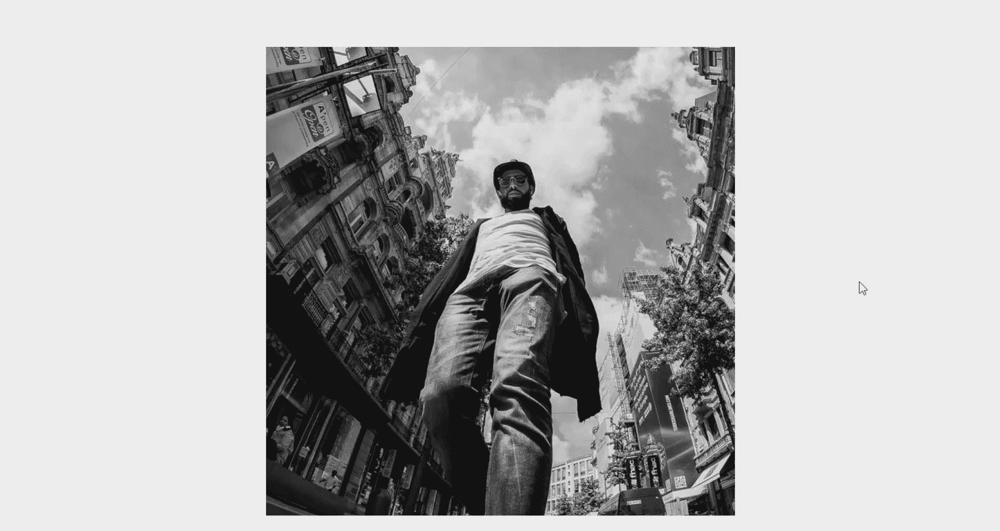

Complete Adobe Lightroom Megacourse： Beginner to Expert Photo Editing part2：p08：透视 📐


在本节课中，我们将一起学习关于透视的内容。透视就是照片的拍摄角度，不同的角度会完全改变照片想要表达的意思，也会改变看照片的人心里的感觉。我们会看一个具体的例子，同一个主体从不同角度拍摄，效果会有什么不同。在Lightroom的变形面板里，你有机会修改照片的透视和角度。搞清楚每种透视分别表现什么，知道它展示了什么，这非常有用，这样你才能确保自己按正确的方式进行调整，让调整结果符合你想要传达的信息或情感。

下面我们先来看看具体的拍摄例子，感受透视是如何影响情绪的。

我们今天要聊聊透视，以及每一个拍摄角度和透视，怎样能改变照片的信息，并且操纵人们对照片产生的情绪。这里有一个例子，拍摄的是同一个主体，但是使用了不同的角度和透视。我们将会看到，这些不同的拍摄方式，会怎样影响这一个主体。

以下是关于近景与情感的说明。

- 大象的半身特写，拍摄者非常靠近，观众只能看到大象的一部分，这种构图会传达出一种特定的情感。
- 把大象换成母亲抱着婴儿，看不到母亲的脸，也看不到婴儿的脸，只能看到母亲抱着婴儿这个动作，这时候重点不在于这是谁，而在于展示母爱这种情感😔。
- 当画面放得很近，就好像让观众也能贴近这种情感。如果你是个母亲，发了一张这样的照片，你就是在分享自己作为母亲所感受到的情绪😊，这样别人很容易与你产生共鸣。
- 比如你在滑板上，画面里只有你的腿和滑板，这展示的是你滑板时的感受，而不是想展示你技术有多好，也不是想展示这是你，更不是想展示地点在哪里，只想展示你滑板时的那种心情。

刚才这些例子主要讲的是近景和局部特写，接下来我们看看低角度拍摄会带来什么样的感觉。

接下来，我们来看看低角度拍摄。在这个例子里，你只能看到大象鼻子的下面，看不到整只大象，只能看到它的一小部分。低角度拍摄会营造出一种威慑感。这意味着当你看着这张照片时，如果画面里有人高高在上看着你，而你的视角又是在下方，这种感觉就会显得有些令人生畏😔。它可能表现出那个人所拥有的权力，比如说一个CEO正低头看着相机，这就营造出一种场景，让人觉得这个人非常强大，超出了所有人的预期。在社交媒体上，低角度拍摄被用得非常多，因为拍摄者想要表达那个人超出大家的预期，而且比我们想象的要更加自信、强大和有力量。

**核心概念公式：**
```text
威慑感 = 观看角度 ÷ 被摄体高度
```

说完低角度带来的威慑力，我们再看看另一种常用于讲述个人经历的角度。

还有一种角度，就像下面这两个例子，它们用来展示一种经历。比如说，有个人站在理发店、咖啡店或者理发店的门前，拍摄者想表达的就是，我，就是这里的这个人，我刚去过这个地方，而且我有话要说。也许我想说那里的食物真的很难吃，也可能是真的很好，或者是我那天学到了新东西。这样一来，我就在分享一个包含我个人经历的故事😊。同样，如果画面里只是我的头，背景里有别的东西，也许是帝国大厦，那么这就在我的故事里展示了一段经历。故事里发生了什么，我遇到了新朋友吗，我在那里做了什么，我的经历如何，我学到了什么新东西。这种拍摄角度非常适合讲故事和分享经历😊。

以下是关于经历与故事角度的说明。

- 人物站在店铺门前，表达“我刚去过这里并有话要说”。
- 画面只有头部，背景有地标建筑，展示故事中的经历片段。
- 观众会好奇发生了什么、遇到了谁、学到了什么，从而产生共鸣。

除了展示经历，低角度还可以和观看方向结合，营造出奇妙感和冒险感。

还有些照片，虽然也是低角度，但是拍摄对象和相机朝向同一个方向。比如现在我们看到大象正在低头抬头看着上方，后面还有一束花，这就营造出一种奇妙感。如果有人在纽约夜游，拍摄者用低角度拍他的头部，但是这个人正看着别的方向，这就创造出一种奇妙感，也创造出一种冒险感。这表明那个人玩得很开心，超出了他的预期，超出了他的想象，他真的很喜欢那个地方😊，而且他在那里探索了很多东西。

拍摄时除了角度，光线和阴影也很重要，不过阴影不是Lightroom能做的。

然后我们来说说阴影。阴影不是你在Lightroom里能够创造出来的东西，它跟你拍照时的光线布置有关，跟你按下快门那一刻的光线有关，所以这部分超出了Lightroom的范围。但我们还是简单过一下。当我们的身后有一个影子，而且我们正在做某件事情，比如说用双手摆出一个形状，身后就出现这个形状的影子，这就能传递一个信息。所以，如果我想传达一个严肃的信息或者一个重要的信息，我会在自己身后使用影子。这可能是一张单人的照片，而那个人身后的影子代表支持者。当你想要谈论一些重要的事情，传达严肃的信息时，在照片里加入阴影是非常重要的。

说完阴影，接下来我们对比一下高角度拍摄。

接着是高角度拍摄。高角度会展现出无助感和纯真感。现在，当我们从上方看着这只大象时，我们会觉得这只大象其实非常小，一点也不令人生畏。而这就跟之前我们从下方看它的时候完全不同。所以，如果你在拍摄一个人，那个人正抬头看着相机，这就展示出这个人看起来多么渺小，也许还有多么脆弱。你在电影里可能见过这种镜头，当一个角色感到非常难过的时候，他跌倒在地上，镜头从上方拍摄😔，他也许会尖叫，也许会喊出某个人的名字，我们很快会看到一个具体的例子。

**核心概念公式：**
```text
无助感 = 机位高度 ÷ 被摄体高度
```

高角度讲完了，我们再看看特写镜头能产生什么效果。

还有一种角度是非常靠近相机的拍摄，被摄者的鼻子可能正对着镜头。这种拍摄方式能非常快速地与观看照片的人建立连接。当我们看到一个人的特写，脸部细节非常清晰，眼睛也非常有神，我们就能很容易地与这张照片产生共鸣。我们会想知道这个人为什么表情这么严肃，发生了什么事，这就能吸引你的注意力。你可以使用缩放工具，把画面缩小，只捕捉脸部，效果会非常好。

以下是关于特写与连接感的说明。

- 镜头非常靠近被摄者，鼻子正对着相机。
- 人脸特写，眼睛和面部细节清晰，容易与观众建立情感连接。
- 使用缩放工具只保留脸部，能引发观众好奇，想要知道背后的故事。

除了特写，有些照片里的主体甚至不容易被注意到。

还有一种照片，里面的主体存在，但你一开始甚至没有注意到。这只是一张普通的照片，里面不止一个主体，不只是单一的对象。这可能是一张风景照，里面有一个人作为主体，但旁边还有一座山。这同样讲述了一个故事，但是更多地是在讲述那个人去过的地方。在我们的例子里，那就是一座山。

接下来我们来看一些具体的角度应用实例。

这是一个高角度的例子，同样用来展示无助感。你可能在很多电影里见过这种情况，当一个角色在电影大部分时间里都很强大、很自信，但是当拍摄角度改变，变成了高角度拍摄时，我们就会感觉到那个人不再那么强大了，他可能感到有些绝望，也许感到很虚弱😔，我们就是从这种角度得到这种感觉的。通过在Lightroom的变形面板里改变垂直透视，你就能创造出这种无助感或者纯真感。当你点击相关选项时，效果就会呈现出来。

**Lightroom 变形面板代码示例：**
```text
transform_panel.vertical = 负值
// 效果：营造高角度视角，表现无助感或纯真感
```

说到变形面板，里面的引导线非常有用。

还要记住，在变形标签页里我们有引导线工具，这里有两个东西。这些引导线非常适合创造完全干净的线条，尤其是在拍摄建筑的时候。当你看到如此整齐的线条，建筑的中心部分，顶部完美地对齐在一起，这就会创造出一种满足感。虽然这儿的线条可能还可以更好，但那不是重点。重点是，当你在社交媒体上看到很多令人满意的内容时，这也创造出同样的感觉。任何看到建筑部分完美对齐的人，都会感到满足，并且会非常注意建筑的结构。所以，如果你是一名建筑师，正在尝试通过摄影来展示你的作品，变形标签页里的引导线就是创造这种干净、令人满意效果的好方法。

以下是关于引导线与变形面板的说明。

- 引导线适合创建完全干净的线条，尤其适用于建筑摄影。
- 建筑顶部与中心部分完美对齐，会产生满足感。
- 社交媒体上的令人满意的内容，往往依赖这种完美对齐。
- 建筑师可以利用引导线，让作品照片看起来更干净、更专业。

除了引导线，我们再看另一个高角度的例子。

还有另一个高角度的例子，这也表现出那个人感到无助，感到虚弱，他可能需要帮助。但是现在，这个人正在努力爬一架梯子，从他脸上的表情我们可以看到，他正在非常努力地尝试，他感觉很虚弱，但是他眼睛里还有一点希望😔。只不过因为高角度的拍摄，这种希望显得不是那么强烈。如果电影导演想要展示这个人正在为自己的生命而战斗，要去某个地方，你会选择侧角度或者低角度来拍摄。但是就在这个当下，特别是有手伸出来的时候，我们会觉得这个人需要我们的帮助。

接下来我们聊聊镜头校正里的畸变标签页。

还有另一个东西是镜头校正里的畸变标签页。你之前看到，我们可以要么把画面从相机那里进一步拉远，要么把它拉近，从而创造出鱼眼效果。当我们有引导线，就像这里的桥，当我们把画面从相机那里进一步拉远时，我们就把这座桥给拉伸了，这就营造出一种冒险感，创造出一种经历，让我觉得我正站在这座桥上，前面还有很长的路要走😊。所以通过这样做，当你面对桥梁、街道、市场这些场景时，畸变标签页就非常适合为观看者创造出那种无尽的冒险感。

**核心概念公式：**
```text
冒险感 = 画面拉伸程度 × 引导线数量
```

说完低角度建筑，我们再看看鱼眼效果的优势。

这是另一个低角度的例子，它展现出建筑的宏伟感。这个例子展示了这座建筑有多大、有多高，有点让建筑看起来非常重要。如果我要再举一个电影的例子，当一个角色开始进入一家重要公司工作时，镜头通常会先从低角度拍这座建筑，也许Logo就在某个地方，然后再拍一个角色的高角度。角色看到建筑有多大、多重要时，可能会感到紧张。所以，通过使用低角度，我们就创造出这种感觉，即这座建筑非常重要，你应该感到敬畏。

这是一个你可以利用畸变标签页里的鱼眼效果来获得好处的例子。我们之前看到，通过向左移动，我们可以创造出鱼眼效果，它甚至像一只眼睛的形状，你可以看到这里的轮廓线。这就创造出一种冒险感，是的，那些建筑物又高又大，但是它有点像迷宫，这会让人觉得也许你想要进入这些照片😊，也许你想要探索这些建筑，这也挺有趣的。而且，再次借助引导线，我们可以创造出完美的主体流动，让看到的人感到满意。你可以看到主树被完美地放在正中间。通过使用Lightroom的引导线，我们在这里创造了完美的角落，这是一个非常适合使用的透视角度。

以下是关于鱼眼效果优势的说明。

- 向左移动可创建鱼眼效果，形状像一只眼睛。
- 鱼眼效果会扭曲整体，适合桥梁、街道、市场等场景。
- 能营造迷宫感和无尽探索的冒险氛围。
- 配合引导线，可创造完美的主体流动与满足感。

最后，我们再看一个低角度的例子。

最后，我们还有一个低角度的例子。这展示出威慑感，就像我们之前谈到的。这就好像我们是地上的一个小石子，而这个人正要踩在我们身上。这就是为什么它只通过低角度，就展示出这个人有多么强大。所以，同样，你可以使用垂直标签页，让你的照片看起来就像是从低角度拍摄的，从而为这个主体营造出那种强大的感觉。

好了，这就是透视的工作原理。下次你想要编辑照片的时候，你现在知道每种透视会怎样影响你的照片。因此，你现在知道如何使用每一个选项，就可以把变形标签页用好。本节课我们就讲到这里，下节课见。



本节课中我们一起学习了透视的基本概念，了解了近景、低角度、高角度、特写、阴影以及畸变等不同拍摄方式如何影响照片传达的情感和信息，并掌握了在Lightroom变形面板中使用引导线和垂直透视调整的方法。
