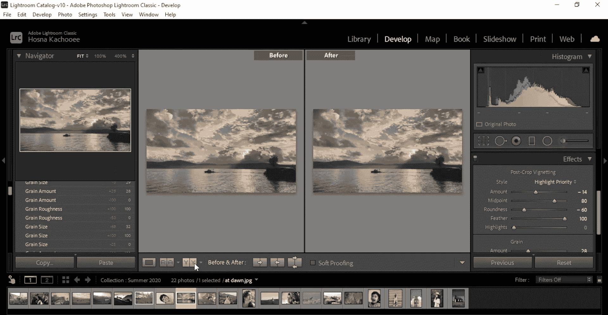

# Adobe Lightroom 照片编辑从入门到精通：09：效果面板详解 🖼️


在本节课中，我们将学习 Adobe Lightroom 开发模块中的效果面板。这个面板位于右侧面板的最下方，用于在导出图片之前对照片进行最终的创意处理。我们会详细讲解后期裁剪暗角功能，包括数量、中点、圆度、柔边以及高光保护等参数。之后我们会介绍颗粒功能，并通过一张实际的风光照片示例，演示如何给画面添加复古质感。学完本节课，你将掌握如何使用效果面板提升照片氛围。


上一节我们介绍了基本面板，本节中我们来看看开发模块右侧的最后一个面板，也就是效果面板。效果面板是你在导出照片之前进行最后调整的地方。这里包含两个主要功能，第一个是后期裁剪暗角，第二个是颗粒。这两个功能都不属于纠正性的修图操作，而是用来给照片增加特定氛围的创意效果。你可以根据自己的拍摄风格，决定是否使用这些工具。


首先我们来看看效果面板中的第一个工具，它叫做后期裁剪暗角。后期裁剪暗角的作用，是在图片的边缘添加变暗或变亮的效果。当你移动滑块时，照片四周的角落会发生明显变化。这个功能特别适合用来吸引观众的注意力，让画面中心更突出。


```
后期裁剪暗角 = 在图片边缘添加变暗或变亮效果
```


以下是后期裁剪暗角面板中可供选择的三种风格。

- 高光优先：在暗角处尽量保留高光细节，适合天空明亮的风光照片。
- 彩色优先：在暗角处尽量保留原有颜色，适合色彩丰富的图片。
- 绘图叠加：不论高光或颜色，直接在照片上方叠加暗角效果。


接下来我们详细看看高光优先模式下的各个滑块参数。高光优先是默认使用的模式，它的逻辑是先应用暗角效果，然后尽可能挽回因为变暗而丢失的高光部分。这样处理后，画面边缘会有暗角效果，但天空等亮部不会变得过于死黑。


以下是高光优先模式下的主要调节项。

- 数量：控制暗角的强度。向右拖动会让角落变亮，向左拖动会让角落变暗。
- 中点：决定受影响区域的中心大小。数值越小，影响范围越集中；数值越大，影响范围越分散。
- 圆度：决定受影响区域的形状。向左拖动会变成方形或矩形，向右拖动会变成圆形或椭圆。
- 柔边：控制暗角边缘的过渡平滑程度。数值越低，边缘越生硬；数值越高，边缘越自然。
- 高光：挽回在应用暗角后丢失的高光细节，特别适合处理有明亮天空的照片。


```
数量向右 = 角落变亮
数量向左 = 角落变暗
```


除了高光优先，效果面板还提供另外两种风格，分别是彩色优先和绘图叠加。彩色优先的作用是保护暗角区域的颜色信息。如果你的照片角落里有丰富的颜色，比如夕阳或彩色建筑，选择这个模式可以避免颜色被暗角效果掩盖。不过如果照片本身颜色不多，这个选项的效果不会很明显。绘图叠加则完全不同，它不考虑高光或颜色，直接把暗角效果覆盖在整张照片的最上层，无论下面是什么内容都会被统一处理。


了解参数还不够，我们需要通过一个实际案例来看看怎么操作。假设我们有一张风光照片，画面中有小船、山峰、水面和天空。四个角落都有较多的亮部，除了其中一个角落是云朵之外。由于主体是一艘小船，我们无法仅靠中点把注意力全部吸引过去，因此更合理的做法是保留山峰、水面和天空等主体区域的吸引力。这时候我们可以选择高光优先模式，因为照片角落主要是高光区域。我们先把数值稍微向右调亮边缘，避免出现不自然的暗边。然后调整中点，把受影响范围扩大到想要的区域，再用圆度把形状设置得更接近矩形，以符合风光照片的构图特点。如果是人像照片，则建议使用更圆润的中点，因为人的脸部通常是圆形的，且多位于画面中心。


以下是处理风光照片时的调节步骤。

1. 选择高光优先作为暗角风格。
2. 根据需要让边缘变亮或变暗，保持效果自然。
3. 调整中点，确定受影响区域的大小和位置。
4. 调整圆度，让形状接近矩形或圆形。
5. 调整柔边，让边缘过渡更加平滑。
6. 使用高光滑块挽回丢失的亮部细节。


在暗角效果设置完成后，我们再来看看效果面板中的第二个功能，也就是颗粒。颗粒可以理解为在照片上添加成千上万个像米粒一样的小颗粒，从而给图片增加一种纹理感。这种效果非常适合复古风格的照片，或者任何你希望增加粗粝质感的图片。颗粒与之前面板中的纹理功能不同，纹理功能是挖掘图片本身已有的细节，而颗粒是在图片上额外叠加新的纹理。


```
颗粒 = 在图像上叠加大量微小颗粒纹理
```


以下是颗粒功能中的三个调节参数。

- 数量：控制添加多少颗粒，数值越高颗粒越多。
- 大小：决定单个颗粒的尺寸。太小会显得像素化，太大会让主体失去清晰度。
- 粗糙度：控制颗粒边缘的锐利程度。向右调节可以让颗粒变成螺旋线条，看起来更柔和。




最后我们实际在照片上添加一些颗粒，看看最终效果。我们可以给照片添加少量颗粒，保持尺寸较小，粗糙度设为中等。这样处理后，水面和天空等平坦区域会呈现出一种细腻的颗粒感，整张照片的氛围会更有电影质感。不过要注意，颗粒属于可选的附加效果，并不是每张照片都必须添加，也不属于修图中的纠正步骤。你可以根据自己想要的风格决定是否使用。


本节课中，我们一起学习了 Lightroom 开发模块的效果面板。首先介绍了后期裁剪暗角的三种风格，分别是高光优先、彩色优先和绘图叠加，并详细讲解了数量、中点、圆度、柔边和高光等参数的作用。接着通过风光照片示例，演示了如何给边缘添加自然的亮暗效果。最后我们介绍了颗粒功能，包括数量、大小和粗糙度的调节方法，并说明如何用它来增加照片的复古质感。下一节课我们将学习最后一个面板，即校准面板，学完之后你就掌握了如何完整地开发一张照片，随后可以进入导出或发布阶段。
