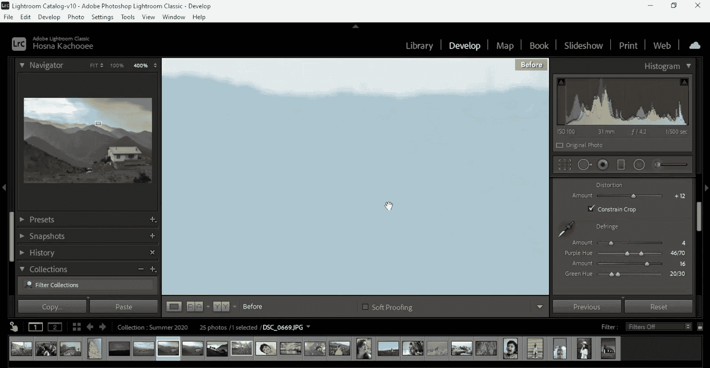

# Complete Adobe Lightroom Megacourse： Beginner to Expert Photo Editing：105：Calibration 🎨

在本节课中，我们将学习Lightroom开发模块中的最后一个面板，也就是校准面板。你会了解这个面板的具体作用，学习如何修正相机或光线造成的不正常颜色，并掌握利用红绿蓝三原色来调整照片色调的方法。通过本节课的内容，你能够让图像中的颜色更符合你的想法，或者赋予照片一种特定的配色风格。

## 什么是校准面板

校准面板是Lightroom开发设置里的最后一个面板。当你把这个面板展开时，可能会注意到里面出现了一些在其他面板中没有见过的设置选项。

校准的主要目的就是修正图像中某些部分颜色出现偏差的问题。有时候相机把绿色拍成了奇怪的颜色，或者光线让蓝天看起来变成了紫色，还有时候镜头会导致图像颜色发生失真。校准面板就是用来解决这些情况的。如果你希望照片呈现某种特定的配色风格，也可以使用这个面板来实现。

数字图像的颜色构成可以用下面的公式来理解：

`红色 + 绿色 + 蓝色 = 图像中的所有颜色`

## 认识红绿蓝三原色

在校准面板中，你会看到红色主色、绿色主色和蓝色主色这三个选项。这和传统颜料使用的红黄蓝三原色不同，数字图像采用的是红绿蓝三原色。

在任何一张数字照片里，红色、绿色和蓝色共同构成了画面中的所有色彩。比如说，蓝色通常出现在天空或山脉中，绿色通常出现在草地上，红色则多见于人物的面部、花朵或者夕阳。正因为图像中的每一个部分都包含这三种颜色的不同比例，我们才需要校准面板来进一步调整或修正照片里的颜色。

每个主色调面板都包含两个我们比较熟悉的控制选项，分别是色相和饱和度。

色相决定颜色的偏移方向。比如在红色主色调中，移动色相滑块会改变图像中红色部分的具体色调。饱和度则决定颜色的强弱程度，也就是颜色看起来有多鲜艳。这两个滑块配合使用，就可以在不完全去除颜色的前提下，精细地调整或修正图像中对应主色的表现。

以下是色相和饱和度的基本作用：

- 色相滑块：改变选定主色的具体色调
- 饱和度滑块：改变选定主色的强度与鲜艳程度
- 两者配合：在不把颜色完全去掉的情况下，调整颜色的外观

需要注意的是，降低饱和度并不会让颜色完全消失，它只是降低了颜色的强度，颜色本身仍然存在。如果你想完全去除图像中的某种颜色，应该使用HSL面板或基本面板，而不是校准面板。

## 实际操作示例

我们先来看一张还没有经过编辑的原始照片。这张照片里包含蓝色、绿色以及山脉中的紫色等多种颜色。

在处理过程版本时，建议保留在第5版以下，不要随意更改这个设置，保持默认选项就足够好用了。

接下来我们依次来处理红色主色、绿色主色和蓝色主色。

首先是红色主色。如果草地看起来缺乏生机，不够绿，可以适当提高红色主色的饱和度，让草地颜色显得更鲜艳一些。

其次是绿色主色。把绿色主色向左移动会引入不同的绿色色调，向右移动则可能带来偏紫或者更深的绿色。由于画面中的每个部分都包含红绿蓝，调节绿色主色也会影响山脉等其他区域。你可以根据需要让绿色变得更鲜艳，或者更柔和一些。

最后是蓝色主色。如果你喜欢偏橙色的草色，可以将蓝色主色向左移动；如果希望偏紫色，则可以向右移动。根据你想要达到的风格进行调整，同时控制饱和度，避免颜色看起来过于不真实。

使用校准面板之后，即使只对未编辑的图像进行简单调整，也能明显看出颜色发生了变化。

## 在已编辑图像中进一步调整

在完成基础的光线和颜色修正之后，你可以回到校准面板进行微调。比如说，降低曝光和高光以后，再利用红色、绿色、蓝色主色的滑块，把颜色调整到自己喜欢的状态。

调节过程中不需要追求固定数值，也没有严格的规则。你只需要反复尝试这些滑块，直到找到自己满意的效果。如果调整后出现边缘不自然的情况，可以切换到HSL面板，对饱和度进行局部修正，去掉粗糙的色块线条，让颜色过渡更自然。

调色校准的核心思路可以总结为下面的公式：

`校准面板 = 修正颜色偏差 + 自定义图像风格`

本节课中我们一起学习了Lightroom开发面板的最后一部分，也就是校准面板。现在你已经了解每个面板的使用方法，可以按照自己的喜好编辑图像。你也学会了如何利用这些面板进行选择性调整。

完成开发工具的使用之后，下一步需要导出你的图像。我们将在下一节课中介绍导出流程。在未来的课程里，我们还会学习如何实现Pinterest或Instagram上常见的特定编辑风格，并通过简单的步骤让你自己制作出类似效果。

我将在下一节课与你见面。
