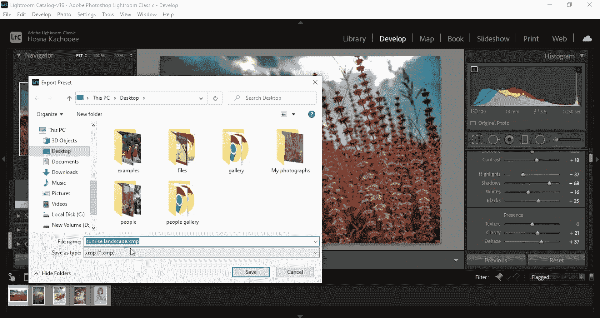
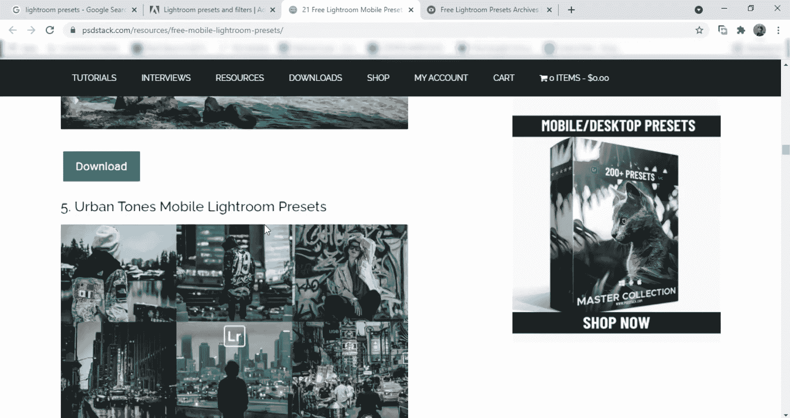
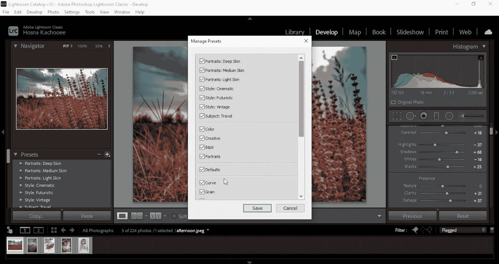

# 📸 Adobe Lightroom 照片编辑从入门到专家完整大课：第11章：预设的创建与应用


在本节课中，我们将学习如何在 Adobe Lightroom 中创建自己的预设，如何将预设导出到电脑以便分享或出售，以及如何从互联网上下载他人制作的预设并导入到自己的软件中。预设是摄影后期处理中非常实用的功能，它可以把一组已经完成的图像调整参数保存起来，下次打开另一张照片时只需点击一次，就可以立刻套用同样的外观效果，从而节省大量重复调整的时间。


预设的核心含义可以用下面的公式来描述：

```text
预设 = 一组已保存的图像调整参数
```

也就是说，当你对一张照片调整了曝光、对比度、色彩等设置，并将这些设置保存为预设之后，以后处理其他图片时可以直接调用，无需从头重复同样的操作步骤。


## 一、预设的基本概念


上一节我们介绍了 Lightroom 的基础调整面板，本节中我们来看看软件自带的预设系统。


在 Lightroom 的界面中，你可以看到一个名为“预设”的标签页。里面已经内置了一些 Lightroom 官方提供的预设。当你将鼠标悬停在每个预设上方时，左侧的导航器和主窗口都会显示该预设作用在当前图片上的预览效果，这样你可以快速判断该预设是否适合自己的照片。

Lightroom 还对这些预设进行了分类，常见的分类包括人像、电影感、未来感、复古感、旅行等。此外，还有一些基础的色彩、创意和黑白人像预设。除了这些常见分类，还有一些专门针对曲线、颗粒、光学、锐化和渐晕等特定目标的预设。

下方还有一个名为“用户预设”的标签页。如果你还记得之前的课程内容，每个模块都有用户模板，可以通过点击加号按钮来创建。在这里的操作逻辑是一样的，只不过是用户预设而不是模板。本质上，预设也是一种模板形式，只是保存的是编辑参数而不是构图框架。


## 二、为什么要给预设起具体的名字


在之前的模块中，我们学习过如何创建用户模板，本节中我们来看看如何给预设命名和分类。


当你根据一张图片的特定调整创建了预设，并且给它起了一个比较随意的名字之后，这个预设可能只适用于那张特定的照片。比如你为一张特写人像照片调整了色调，想要表达某种情绪，然后把预设命名为“特写人脸”。当你把这个预设套用到另一张照片上时，效果可能并不理想，因为原始调整是针对特定光线和构图设计的。

因此，你需要像 Lightroom 对官方预设进行分类那样，给自己的预设起更具描述性的名字。不要只叫“特写人脸”，可以改成“特写人脸冷色调”或“特写人脸电影冷色调”。这样当你以后浏览预设列表时，一眼就能知道这个预设适合什么样的场景，而不需要逐个点击预设来试效果。


## 三、创建黑白人像预设的步骤


以下是创建一个黑白人像预设的具体操作步骤：


- 打开一张人像照片，点击黑白模式，使图片变为黑白效果。
- 降低高光，加深阴影，增加图片的立体感。
- 提高去雾量和清晰度，让细节更突出。
- 调整黑色和白色的色阶，优化画面的明暗层次，确保保留足够细节。
- 检查剪裁提示是否开启，如果画面中出现红色提示区域，在键盘上按下 J 键将其关闭。

接下来转到色调曲线面板，进一步调整图片。创建一个 S 型曲线，将高光、对比度和阴影都提升大约 1.4 倍，以增强画面的层次感。然后添加镜头校正，让主体与相机的距离显得更远。使用受限裁剪，不进行变形操作，保持原有构图。

在颗粒方面，不要让效果过于强烈，建议调整颗粒的粗糙度和大小，营造柔和的质感。完成这些调整后，选择“适应窗口”缩放图片，检查整体效果。此时你已经得到了一张简单的黑白人像，对比度有所提升，且主体与镜头的距离感也被拉开了。


## 四、保存预设时的参数选择


以下是保存预设时需要注意的设置项：


- 预设名称：建议起具体名称，例如“人像 黑白 特写”，方便以后识别。
- 预设分组：可以新建分组，也可以保留在“用户预设”组中。
- 自动设置：建议不勾选，使用自己刚才手动调整的参数。
- 参数勾选：只保留你实际使用过的调整项目，例如基础面板、色调曲线、HSL、颗粒等，不需要的项目可以取消勾选。

点击预设面板右上角的加号按钮，选择“创建预设”。在弹出的窗口中，按照上述要求填写名称和分组，不触碰自动设置，而是使用自己的设置。在参数选项中，勾选你想包含在预设里的项目。Lightroom 通常会自动勾选所有可用项，但如果你没有使用镜头校正、校准、降噪或色彩分级，可以取消勾选这些不相关的项目。完成勾选后，点击“创建”按钮。

创建完成后，进入“用户预设”文件夹，就能看到刚才保存的人像黑白特写预设了。


## 五、在其他照片上测试预设


上一节我们完成了黑白人像预设的保存，本节中我们来看看如何在其他照片上试用这个预设。


选取另一张人像照片，点击刚才保存的预设。你会发现预设被应用到了新图片上。不过需要注意，预设可能不会在每张照片上都显得完美，因为每张图片的拍摄角度和光线条件都不同。这时候，你可以把预设作为编辑的基础起点，然后回到基础面板，根据当前图片的实际情况进一步调整去雾量、白色色阶等参数，使预设效果更符合这张特定照片的需求。

这样，你就拥有了一个属于自己的黑白特写人像预设，可以在后续编辑中快速调用。


## 六、创建日出风景预设


让我们转到另一类预设。本节中我们来看看如何为风景照片创建预设。


找到一张尚未编辑的风景照片，比如一张拍摄日出的竖构图照片。图片中有漂亮的日出和蓝色云朵。首先点击“重置”按钮，撤销之前的所有编辑，重新开始。

按照惯例，先从去雾量开始，增强需要的画面细节。然后提高自然饱和度，让照片中的色彩更鲜艳。进入色调面板，增加对比度，降低高光，适当调整阴影，降低白色，提亮黑色。接着增加清晰度，让风景线条更分明。

转到色调曲线面板，根据个人喜好进一步调整高光、对比度和阴影。然后进入 HSL 面板，修改蓝色的饱和度，使天空颜色看起来更自然，不至于过于亮丽或不真实。接着调整橙色，可以偏红或偏黄，建议保持偏红，并适当提高饱和度。黄色和绿色的亮度可以根据实际情况微调。

完成色彩调整后，进行色彩分级。分别处理高光、阴影和中间调。对于高光，可以尝试红色或橙色来营造初夏的效果。中间调可以尝试蓝色来平衡天空中的红色。阴影部分通常不需要做太大改动，保持原状即可。锐化、镜头校正和变形根据需要决定，确保图片的水平线是直的，必要时使用受限裁剪进行修正。

回到去雾量面板，适当增加去雾效果，让日出场景更有层次。此时你已经完成了一个日出风景预设的初步调整。


## 七、预设在批量处理中的应用


预设的价值不仅体现在单张照片的编辑上，本节中我们来看看预设在大量照片处理中的实际应用场景。


假设你是一名婚礼摄影师，拍摄了一场婚礼，拍摄了两百张甚至更多的宾客照片。这些照片都是在同一天、同一场景下拍摄的，可能都使用了同一个背景，比如鲜花墙。如果你要逐张编辑这两百张照片，工作量会非常大。

这时候，如果你有一个婚礼预设，里面包含了亮白色调和背景中常见的绿色元素，你就可以直接将这个预设应用到所有图片上，而不是花时间逐张查看和编辑。预设提供了一个统一的起点，大大提高了后期处理的效率。


## 八、导出预设到电脑


上一节我们介绍了预设在批量处理中的作用，本节中我们来看看如何将自己制作的预设导出到电脑中。


找到你想要分享的预设，右键点击该预设。在弹出的菜单中，你可以将其添加到收藏、应用、导入、重命名、移动、更新当前设置、显示在资源管理器中或删除。我们需要选择的是“导出”。

点击导出后，系统会打开一个保存窗口，你可以选择保存位置，并命名文件，比如“日出风景”。导出的文件格式是 XMP。

保存完成后，你的预设就已经导出到了电脑上。此时你可以轻松地将这个文件发送给朋友或家人，也可以在不同的平台上出售。


## 九、从网上下载预设




除了自己制作预设，本节中我们来看看如何从互联网上寻找并下载他人制作的预设。


打开 Chrome 浏览器，搜索 Lightroom 预设。你会看到很多广告和网站，有些提供免费预设，有些则是付费的。你可以先尝试免费预设，也可以支持你喜欢的摄影师或博主，购买他们的预设包。

在下载预设时，请务必确保下载来源的网站是可信赖的。检查网址是否以 HTTPS 开头，这通常是一个安全的标志。但因为你要下载文件到电脑，还是需要确认网站的可靠性，避免将病毒引入自己的系统。

以 Adobe 官方网站为例，它是一个可信的渠道。除了 Adobe，还有许多第三方网站提供 Lightroom 预设，包括画笔和移动端预设。有些网站提供 21 款免费的 Lightroom 移动端预设，页面上会有效果预览，让你了解套用后的图片大致是什么样子。

移动端预设和桌面端预设使用不同的文件格式，可以用下面的代码块来说明：

```text
桌面端预设格式：XMP
移动端预设格式：DNG
```

DNG 是 Adobe 的原始图像格式，主要用于移动端。如果你在手机上使用 Lightroom，就需要获取 DNG 格式的预设。而桌面版 Lightroom 使用的预设格式通常是 XMP。网站一般会说明安装步骤，你只需点击下载，就会得到 XMP 文件，然后就可以将其导入到 Lightroom 中使用。


## 十、将下载的预设导入 Lightroom


上一节我们介绍了如何从网上下载预设文件，本节中我们来看看如何把下载好的 XMP 文件导入到 Lightroom 中。




下载完成后，无论是购买的还是免费获取的 XMP 文件，都需要导入回 Lightroom 才能使用。点击预设面板的加号按钮，选择“导入预设”。然后在弹出的窗口中找到你下载的 XMP 文件位置，点击导入。

如果该文件已经在你的 Lightroom 中存在，系统会提示重复导入的错误，但预设会显示在“用户预设”中，而不是 Lightroom 自带的默认预设列表里。你可以通过“管理预设”创建不同的文件夹，删除或保留某些预设，根据自己的需求进行整理。

下载的预设不会直接混入 Lightroom 原有的预设分类中，它们通常会有自己独立的空间，具体取决于预设的分组方式。这样一来，你就完成了从下载到使用预设的全过程。




## 十一、本节总结


本节课中我们一起学习了预设的概念、Lightroom 自带预设的分类、如何给预设起具体名称、创建黑白人像预设的步骤、保存预设时的参数选择、在其他照片上测试预设、创建日出风景预设、预设在婚礼摄影等批量处理场景中的应用、导出预设到电脑、从网上下载预设，以及将 XMP 文件导入 Lightroom。

预设是非常简单且实用的功能，随着你在照片编辑和 Lightroom 使用方面不断进步，你会越来越频繁地使用它们。本节课就到这里，我们下一课见。


