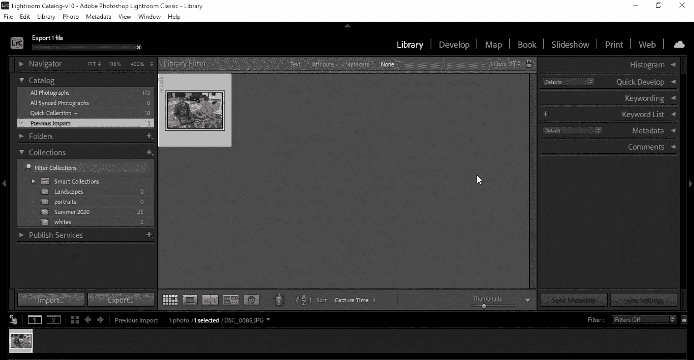
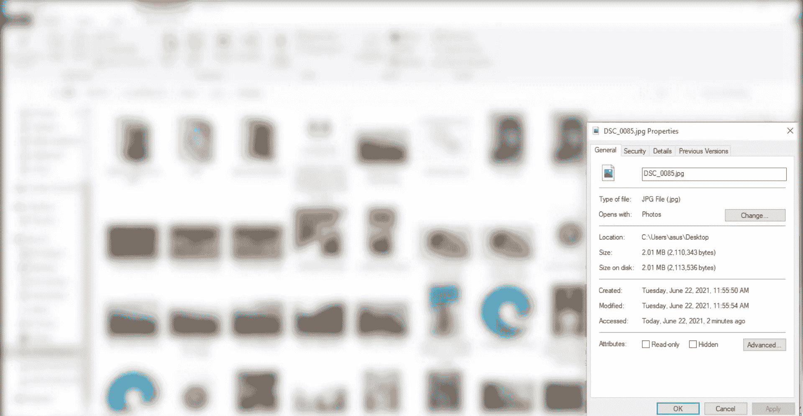
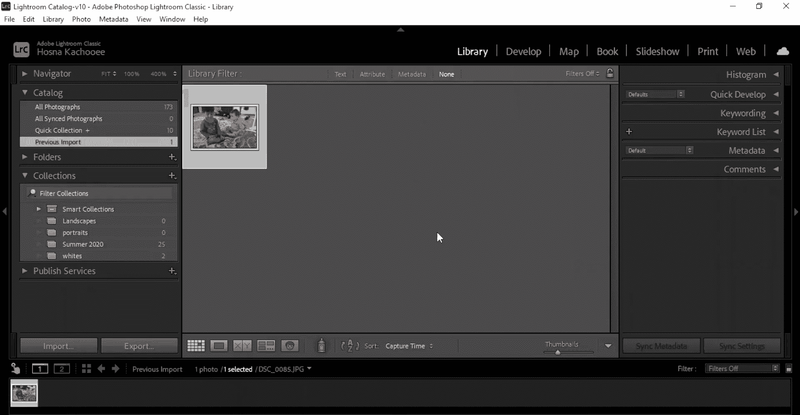

# 📸 Complete Adobe Lightroom Megacourse：Beginner to Expert Photo Editing part2：p12 107：元数据与水印

在本节课中，我们将要学习如何在 Adobe Lightroom 中处理图片的元数据，以及如何为图片添加水印。元数据就像是图片的身份证，里面记录了拍摄参数、版权声明和作者信息；而水印则是给图片加上一个明显的标记，防止别人未经允许使用你的作品。无论你是想保护自己的摄影成果，还是想让客户知道图片归你所有，掌握这两个功能都非常重要。接下来我们会一步步演示如何导入图片、创建元数据预设、编辑水印样式，最后导出带有水印和元数据的图片。

首先，我们先看看如何把图片导入 Lightroom，并给图片绑定元数据。

在 Lightroom 里导入图片是很常见的操作，我们通常会先选择图片来源，然后决定导入时要应用哪些设置。下面是导入时的操作步骤：

- 点击导入按钮，选择图片所在的文件夹作为来源。
- 在导入界面左侧，取消全选，只挑选一张你想要处理的图片。
- 查看右侧面板，找到“导入时应用”这一部分，展开它。
- 在“元数据”下拉菜单中，选择你之前创建好的元数据预设，或者暂时不选。
- 建议一定要选一个元数据预设，这样图片导入后就自带版权和作者信息。

导入设置完成后，如果你还没有现成的元数据预设，就需要创建一个新的。

元数据预设可以看作是一个模板，里面预先填好了你的个人信息和版权声明。创建步骤如下：

- 点击“新建”按钮，这时会弹出一个设置面板。
- 在“预设名称”栏里，随便起一个你容易记住的名字，比如你的名字或者机构名称。
- 填写“基本信息”和“相机信息”部分，这些不是最关键的。
- 最关键的是“版权信息”区域，必须要开启版权选项。

元数据 = 基本信息 + 相机信息 + 版权信息 + 位置信息

版权信息是元数据里最重要的一块，因为它直接声明了图片的归属权。下面是具体填写方法：

- 勾选“版权已启用”复选框。
- 在版权文本框里，可以从网上复制版权符号 ©，然后粘贴进去，后面跟上你的全名或者昵称。
- “版权状态”可以选择“已版权”，表示这张图片受版权保护。
- “使用条款”可以填写“版权所有”，意思是未经许可不得擅自使用。
- “版权信息网址”填你的个人网站、作品集链接，或者任何你发布图片的地方，方便别人找到原作者。

填写完这些内容后，给预设起个名字，比如加上你的名字，然后点击“创建”保存。如果你已经有现成的预设，就直接点击“取消”退出，之后导入时选用那个已有的预设即可。

元数据预设准备好之后，我们就可以把图片导入 Lightroom，开始后续的编辑工作。

调整完图片之后，通常需要导出文件。在导出界面，我们可以勾选要保留的信息，比如个人信息和位置信息。如果你想给图片加上水印，操作如下：

- 在导出设置里找到“水印”选项，勾选启用。
- 点击“编辑水印”按钮，进入水印自定义界面。
- 默认情况下，水印会显示在图片左下角，是一个小方块形式。

为什么要给图片加水印呢？如果你打算把图片发布到网上，或者发给客户，但又不希望对方直接拿走使用，加一个醒目的水印就能起到保护作用。当然，水印并不能完全防止专业人士用 Photoshop 把它去掉，但对大多数普通用户来说，已经足够有效了。

进入水印编辑界面后，你可以按照自己的喜好调整水印的样子。下面是可调整的选项：

- 文字内容：可以输入你的全名、机构名称、页面名称，或者任何你想显示的文字。
- 图形选项：如果你有自己的 Logo，可以选择图形模式，把 Logo 放在图片角落或中间。
- 字体选择：在文字模式下，可以挑选喜欢的字体，比如 Arvo。
- 字体样式：可以选择粗体、斜体等样式。
- 颜色设置：建议选择白色，这样在大多数背景下都比较清楚。
- 阴影设置：可以给文字添加阴影，调整阴影的大小、偏移量、半径和角度，或者完全不加阴影。

水印样式 = 文字内容 + 字体 + 字体样式 + 颜色 + 阴影效果 + 透明度 + 位置

除了基本样式，水印的位置和显示强度也很重要。下面是调整方法：

- 透明度：建议把水印设得比较淡，这样可以看到水印背后的图片细节，既起到标记作用又不影响观看。
- 尺寸调整：可以选择“适应”让 Lightroom 自动计算合适大小，或者选择“填充”让水印占据更多空间，适合做 Logo。
- 边距设置：可以调整水平边距或垂直边距，把水印向左右或上下移动。
- 锚点定位：可以选择水印贴在图片的左上角、右上角、左下角、右下角或者中心位置。
- 旋转：如果需要，还可以把水印旋转到你想要的角度。

当水印的各项参数都调整满意之后，就需要把这个水印保存下来，方便以后重复使用。

保存水印预设的步骤很简单：

- 在水印编辑界面底部，点击“保存”按钮。
- 给水印起个名字，比如“文字水印”，方便以后识别。
- 保存完成后，回到导出界面，点击“导出”按钮。
- 等待文件导出完成，然后打开导出的图片文件夹。

找到导出好的图片后，打开它就能清晰地看到刚才设置的水印。如果你把水印做得很大，它就会覆盖在图片上很显眼的位置，起到很好的保护作用。

水印效果确认无误之后，我们还可以检查一下之前设置的元数据是否已经写入图片。

打开导出后的图片文件，查看属性中的详细信息，就能看到元数据内容了：

- 在文件属性的“详细信息”选项卡里，你会看到刚才填写的版权信息。
- 还能看到相机信息、高级照片信息，以及图片的创建者和位置信息。
- 如果你之前给图片添加了评分或关键词，这些信息也会显示在这里。
- 如果图片上传到支持元数据的平台，比如 Behance，你的版权信息会一直显示，除非你复制一份没有元数据的图片。

元数据持久化 = 原始图片 + 嵌入版权信息 + 上传到支持元数据的平台

本节课中，我们一起学习了如何在 Lightroom 中创建和使用元数据预设，如何填写版权信息，以及如何给导出的图片添加自定义水印。元数据相当于给图片签名，水印则是贴上醒目的标记，两者结合起来能更好地保护你的摄影作品。希望你能从这节课里学到不少，以后也能在自己拍摄的图片上加上专属的签名。我们下节课再见。
