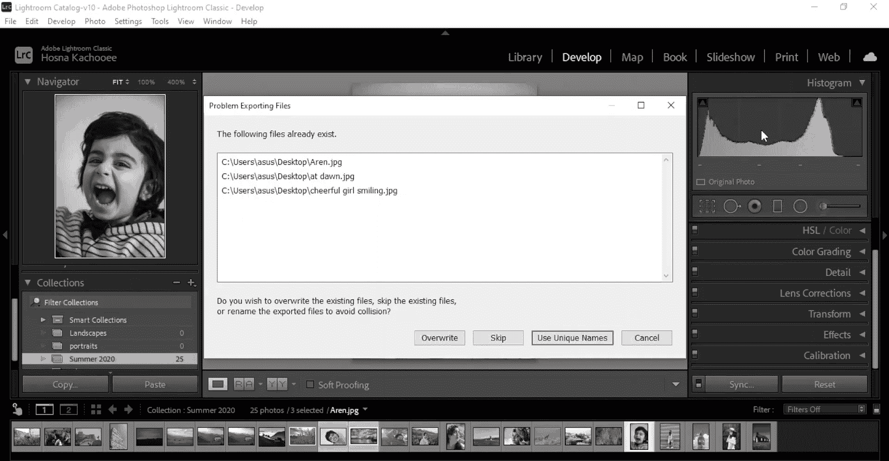
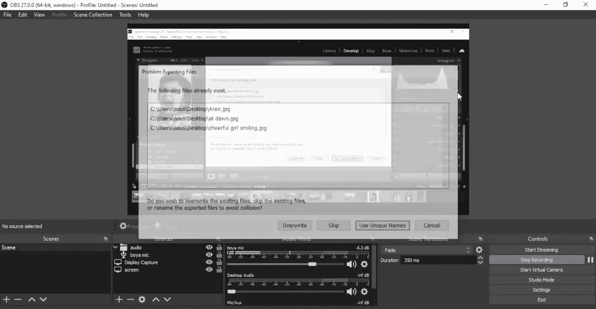
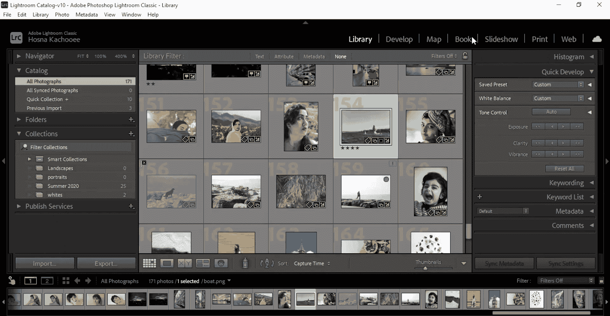

📸 完整Adobe Lightroom大课程：第13章：导出图片

在本节课中我们将要学习如何把已经调色完成的照片从Lightroom里面导出来，并且发布到你想要的任何地方。当你把照片导入软件，在开发模块里把各种参数调好之后，最后一步就是把图片导出成实际的文件，这样你才能在电脑里使用，或者发到网上跟朋友分享。导出听起来可能有点复杂，但实际上只要弄清楚几个主要选项，整个流程就非常简单了。我们现在就开始聊聊具体怎么操作。

当你准备好导出图片的时候，首先要做的是确认你想导出的照片已经在胶片条里面，或者在库模块里面能够找到它们。因为我们刚才正好在开发面板里面结束了编辑，所以我就直接在胶片条里面来演示。这就是你在完成编辑之后会停留的地方，所以我会先把我喜欢的那些图片挑出来。具体的操作方法就是按住键盘上的Control键，然后用鼠标点击你想要导出的那几张照片，这样就可以一次性选中多张图片了。导出图片的方法其实不止一种，我下面就把常见的几种方式列出来，你可以根据自己的习惯来选择：

以下是常用的导出操作方式：
- 在图片上点击鼠标右键，然后选择导出选项。
- 点击顶部的文件选项卡，往下滚动找到导出，然后点击进入。

这两种方式的效果是一样的，只是操作路径稍微有点不同而已。我个人更喜欢用右键的方法，因为这样操作起来更快，不需要在菜单里面来回找。好了，选好图片之后我就直接点击导出按钮。

等你等了一会儿之后，电脑屏幕上会弹出来一个导出设置面板。现在面板上方写着“导出三个文件”，这是因为我们在胶片条里面刚好选中了三张照片。面板的左边有一些预设选项，包括系统自带的预设和用户自己保存的预设，你可以随时添加或者删除这些预设。而面板的右边才是我们真正要进行导出操作的地方，所有的参数都要在这里面设置完成。

接下来我们要决定的是，导出之后的图片到底要存放在哪里。你可以选择把文件存到外置硬盘里，也可以直接保存在电脑的本地硬盘上。如果你想通过电子邮件发送图片，或者把图片刻录到光盘里，那么文件就得留在电脑里面才行。不过现在我就直接把图片存放在我的笔记本电脑硬盘上。如果你的电脑上连接了外置硬盘或者U盘，那些设备也会在这里面显示出来，供你选择。这里的第一个重要设置就是导出位置，也就是你想让图片存放在哪个文件夹里面。

以下是导出位置的常见选择方式：
- 点击这里打开文件夹选择界面，然后指定一个具体的文件夹。
- 选择和原始图片相同的文件夹。
- 先不确定，稍后再来选择。
- 如果你在使用预设，那么最近使用过的文件夹会出现在这里，比如桌面、文档、用户文件夹、视频和图片等。

我现在暂时就选择桌面文件夹。当你知道图片要放到哪里之后，还可以决定要不要把它们放到一个子文件夹里面。这意味着你可以直接在Lightroom里面新建一个文件夹，比如取名叫Lightroom导出文件夹，然后把选中的三张图片都放进去。如果你点击这个子文件夹选项，就可以给新文件夹起一个名字，这些图片就会在导出完成之后自动进入这个新建的文件夹里面。

这里还有一个我建议你一定要开启的选项，就是把导出的编辑版本添加到Lightroom的目录里面。我们在之前的库模块课程里面讲过，目录就是存放所有图片信息的地方，所以我建议把编辑好的版本也一起加进去。这样以后你想要给图片打分、加标记，或者做其他管理操作的时候，就不需要把这些图片重新导入一遍了，直接在软件里面就能找到了。

有时候我们会遇到一种情况，也就是想要导出的文件在目标文件夹里面已经存在了，而你自己可能还不知道。这时候Lightroom就会询问你，当遇到重复文件时应该怎么处理。现在默认的设置是“询问我要怎么做”，也就是说Lightroom会弹出来一个错误提示框，问你到底该怎么办。你可以给软件下达不同的指令，下面是几种常见的处理方式：

以下是重复文件的处理选项：
- 跳过这些文件，不导出重复的图片。
- 为导出的文件选择一个新名称，Lightroom会自动加上随机数字，比如boy1变成boy2，或者boy1-2。
- 直接覆盖掉已经存在的文件，不会弹出任何警告提示。

我个人还是建议保持“询问我要怎么做”这个设置，这样等到真正遇到重复文件的时候，你可以亲自决定怎么处理，而不是让软件自动帮你做决定。这样导出位置的设置就讲完了，我们先关闭这个位置设置面板。

位置设置完成之后，接下来我们要看的是文件命名选项。你可以把这个功能打开，这样如果你导出的一组图片都跟同一个主题有关，就可以给它们统一重命名。比如如果这三张照片都是同一个生日派对的主角，你可以把它们命名为生日男孩，Lightroom就会自动生成生日男孩1、生日男孩2、生日男孩3这样的文件名。这种方式非常适合拍摄对象相同，或者拍摄地点相同的图片。你还可以从下面这些命名方式里面任意选择：

以下是可用的文件命名模式：
- 自定义名称，自己输入想要的名字。
- 原始文件编号，保留相机原来的编号。
- 自定义名称序列，自定义名字后面加上数字顺序。
- 日期，使用拍摄日期作为文件名。
- 文件名，保持原来的文件名不变。
- 序列，只使用数字序列。
- 或者你可以自己创建一个命名预设，以后直接调用。

核心命名逻辑可以用下面这个公式来理解：
`新文件名 = 自定义名称 + 序列号`

因为我导出的这几张图片完全没有关系，没法用同一个名字把它们串起来，所以我就保持使用文件日期和原始文件名，不开启自定义重命名。至于文件扩展名，可以用大写也可以用小写，其实区别不大，我就保持默认的小写即可。文件命名的设置就到此为止，我们关闭这个面板。

在文件设置面板下面，还有一个是关于视频的选项。这里有点奇怪，Lightroom虽然不能编辑视频，但是它可以让你导入和导出视频文件。这是因为Lightroom本身也是一个照片和视频的管理系统，所以你可以用它来管理照片和视频，不过这一节我们不需要用到视频导出，所以直接把它关闭就好。

接下来我们要打开的是文件设置面板，在这里面你可以选择导出图片的格式。Lightroom提供了多种图片格式供你选择，每种格式适合的场景都不一样，我下面逐一解释给你听：

以下是常见图片格式及其用途：
- JPEG：默认格式，适合低分辨率的网络文件，加载速度快，大多数平台都要求上传JPEG而不是PNG、RAW或者DNG，所以如果你想发送给朋友，或者分享到Instagram，用JPEG就够了。
- PSD：代表Photoshop文档，如果你打算以后在Photoshop里面继续编辑或者修改这张图片，就可以选择PSD格式，导出之后直接在Photoshop里面打开。
- TIFF：适合需要出版的图片，质量非常好，但是文件体积通常很大。如果你是做商业工作，比如要把图片交给杂志社打印，就应该使用TIFF格式，这对专业人士和初学者都很友好。
- PNG：适合复杂的文件，比如图片里面没有背景，或者包含大量复杂的细节，像很多点、很多图形之类的，不过PNG文件体积也比较大，而且不是所有平台都支持直接分享PNG，所以在可用性上不如JPEG灵活。
- DNG：这是一种类似于相机原始文件的格式，但是和Camera Raw不同的是，DNG在编辑和发布方面给你更多的控制权，而且文件大小适中，在不损失细节的前提下节省空间，很适合导出之后继续使用。

如果你是在相机里拍摄照片，通常可以选择JPEG或者RAW格式，我个人推荐用RAW拍摄，这样你能从照片里面挖出更多细节，后期调整的空间也更大。拍完之后你可以保存为JPEG来节省空间，也可以保持原始格式不变。我自己的照片就是JPEG格式，所以这里就保持JPG不变，没问题。

文件格式选好之后，接下来就是色彩空间的设置。这个选项主要取决于你导出之后打算怎么使用这张图片。你是想打印出来，还是想发布到网上，或者是想要非常大的分辨率，又或者只是想要快速导出分享？默认的sRGB通常已经足够了，如果你没有什么特殊要求，我建议就保持这个设置。其他的色彩空间更适合打印或者出版用途，具体选哪个要看你的实际需求。不过因为这是一节面向初学者的教程，我们就先保持默认的sRGB不变。色彩空间主要决定了图片里面的颜色在不同设备上是怎么显示的。

色彩空间设置完之后，我们要来看看图片质量的选项。你可以选择降低图片质量，也可以选择提高图片质量。如果你不打开这个限制，那么提高质量就会让文件体积变大，降低质量就会让文件体积变小。我们可以把质量数值调回来，比如设成58，具体数字多少并不重要。如果你想提高质量，又不希望文件体积太大，那么就可以限制文件大小。这时候你告诉Lightroom，导出的文件不能超过多少兆字节。很多网站都会限制图片文件体积要小于10兆字节，所以你可以根据自己要把图片用在哪里，来决定要不要开启这个选项。核心限制逻辑如下：
`导出文件体积 ≤ 用户设定值（例如 10 MB）`
我这里就把它关闭，保持质量设置在58就好。这就是文件设置面板的使用方法。

文件设置说完之后，我们继续看下一个面板，就是图像大小调整。在这里面你可以调整导出图片的尺寸。比如如果你要把图片打印成相框里的照片，或者杂志封面，你就需要给Lightroom指定宽度和高度，并且可以改变测量单位，这样Lightroom就知道你要导出什么用途、什么尺寸的图片了。你可以选择按长边和短边调整，也可以使用英寸或者百分比，输入你想要的数值，Lightroom就会帮你完成调整。还有分辨率的设置，如果你要把图片尺寸调大，那么分辨率也应该相应地调高，这样每英寸里面的像素数量就能保持在合理的水平，图片的细节才能被保留下来。核心计算方式如下：
`图像尺寸 = 宽 × 高`
`分辨率 = 像素数 / 英寸`
你也可以告诉Lightroom不要放大图片，只改变尺寸，不要拉伸变形，保持原来的样子就好。不过这些设置主要是针对特殊用途的导出，或者是要发布的情况，现在我们只是想要把图片导出到电脑里面，暂时没有特定的用途，所以这些选项先关闭。

图像大小调整之后，还有一个输出锐化的选项。你可以打开它，然后根据你的用途来选择锐化方式。比如你要把图片发到杂志上出版，可以选择纸张类型；如果是数字导出，就选数字设置，同时还可以调整锐化的强度。这个功能会根据你给的预设来锐化图片。不过因为我们现在没有特定的发布用途，所以就不开启输出锐化了。

接下来是元数据设置。我们在之前的课程里面讲过，元数据是附加在图片上的不可见数据，不管图片后来发生了什么，其他人都能看到你添加的这些元数据。比如元数据可以是你的版权信息、全名、网站名称，或者你想添加的任何内容。这里面也有一些预设可以选择，比如你可以只保留版权信息。如果你要在每个预设里面添加信息，就需要单独去设置，输入你的名字之类的内容。你可以选择添加所有元数据，也可以添加个人信息，或者把它们全部删除。比如拍摄地点信息，如果照片是在伊斯坦布尔拍摄的，你可以保留这个地点，也可以把它删掉，或者添加关键词。核心内容可以表示为：
`元数据 = 版权信息 + 作者姓名 + 网站名称 + 拍摄地点`
这些信息对于在网上发布照片非常有用，这样每个人都知道是谁拍摄的图片，以及在哪里拍摄的。

元数据设置完之后，接下来就是水印选项。水印是一个非常有用的功能，因为有很多时候别人会直接拿走你的图片却不给你署名。比如你想先把图片发给客户看看，看客户是否同意，然后再把最终图片交给他。这时候你就可以添加一个水印，水印可以自己编辑和创建，可以是低透明度的文字或者图形。有了水印之后，别人想要偷走你的图片就不容易了，因为除非对方是专家，知道怎么去除水印，否则很难在不留下痕迹的情况下使用你的图片。核心表现形式如下：
`水印 = 低透明度文字或图形`
我现在先关闭水印，因为暂时不需要把图片分享给任何人。

水印设置完之后，最后一个面板就是后期处理。你可以告诉Lightroom，在导出完成之后要做什么。比如你可以让它在导出后自动打开资源管理器，或者打开Photoshop，或者打开其他应用程序来做进一步的调整。你也可以选择不做任何操作，或者让软件显示资源管理器，这样你就能看到导出结果了。我这里就选择让它打开资源管理器，这样你就能亲眼看看导出是怎么工作的。

现在我已经把刚才选中的三张图片设置好了所有的导出选项，接下来就要点击导出按钮了。导出完成之后，Lightroom会打开资源管理器窗口，让你查看导出的文件。我们等一下。好了，导出已经完成了，资源管理器窗口也打开了，你可以看到选中的文件就在这里，文件名就是我刚才设置的名字，后面跟着系统自动添加的数字，因为文件夹里面已经有原来的文件了。这就是导出的全部过程，Lightroom完全按照我刚才设置的要求执行了，并且在资源管理器里面打开了文件位置。

现在我们来测试一下重复文件的情况。前面我们说过，如果Lightroom要导出的图片在目标位置已经存在，它就会询问我们要怎么做。所以现在我们保持这三张图片被选中，再次点击导出。这时候软件会弹出来提示，问你要怎么处理。你可以在这里告诉软件使用唯一文件名，比如就会变成at Don 3，因为我们之前已经有一个2了。你也可以选择跳过，不导出这些重复文件，或者直接覆盖掉已经存在的文件。之所以会出现这个询问框，是因为我们之前把设置改成了“询问我要怎么做”，而不是提前给软件下达固定的指令。

好了，这个测试就到此为止，我们关闭这个提示框。接下来我切换回库模块，你会发现这些图片也已经出现在Lightroom的目录里面了。即使我没有勾选导出新版本到目录，新的编辑版本，比如说这个彩色版本，其实也可以加入到目录中。这就是导出一张图片，或者导出一组选中图片的完整方法，也是你可以在导出过程中，或者导出完成之后，给Lightroom下达指令的方式。

在下一节课中，我们将会学习更多关于元数据的内容，以及如何使用下面的标签页来发布这些图片。如果你感兴趣的话，记得继续关注。

本节课中我们一起学习了如何在Lightroom里面导出图片，包括如何选择要导出的照片、不同的导出入口、导出位置和子文件夹设置、如何处理重复文件、文件命名规则、图片格式和色彩空间选择、质量和文件大小限制、图像尺寸调整、输出锐化、元数据和水印设置，以及导出后的后期处理操作。希望这些内容能帮助你顺利把调好色的照片导出到电脑里面，我们下一节课见。

