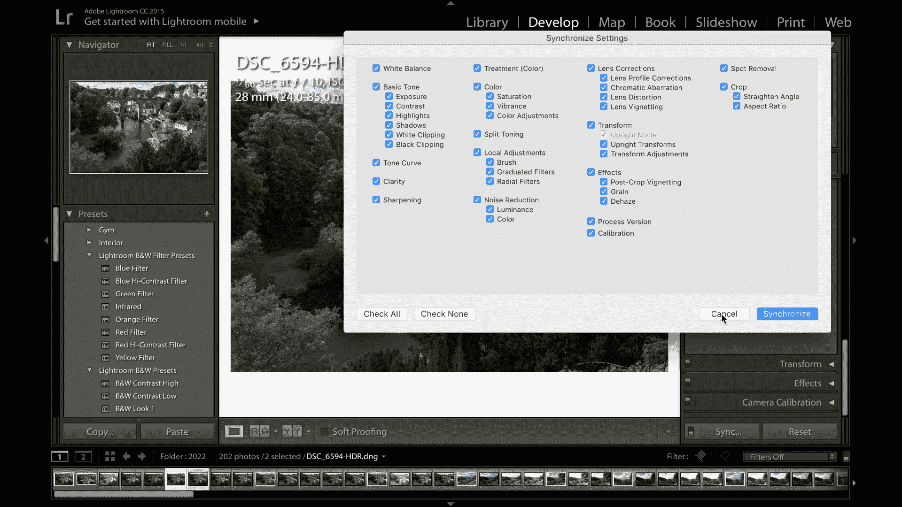
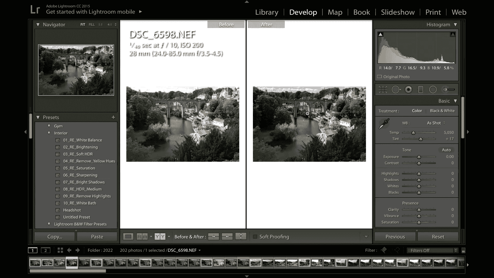

📸 Adobe Lightroom 高级照片编辑教程：第 14 章：使用渐变滤镜

在本节课中，我们将学习 Adobe Lightroom 中的高级照片编辑技巧。本节课的核心内容是渐变滤镜（Graduated Filter）的使用方法。我们会先了解本节课包含哪些知识点，然后逐一介绍径向滤镜、红眼修复、修复和克隆工具、裁剪与宽高比、相机色彩配置文件，最后讲解批量编辑和预设的安装方法。通过这些内容，你将掌握如何在 Lightroom 中高效地处理照片，提升后期工作流程的速度，让你的照片编辑更加专业。

本节课将要介绍的功能列表如下：

- 渐变滤镜：用于对图片局部区域进行曝光调整，常用于天空过亮或地面过暗的场景
- 径向滤镜：用于对圆形或椭圆区域进行局部编辑，适合人像或物体的重点处理
- 红眼修复工具：用于修正人眼瞳孔中的红眼现象，让人像照片更自然
- 修复画笔与克隆画笔：用于去除画面中的干扰元素，功能与 Photoshop 中的对应工具非常相似
- 裁剪工具与宽高比设置：用于调整图片构图和输出比例，决定图片在不同平台上的显示效果
- 相机色彩配置文件：用于匹配相机原始色彩风格，保持拍摄时的色彩一致性
- 批量编辑与预设：用于加快多张照片的处理速度，支持从互联网下载安装免费或付费预设

接下来，我们进入 Lightroom Classic 的开发模块，详细认识每一个工具的位置和基本用法。在开发模块的右侧工具面板中，你可以找到渐变滤镜、径向滤镜、红眼修复和点状移除工具。点状移除工具打开后，包含克隆画笔和修复画笔，它们的功能与 Photoshop 中的对应工具非常相似，可以用来去除画面中的杂物，减少对 Photoshop 的依赖。



下一节中我们来看看裁剪工具和宽高比的使用方法。裁剪不仅可以调整构图，还能决定图片在不同平台上的显示效果。了解宽高比有助于你在编辑完成后更好地分享和使用图片。

接着，我们介绍相机色彩配置文件与 Lightroom 设置的关系。如果你在拍摄时设置了特定的色彩配置文件，在 Lightroom 中也可以加载对应的配置文件，保持色彩的一致性。这也会引出如何通过批量编辑提升工作效率，以及如何创建和安装自己的预设。你可以从互联网或其他摄影师处下载免费或付费的预设，安装到 Lightroom 中使用。

现在，我们正式进入本节课的核心内容，开始学习渐变滤镜的实际操作。

### 渐变滤镜的基本位置与操作方式

首先，我们需要在 Lightroom Classic 中打开一张图片，并进入开发模块。在右侧工具面板中，找到渐变滤镜工具。这个工具的作用是让你在图片的某个方向上逐步调整曝光、对比度等参数，常用于天空过亮或地面过暗的场景。

使用渐变滤镜时，有两种常见的操作路径。第一种是直接在彩色图片上使用渐变滤镜；第二种是先将图片转换为黑白，再使用渐变滤镜处理曝光问题。以下是具体的操作步骤：

1. 点击渐变滤镜工具图标
2. 在图片上拖拽一个十字准星，确定渐变的起始位置和方向
3. 调整渐变区域的角度，使其与画面中的水平线、垂直线或对角线保持平行
4. 查看选中遮罩叠加层，确认受影响的区域
5. 调整曝光、阴影、高光等参数，完成局部修正

为了方便观察调整效果，建议始终开启“显示选中遮罩叠加层”选项。这样你可以清楚地看到红色或粉色遮罩覆盖的区域，知道哪些部分会被修改。遮罩颜色会从调整区域逐渐向图片边缘消失，形成自然的过渡效果。

### 实战示例：在彩色图片上使用渐变滤镜

我们以一张风景照片为例，演示如何使用渐变滤镜平衡曝光。这张照片是作者通过三次不同曝光拍摄的包围曝光图片，也就是所谓的 HDR 包围曝光。三张图片分别为欠曝、正确曝光和过曝。本节课我们使用欠曝的那一张来演示渐变滤镜的效果。

如果你了解 HDR 或包围曝光流程，就会明白为什么作者要拍三张不同曝光的照片。其目的是后期将它们合成一张高动态范围的图片。但本节课不讲解 HDR 合成，只专注于如何用渐变滤镜单独处理其中一张图片。

在开始使用渐变滤镜之前，作者先将三张图片全部重置，确保没有任何预先的编辑设置。接下来，针对欠曝图片的天空部分，使用渐变滤镜从上向下拖拽，覆盖画面上半部分。调整时要注意保持渐变线与画面的水平线平行，避免出现歪斜的过渡区域。

曝光调整的基本思路可以用这个公式来理解：

```
调整后曝光 = 原始曝光 + 渐变滤镜补偿值
```

由于原始图片欠曝严重，如果直接大幅增加曝光，会导致画面过曝。因此作者选择先将曝光拉低，观察天空和地面的亮度差异，再慢慢调整到合适的位置，使画面上下亮度更加均衡。调整完成后，点击完成按钮，然后使用前后对比视图查看效果。你可以清晰地看到，仅通过调整曝光，阴影部分的细节就被找回了，画面层次感明显提升。

### 实战示例：在黑白图片上使用渐变滤镜

除了在彩色图片上使用，渐变滤镜在黑白模式下也非常有用。特别是当你只有一张单张照片，而没有拍摄包围曝光的三张图片时，建议先将图片转为黑白，再使用渐变滤镜处理曝光问题。

黑白处理的核心逻辑如下：

```
黑白模式 = 仅保留明暗色调，去除颜色干扰
```

当图片变为黑白后，你不再需要考虑颜色，只需要关注高光、阴影和中间色调。这样可以缩小观察范围，更容易发现哪些部分需要改进。例如，在风景照片中，天空的云层细节可能不够明显，转为黑白后可以更清晰地判断需要加深还是减亮某个区域。

操作步骤如下：

1. 裁剪并校正图片，确保地平线和桥梁等结构线条笔直
2. 将图片转换为黑白处理
3. 点击渐变滤镜工具，从图片顶部向下拖拽
4. 开启选中遮罩叠加层，观察粉色遮罩覆盖范围
5. 调整曝光、阴影、高光和清晰度等参数

在黑白模式下，作者并没有大幅调整曝光，而是选择先将曝光调回零，然后调暗阴影，使天空部分的云层更加突出。接着适当增加高光，让云层细节重新出现。为了保持画面整体协调，清晰度数值设置为 10 左右，避免上下部分差异过大。

完成渐变滤镜调整后，点击完成，然后切换回彩色模式查看最终效果。通过前后对比，你可以看到天空部分的云层细节明显改善，画面整体更加平衡。

### 细节调整与后期润色

使用渐变滤镜完成主要曝光调整后，还可以根据需要进行进一步的细节润色。作者建议不要过度编辑，因为照片的美感往往在于画面内容本身，而不是极端的后期处理。



以下是常见的润色步骤：

1. 对全图适当增加清晰度，例如设置为 15
2. 使用调整画笔对局部过暗或过亮的区域进行微调
3. 进入 HSL / 色彩与黑白面板，有选择地调整绿色或黄色等颜色的饱和度
4. 确保最终效果保持真实，不显得不自然

在 HSL 面板中，你可以选择增加绿色的饱和度，使风景中的植被更加生动，但不要调整得过度，以免失去真实感。

### 总结

本节课中，我们一起学习了 Adobe Lightroom 中渐变滤镜的使用方法。首先介绍了本节课包含的全部高级编辑工具，然后详细讲解了渐变滤镜在开发模块中的位置和基本操作。接着，我们通过两个实战示例，分别演示了在彩色图片和黑白图片上使用渐变滤镜平衡曝光的方法，并介绍了如何通过遮罩叠加层观察调整范围。最后，我们还学习了如何进行细节润色和 HSL 颜色调整，使风景照片更加出色。

希望这节课能帮助你掌握渐变滤镜的使用技巧，在后续的照片编辑中灵活运用，让你的作品更加出色。

