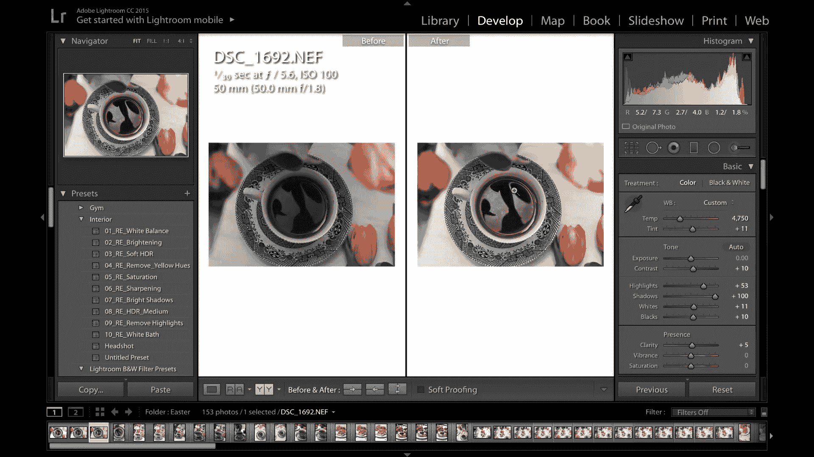
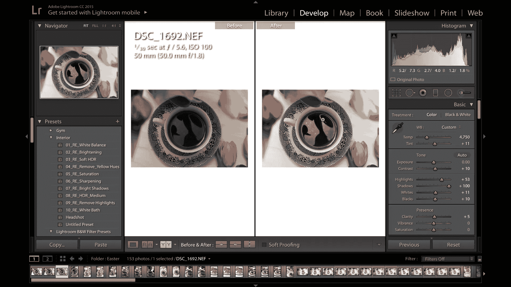
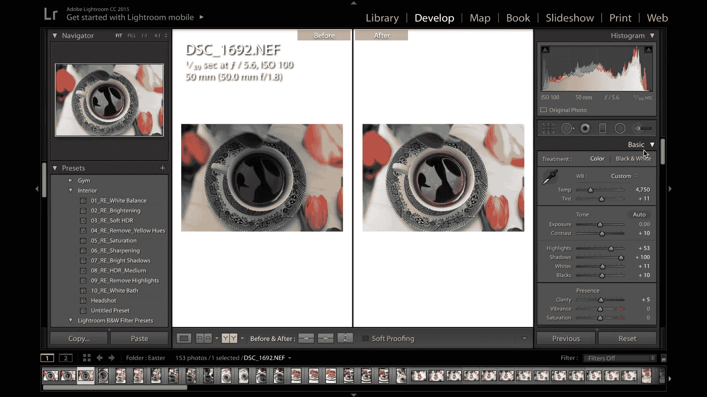
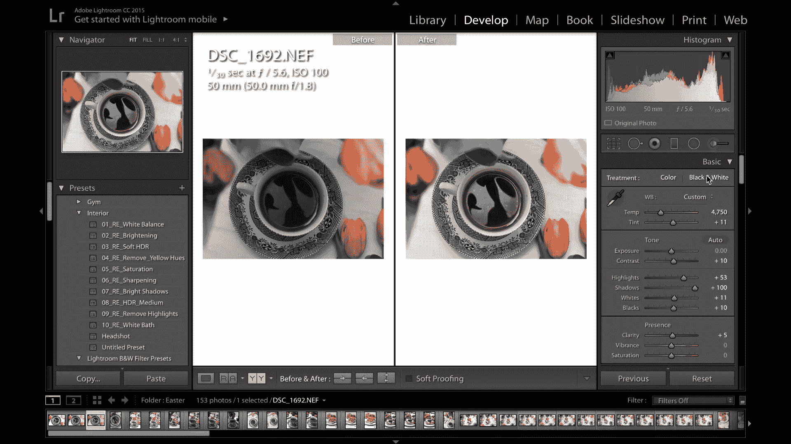

# Adobe Lightroom 从入门到精通照片编辑教程：15：使用径向滤镜 🎯


在本节课中，我们将学习 Adobe Lightroom 中的径向滤镜工具。这是一个非常实用的局部调整功能，适合只需要修改照片中某个小范围区域的情况。接下来的内容会一步步教你如何启用这个工具，如何画出调整区域，以及如何通过阴影、高亮和色彩让局部细节更突出。


## 什么是径向滤镜 📐


径向滤镜是 Lightroom 开发模块中的一种局部调整工具。它的作用是在照片上创建一个圆形或椭圆的蒙版区域，只对圆圈内部或外部的像素进行调整，而不会影响画面的其他部分。

以下是该工具的核心逻辑描述：

```
调整区域 = 径向蒙版圆形范围
调整效果 = 阴影 + 高亮 + 清晰度 + 颜色 + 曝光
```


当你只需要优化画面中某个特定对象，比如一杯茶、一个人物面部或某个小物品时，径向滤镜就是最合适的选择。它能让你在不改变全图色调的前提下，精准地提升局部细节。


## 启用径向滤镜工具 🖱️


上一节我们介绍了渐变滤镜的使用方法，本节中我们来看看径向滤镜。

在 Lightroom 顶部点击“开发”标签页，进入编辑界面。在右侧工具栏中找到径向滤镜图标，它的形状是一个圆圈。

以下是启用步骤：

1. 点击顶部的“开发”模块。
2. 在右侧工具面板中选择径向滤镜图标。
3. 确认当前未高亮显示任何蒙版区域，表示工具已就绪，可以开始绘制。


## 绘制圆形调整区域 ✏️


工具启用后，我们需要在照片上画出一个圆形，确定想要调整的具体范围。

以下是绘制方法：

1. 用鼠标在照片上按住并拖动，画出一个圆圈。
2. 将圆圈的边缘对准你想要调整对象的边界，比如茶杯标识与杯身的交接处。
3. 适当微调圆圈的大小和位置，使其尽可能贴合目标区域。
4. 确认圆圈范围合适后，就可以开始对该区域进行参数调整了。


## 调整阴影与高亮 ☀️


画好圆形蒙版后，接下来需要改变该区域内部的光影效果，让目标对象成为画面的视觉焦点。


以下是常用调整步骤：

1. 将“阴影”滑块向右移动，提亮圆圈内较暗的部分。
2. 适当提高“高亮”滑块，恢复区域中较亮部分的细节。
3. 如果高亮过度，可将滑块向左拉回，避免画面看起来不自然。
4. 增加“清晰度”数值，让圆圈内的纹理更加分明。


## 增强局部色彩 🎨


光影调整完成后，可以进一步优化圆圈区域内的颜色表现，让目标对象更显眼。

以下是色彩调整建议：

1. 只对圆形蒙版内部进行色彩增强，不要影响全图。
2. 适当增加饱和度或自然饱和度，给茶液或目标对象增加一点色彩层次。
3. 控制调整幅度，避免颜色看起来过于突兀或奇怪。
4. 完成色彩微调后，圆圈内的对象就会在保持自然的前提下变得更有吸引力。


## 查看前后对比效果 🔍


所有参数调整完毕后，需要点击“完成”按钮，退出蒙版编辑模式，然后对比编辑前后的效果。

以下是查看方法：

1. 点击界面上的“完成”按钮，保存当前径向滤镜调整。
2. 使用前后对比功能，查看未编辑的原始照片。
3. 观察圆圈区域内阴影差异和色彩表现的变化。
4. 确认调整效果符合预期后，该局部增强就完成了。


## 在黑白模式下辅助编辑 ⚫⚪


除了在彩色模式下直接调整，你也可以先将照片转为黑白，再使用径向滤镜进行局部修改，最后再切回彩色。

以下是黑白辅助编辑流程：



1. 在“基本”面板中将照片暂时转为黑白模式。
2. 重新绘制径向滤镜圆圈，调整阴影、对比度和清晰度。
3. 黑白模式下能更清楚地看出光影变化，帮助你判断调整幅度是否合适。
4. 点击“完成”后，将照片切回彩色模式。
5. 再次查看前后对比，确认局部增强效果。


两种方法的操作逻辑完全相同，唯一的区别在于：在开始任何局部调整之前，你是否先在“基本”面板中把图片转成了黑白。无论选择哪种方式，最终能达到的调整效果都是一样的。




## 本节总结 📝






本节课中，我们一起学习了如何在 Adobe Lightroom 中使用径向滤镜。从启用工具、绘制圆形蒙版，到调整阴影、高亮和色彩，最后再通过前后对比确认效果，并了解了在黑白模式下辅助编辑的可选技巧。希望这些内容能帮助你更好地掌握局部照片编辑的方法，在实际操作中灵活运用。


