# Complete Adobe Lightroom Megacourse：Beginner to Expert Photo Editing part2 p16：第16章：径向筛选器与去除干扰元素 📷

## 课程概述

在本节课中，我们将学习 Adobe Lightroom Classic 中的两个高级编辑工具。第一个是径向筛选器（Radial Filter），用于对图像中圆形或椭圆形区域进行局部曝光与色彩调整；第二个是去除干扰元素工具（Spot Removal Tool），包含修复画笔和克隆画笔，用于清理画面中不需要的细节。本节课将以一张香肠和土豆泥的食物照片为例，演示如何增强主体区域并去除干扰斑点，帮助你掌握从局部增强到画面清理的完整后期工作流。

## 一、径向筛选器基础与适用场景

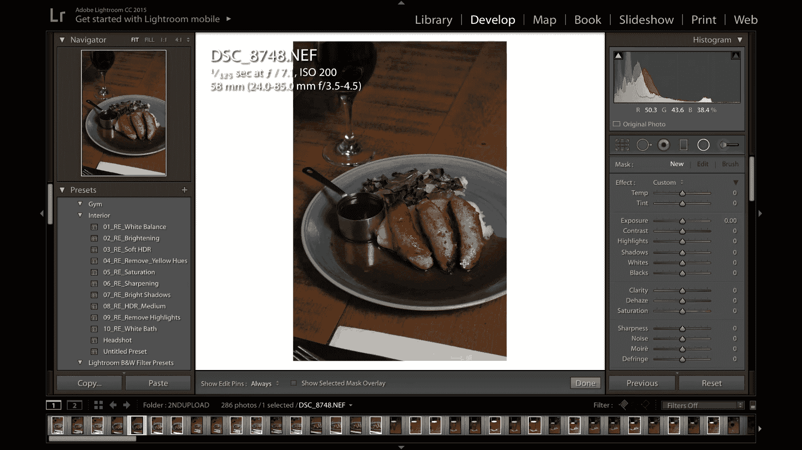

上一节我们介绍了渐变筛选器的使用方法，本节中我们来看看径向筛选器以及如何减少和去除画面中的干扰元素。

径向筛选器与渐变筛选器的主要区别在于作用形状。渐变筛选器可以沿斜线、水平或垂直方向分段应用，而径向筛选器顾名思义是一个圆形，你也可以将其调整为椭圆形。它并不是一定会高频使用的滤镜，但在需要编辑圆形或椭圆局部区域时非常有用，并且支持彩色或黑白两种模式进行操作。

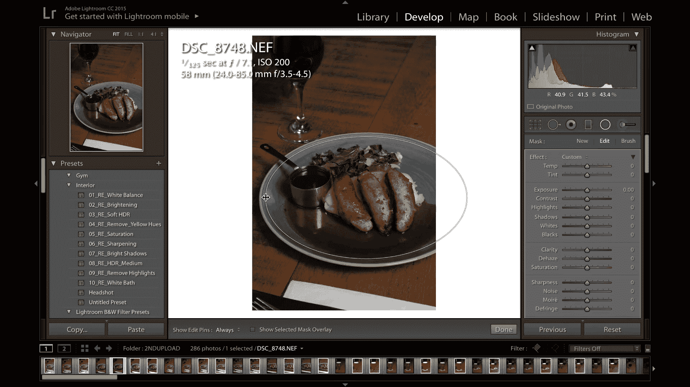

以下是径向筛选器的核心特征：
- 适用于编辑图像中的圆形或椭圆区域
- 圆形大小和形状可根据编辑需求自由更改
- 支持彩色和黑白两种模式编辑
- 适合在需要强调局部区域时使用，而非必然高频使用

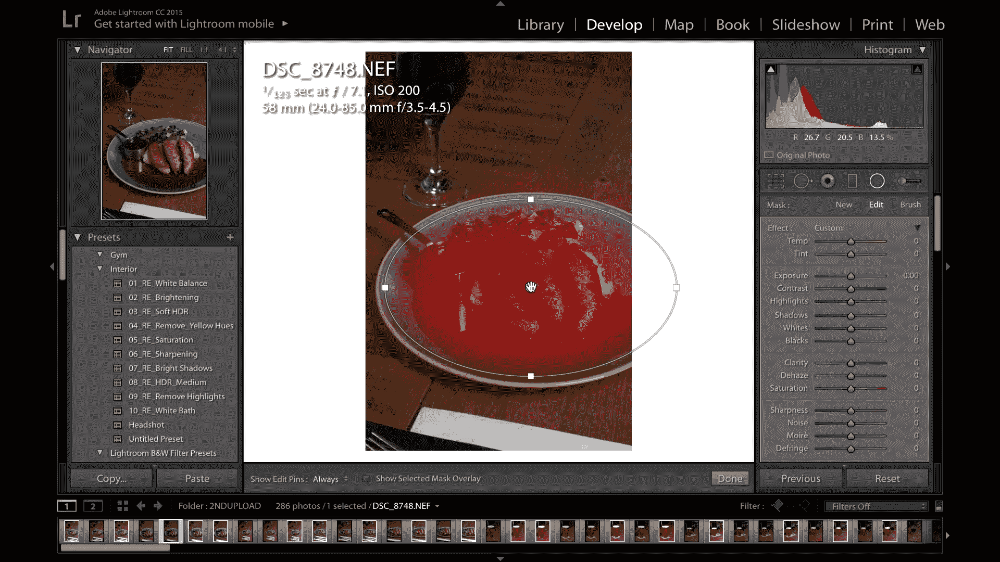

## 二、创建和调整椭圆遮罩区域

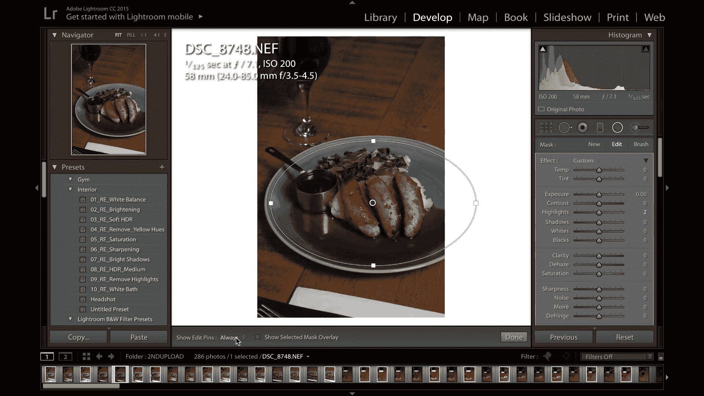

我们在 Lightroom Classic 工具面板中点击径向筛选器图标，此时光标会变成一个十字准星。接下来需要确定筛选器的作用区域。

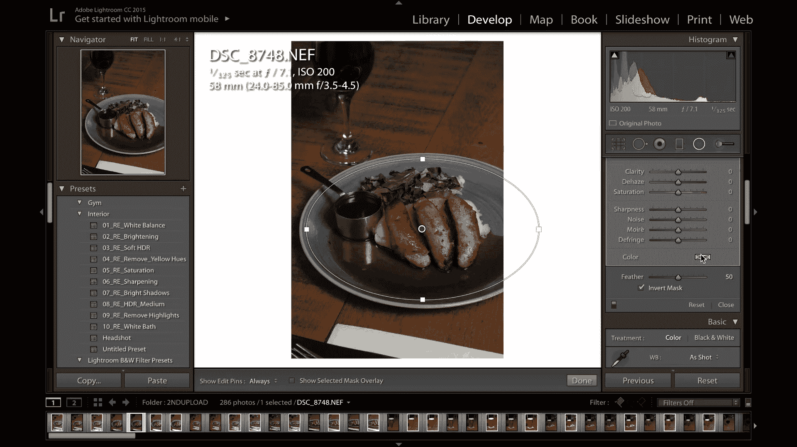

以下是具体操作步骤：
1. 将十字准星对准图像中需要增强的区域中心点
2. 按住鼠标拖动，调整圆形或椭圆的大小与形状
3. 通过拖动四个方向的小方块来改变尺寸，注意上下方块会联动移动，左右方块也会联动移动
4. 松开鼠标后，形状和大小的调整会受到一定限制，因此需要在操作过程中尽量调整到理想状态

以本例中的食物照片为例，我将椭圆区域对准香肠和土豆泥盘子，因为这是观众视线自然聚焦的重点区域。为了进一步吸引观众注意力，我们只对盘子中的食物区域应用筛选器。

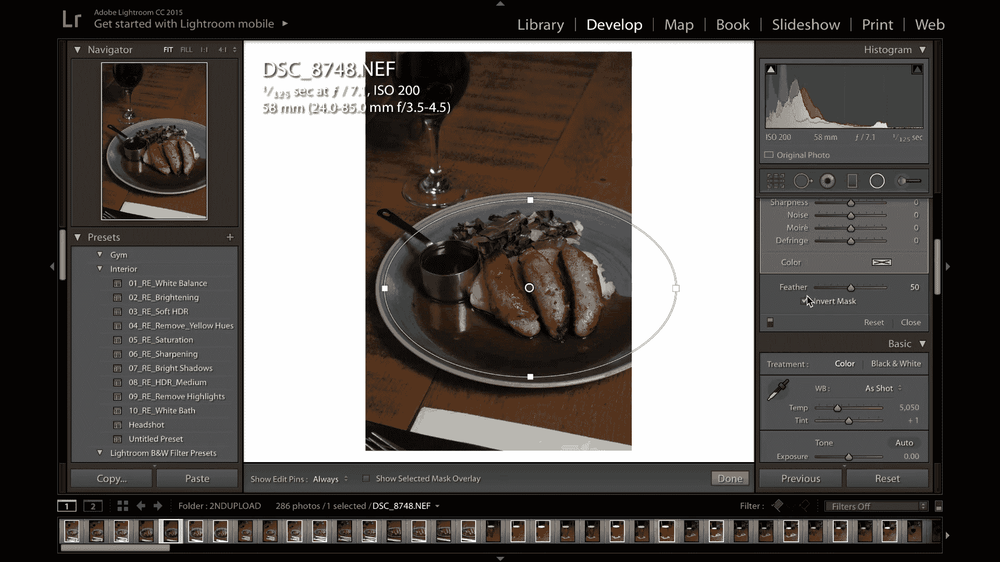

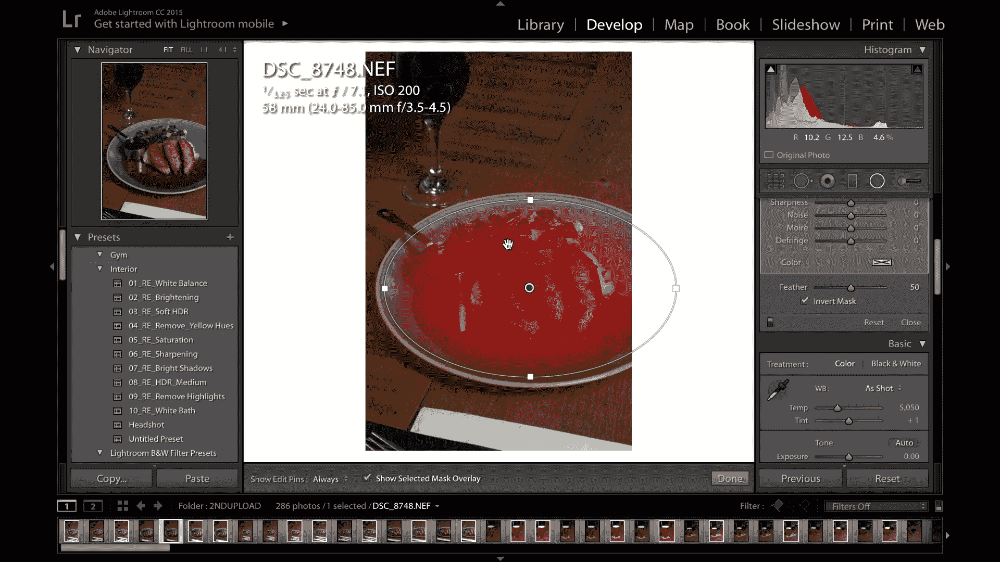

> 遮罩区域 = 圆形基础形状 + 椭圆形变形 + 四个方向联动控制点

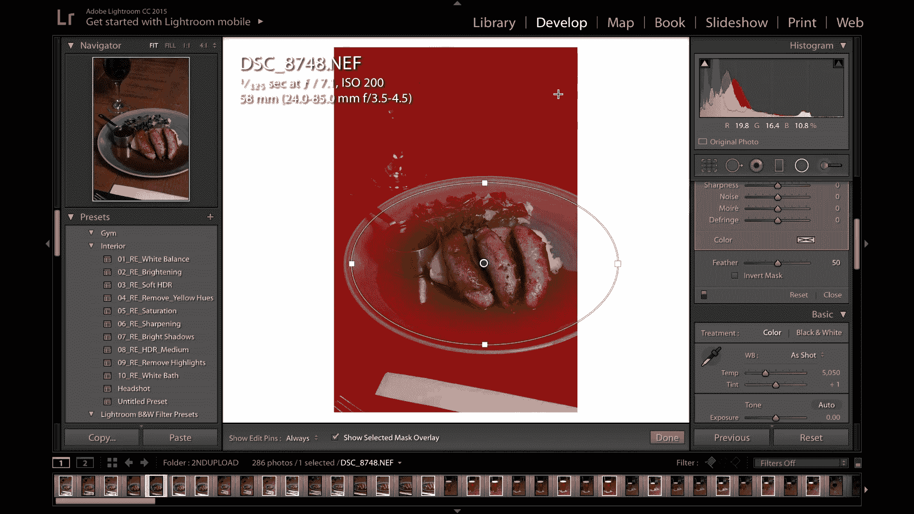

## 三、蒙板显示与反转设置

在完成遮罩形状绘制后，我们需要确认编辑范围是否准确。此时可以使用蒙板叠加层来查看实际受影响的区域。

以下是蒙板设置选项：
- Pin 显示模式：Auto、Always、Selected、Never 四种可选
- 颜色选项：可调整遮罩区域的显示颜色
- 反转（Invert）：切换编辑区域为椭圆内部或外部

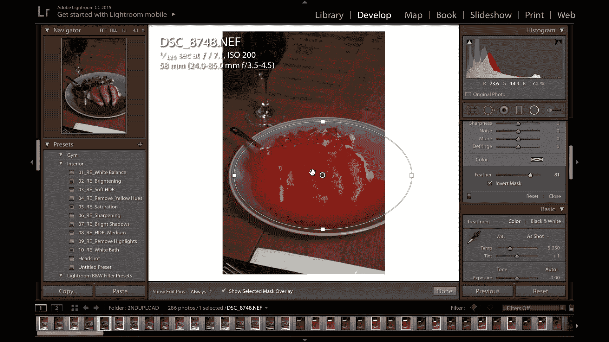

默认情况下，径向筛选器编辑的是椭圆内部区域。如果点击“反转”，则会编辑椭圆外部的区域。在本例中，我们需要编辑的是盘子中间的食物部分，因此保持默认不反转，即编辑中间区域。此外，该面板还提供颜色调节选项，如果某个区域的白平衡不合适，或者你希望有意将香肠调成黄色，都可以在这里进行颜色更改。

## 四、柔边参数与局部曝光调整

柔边（Feather）参数控制遮罩边缘的过渡宽度。柔边越大，编辑效果向外扩散的范围越广，边界越自然；柔边越小，编辑区域更集中在圆形边缘附近。

以下是柔边的作用原理：
- 外圆代表筛选器的作用范围截止点，超出此范围不进行任何编辑
- 内圆代表柔边区域，两圆之间产生逐渐溶解的过渡效果
- 柔边数值越小，溶解过程越快；数值越大，柔化效果越弱

本例中，我将柔边设置为约 50，以确保覆盖整个食物区域，同时避免过度扩散到周围的卷心菜或肉汁区域。

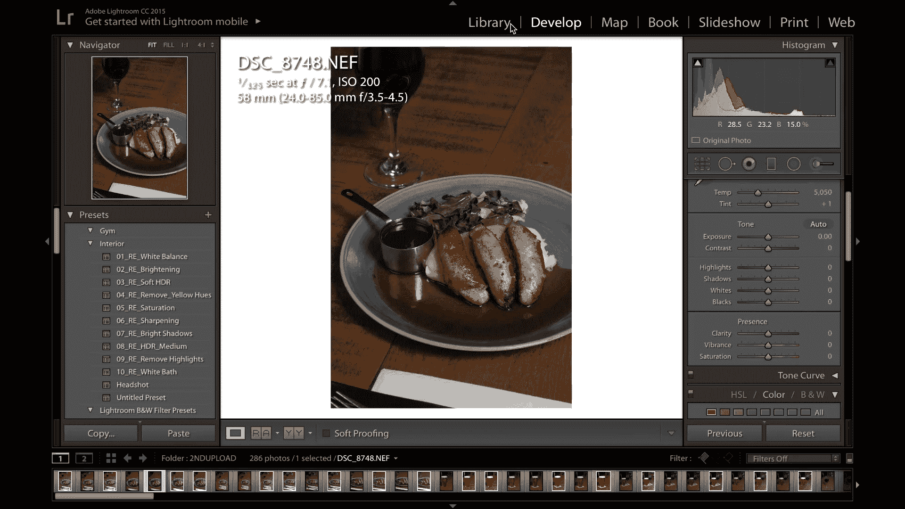

接下来进行局部曝光调整，所有调整的目标是让照片看起来真实自然，同时让食物部分更具吸引力：
- 高光（Highlights）：调至 74，增强香肠和肉汁的亮部细节
- 阴影（Shadows）：调至 50，提亮香肠下方及肉汁碗中的阴影区域
- 清晰度（Clarity）：调至 10，避免食物照片过度锐化导致质感流失

> 调整参数示例：Highlights = 74，Shadows = 50，Clarity = 10

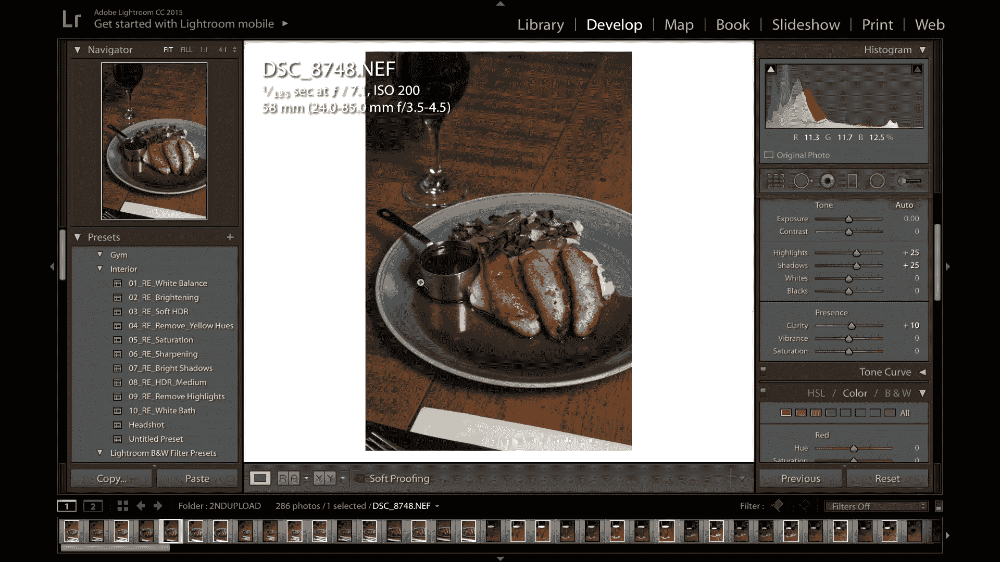

## 五、前后对比与整体食物照片设置

调整完成后，我们可以使用 Y 键查看编辑前后的对比效果。这样可以直观判断局部增强是否过度，是否保持了合理的曝光风格。

除了径向筛选器的局部调整，我通常还会对整张食物照片应用基础设置，以统一画面亮度，避免过度曝光，同时保持木质桌面的自然质感和适当的暗部细节：
- 清晰度：10
- 高光：25
- 阴影：25

这些全局设置旨在让整体画面更加协调，而不会过度突出某个部分。

## 六、去除干扰元素工具介绍

在完成径向筛选器编辑后，本节课的第二个工具是“减少和去除干扰元素”（Reduce and Remove Distractions）。这个工具帮助我们识别并清理画面中不需要的细节。

以下是常见需要去除的干扰元素类型：
- 玻璃表面的反光
- 香肠上的烤痕（如希望保持真实感可保留）
- 看起来突兀的小斑点或瑕疵
- 影响主体观赏的多余物体

在本例中，我首先放大图像，逐一检查画面，找出需要处理的区域。对于想要保留的真实质感，如香肠的烤痕，可以选择不处理；对于明显的干扰斑点，则使用去除工具进行清理。

## 七、修复画笔与克隆画笔操作

点击去除干扰元素工具后，会出现修复画笔（Heal）和克隆画笔（Clone）两个选项。我们需要设置画笔大小、柔边和不透明度。

以下是画笔参数说明：
- 大小（Size）：控制画笔覆盖范围，可通过顶部和侧面的十字控制点调整
- 柔边（Feather）：控制两个同心圆之间的过渡效果，外圆为作用截止点，内圆为柔化起始区域
- 不透明度（Opacity）：100% 表示完全覆盖替换，低于 50% 则只会逐步淡化目标区域

操作时，先涂抹需要去除的区域，再选择一个参考区域作为替换来源，按下 Enter 确认。如果不透明度设置过低，例如 14，效果会非常轻微，几乎看不出来；将其提高到 90 后，目标瑕疵会被彻底覆盖消除。

> 克隆画笔逻辑：源区域像素 → 替换目标区域像素 → 不透明度控制覆盖程度

## 八、视觉斑点辅助工具与细节核对

在清理过程中，有时我们长时间观察同一张图片，容易忽略某些细小瑕疵。此时可以启用“视觉斑点”（Visual Spots）辅助功能。

该工具的作用如下：
- 自动标记画面中视觉上突出的斑点区域
- 帮助发现肉眼可能容易忽略的干扰元素
- 适用于检查表面纹理、木质桌面等容易混淆的区域

需要注意的是，并非所有标记出的区域都需要去除。例如木质桌面的天然纹理属于画面的一部分，不应删除。启用视觉斑点后，我们可以逐一判断哪些真正需要处理，哪些应当保留。

## 九、完整工作流总结与跨场景应用

回顾本节课的完整编辑流程，我们先对食物照片进行了基础编辑，提升了清晰度、高光和阴影表现；接着使用径向筛选器增强了盘中食物的局部细节；最后运用修复画笔和克隆画笔去除了画面中的干扰斑点。

这些技术虽然是在食物摄影中演示，但同样的方法也可以应用于人像、风景、建筑等其他类型的摄影作品。径向筛选器适合任何需要突出圆形或椭圆主体的场景，而去除干扰元素工具则是所有后期编辑中清理画面杂物的通用手段。

## 本节课总结

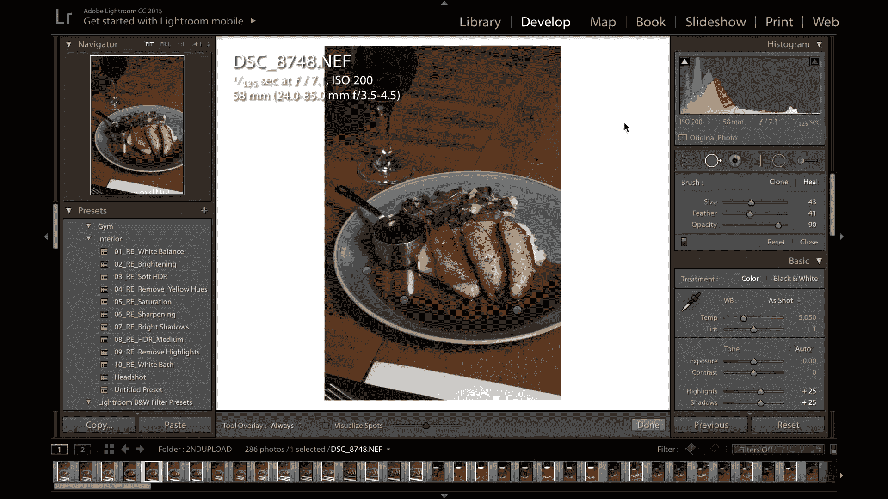

在本节课中，我们一起学习了如何在 Adobe Lightroom Classic 中使用径向筛选器对局部圆形区域进行曝光与色彩调整，以及如何使用修复画笔和克隆画笔去除画面中的干扰元素。你现在可以尝试将这些技巧应用到自己的照片编辑中，无论拍摄的是食物还是其他主体，都能让画面更加专注且干净整洁。

