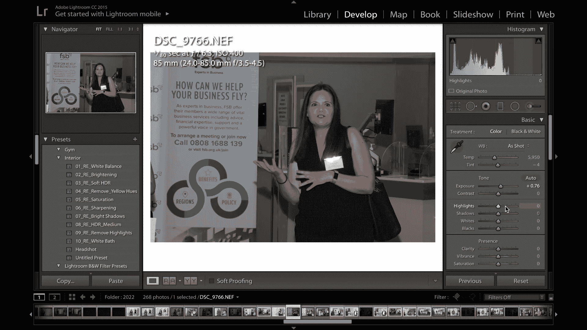
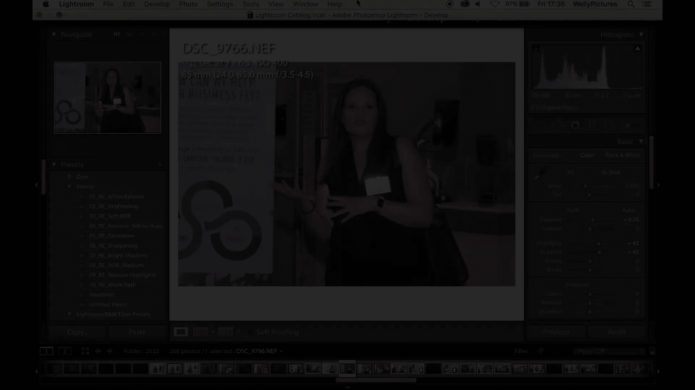

📷 Complete Adobe Lightroom Megacourse：17：红眼修正工具 📷

在本节课中我们将要学习如何在 Adobe Lightroom 中使用红眼修正工具。这节课属于后期进阶技巧的一部分，主要教你去除人像照片中由闪光灯引起的红眼现象。我们会从红眼产生的原因讲起，然后逐步演示如何放大眼睛区域，如何放置修正圆圈，如何调整瞳孔大小和暗度，最后还会简要介绍画笔、降噪和裁剪等辅助步骤。无论你是刚接触 Lightroom 的新手，还是已经有一点编辑基础的学习者，都能通过本节课掌握这个实用工具，并在以后处理闪光灯人像时快速修复红眼问题。

本节我们先来看看红眼现象是怎么产生的。

红眼现象是指人像照片里人物的眼睛出现不自然的红色斑点。这种情况通常发生在低光线环境下，摄影师使用闪光灯正对着人物拍摄时。闪光灯光线进入瞳孔，反射眼底血管后被相机捕捉，最终在照片里形成红色亮斑。如果闪光灯没有直接对准人物，或者环境光线足够充足，一般就不会出现明显的红眼。

红眼产生的基本条件可以用下面这个公式来表示：

```
低光线环境 + 闪光灯正对人物 = 红眼现象
```

在本节演示中，这张示例照片是在光线很暗的场景下拍摄的。摄影师为了让人物脸部获得足够光线，不得不将闪光灯正对着人物。结果在两只眼睛里都出现了明显的红眼。虽然在实际拍摄中这并不是理想效果，但正好适合用来演示如何使用红眼修正工具进行修复。

接下来我们看看在开始修正之前，为什么需要先放大图像。

因为眼睛在整张照片里占据的面积非常小，如果不放大，很难准确地定位红眼区域。建议先将图像放大，直到能够清晰地看到瞳孔的细节。在演示中，作者将放大比例设置为 4:1，这样不仅能看清瞳孔颜色，还能观察到闪光灯在瞳孔中留下的小亮斑。放大后，你操作修正工具时会更加精准，也能更直观地看到修正前后的差别。

放大比例设置如下：

```
缩放比例 = 4:1
```

放大之后，就可以正式使用红眼修正工具了。

以下是使用红眼修正工具的基本操作流程：

1. 在 Lightroom 右侧工具面板中找到红眼修正工具。
2. 将工具移动到眼睛瞳孔区域。
3. 让圆圈中心的小十字准确对准瞳孔中心。
4. 按下回车键确认，工具会生成一个覆盖瞳孔的圆圈。

在放置圆圈时，要尽量让圆圈中心的红点位于瞳孔正中央。如果瞳孔正中央正好有闪光灯的亮斑，可能会让定位稍微困难一些，但只要耐心调整位置，就能让圆圈覆盖住红色区域。

工具放置好以后，还需要调整圆圈的大小和深浅。

默认情况下，圆圈的直径大约是瞳孔大小的 50%。如果圆圈太小，无法完全覆盖红眼，可以增大它的尺寸，直到刚好包住整个瞳孔。覆盖条件可以用下面这个公式来表示：

```
圆圈直径 >= 瞳孔直径
```

除了大小，面板中还有一个变暗滑块。将其数值调高，可以让瞳孔变得更黑，更接近自然眼睛颜色。如果数值调得太高，瞳孔可能会变成纯白色，这看起来也不自然。因此建议适度调整，既能去除红色，又保留眼睛的真实质感。在演示中，作者将变暗数值设置在大约 12 到 14 之间，这样既去掉了红色，又没有过度处理。

除了单个圆圈，还有另一种常见的处理方式。

使用红眼修正工具时，你有两种不同的处理策略。第一种方式是使用多个小圆圈。你可以在瞳孔的不同位置分别放置几个小圆圈，逐个覆盖红色区域。这种方法的优点是容易上手，但缺点是操作步骤多，花费时间长，而且圆圈多了以后容易混淆，不太清楚哪个圆圈对应哪个位置。

第二种方式是使用一个大圆圈。先放一个圆圈覆盖瞳孔，然后点击圆圈边缘，拖动调整圆圈大小，直到刚好填满整个瞳孔。这种方式更高效，只需要处理一个圆圈即可完成修正。演示中作者特意展示了这两种方法，目的是让你了解如果第一种方式效果不理想，可以切换到第二种方式。一般来说，建议先尝试多个小圆圈熟悉工具，熟练之后直接使用单个大圆圈会更快。

修正红眼之后，还可以做一些整体画面的微调。

如果照片中还有闪光灯造成的眩光，可以使用调整画笔轻轻涂抹，尽量降低其干扰程度。另外，如果图像在高 ISO 或低光线下拍摄，可能会有一些噪点。此时可以前往细节面板，适当增加噪点降低数值，让画面更干净，但不要调得太高，否则会丢失细节。



在演示中，作者将噪点降低数值设置为大约 14，然后稍微调整高光和清晰度，最后进行裁剪。裁剪时可以遵循三分构图法则，将人物主体放在画面的合适位置，同时去掉边缘不需要的部分，比如他人手臂等干扰元素。经过这些步骤，照片的整体质感就会明显提升。



在本节课中我们一起学习了如何在 Adobe Lightroom 中使用红眼修正工具。我们了解了红眼产生的原因，学会了放大图像以便精确操作，掌握了放置和调整修正圆圈的基本步骤，比较了多个小圆圈和单个大圆圈两种方法的优劣，最后还简单介绍了画笔、降噪和裁剪等后期微调手段。希望这节课对你有所帮助，以后在处理闪光灯人像照片时，就能快速去除不自然的红眼效果了。
