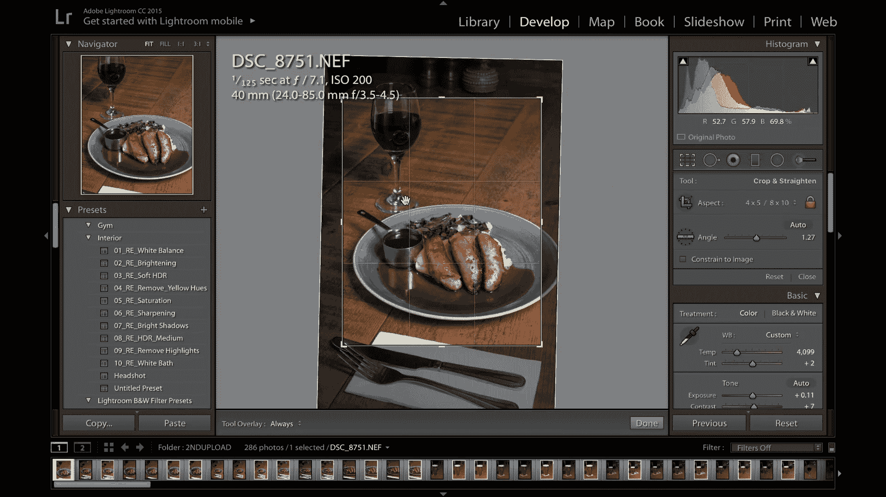
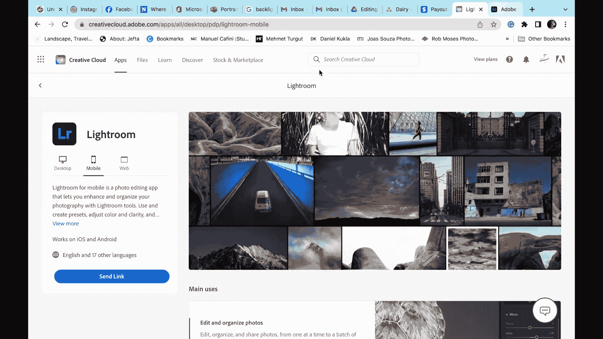
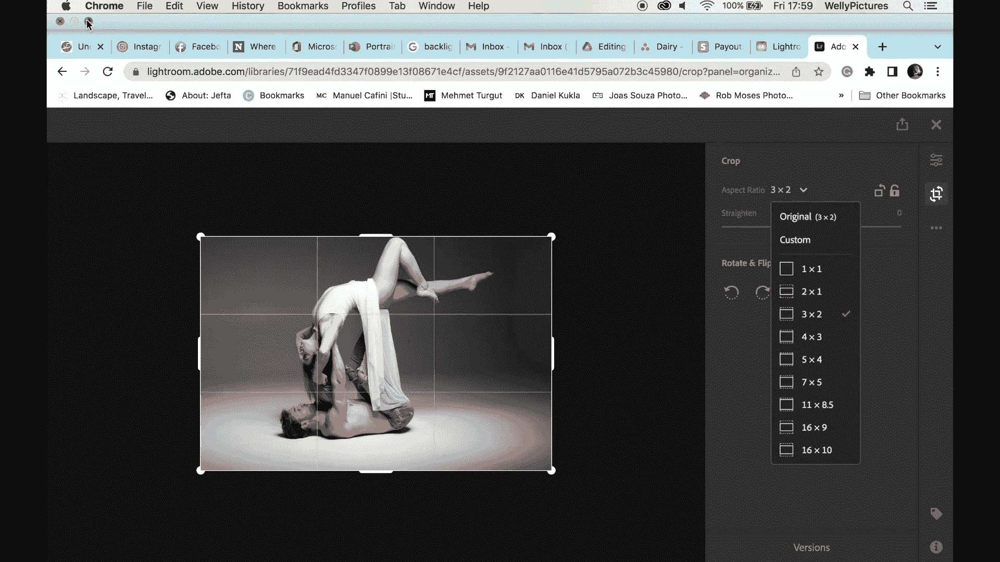
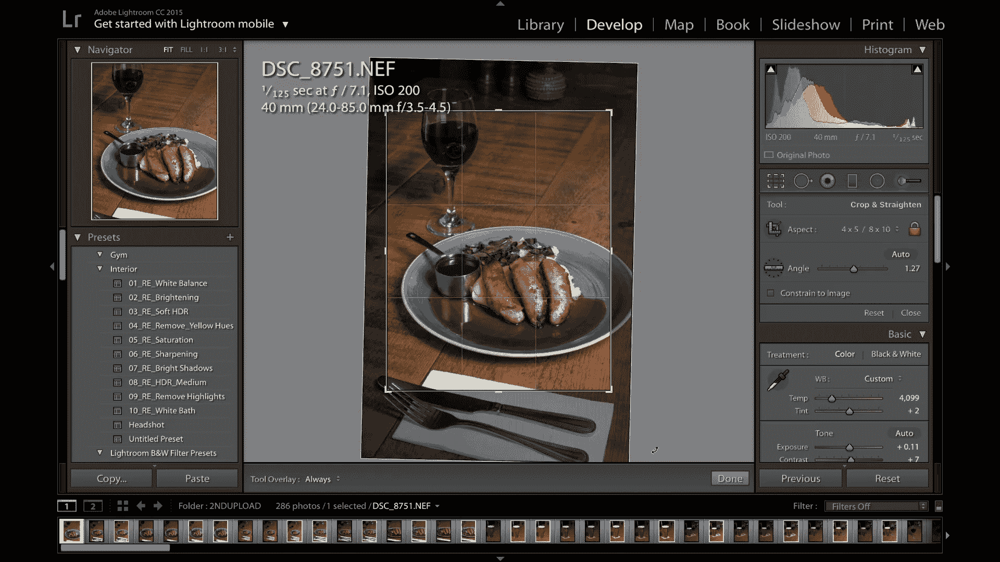

# Adobe Lightroom 从入门到精通：18：改变图片长宽比 🖼️

在本节课中，我们将一起学习 Adobe Lightroom 中图片长宽比的含义，了解为什么在裁剪图片时可能需要修改长宽比，并掌握在 Lightroom 经典版与网页版中设置和调整长宽比的具体步骤。


首先，我们需要搞清楚长宽比到底指的是什么，才能明白后续的裁剪操作到底在做什么。简单来说，长宽比就是用来衡量一张图片宽度和高度之间比例关系的数值。你可以把它理解为下面这个公式：

```text
长宽比 = 图片宽度 ÷ 图片高度
```

当我们说一张图片是横向构图时，通常意味着它的宽度数值比高度数值大；而当一张图片是纵向构图时，高度数值通常比宽度数值大。理解这个基本概念之后，你就能知道在裁剪时，到底是应该保持原有比例，还是改成正方形、四比五或者其他常见比例。


掌握了长宽比的基础概念之后，我们回到 Lightroom 的实际操作界面，看看裁剪工具是如何工作的。在 Lightroom 经典版中，裁剪工具通常被称为裁剪叠加层，它适用于任意类型的照片。进入编辑模块后，你会找到裁剪区域，在那里你可以画出想要保留的画面部分。默认情况下，这个裁剪区域会跟随图片原本的长宽比，也就是说，如果你不做任何改动，裁剪出来的图片跟原始图片的比例是一致的。


在正式裁剪之前，还有一个非常实用的功能可以帮助你把图片扶正，避免画面出现歪斜的情况。你可以使用角度标尺工具，在图片上画一条参考线，确保画面中的水平线或垂直线真正保持笔直。比如拍摄风景照时，地平线必须水平；拍摄酒杯时，酒杯本身也应该垂直笔直，不能歪斜。如果你发现拍摄时相机没有拿正，可以利用这条角度线进行校正，同时配合网格线再次检查，确认自己满意之后，按下确认键完成裁剪。


掌握裁剪工具的基本用法后，我们来探讨一个核心问题：为什么要特意去改变图片的长宽比？在实际使用中，不同的平台和用途对图片尺寸都有不同的要求。如果你打算把照片上传到个人网站，通常希望图片文件体积更小，这样上传速度更快，网页加载也更流畅，访问者浏览起来不会感到无聊。在社交媒体上，同样需要注意合适的尺寸，而且如果你将来想要打印照片，无论是通过数字打印还是自己使用打印机，提前了解常见的长宽比设置都会很有帮助。


了解修改长宽比的目的之后，我们具体看看 Lightroom 经典版里提供了哪些可选的长宽比。以下是经典版中常见的选项列表：

- 原始比例：保持图片最初拍摄时的宽高比例不变。
- 自定义比例：由你自己决定裁剪范围，完全由你掌控图片的最终形状。
- 一比一：正方形比例，非常适合 Instagram 或 Facebook 等社交媒体，尤其是 Instagram，因为它主要引导用户将图片裁剪成正方形格式。
- 四比五：对应传统的八比十寸打印尺寸，也是常见的相框规格，适合打印使用。
- 五比七：另一种传统打印尺寸，常见于普通相框和照片输出。
- 二比三：经典摄影比例，广泛用于各种照片场景。
- 十六比九：更偏向横向的宽屏比例，同样适合在社交媒体上使用。



此外，你还会看到一些以像素为单位的尺寸选项，比如网站上传时常见的像素要求，有时候单位是厘米，有时候是英寸，有时候就是像素数字。如果你看到的数字都大于一位数，通常意味着平台要求你的图片必须在特定的像素范围或长宽比范围内才能上传。


选定一个固定的长宽比以后，你依然可以自由移动裁剪框，决定画面的具体构图。也就是说，即使你把长宽比设成了八比十，你依然可以把裁剪框拖动到你喜欢的位置，而不需要受限于原来的裁剪区域。这个功能让你在保持比例固定的同时，还能灵活调整画面内容。




除了经典版，Adobe 还提供了 Lightroom CC 和网页版，它们的界面和长宽比选项有一些区别，下面我们一起来看看。网页版允许你下载图片、编辑完成后分享图片，也可以进行基础编辑。你还可以把 Lightroom 下载到桌面，然后与手机同步，或者直接通过链接在网页端打开 Lightroom，这样即使在外拍摄现场，也可以上传和编辑照片。网页版的界面看起来和桌面版的全能 Lightroom 不太一样，工具栏只有在点击某张图片后才会出现，但这并不影响你使用裁剪和旋转功能。


在网页版和经典版中，还有一个关键设置需要注意，那就是长宽比的锁定状态。当你的锁定图标没有被锁上时，意味着你可以独立调整顶部、底部或两侧的边框，而不必非得从画面角落开始裁剪。在 Lightroom 经典版中，双击这个锁定图标就可以解锁它，这样你就可以根据需要，分别设置不同边长来裁剪图片，获得更自由的构图效果。


最后，我们把两个版本的长宽比列表放在一起对比，帮助你快速找到适合自己的尺寸。以下是网页版中常见的选项：

- 三比二：很多照片的默认原始比例。
- 一比一：Instagram 主要个人资料设置使用的正方形尺寸。
- 二比一：额外提供的比例，可以用于正方形格式之外的不同元素。
- 十六比九：常见的横向宽屏比例。
- 五比四：类似于纵向构图的比例。

相比之下，网页版多出了一些选项，比如二比一和三比二，但也缺少了一些经典版里的尺寸，比如十一比八或者七比五之类的选项。总体来说，两个版本的主要比例都很相似，都能满足 Instagram、Facebook 以及其他社交媒体的常用尺寸需求，同时也保留了一些其他变体供你选择。




学完所有选项之后，还有一个非常重要的实际建议需要和你分享。不管你最终选择哪种长宽比，都要先考虑这张图片是要用在什么地方，哪种尺寸更合适、更实用。比如，如果你把一张精美的照片发到 Instagram，却用正方形比例裁剪，可能会把画面中最重要的部分给裁掉，这就得不偿失了。所以在修改长宽比时，请务必留意这一点，牢记这些关键知识点，能够让你的照片编辑更加得心应手。




本节课中，我们一起学习了 Adobe Lightroom 中图片长宽比的含义与计算方式，回顾了裁剪工具的基础操作，了解了如何使用角度工具让画面保持水平或垂直，探讨了修改长宽比在网站、社交媒体和打印场景中的作用，梳理了 Lightroom 经典版与网页版中的长宽比选项列表，掌握了在固定比例内重新调整裁剪区域的方法，以及锁定和解锁长宽比的操作技巧。希望这些内容能帮助你在实际编辑照片时，根据不同用途选择最合适的图片尺寸。
