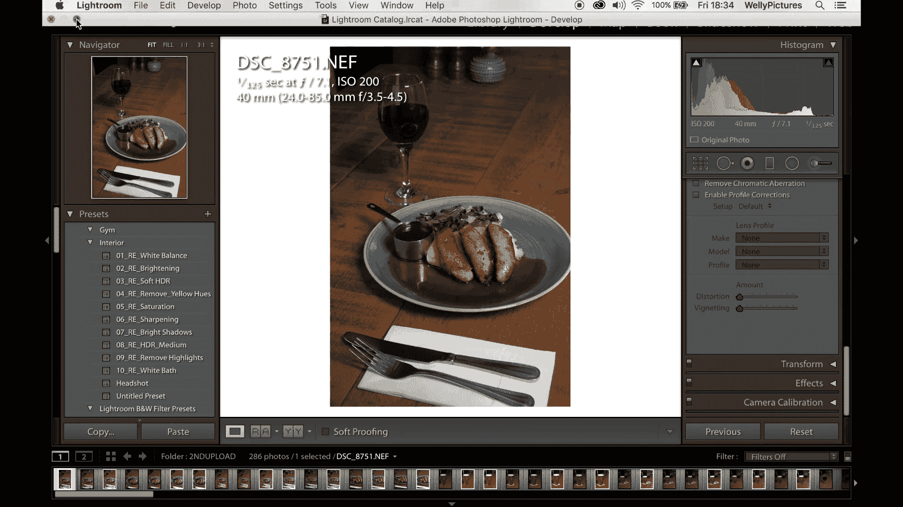
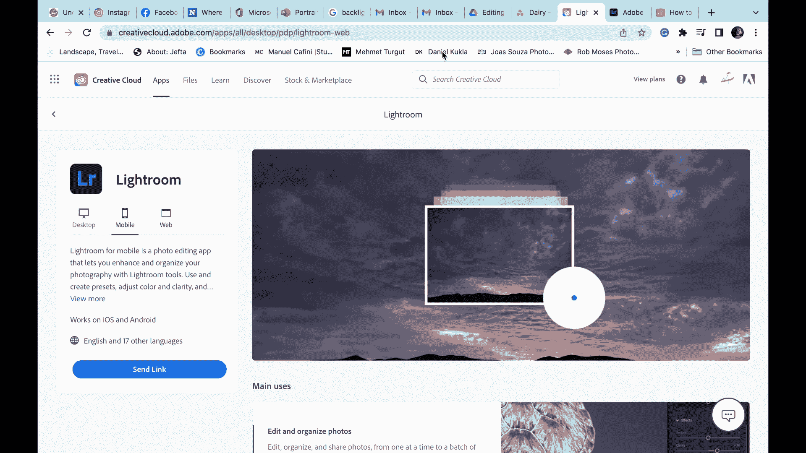
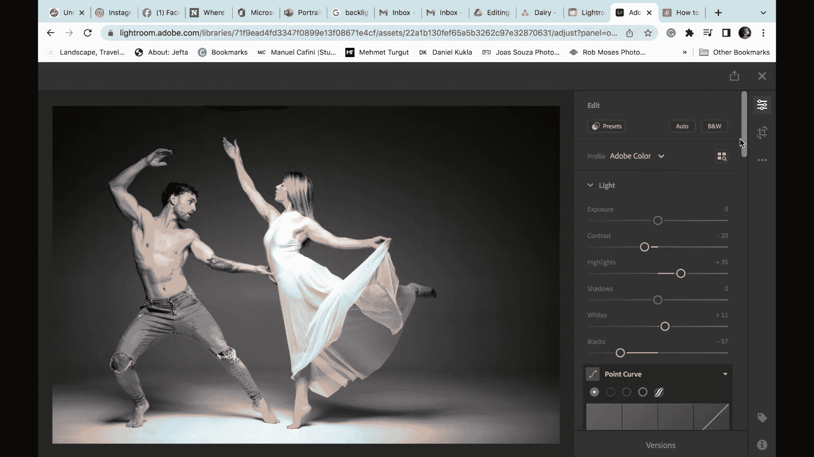
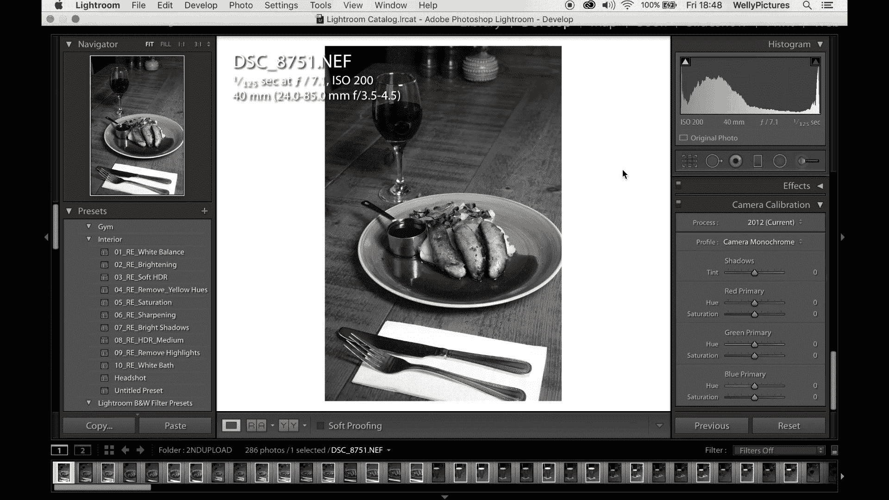

# 完整Adobe Lightroom大课：初学者到专家照片编辑：第19部分：相机色彩配置文件 📷

在本节课中我们将要学习Adobe Lightroom里面关于相机色彩配置文件的使用方法。这部分内容属于进阶编辑技巧中的一个重要知识点，主要目的是帮助你理解如何在拍照阶段和后期编辑阶段之间建立颜色上的关联。我们会先解释不同相机品牌对色彩配置文件的不同称呼，然后演示如何在Lightroom Classic中找到并调整这些配置文件，接着讨论Raw格式和JPG格式在使用配置文件时的差异，最后展示Lightroom桌面版和网页版中更多创意配置文件的应用方式。

## 一、什么是相机色彩配置文件

上一节我们介绍了基础的编辑面板和调整工具，本节中我们来看看相机色彩配置文件到底是指什么。简单来说，色彩配置文件决定了相机记录颜色的方式，也决定了Lightroom读取这些颜色的方式。你可以把它理解为照片的“底色模板”，它会直接影响照片的明暗程度、色调风格以及整体视觉效果。

在实际使用中，色彩配置文件的核心作用是让拍摄时的设置与后期编辑软件中的设置保持一致。如果你在相机里选择了某种画风，然后在Lightroom里选择同样的配置文件，那么照片导入后呈现的效果就会更接近你在相机屏幕上看到的效果。当然，如果你不特意去匹配它们，也完全可以正常使用Lightroom，只是照片导入后可能会使用软件的默认设置，而不是相机里预设的风格。

核心关系可以用这个公式来描述：

`相机色彩配置文件 = Lightroom 中的相同配置文件 = 颜色关联一致`

## 二、不同相机品牌的配置文件名称

以下是各大相机厂商对色彩配置文件的不同称呼：

- 佳能（Canon）：Picture Style，中文通常叫图像风格
- 尼康（Nikon）：Picture Control，中文通常叫画面控制
- 富士胶片（Fuji Film）：Film Simulation，中文通常叫胶片模拟模式
- 索尼（Sony）：Creative Style，中文通常叫创意样式
- 宾得（Pentax）：Custom Image，中文通常叫自定义图像
- 奥林巴斯（Olympus）：Picture Mode，中文通常叫图像模式

这些名称虽然不一样，但指代的都是同一件事，也就是相机内部用来处理颜色的预设模式。了解这些名称有助于你在相机菜单中快速找到对应的设置选项，不至于在不同品牌的相机之间找不到对应的功能。

## 三、在Lightroom Classic中查看配置文件

现在我们来看看如何在Lightroom Classic中找到这些选项。打开Lightroom Classic，进入编辑模块，把右侧面板一直向下滑动，直到找到“相机校准”或“相机色彩配置文件”区域。在这个区域里，你会看到默认选项通常是“Adobe标准”。

`Adobe标准 = RGB`

这里的RGB就是红绿蓝三种原色组合而成的颜色集合，也是绝大多数照片编辑软件（包括Photoshop）中使用的基本颜色模式。当你在Lightroom里打开一张照片，而相机里并没有设置特定的配置文件时，Lightroom会默认采用Adobe标准，这完全没问题，不需要强行更改。你可以保持默认设置，照片依然可以正常编辑。

## 四、如何将相机配置文件与Lightroom匹配

以下是将相机设置与Lightroom配置文件对齐的具体步骤：

1. 在相机菜单中进入画面控制或图像风格设置
2. 选择你想要的模式，例如风景模式或人像模式
3. 拍摄照片并将其导入Lightroom
4. 在Lightroom中找到相机色彩配置文件面板
5. 选择与相机中相同的模式，例如“相机风景”

以尼康用户为例，如果你在相机里将画面控制改为“风景”，然后拍摄一张风景照，接着在Lightroom里把色彩配置文件切换到“相机风景”，你就会发现照片变得更暗，阴影部分更深，颜色也发生了变化。这就是通过切换配置文件为图像增加了一层编辑效果。如果你不希望这么做，完全可以保持Adobe标准，不必强制匹配。这个匹配过程更多是给那些希望拍摄时看到的效果与后期导出效果高度一致的摄影师使用。

## 五、Raw格式与JPG格式的区别

这里需要注意一个重要的技术细节，以下是两种格式的主要差异：

- JPG格式：相机里设置的配置文件会直接写入照片文件，Lightroom可以识别并关联这些设置
- Raw格式：相机里的配置文件设置不会被Raw文件记录，Lightroom无法直接读取相机里的画面控制选择

也就是说，如果你是Raw格式拍摄，改变相机里的配置文件后再导入Lightroom，你会发现照片并没有任何变化，仿佛什么都没发生过。Raw格式保留了更多原始数据，相机里的预设只作为参考，不会被锁定在文件里。

不过Raw格式用户依然可以使用色彩配置文件，只是用途不同。你不能用来和相机设置“结婚”或绑定，但可以用来作为后期编辑的起点，帮助你进一步调整图像。有些摄影师习惯在相机里选择黑白模式，这样可以专注于高光、中间调和阴影的明暗对比，后期再把照片恢复成彩色，同时保留黑白照片的色调层次感。

## 六、Lightroom桌面版与网页版中的配置文件

除了Lightroom Classic，Lightroom的桌面版和网页版也提供了色彩配置文件功能。以下是这两个版本中的常见选项：

- Adobe颜色（默认选项）
- 风景
- 人像
- 标准
- Adobe生动
- 单色

这些选项与传统相机配置文件的功能类似，可以用来给照片快速套用一种整体风格。在新版Lightroom里，这些配置文件更像是一组自带的滤镜或预设，你只需点击一下就能给照片添加复古、现代或其他艺术效果。

## 七、使用创意配置文件进行编辑

以下是将配置文件作为编辑起点的操作方法：

1. 打开一张照片，进入编辑面板
2. 找到配置文件菜单，浏览可选的风格
3. 选择一个你喜欢的配置文件，例如复古或生动风格
4. 根据需要调整对比度、高光、阴影等基础参数
5. 如果需要，可以随时切换回其他配置文件，之前的基础编辑不会丢失

配置文件就像是照片编辑的“起始点”，相当于给图片加了一层初始滤镜。之后你还可以继续调整细节，让照片完全符合你的想法。新版Lightroom甚至允许你调整配置文件的强度，让效果更淡或更浓。

## 八、实际编辑示例

为了让你更直观地理解，我们可以看一个简单的编辑流程。首先选择一张照片，应用一个风景类型的配置文件，你会发现照片的色调立即发生了变化，变得更有层次感。接着你可以稍微降低对比度，调整高光部分，让画面不至于太暗或太亮。

完成这些基础编辑后，你依然可以切换回原来的标准配置文件，之前的所有调整参数都会保留。这意味着配置文件并不是永久性的修改，而是一种可以随时更改的叠加效果。

## 九、本节总结

本节课中我们一起学习了相机色彩配置文件的相关知识。我们了解到，不同相机品牌对配置文件有不同的叫法，在Lightroom Classic中可以通过相机校准面板来选择对应的配置文件。如果你希望拍摄设置与后期效果保持一致，可以将相机里的配置文件与Lightroom里的配置文件匹配起来。

同时，我们也讨论了Raw格式和JPG格式的区别，知道了Raw用户不能直接绑定相机配置文件，但可以把配置文件作为编辑起点。最后，我们展示了Lightroom桌面版和网页版中更多创意配置文件，它们可以像Instagram滤镜一样快速为照片添加风格，并为后续编辑提供方便的起始方向。

