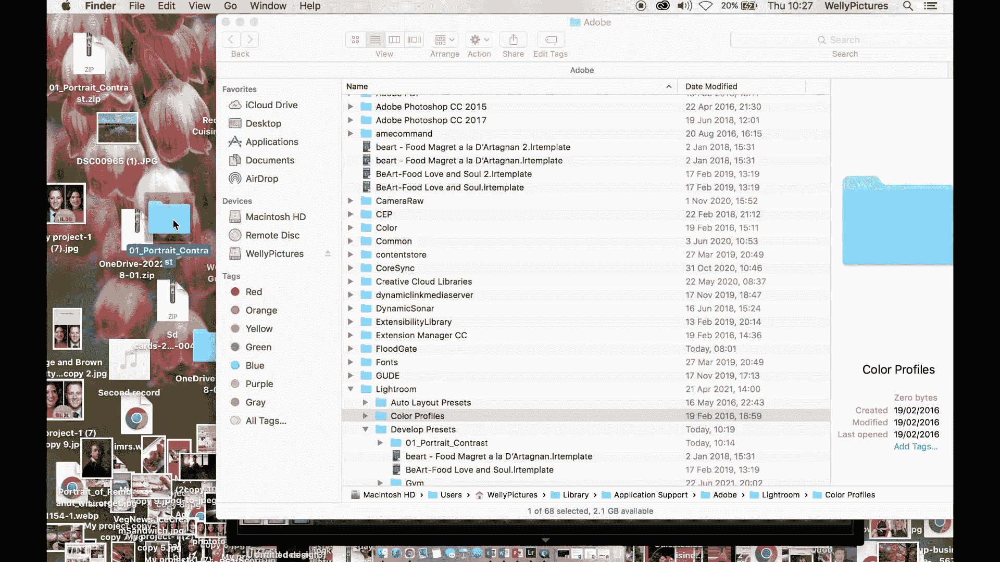
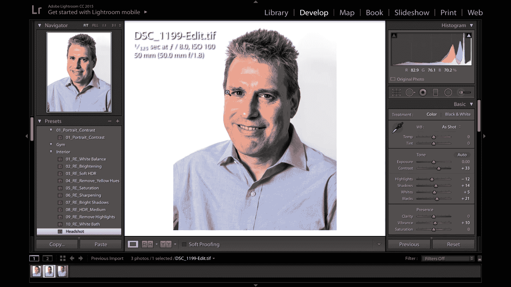

# 完整Adobe Lightroom从入门到专家照片编辑全攻略 第二部分：第20课：安装、使用与创建预设以加速工作流 🎨

在本节课中，我们将一起学习如何在 Adobe Lightroom 中安装、使用和创建预设。预设就像是一套预先保存好的调色参数，你可以把它当成一键套用的滤镜，这样处理大量照片时就不需要每张图片都重新拖动滑块。我们先看看预设到底是什么，然后学习如何把从网上下载的预设导入 Lightroom，接着教你如何根据自己的拍摄风格创建专属预设，最后介绍如何把预设批量应用到多张照片上，帮助你提高后期工作效率。

## 什么是预设 📦

预设的核心思想非常简单，就是把一组已经调好的参数保存起来，下次直接套用。你可以把它理解为下面这个公式：

预设 = 曝光 + 对比度 + 高光 + 阴影 + 白色 + 黑色 + 清晰度 + 去噪 + 镜头校正等所有后期参数

简单说，当你把一张照片调到满意的效果，然后把这些参数保存为一个预设文件，以后拍摄光线相似的照片时，只需点击一下这个预设，所有参数就会自动套用到新照片上，省去重复操作的时间。

Lightroom 自带了一些默认预设，你也可以从互联网上下载免费或付费的预设，或者自己制作专属预设。下面我们先来看看如何安装下载好的预设。

## 下载并安装预设到 Lightroom 💾

以下是安装预设的具体步骤：

- 第一步，在电脑上下载预设文件。预设通常以压缩包形式发布，比如 ZIP 文件。
- 第二步，打开 Lightroom，进入偏好设置界面，点击“预设”选项卡。
- 第三步，点击“显示 Lightroom 预设文件夹”，系统会打开存放预设的本地目录。
- 第四步，把下载好的预设文件夹拖放到“冲洗”预设文件夹中。
- 第五步，关闭偏好设置窗口，重启 Lightroom 程序。
- 第六步，重启完成后，回到“冲洗”模块的预设面板，你就能看到刚才导入的预设了。

以免费的“肖像对比度”预设为例，把它拖进预设文件夹并重启 Lightroom 后，在预设列表中就能找到它。点击这个预设，照片的对比度会立即提升，画面看起来更有层次感。这就是安装预设的完整流程，操作并不复杂，只需要记住把文件放到正确的文件夹里，然后重启软件即可。

## 创建属于你自己的预设 🛠️

有时候下载的预设并不完全符合你的拍摄风格，这时候自己制作预设会更实用。以下是创建自定义预设的方法：

- 第一步，挑选一张代表性的照片，在“冲洗”模块中调整曝光、对比度、白平衡、清晰度等参数，直到效果符合你的要求。
- 第二步，在预设面板上点击加号图标，选择“新建冲洗预设”。
- 第三步，给预设起一个容易识别的名称，比如“头像测试”或“室内风格”。
- 第四步，选择要保存的参数项。比如你只调整了基础色调和清晰度，就只勾选这些选项，不需要的参数可以取消勾选。常见的可勾选项包括白平衡、基础色调、色调曲线、清晰度、锐化、颜色处理、自然饱和度、分离色调、渐变滤镜、降噪、镜头校正和变形等。
- 第五步，确定保存，预设就会出现在你选择的预设文件夹中。

这里有一个重要细节，在创建预设之前，你必须先完整编辑好一张照片，然后决定哪些调整部分需要被保存。比如你改了白平衡，就勾选白平衡；如果你调了色调曲线，就勾选色调曲线。这样创建出来的预设才能完整反映你的后期习惯。

## 将预设批量应用到多张照片 🖼️

预设最大的价值在于批量处理，尤其是当你拍摄了一组光线相似的照片时。以下是批量应用预设的思路：

- 第一步，在“库”模块中选中已经应用了预设的那张照片。
- 第二步，按住 Shift 键，再选中其他需要应用相同效果的照片。
- 第三步，点击刚才创建好的预设，所有选中的照片会同时套用同样的参数。
- 第四步，检查每张照片的效果，如果某张图片光线差异较大，可以单独微调曝光或阴影。

举个例子，假设你在同一场景下拍摄了十张人像照片，光线和曝光基本一致，这时只需要对第一张照片调好参数并保存为预设，然后把这个预设应用到剩下九张照片上，所有照片的风格就会保持统一。这就像给一组照片穿上了同一件衣服，观看起来更有整体感。不过需要注意的是，如果拍摄环境光线差异很大，直接套用预设后可能还需要对每张图做少量的局部调整，不能完全依赖预设解决所有问题。

## 本节课总结 ✅

在本节课中，我们一起学习了 Lightroom 预设的基本概念，掌握了如何从网上下载预设并将其安装到 Lightroom 中，也学习了如何根据自己的后期风格创建专属预设，最后还介绍了如何把预设批量应用到多张照片上。预设就像是一套可重复使用的调色方案，合理使用可以大幅提升照片处理速度，让一组照片保持统一的视觉风格。希望这节课的内容对你有所帮助，祝你在 Lightroom 的后期创作中工作更高效。

