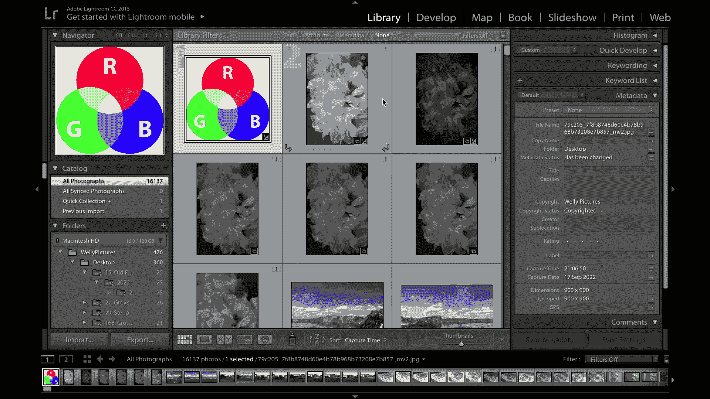
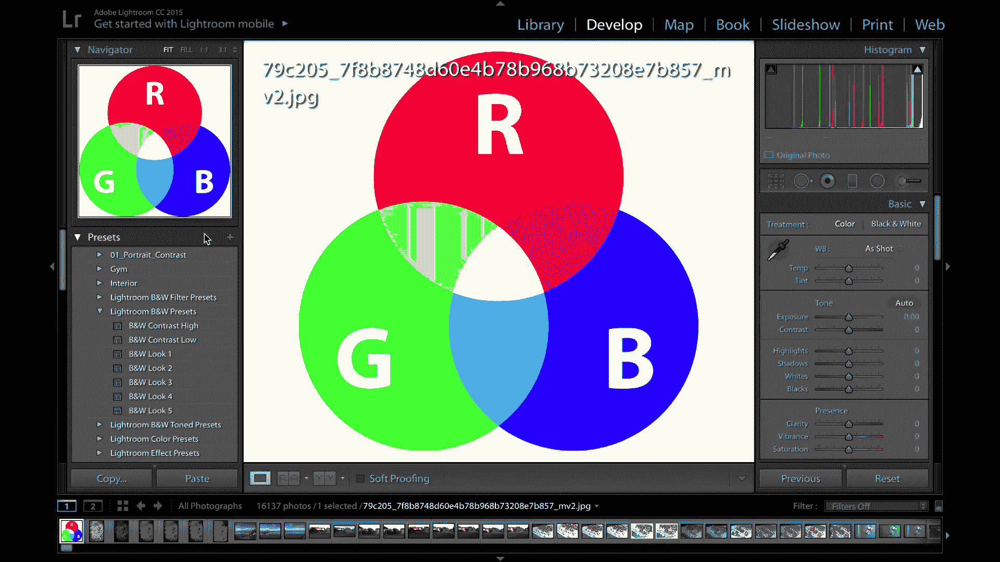
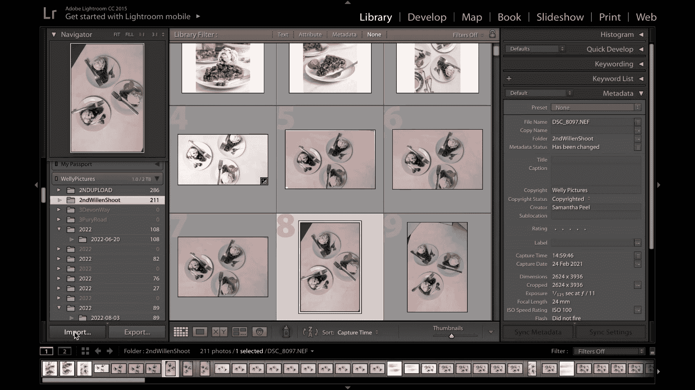
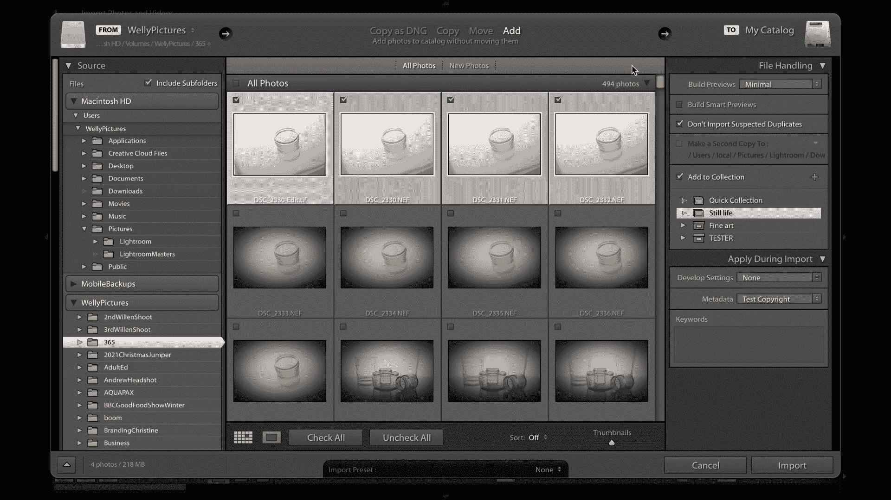
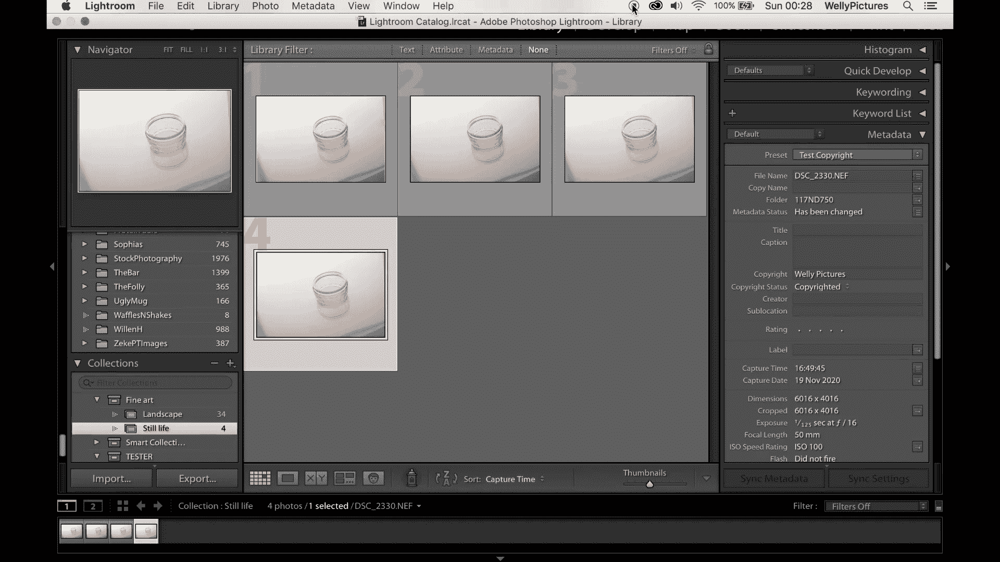

# Complete Adobe Lightroom Megacourse： Beginner to Expert Photo Editing part2：p21：Create Your Copyright Preset 📸





## 课程概述

在本节课中我们将要学习如何在 Adobe Lightroom 中创建自己的元数据版权预设。我们会先了解预设和元数据的基本概念，然后逐步讲解如何设置版权信息、创作者信息以及其他常用内容，最后学习如何在导入照片时直接应用这个预设，或者在导入后将元数据同步到整个相册。通过这节课，你将能够为自己的照片建立统一的版权标识，保护作品的所有权。

## 认识预设与元数据

在之前的课程中，我们已经聊过 Lightroom 中的预设功能。预设可以帮你快速套用一组固定的设置，而不需要每次都手动去调整各项参数。如果我们进入编辑模块，就可以在这里添加预设。不过有一个我之前漏掉的事情，我想在这里补充进来，那就是制作你自己的元数据预设。

现在请切换到库模块，因为元数据预设的设置是在库模块中完成的。那么元数据到底是什么呢？简单来说，元数据是一份记录照片信息的文件。它会告诉你关于这张照片的各种细节，比如你对照片做了哪些编辑，照片是什么时候拍摄的，照片是怎么拍摄的。它还会提供一些关于照片本身的额外信息，而你可以利用这些元数据来管理和保护你的作品。

当你导入照片时，元数据通常以 XMP 文件的形式存在。一旦你导入一张原始照片，随照片一起的那个 XMP 文件就是元数据信息。当你开始编辑照片时，元数据信息会随之修改，但你不仅可以编辑和改变图像格式中的元数据，还可以向图片中添加更多有用信息，并基于这些信息创建你自己的预设。

```
Metadata = 拍摄时间 + 拍摄方式 + 编辑记录 + 版权信息
元数据文件 = XMP 文件
```

## 创建你的元数据预设

了解了元数据的基本概念之后，我们就可以开始动手创建属于你自己的元数据预设了。首先，你需要点击“编辑预设”按钮。此时预设列表显示为自定义。我已经设置好自己的预设并命名为“版权”，但我建议你也制作属于自己的预设。

以下是创建新元数据预设的具体步骤：

- 点击“保存当前设置为新预设”。
- 为预设命名，比如我这里输入“test Copyright”。
- 点击“创建”按钮完成命名。

现在你已经为元数据预设命名了，接下来可以开始添加一些基本信息。你可以放入副本名称、评分、标签、说明等内容，所有这些都可以加入到元数据中。拥有这些信息确实很有用，但如果你打算将其作为预设使用，通常希望预设保持简洁。你可以根据不同照片的需要，在之后再添加更多信息。

这里我先将基本信息部分最小化。接下来是相机信息部分，你可以填写所有表明相机使用情况的信息。不过别误会，相机信息通常已经自动导入到元数据中了，除此之外你还会看到 IPTC 内容，包括 IPTC 主题代码、描述、类别、标题等。这些信息通常是针对单张照片的，所以在制作预设时，如果这些信息对每张照片都不一样，就不需要全部加进去。当然，如果你愿意，也可以创建多个元数据预设。

例如，如果你经常拍摄婚礼照片，就可以在这些基本信息和 IPTC 内容中预先添加一些常用内容，因为你知道在导入图片时，自然会希望把这些信息加到照片里。

## 元数据中包含的关键信息

在设置元数据预设时，你会遇到很多不同的信息字段。以下是主要包含的内容分类：

- 基本信息：副本名称、评分、标签、说明
- 相机信息：拍摄所使用的相机型号和参数
- IPTC 内容：主题代码、描述、类别、标题等
- 版权信息：版权所有者、版权状态、使用权限条款、网站
- 创建者信息：姓名、地址、城市、邮编、公司、电话、邮箱、网站、职位
- 图片信息：创建日期、智慧类型、场景代码、子位置、城市等
- 扩展信息：图片高度、宽度、扩展艺术品、扩展描述、扩展模型等

接下来重点看版权选项部分，这是我比较建议你关注的地方。在版权字段，我通常会使用公司名称来给我的图片命名。你还可以设置版权状态，有三种常见选择：未知、版权、公共领域。如果你希望确保上传并通过 Lightroom 分享的照片归某人所有，就勾选“版权”；如果选择“公共领域”，就意味着这张照片可以被共享，相当于你放弃了所有权利。

你还可以添加使用权限条款，输入一些特定的条款内容，并在版权选项中选择你想放入的项目。此外，网站地址也可以填进去，比如 www 开头的网址。你在这里填入的所有信息都会随图片一起传输，属于共享信息。举个例子，如果有人下载了我的图片，这些图片始终会带有版权信息，并且会标明是谁拍摄的照片，至少能保证这一点。

除了版权信息，你还会看到创建者信息，也就是你自己的信息，包括地址、城市、邮编、公司、电话、邮箱、网站和职位。你可以把所有这些信息都添加进去，并将其设为预设。这意味着，只要你在导入图片时始终高亮这个预设，每一张导入的图片都会包含所有这些信息。

关于图片本身的信息，比如创建日期，你也可以加进去。你可以勾选添加，或者留空来清除。还有智慧类型、场景代码、子位置、城市等等。你之所以有意添加这些信息，是因为你知道自己主要会在某个特定区域工作。比如我主要在伦敦工作，所以会把伦敦添加进去，通常也就是英国，把这些信息填进去即可。

你看，在浏览这些不同选项的时候，你可以全部填写并将其作为预设添加，这样所有这些信息就会加到你拥有的每一张图片上。或者，你也可以决定只包含那些对你自己的预设更相关的信息，因为要记住，这将应用到每一张图片上，所以你需要考虑是否真的需要添加所有这些信息。这完全取决于你。

此外还有扩展管理部分，它会给出图片的高度、宽度，还有你想添加的扩展艺术品、扩展描述、扩展模型等等。我并没有填写所有内容，因为我知道当我使用我的预设时，会按照自己的流程操作，确保图片有版权，标注是谁拍摄的。以后如果需要，我再添加与搜索引擎关联的关键词，用于社交媒体和网站。现在我已经添加好了，你可以看一看，所有高亮为蓝色的选项都包含了某种信息。

所以，去掉不需要的部分。我实际主要使用的模型就是版权预设。

## 应用你的元数据预设

现在我要点击“完成”按钮，这意味着我将保存这个预设。如果你进入预设列表，应该能看到我常用的“版权”预设，以及我刚刚创建的“test Copyright”预设。

当你选好一组图片后，可以按照以下方式应用元数据预设：



- 进入库模块。
- 点击“编辑”，然后选择“全选”。
- 在预设面板中选择你想要应用的版权预设。
- 如果需要，还可以添加标题、评分、标签、拍摄时间等额外信息。
- 添加你的姓名到选择中，然后点击“同步元数据”按钮。

点击同步元数据后，这一整个相册中的所有内容都会被同步。当你取消选择时，你会发现这些图片都拥有了相同的预设和相同的信息。逐一查看每张图片，它们现在都有了同样的元数据内容。

你也可以在导入照片时直接使用这个预设。进入导入界面，比如我只导入前四张图片。点击导入后，你会看到文件处理选项，可以设置预览的显示方式。在这里你还可以选择将图片添加到某个合集，比如我打算把它们添加到我的“静物生活”合集中。



确认添加到合集后，进入“应用期间”设置，你可以修改预设。但我想做的是放入我的元数据，所以我会把 test 元数据应用到这四张图片上，并将它们导入到我的库中。我特意把它们放进了一个合集，这样你可以看到我在往下滚动时，已经有了“美术”分类，里面就是我的合集。把这个合集移到美术文件夹中，然后查看这些图片，它们都带有 test 预设，也就是只包含了我公司名称的版权信息，所有图片都拥有相同的元数据。

## 课程总结



本节课中我们一起学习了如何在 Adobe Lightroom 中创建自己的元数据版权预设。我们了解了什么是元数据，学会了保存当前设置为新预设，掌握了版权信息、创作者信息和图片信息等关键字段的填写方法，并且学习了如何在导入时直接应用预设，或者在导入后通过同步元数据功能，将统一的版权信息应用到整个相册中的每一张图片上。希望这节课能帮助你更好地保护自己的摄影作品。

