# Adobe Lightroom 批量编辑教程：02：22：批量编辑加速工作流 🖼️

在本节课中，我们将学习如何在 Adobe Lightroom 中使用批量编辑功能来加速照片处理工作流。批量编辑的核心思想是：对一组图片应用相同的设置，而不是一张一张地重复操作。本节课会把整个过程拆成两个主要阶段，一个是在把照片导入 Lightroom 之前或导入时就做好统一设置，另一个是在照片已经导入后，通过开发模块或资料库模块再次统一调整。无论你是处理几十张人像照片，还是一整套风景作品，这些方法都能让你节省大量时间。

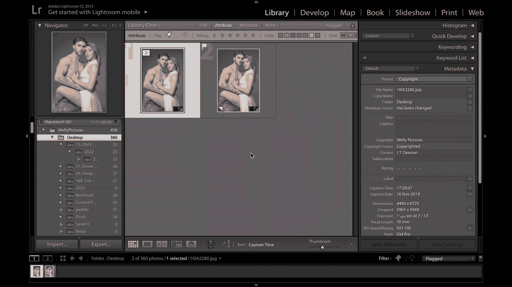

---

在正式开始之前，先了解一下批量编辑的基本逻辑。你可以把它看作一个简单的公式：

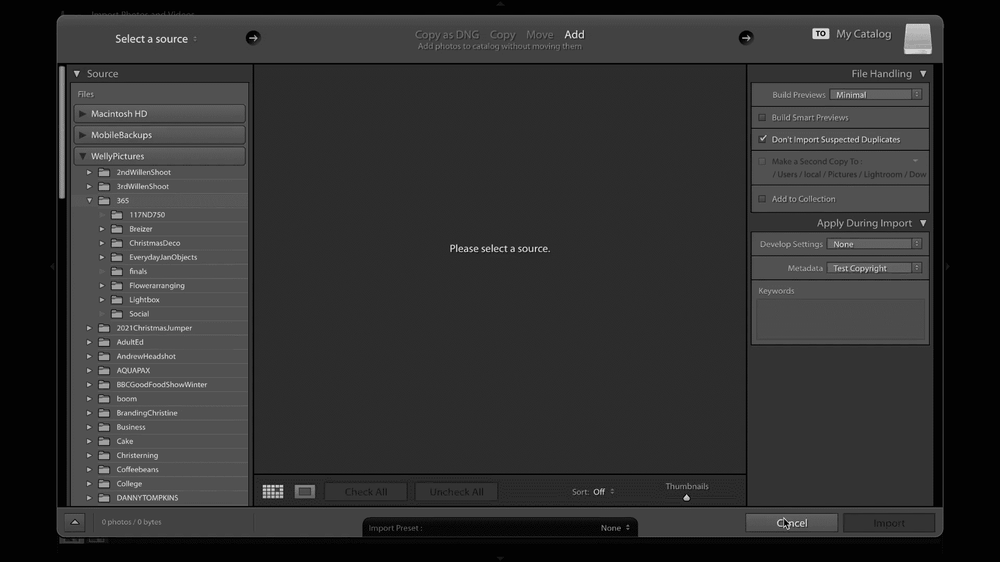

批量编辑结果 = 选中的图片集合 × 统一应用的预设或参数

换句话说，只要选中多张图片，并把同一套参数批量应用过去，就能快速完成重复性的编辑工作。下面我们先来看看如何在导入阶段就为图片做好准备。

---

## 第一阶段：在导入阶段整理与选择图片

进入 Lightroom 的资料库模块，点击导入按钮，就能打开导入界面。在这个界面里，有一个叫做“文件处理”的区域，其中有一个选项叫“不导入疑似重复的照片”，建议将其勾选，这样可以避免把重复的图片导入目录。

以下是导入界面中需要关注的关键选项：

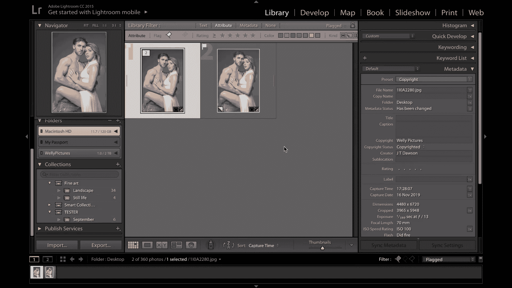

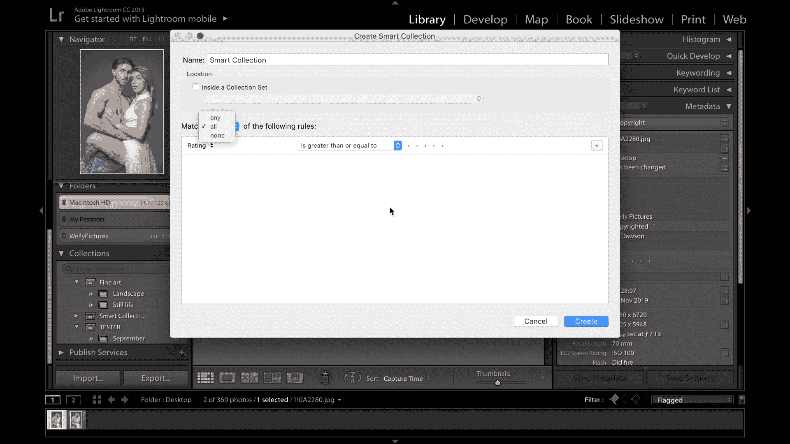

- 文件处理：用于决定如何读取和存放图片文件
- 不导入疑似重复的照片：防止重复图片进入库中
- 加入到集合：把导入的图片直接放入指定集合

除了文件处理，左侧面板里还有一个集合区域。集合可以帮你把照片按主题分类，比如美术系列、风景系列或静物系列。Lightroom 还会自动提供一个智能集合，你可以根据评分或标签自动筛选照片。如果你想更细致地管理，可以创建一个集合集，把多个集合放在同一个文件夹里。

集合集的层级关系可以用代码表示：

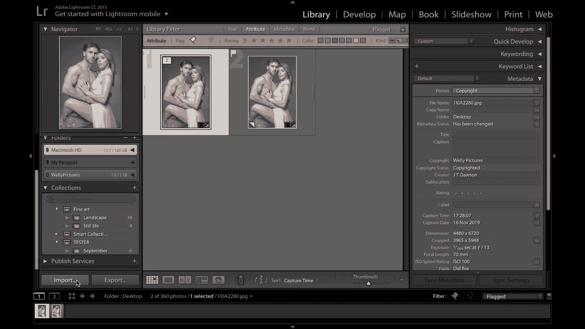

```text
集合集（顶层文件夹）
  └─ 普通集合（手动放入的照片）
  └─ 智能集合（根据规则自动聚合照片）
```

创建集合的方法很简单，点击加号按钮，输入名称即可。集合集是整体文件夹，普通集合和智能集合则是放在里面的子项目。即使你不提前建立集合，导入照片也不会受影响，但建立集合是一个保持图片井然有序的好习惯。

接下来，我们需要选择要导入的图片。在导入界面里，已经导入的图片会显示一个带白色方框的勾标记，而尚未导入的图片则显示为云朵图标。如果你打算一次性导入大量照片，可以直接全选；如果只想导入其中几张，可以取消全选，再手动勾选想要的图片。

选择多张相邻图片的操作如下：

1. 鼠标点击第一张图片
2. 按住 Shift 键，再点击最后一张图片
3. 中间的所有图片会被一次性选中
4. 统一勾选这些图片，准备导入

这样选好图片后，你就可以决定是否把它们直接放入某个集合，也可以暂时不处理，先进入下一步。

---

## 第二阶段：在导入过程中应用预设与元数据

导入界面中有一个非常重要的区域，叫做“导入期间应用”。这就是批量编辑的核心入口之一。这里主要包含三个部分：元数据、关键字和预设。

首先看元数据。元数据就是图片的背景信息，包括版权、摄影师姓名、图片是否为公开使用等。你可以使用已有的元数据预设，也可以新建一个。比如设置好版权信息后，所有即将导入的图片都会自动带上这些信息，不需要一张张手动添加。

元数据信息会被写入图片的 XMP 辅助文件中。XMP 文件相当于图片的背景档案，记录了所有编辑参数、元数据和关键字等额外信息。

其次是关键字。在 Lightroom CC 中，给图片添加关键字是一个很好的标记方式，方便日后快速检索。导入时批量添加关键字，意味着每张图片进库时就自带标签。

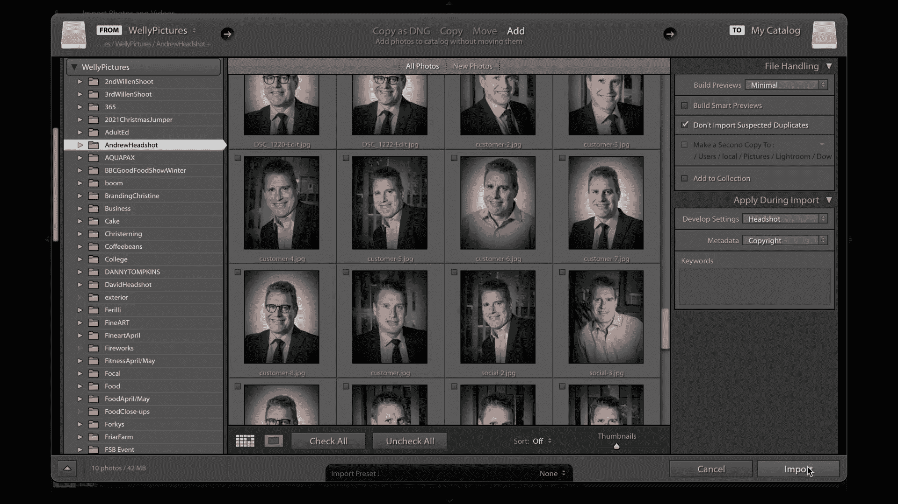

再来是预设。预设是一套预先保存的编辑参数，可以包含曝光、对比度、高光、阴影等基础调整。如果你之前已经制作过人像预设，就可以在这里选中它，让所有导入的人像照片直接套用该预设。

应用预设的逻辑可以简化为：

导入图片组 + 选中的开发预设 = 所有图片自动获得相同的基础编辑

设置好元数据、关键字和预设后，点击导入按钮。选中的图片就会被导入 Lightroom 目录，并且每张图片都已经带上了你设定的元数据和预设效果。

---

## 第三阶段：导入后在开发模块同步编辑

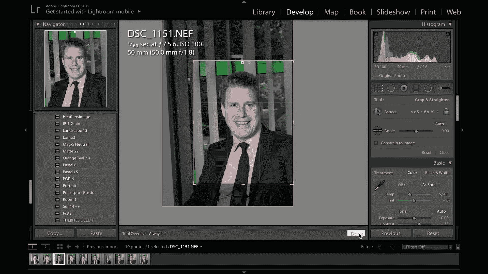

图片导入完成后，切换到开发模块。此时，所有刚刚导入的图片应该都拥有相同的预设设置。不过，不同图片的构图和光线可能仍有差异，比如有些已经裁剪过，有些还是原始 RAW 文件。

接下来我们要做的是进一步统一处理。假设你有一组人像照片，需要把裁剪比例调整为适合人像的尺寸，常见的有 8×10 或 4×5。

裁剪比例的选择可以用下面的代码片段理解：

适合人像的裁剪比例 = 8 × 10  或  4 × 5

对其中一张 RAW 图片进行裁剪后，如果想让其他 RAW 图片使用完全相同的裁剪，可以选中第一张图片，按住 Command（Mac）或 Control（Windows）键，再点击第二张 RAW 图片，形成多选状态。

多选图片后，点击“同步”按钮。同步功能不仅可以用于预设，也可以用于把一张图片的编辑结果应用到另一张图片上。即使你没有把编辑保存为预设，也可以先编辑好一张图，再把同样的效果同步到整个图库中。

在同步对话框中，如果你只想同步裁剪，可以先点击“全不选”，然后只勾选“裁剪”这一项。这样就不会把其他不需要的设置覆盖过去。

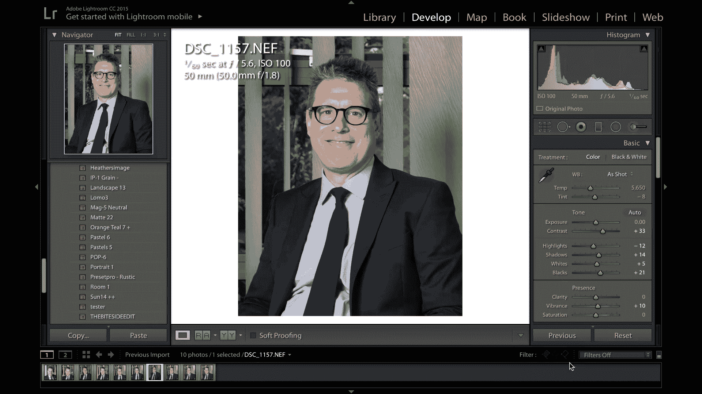

同步完成后，所有选中的图片都会被裁剪成相同的尺寸。你还可以对画面进行微调，比如移动裁剪框，让主体与背景的百叶窗对齐，或者把图片拉直，确保水平线正确。

至此，第一批图片已经完成了预设编辑和统一裁剪，整个过程耗时很短。

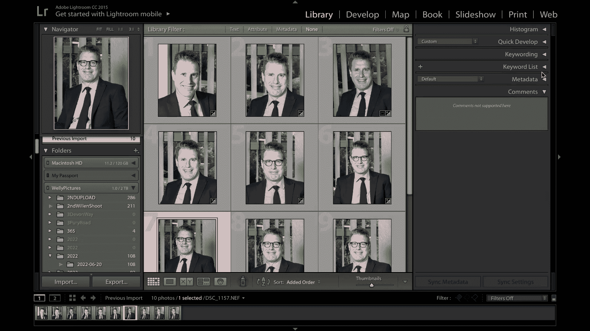

---

## 第四阶段：资料库模块快速开发批量处理

除了开发模块，Lightroom 的资料库模块也提供了一种不需要进入细节编辑界面就能批量处理的方法，这就是“快速开发”工具。

回到资料库模块，右侧面板包含直方图、相机信息、关键字和元数据预设等模块。你可以在这里为图片添加关键字，或者建立自己的关键字列表，方便后续筛选。

元数据预设同样可以在资料库模块中设置。如果导入时没有添加版权信息，可以在资料库模块里补上。选中多张图片，按住 Shift 进行多选，然后同步元数据，所有图片就会统一拥有相同的版权或作者信息。

以下是资料库模块中可以批量处理的内容：

- 关键字：为多张图片同时添加标签
- 元数据预设：批量写入版权和摄影师信息
- 快速开发面板：快速调整曝光、白平衡、色调等

快速开发面板里有一些有趣的控制方式。比如白平衡，如果是 RAW 文件，会显示多种白平衡预设；如果是其他格式，可以点击小箭头按钮来微调色温或色调。单个箭头代表微调一档，双箭头代表微调两档，类似于相机的曝光补偿概念。

色调控制部分也有类似的箭头设计。单个箭头代表调整三分之一档，双箭头代表调整一档。这和相机的包围曝光概念类似，你可以有意识地欠曝或过曝，然后通过这些按钮快速统一调整整组图片的亮度。

快速开发面板的调节逻辑可以表示为：

单个箭头 = 微调一档（1/3 档或 1 档，取决于项目）
双箭头 = 双倍档位（2 档或 1 档，取决于项目）

在快速开发面板里调整完参数后，如果选中了多张图片，可以点击同步按钮，把刚才的调整应用到所有选中图片上。需要注意，资料库模块的同步分为两类：一类是同步元数据，另一类是同步快速开发面板里修改的编辑设置。

---

## 第五阶段：两种批量编辑路径的总结对比

回顾刚才的演示，批量编辑在 Lightroom 中主要有两条路径。

第一条路径是在导入时就完成准备。你可以把图片导入集合，在导入期间应用元数据预设和开发预设，这样图片进库时就已经带有版权信息和基础编辑效果。导入后进入开发模块，还可以针对个别图片做微调，再通过同步功能把裁剪或其他设置应用到多张图片。

第二条路径是在导入后回到资料库模块。使用快速开发工具，你可以批量调整白平衡、色调、清晰度等参数，也可以批量添加元数据和关键字。当选中的图片数量增多时，利用同步设置功能，就能把编辑结果快速扩散到整组图片中。

两种路径的核心区别可以用下面的代码块概括：

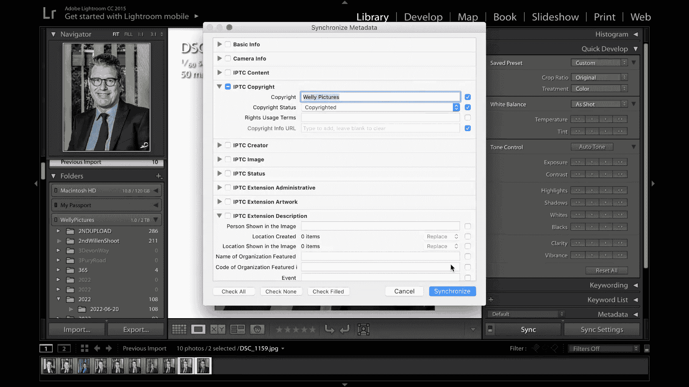

```text
路径一：导入期间应用预设 + 开发模块同步裁剪 = 基础编辑已完成
路径二：资料库快速开发 + 同步设置 = 无需进入开发模块即可批量处理
```

无论选择哪条路径，目标都是一样的：减少重复操作，让大量图片的编辑变得更快、更简单。

---

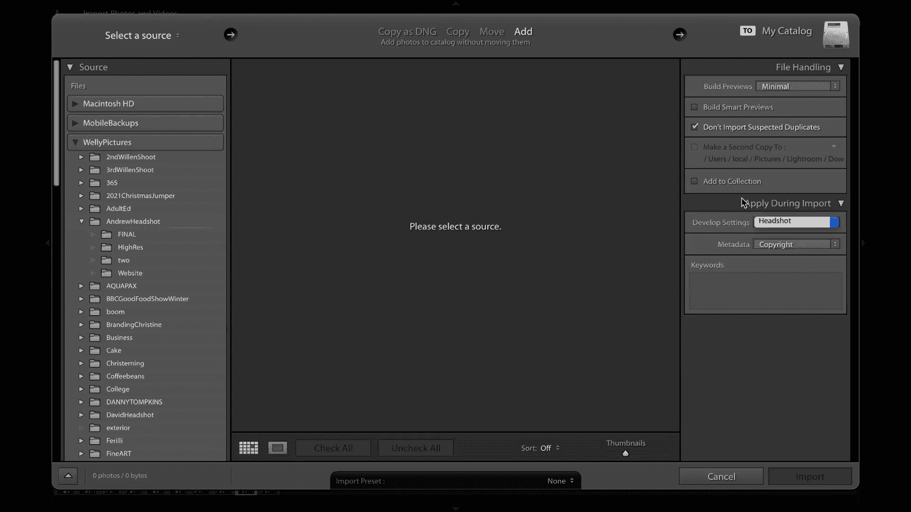

## 本节课总结

本节课中，我们一起学习了如何在 Adobe Lightroom 中使用批量编辑来加速工作流。我们先介绍了在导入阶段如何整理集合、选择图片，以及如何在导入期间应用元数据、关键字和开发预设。接着，我们演示了如何在开发模块中对多张图片同步裁剪和对齐设置。最后，我们探索了资料库模块的快速开发工具，学习了如何批量调整白平衡、色调，并同步元数据和编辑参数。

掌握这些方法后，无论是处理人像、风景还是其他类型的照片，你都可以一次性对多张图片应用相同的编辑，而不需要一张张重复调整。希望这节课的内容对你的 Lightroom 工作流有所帮助。
