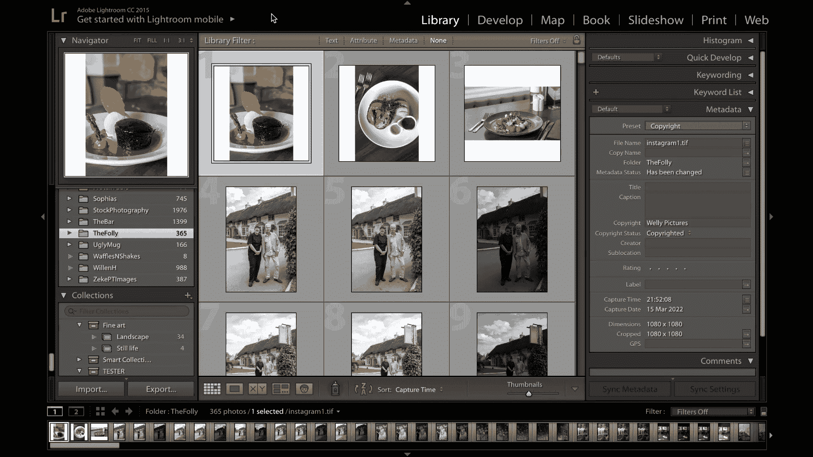
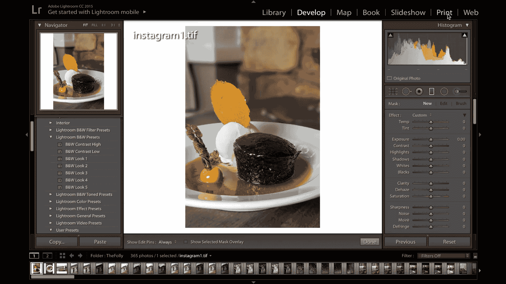
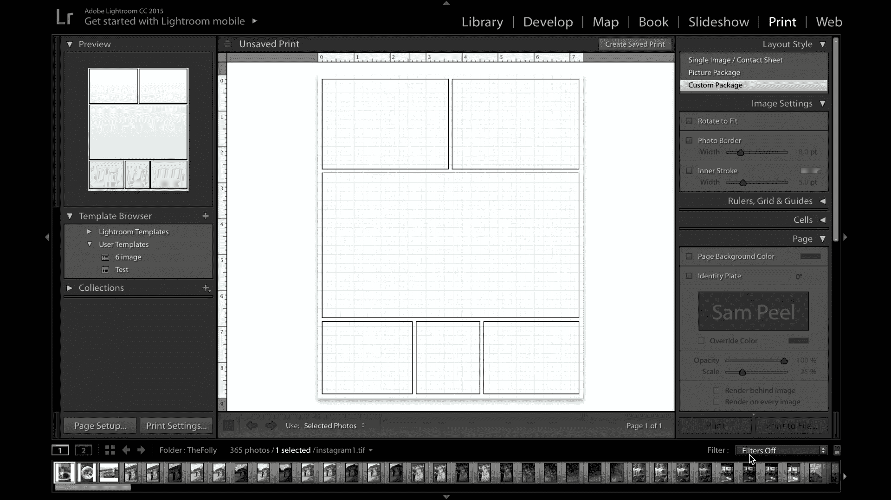

# Adobe Lightroom 精通课程：第23章：修饰与增强图片 🖼️


在本节课中，我们将一起学习 Adobe Lightroom 中修饰和增强图片的核心技巧。这部分内容适合已经了解基本操作、希望让照片看起来更专业的初学者。我们会从 Develop 模块的色彩调整开始，逐步过渡到照片合并、滤镜使用、细节修整、预设管理，最后介绍打印与拼贴画制作。每一个知识点都会用大白话讲解，确保你能听懂、看懂、学会。课程会尽量避免专业术语堆砌，多用生活化的例子帮助你理解每个滑块和面板的实际作用。


## Develop 模块与秋季色调调整 🍁


上一节我们简单介绍了本章的学习目标，本节中我们来看看 Develop 模块里的色彩调整。Develop 模块是 Lightroom 最核心的编辑区域，几乎所有关于光影和颜色的修改都在这里完成。接下来我们会尝试把一张普通照片改造成秋季场景，让画面整体带上温暖的橙黄色调，营造出金秋的氛围感。不需要复杂的美术功底，只需移动几个滑块就能看到明显变化，非常适合刚接触后期处理的朋友练手。


```
秋季色调 = 原始色温 + 暖色偏移 + 饱和度提升
```


以下是调整秋季色调的常用步骤：



- 调整白平衡，让画面偏暖
- 提高橙色和黄色的饱和度
- 适当降低蓝色色调
- 增加对比度，让层次更分明


## 照片合并技术与全景图制作 🌄


完成色彩调整之后，我们继续探索 Lightroom 中更有趣的合成功能，本节中我们来看看照片合并技术。有时候一张照片拍不下整个风景，这时候就需要把几张相邻的照片拼接成一张全景图。Lightroom 自带的照片合并工具可以帮你自动对齐和缝合图片，不需要额外安装 Photoshop 也能完成。这个功能特别适合拍摄大场景、建筑群或广阔草原的时候，能让你的照片视野更开阔。


```
全景图制作 = 选中多张重叠照片 → 照片合并 → 全景图输出
```


以下是制作全景图的基本流程：

- 在库模块中选中要拼接的照片
- 点击照片菜单，选择合并为全景图
- 等待 Lightroom 自动对齐与融合
- 裁剪边缘，保存最终图片


## 径向滤镜与摄影棚光效 💡


学会拼接全景图之后，我们回到单张照片的创意编辑，本节中我们来看看如何用径向滤镜模拟摄影棚光效。如果你想让照片里的模特看起来像是在摄影棚里被专业灯光打亮，可以使用径向滤镜。这种滤镜呈椭圆形，你可以把它放在人物周围，然后给选中的区域加上彩色光斑或提亮效果。这就好比在暗房里打开一盏柔光灯，让主体瞬间脱颖而出，背景保持较暗，产生明显的对比感。


```
摄影棚光效 = 径向滤罩 + 颜色叠加 + 曝光提升
```


以下是添加摄影棚光效的操作要点：

- 选择径向滤镜工具
- 在照片上画出椭圆区域
- 调整曝光和颜色滑块
- feather 边缘使光效自然过渡


## 降噪与锐化细节处理 🔍


除了添加光影效果，照片的细节品质也很重要，本节中我们来看看降噪和锐化的使用方法。在编辑照片时，我们常常会遇到画面不够干净或者边缘不够锐利的问题。高 ISO 拍摄容易产生噪点，而过度压缩会让细节变得模糊。降噪可以把画面中的杂色点清理掉，锐化则能让轮廓更加分明。这两个操作通常在后期处理的末尾一起使用，先降噪再锐化，效果会更好，画面也会更干净利落。


```
最终画质 = 原始图像 - 噪点 + 边缘锐化
```


以下是降噪与锐化的简单建议：

- 在详细面板中找到降噪滑块
- 适当提高亮度降噪，避免过度抹除细节
- 使用锐化滑块增强边缘对比
- 按 1:1 比例预览，检查是否出现伪影


## 渐变滤镜与日落照片天空处理 🌇


细节处理掌握之后，我们进入风景摄影常用的局部调整，本节中我们来看看渐变滤镜在日落照片中的应用。拍摄日落时，天空通常比地面亮很多，直接拍出来要么天空过曝发白，要么地面太黑看不清。这时候就可以用渐变滤镜，只对图片上半部分的天空进行调整，降低天空曝光、增加饱和度，同时保持地面的亮度不变。这样处理后的照片，天空色彩更丰富，整体画面也更加平衡，非常适合发布到社交平台。


```
天空曝光 = 原始曝光 × 渐变遮罩强度
```


以下是处理日落天空的步骤：

- 选择渐变滤镜工具
- 从天空向下拉出渐变区域
- 降低高光和曝光数值
- 提高天空的饱和度与对比度


## 基础编辑：褪色效果与柔和粉彩效果 🎨


掌握局部调整之后，我们回到基础面板，看看如何营造特殊的电影感色调，本节中我们来看看褪色效果和柔和粉彩效果。有时候我们不需要照片色彩非常浓烈，反而希望它看起来像旧胶片一样有点褪色，或者像粉彩画一样柔和梦幻。这两种效果都可以通过基础面板里的简单滑块实现，不需要安装额外的插件。只要稍微降低对比度，把黑色阶调抬高，再配合一点色调分离，就能快速出片，给照片加上独特的情绪。


```
褪色效果 = 降低对比度 + 提升黑色点 + 调整色相
粉彩效果 = 降低饱和度 + 提高亮度 + 添加淡色调
```


以下是制作这两种效果的常用设置：

褪色效果：

- 对比度调低
- 黑色点向右拖动
- 阴影部分稍微提亮

粉彩效果：

- 整体饱和度降低
- 曝光和高光适当提升
- 添加浅粉色或浅蓝色色调


## 预设选项与黑白预设及 Lightroom 网页版 📱


学会手动调色之后，我们可以把常用设置保存成预设，下次直接套用，本节中我们来看看预设选项和黑白预设，并了解 Lightroom 网页版的使用方法。Lightroom 里的预设就像是一键美颜的滤镜包，你可以保存自己调好的参数，以后拍类似照片时直接点一下就套用。其中黑白预设特别经典，适合想要拍出文艺复古风格的照片。此外，如果你不想一直打开电脑版 Lightroom，也可以用网页版在浏览器里完成部分编辑，非常方便，适合随时随地修图。


```
黑白预设 = 彩色图像 → 单色转换 → 基础微调
```


以下是使用预设和网页版的注意事项：

- 在预设面板中选择黑白分类
- 套用预设后仍可手动调整基础参数
- 登录 Adobe 账号即可使用 Lightroom 网页版
- 网页版功能不如桌面版完整，适合快速修图


## 打印模块与拼贴画制作 🖨️


后期编辑基本全部介绍完毕，最后我们来看看如何把照片输出成实体或分享图片，本节中我们来看看打印模块和拼贴画制作。修图完成后，很多朋友会想把照片打印出来挂在墙上，或者拼成一张长图发到社交媒体。Lightroom 的打印模块提供了多种模板，你可以自定义布局，把几张喜欢的照片拼在一起，最后保存为 JPEG 格式。这样既方便上传到网站，也方便拿去照相馆打印实体相片，作品展示更灵活。


```
拼贴画 = 多张图片 + 模板布局 → 导出为 JPEG
```


以下是制作拼贴画的简单流程：



- 进入打印模块
- 选择拼贴画模板
- 把照片拖放到对应位置
- 调整边框和间距
- 导出为 JPEG 图片




本节课中，我们一起学习了 Adobe Lightroom 修饰与增强图片的多个实用模块。内容包括 Develop 模块的秋季色调调整、照片合并与全景图制作、径向滤镜的摄影棚光效、降噪与锐化细节处理、渐变滤镜的天空调整、褪色与粉彩效果设置、黑白预设与网页版使用，以及打印模块的拼贴画制作。希望这些内容能帮助你从初学者逐步成长为能够独立完成后期编辑的高手，在实际拍摄中灵活运用这些技巧，让照片效果更上一层楼。
