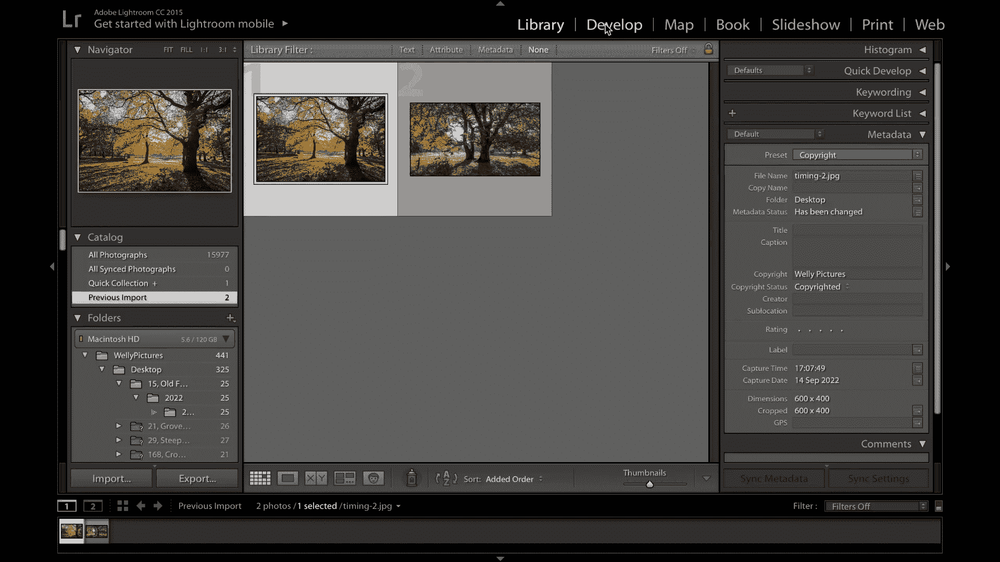
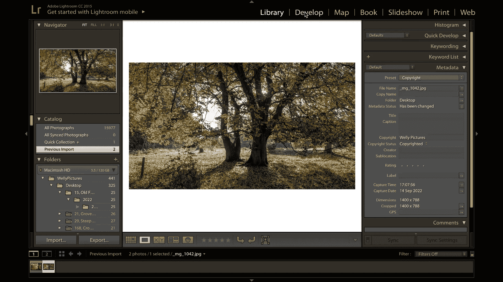
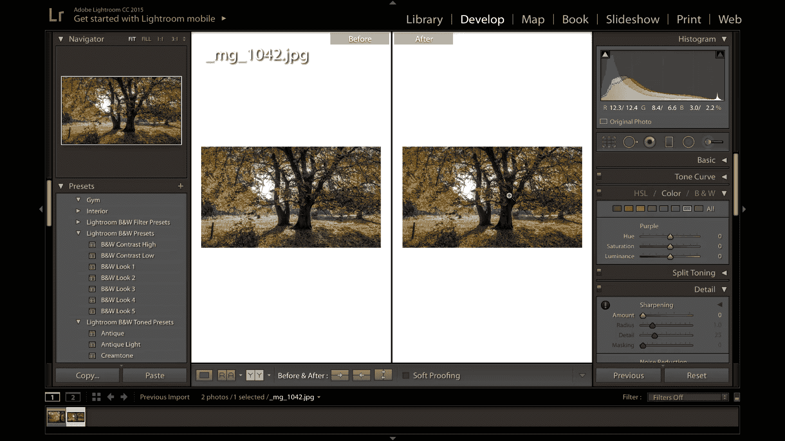

# 完整Adobe Lightroom大课程：从初学者到专家照片编辑part2：p24 119：在秋季场景中改变颜色 🍂

## 开篇概述

在本节课中，我们将学习Adobe Lightroom高级课程的第三部分，也就是图片修饰与增强。本部分会提供一些技巧、建议和方法，帮助你增强任意一组照片。简单来说，接下来的内容会围绕秋季场景展开，讲解如何提升画面中的色彩表现。如果你喜欢风景摄影，还会学到如何利用Lightroom创作出震撼的全景照片。除此之外，我们还会接触凝胶工作室灯光摄影，并讲解如何在Lightroom中使用蒙版。在处理弱光照片时，锐化和降噪也是重要环节，我们会一起学习如何在弱光图像中正确使用这些工具。此外，还会再次尝试预设，打造褪色效果或柔和的粉彩风格。回到风景摄影，会演示添加日落照片的流程。最后，会讲解Lightroom中的LUT，以及在Lightroom Classic中制作属于你自己的拼贴画。以上就是本部分“修饰与增强图片”中将要包含的全部内容。

好了，下面进入本节的第一个具体技巧，也就是如何在秋季场景中改变颜色。

### 第一部分：秋季场景的颜色特点

绝大多数情况下，无论身处世界哪个角落，当秋天来临时，森林或自然场景原本迷人的绿色会转变为树叶呈现的橙黄色，甚至可能是更偏红的颜色，整体画面开始带点棕色感。不过这种效果并非负面，有时恰恰能让照片看起来非常出色。我个人拍摄秋季照片时，会刻意挑选天空非常湛蓝的时候，这样能在橙黄色树叶和蓝天之间形成对比。当然，你也可能追求更具戏剧感的画面，比如雾蒙蒙的天空，拍摄几张这类照片。我即将演示的效果在这类图片上同样有效，甚至可能让效果更好，因为雾气与树叶和自然环境的色彩相结合，会产生独特的氛围。下面我们来看具体操作，我手头有两张示例照片。

这两张照片都是森林场景，不过略有不同。一张已经有较多橙色，另一张则是绿色和橙色的混合。我选择后者来演示这个技巧，因为它包含了多种不同颜色，更适合展示效果。



### 第二部分：导入图片并进入开发模块

将图片导入Lightroom后，进入“开发”模块。目前我处于“资料库”模块，现在切换到“开发”模块。这里我要介绍一个非常简单的尝试方法。基本思路是：不要直接去调整“基本”面板里的参数。当然，如果你想增强颜色，可以提高“自然饱和度”，这是一种做法。但这样做会对整张图片生效，画面所有部分都会增加饱和度和色彩。在某些情况下，你可能并不想这样，而是希望更有选择性地调整。因此，我会最小化“基本”面板，转而使用“HSL颜色和黑白”面板。我喜欢在这里尝试调整。虽然我将其作为秋季风景图像的技巧来介绍，但这类方法并不局限于某种摄影类型，你可以用在人像、风景或城市场景等任何照片上，因为核心思路就是利用颜色来进行针对性调整。

下面详细说明HSL面板的三个核心参数。



### 第三部分：HSL颜色和黑白面板的核心参数

以下是HSL面板包含的三个核心参数：

```text
HSL 核心参数
├── Hue（色相）：改变颜色的色调，例如将红色向橙色偏移
├── Saturation（饱和度）：增强或减弱特定颜色的强度
└── Luminance（亮度）：调整特定颜色的明暗程度
```

使用HSL面板，你可以先识别出画面中的关键颜色，然后分别对它们进行处理。比如降低饱和度，就能减去相当多的红色；反之，提高饱和度，红色就会被加回来。即使只是简单操作，也能看到照片出现细微的变化，这就是一种颜色增强的方式。所谓颜色增强，其实就是想着“我要把某个颜色改成另一种颜色”。在HSL面板里，除了饱和度，还有色相选项。色相的作用是改变某个色调，比如把红色变成橙色，这样一来，画面中所有接近这个色调的颜色都会开始偏向橙色。不过照片里依然有红色，只是你改变了红色的基调，让它从鲜红变成更偏橙的颜色，这就是另一种选择和修改颜色的方法。

亮度选项的作用和饱和度类似。就像“基本”面板里的自然饱和度一样，降低亮度会让红色消失，提高亮度则会让红色变多一些。不过我不怎么用亮度，也不常直接使用HSL标签页来做选择性颜色技巧，只是想把这些选项都展示给你，因为它们也是可用的方法，能起到类似作用。

接下来我进入“色彩”面板，那里同样拥有色相、饱和度和亮度三个选项，只不过是按照完整颜色分组显示的。这样一来，你就可以明确说，我要处理画面里的红色，希望它更偏橙色而非偏紫红，或者想要改变饱和度，完全把红色去掉，或者增强图片中红色的强度。我个人觉得，通过顶部的不同标签页逐个调整，能让我对颜色有更多控制感。

### 第四部分：实际调整红色

本张图是秋季照片，我将专注于红、橙、黄这三种关键色调，因为它们是画面中最主要的颜色。下面先来看红色。当前我不打算改变红色本身，只想增强它。我将饱和度提升到约50。对比前后，差异不算特别明显，但可以看出叶子中红色部分变强了。

为了让大家更清楚地看到变化，我放大了画面，这样在调整颜色时，前后对比的区别会更明显。我只是玩弄一下颜色，就能给图片增加一些东西。

提高饱和度后，效果并不算特别成功，所以接下来我要玩弄色相。目前色相看起来像偏橙的红色，我要把它调得更红一些，让画面中的红色更纯正。这样再处理橙色时，橙色调就能保持独立，不会和红色混在一起。我觉得把色相移到合适位置，红色区域就会变得明显。虽然不算很明显，但叶子中的红色部分确实变强了。让我们回到1比1的比例观看。如果需要，我也可以玩弄一下亮度，稍微加一点，但我并不常用，所以这里不会大量使用亮度。

以下是红色的调整参数示例：

```text
红色调整示例
├── 饱和度（Saturation）：约 +50
├── 色相（Hue）：偏向纯红，约 +3
└── 亮度（Luminance）：保持默认或微调
```

### 第五部分：实际调整橙色

红色处理完毕，接下来调整橙色。我要再次增强橙色，饱和度可能提到约75。此时能看到橙色重新出现。橙色本质是黄色和红色的混合，目前偏浅，我想把它调深一点。一调整就能立刻看到效果，红色也会随之显现，可能看起来很好看，但我不想过度处理，所以把数值降到约20到30之间，保持自然，但让颜色更突出。

现在我使用了红色，通过色相让红色变得纯正，并只提高了红色的饱和度。由于红、橙、黄在色轮上相互邻近，调整橙色的色相会让橙色中带出更多红色，从而进一步增强画面中的红色感，让整体看起来更红。

以下是橙色的调整参数示例：

```text
橙色调整示例
├── 饱和度（Saturation）：约 +75，随后降至 +20 至 +30
├── 亮度（Luminance）：调低，使橙色更深
└── 效果：增强红色在橙色中的体现
```

### 第六部分：实际调整黄色

橙色完成后，来看看黄色。黄色目前从橙黄过渡到黄色，再到黄绿色。我不想让它偏绿，希望呈现漂亮的黄色。我将色相向目标方向移动约30，然后把饱和度设为50。此时可以看到橙色和黄色开始融合，图片原本只是普通的木质色调，现在逐渐呈现出秋季感觉，仅仅是通过改变色调就实现了。

以下是黄色的调整参数示例：

```text
黄色调整示例
├── 色相（Hue）：约 +30，避免偏绿
├── 饱和度（Saturation）：+50
└── 效果：橙色与黄色融合，增强秋季氛围
```

### 第七部分：色彩理论与冷色调增强

除了单独调整暖色，了解色彩理论对任何摄影类型都很有帮助。我知道橙色的互补色是紫色。虽然这张图里紫色不多，但看紫色旁边的蓝色，我们就接近了这种关系。另外，蓝色是黄色的互补色。所以增强蓝色可能会让画面更有张力，虽然不一定非要让颜色更突出，但尝试一下也没坏处。我打算增强蓝色区域，让它变得更偏紫蓝。

不过这并不是说只有画面中的某一部分蓝色发生了变化，可以看到整体稍微变深了一点。接下来尝试增强紫色，看看能否带出一些紫色效果。但这张图里紫色并不多，调整后效果不明显，所以我把紫色数值重新设回0。

以下是色彩理论中的互补色关系：

```text
互补色关系
├── 橙色 ↔ 紫色
└── 黄色 ↔ 蓝色
```

现在画面呈现出不错的红、黄、橙色调，开始带点棕色感，这正是我们要打造的秋季风格风景画面。



### 第八部分：最终效果与后续微调

关于颜色增强，我暂时不再继续调整，因为感觉已经展示了如何使用这个功能。如果要进一步修改这张图，我会尝试把某些区域调暗一点，避免颜色过于强烈，同时提亮一些阴影部分，并适当增加清晰度，不过清晰度不宜过高，甚至可以加点对比度。这样就能得到一张拥有秋季色调的漂亮照片，与原始照片相比，原始照片本身也很漂亮，但这就是通过简单调整颜色所能达到的效果。

显然，如果是在秋季拍摄的照片，或者想要突出秋季色彩的照片，都可以用这个方法。就像我之前说的，你可以在任何照片中选择想要增强的颜色来优化画面。

## 课程总结

本节课中，我们一起学习了Lightroom“修饰与增强图片”部分的概述，以及如何在秋季场景中通过HSL面板改变颜色。具体掌握了红、橙、黄三种颜色的色相、饱和度和亮度调整方法，了解了橙色与紫色、黄色与蓝色的互补色关系，并学会了在不破坏整体自然感的前提下，有选择性地增强秋季色调，让照片呈现出更浓郁的秋季风格。

