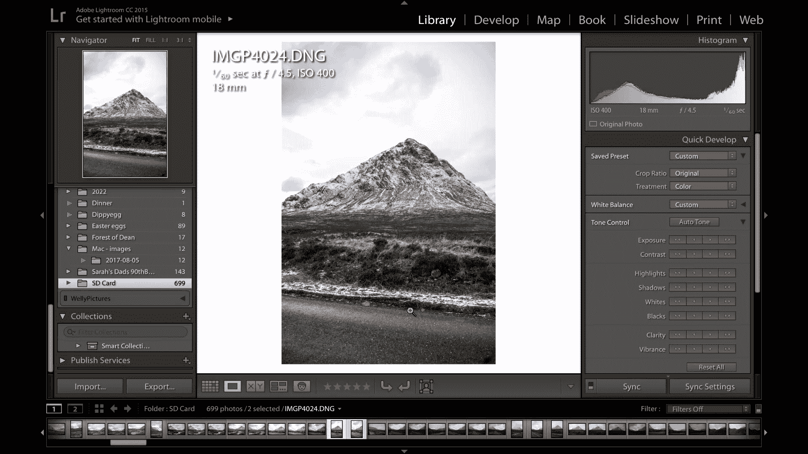
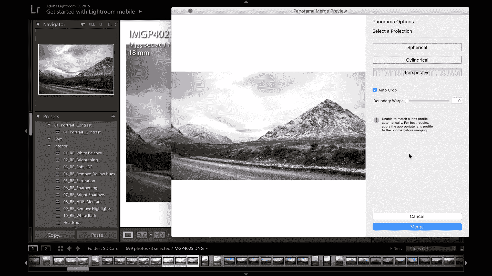
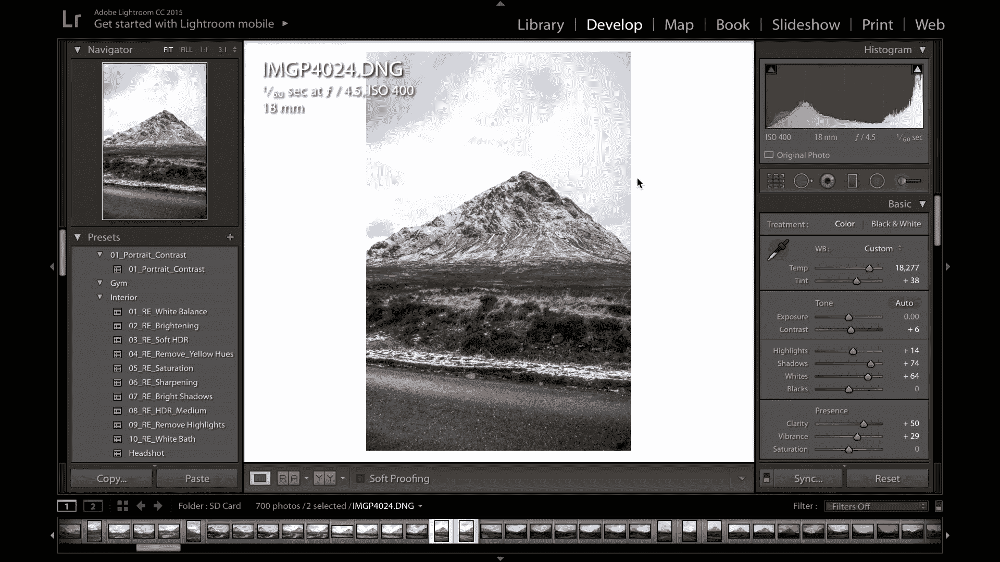
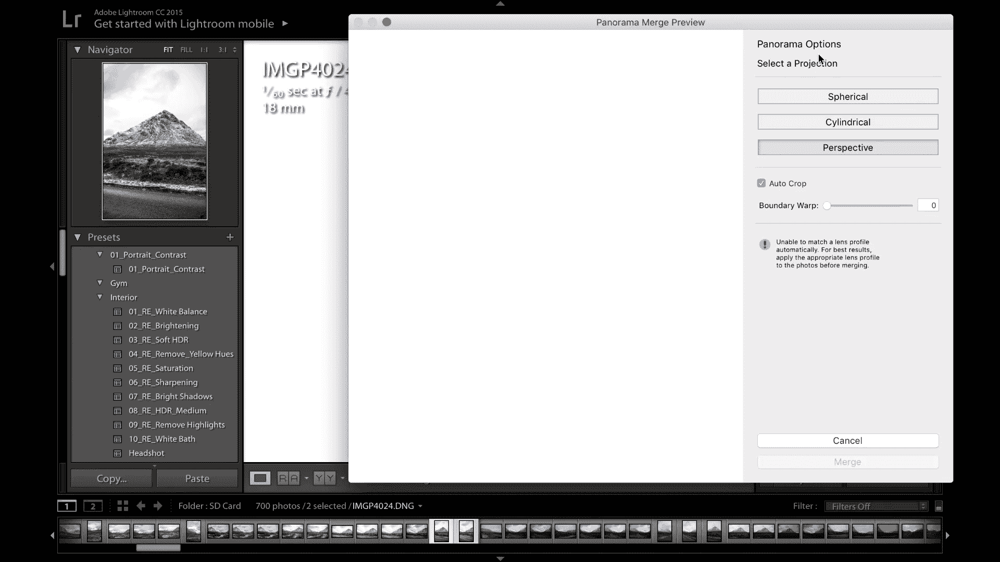
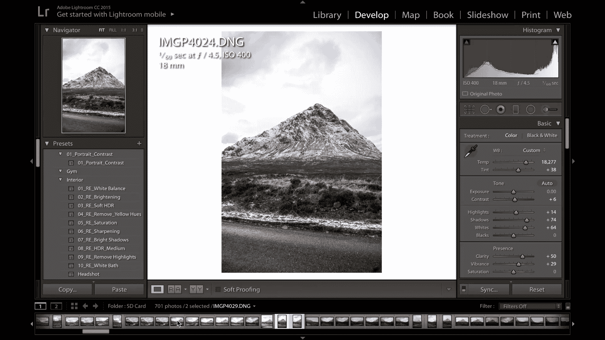
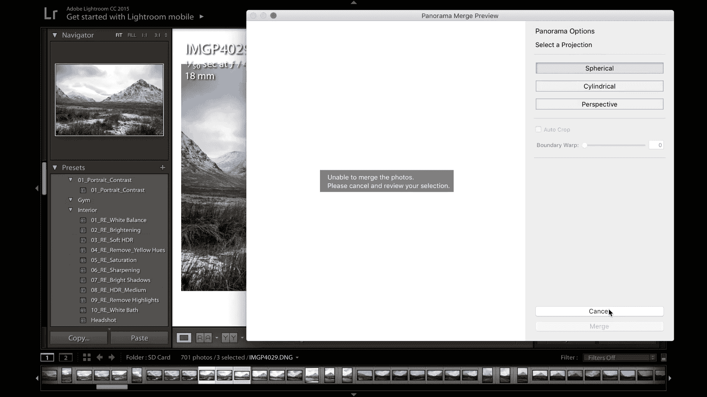

# Adobe Lightroom 照片编辑从入门到精通：第 25 章：创建震撼全景图 🏞️


在本节课中我们将要学习如何使用 Adobe Lightroom 制作全景图。全景图是指将多张照片拼接在一起，形成一张视野更广、画面更长的图像。无论你是拍摄风景照还是建筑照，掌握全景合并技巧都能让你的作品更具冲击力。本节内容适合零基础初学者，我们会用大白话把每一个步骤讲清楚，确保你学会之后可以独立操作。




首先，我们来看看制作全景图最基本的前提条件是什么。

你不能只用一张照片就做出全景图。全景图的核心思想是把多张照片拼接成一张延伸的画面。通常来说，你至少需要三张照片，最多建议六张，这样能保证拼接出的场景足够完整。当然，Lightroom 对照片数量没有严格上限，你可以根据需要使用更多张图片。你拍摄的照片可以是横向构图，也可以是纵向构图，关键在于数量必须多于一张。

图像数量公式：

```text
图像数量 N：3 ≤ N ≤ 6（推荐范围）
最少数量：N > 1
```


上一节我们介绍了全景图所需的照片数量，本节中我们来看看如何在 Lightroom 中选择照片并启动合并流程。

进入 Lightroom 后，按住 Shift 键可以同时选中多张照片。演示时我们只选三张，因为这样足以让你理解整个流程。选好图片之后，点击顶部菜单中的“照片”，然后选择“照片合并”，接着点击“全景”。这时 Lightroom 就会开始处理你的图片，并弹出全景合并预览窗口。

以下是操作步骤：

1. 按住 Shift 键选中多张照片。
2. 点击“照片”菜单。
3. 选择“照片合并” > “全景”。


上一节我们介绍了如何打开全景合并窗口，本节中我们来看看窗口里出现的三种投影模式分别适用于什么场景。

在全景合并界面里，你会看到三个选项，分别是球面、圆柱和透视。这三种模式决定了 Lightroom 如何把多张图片映射到同一张画面上。

球面模式：适合地平线呈弧形的全景图。当你拍摄时身体有旋转，画面会形成更宽的视野，但映射出来的图像会带有一定的弯曲感。



圆柱模式：主要参考画面中的垂直线进行拼接。如果你的照片里有很多竖直线条，并且需要把它们对齐，这个选项非常有用。

透视模式：这是默认选项，适用于大多数常规全景拼接场景。

投影模式代码：

```text
投影模式 = {球面, 圆柱, 透视}
```




上一节我们介绍了三种投影模式，本节中我们来看看拍摄时最容易被忽略的一个细节，即照片之间的重叠部分。

Lightroom 能够把多张照片拼在一起，前提是相邻的两张照片必须有重叠区域。具体来说，第二张照片里应该保留第一张照片至少四分之一，甚至一半的内容。如果没有重叠，软件就无法找到拼接点，合并就会失败。所以在拍摄全景源图时，请务必让每张照片和下一张照片有重叠。



重叠比例公式：

```text
重叠比例 ≥ 1/4（建议达到 1/2）
```




上一节我们介绍了照片重叠的重要性，本节中我们来看看合并窗口里的两个裁剪相关选项：自动裁剪和边界变形。

自动裁剪的作用是去掉画面边缘不整齐的部分，让最终图像成为规则的矩形。边界变形则是在不裁剪的情况下，通过拉伸画面来填满矩形边界。这两个功能通常二选一即可，不需要同时开启。如果你不想使用这两个选项，也可以把它们都关掉，把边界变形设为零，自动裁剪取消勾选，然后合并完成后，手动使用右侧的裁剪工具进行调整。



裁剪策略代码：

```text
自动裁剪 = 勾选 或 不勾选
边界变形 = 0 到 100（数值越大变形越明显）
策略：自动裁剪 XOR 边界变形
```


上一节我们介绍了自动裁剪与边界变形，本节中我们来看看合并完成后生成的文件是什么格式。

当你点击“合并”按钮后，Lightroom 会生成一张新的全景图片。这张图片不是原始 Raw 文件，而是一个用于后期编辑的 DNG 文件。在文件名末尾，Lightroom 会自动添加“PANO.DNG”作为后缀，这样你一眼就能认出这是全景图。这个 DNG 文件可以在 Lightroom 或 Photoshop 中继续编辑。


上一节我们介绍了合并后的文件格式，本节中我们来看看如果照片没有对齐好，Lightroom 会怎么提示。

并不是所有图片组合都能成功合成全景图。如果 Lightroom 发现选中的照片之间没有足够的重叠，或者内容完全无法对齐，它会弹出提示说“无法合并你的照片”，并要求你取消并重新检查选择。这时候无论你切换哪种投影模式，都无法完成合并。唯一的办法是重新拍摄，或者选择更合适的照片组合。


上一节我们介绍了合并失败的原因，本节中我们来看看合并后如何给全景图裁剪比例。

全景图通常是一张又长又宽的图片。在 Lightroom 的裁剪工具里，你可以使用自定义设置，选择常见的全景比例，比如 16 比 9 或 16 比 10。其中 16 比 9 是 Instagram 和 Facebook 等社交媒体平台常用的尺寸，如果你打算分享到网上，这个比例非常合适。

裁剪比例代码：

```text
裁剪比例选项：
- 16:9（适合社交媒体分享）
- 16:10（略高于 16:9）
```


上一节我们介绍了裁剪比例，本节中我们来看看如何对合并好的全景图进行简单的后期调整。

合并完成后，你可以像处理普通照片一样对全景图进行编辑。例如把画面调成黑白风格，适当降低对比度，让高原山丘的氛围更显突出。你也可以使用渐变滤镜重新拉回天空的细节，然后调暗高光，增加清晰度，突出云层的质感。如果滤镜影响到了不需要的区域，比如草地部分，可以切换到画笔工具，选择橡皮擦模式，把多余区域擦除掉，只保留天空和雪山部分受到滤镜影响。调整完成后，对比修改前后的效果，你会发现画面更有层次感。

以下是常用调整项目：

- 曝光度
- 对比度
- 高光
- 清晰度
- 饱和度与自然饱和度


本节课中我们一起学习了如何在 Adobe Lightroom 中创建全景图。我们了解了至少需要三张照片、照片之间必须有重叠、三种投影模式的选择、自动裁剪与边界变形的区别、合并后生成 PANO.DNG 文件、常见裁剪比例以及简单的后期调整方法。希望这些内容能帮助你掌握全景合并流程，拍出更震撼的作品。

