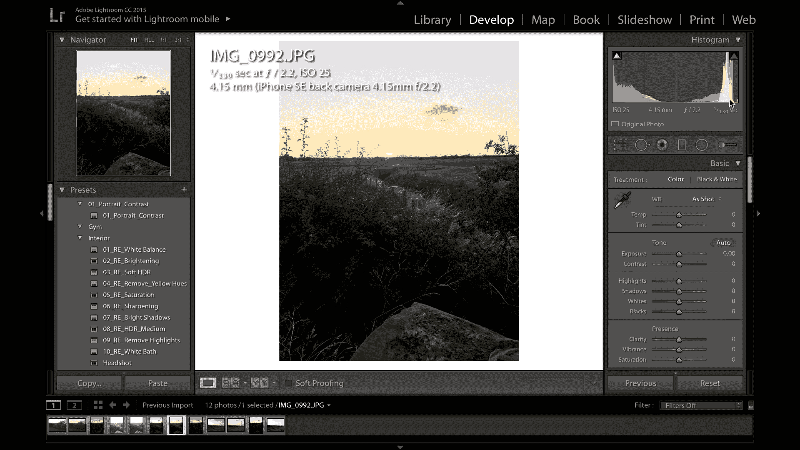
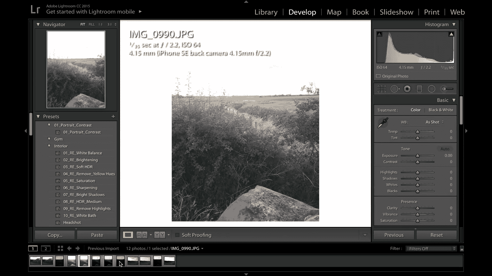
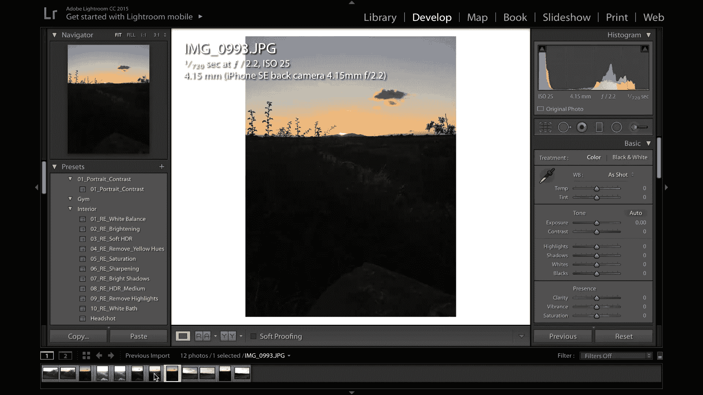
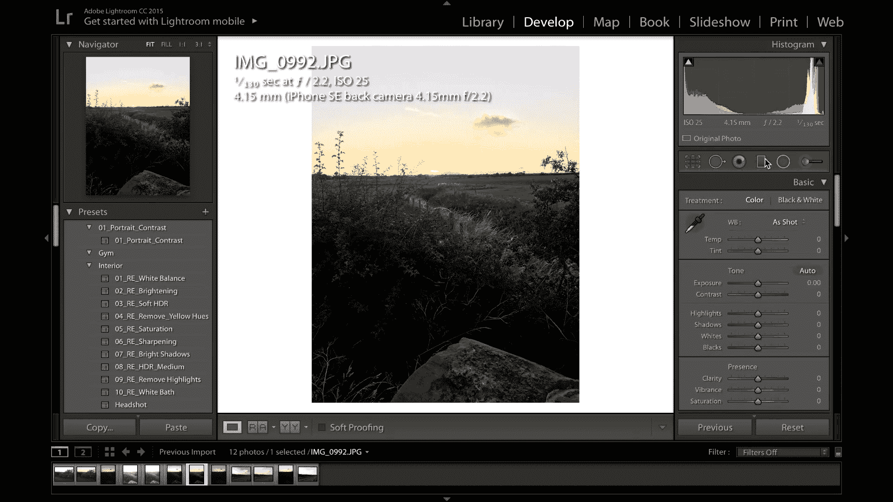
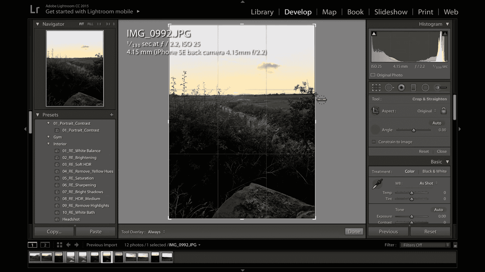
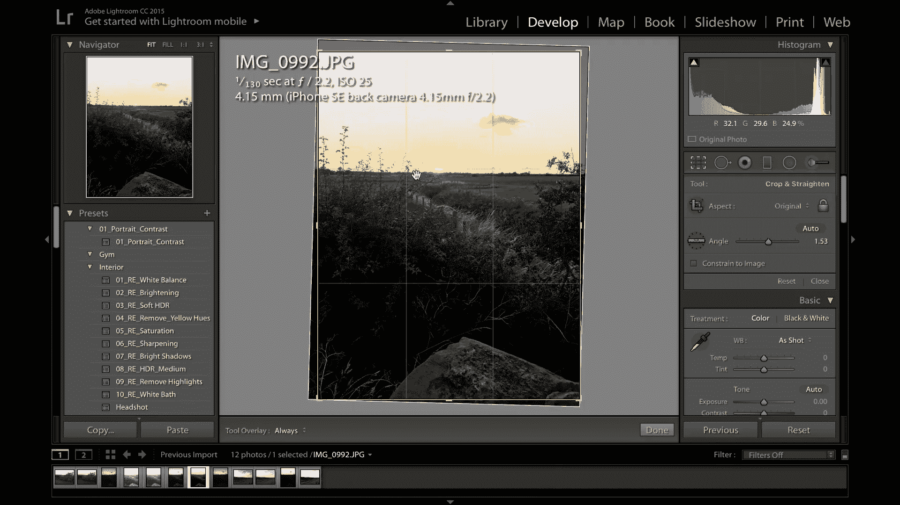
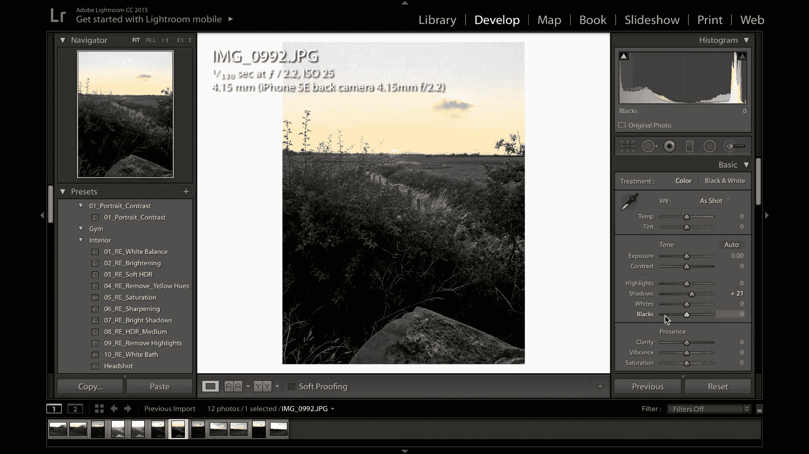
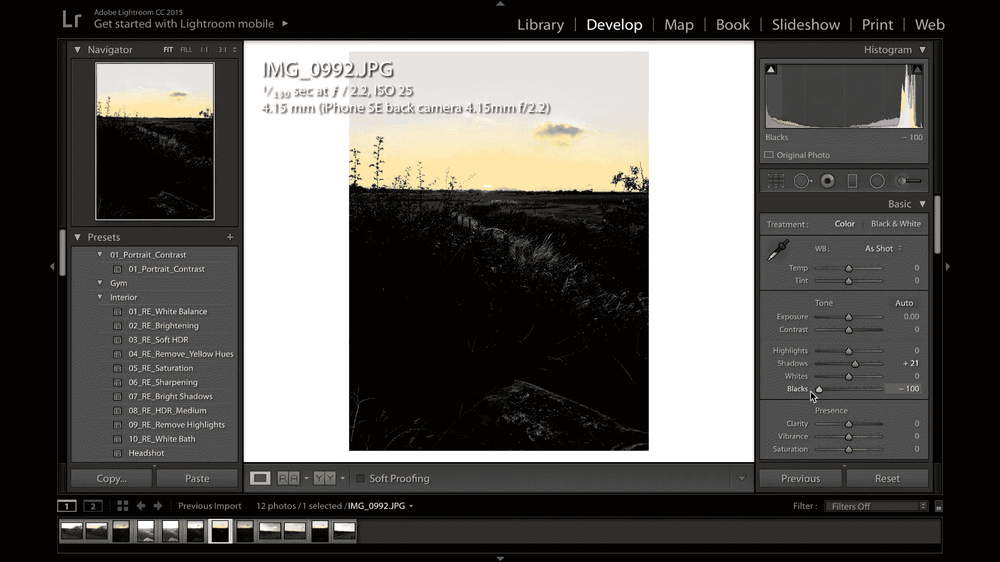
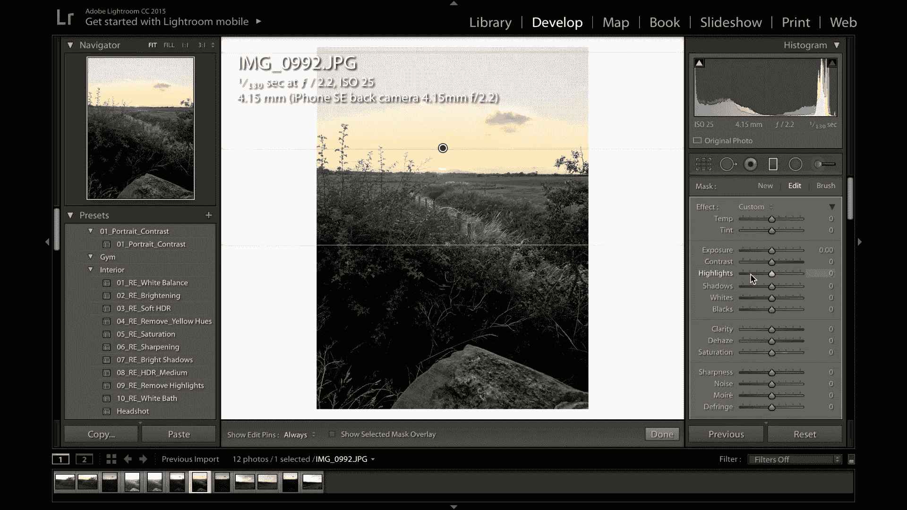
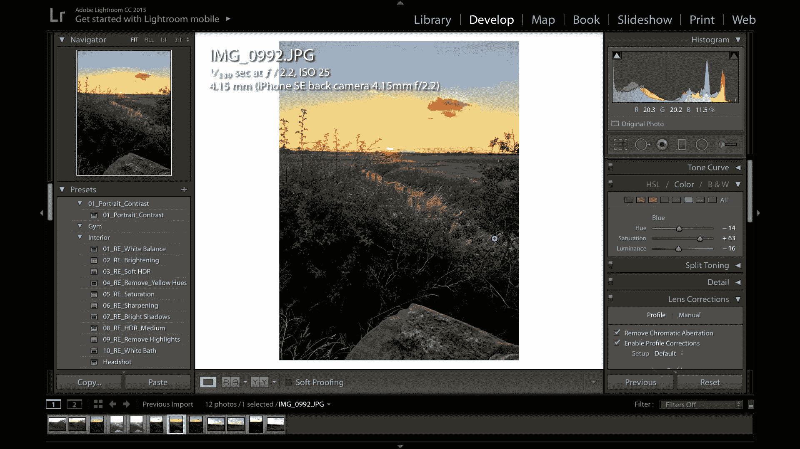

# Complete Adobe Lightroom Megacourse：Beginner to Expert Photo Editing part2 p26：121 Process on Editing a Sunset Photo 🌅




在本节课中我们将要学习如何使用 Adobe Lightroom 处理一张日落风景照片。讲师会演示自己拍摄日落风景时的完整编辑流程，包括如何对照片进行镜头修正、裁剪校正、基础光影调整、渐变滤镜处理以及颜色增强。无论你是刚开始学习后期的新手，还是希望让日落照片看起来更出色的摄影爱好者，本节课都会用大白话把每一步操作讲清楚，帮助你理解为什么要这么调，以及怎么调才能让照片既好看又自然。






关于多张曝光与 HDR 合成


拍摄日落风景时，天空通常很亮，而地面往往很暗，单张照片很难同时保留两边的细节。为了解决这个问题，讲师倾向于拍摄多张不同曝光的图片，然后把它们合成一张 HDR 照片。



以下是 HDR 合成的核心思路：



- 拍摄一张正常曝光的照片，保留画面中的中间色调。
- 拍摄一张曝光较低的照片，专门保留天空亮部的细节。
- 拍摄一张曝光较高的照片，专门保留地面暗部的细节。
- 把这三张不同曝光的图片合并在一起，得到一张暗部和亮部都有清晰细节的 HDR 图片。



公式可以这样表示：

```
HDR 合成 = 低曝光图片 + 正常曝光图片 + 高曝光图片
```

如果你还没有掌握多张曝光拍摄和合成的流程，也完全不用担心。本节课会展示如何只用一张日落照片，在 Lightroom 里把夕阳的色彩和光影重新找回来。需要注意的是，日落拍摄时光线往往很暗，对焦可能比较困难，而且太阳落山速度很快，所以拍摄这些照片需要动作迅速。


镜头修正与裁剪校正






在进入具体的色彩和光影调整之前，先要确保图片的基础几何没有问题。日落风景照经常会出现边缘轻微弯曲的情况，这时候需要先做镜头修正，再处理裁剪和构图。

以下是具体的操作步骤：

1. 打开 Lightroom 的镜头修正面板，启用镜头修正功能，自动移除画面边缘的畸变。
2. 检查四周边缘是否有向上或向下弯曲的现象，确认没有问题后继续。
3. 切换到裁剪工具，使用角度工具对图片进行旋转校正。

对于任何一张风景照片，最重要的一条原则是地平线必须保持水平。这个逻辑可以用简单的代码来理解：

```
如果 地平线 != 水平线：
    使用角度工具进行旋转校正
否则：
    保持当前角度不变
```

讲师会把地平线调整得完全水平，确保它贯穿整个画面。完成裁剪后，点击完成按钮，然后进入后续的光影调整阶段。


基础光影调整


构图确定之后，我们先在基础面板中处理光影，把照片整体的明暗关系先理顺。



以下是调整阴影的步骤：

- 先拉高阴影数值，让画面中较暗的绿色区域变得明亮。
- 观察画面效果，避免把阴影调得过高导致不自然。
- 讲师在演示中先尝试了 48，后来觉得太亮，最终将数值调整到大约 20。
- 这样既能让暗部显露出细节，又不会让原本就是阴影的区域显得过于发白。

除了阴影，还需要调整黑色和白色。这里有一个容易混淆的点：

- 如果把黑色滑块向左拖动（即负值），会把黑色调色再次拉出来，让暗部变得更暗，这不是我们想要的效果。
- 如果把黑色滑块向右拖动（即正值），会提亮白色调色，有时候可以用来代替阴影滑块来整体亮化图片。

演示中，讲师把黑色数值设置在大约 40，让底部的植被细节清晰可见，但不过度亮化。接着尝试调整高光，发现拉低高光会让天空部分变暗，但不想把天空高光降得太低，所以只微调到了 15。


使用渐变滤镜处理天空


基础调整完成后，天空部分可能仍然太亮，需要单独处理。这时就要用到渐变滤镜工具，对图片的上半部分进行局部调整。

以下是渐变滤镜的使用步骤：

1. 在 Lightroom 中选择渐变滤镜工具，画面上会出现一个十字准星。
2. 将滤镜的定位点放在地平线附近，尽量贴近边缘。
3. 显示选定的蒙版叠加层，检查滤镜的起始位置和消失范围。
4. 确保渐变滤镜的方向与地平线平行，不要出现斜向覆盖画面的情况。
5. 隐藏蒙版叠加层，返回到正常编辑视图。

滤镜位置确定后，开始调整天空区域的参数：

- 将高光拉低，甚至可以拉到 -100，把天空亮部压下去。
- 接着调整阴影，让天空与地面的过渡更自然。
- 调整白色滑块，如果拉到最底部会突出亮白色调，但不需要这么极端。
- 讲师最终把白色设置在 +25 左右，保留一点亮度。
- 调整黑色滑块到大约 +30，增加暗部对比度，希望让这一部分颜色开始回归。

调整完成后，天空会出现漂亮的蓝色，云层上会有金色的不同色彩，太阳部分也更加突出。


颜色与色相饱和度调整


光影处理好之后，最后一步是调整颜色，因为日落照片的核心就是色彩。

以下是颜色面板的调整思路：

- 进入色彩混合器或 HSL 面板，选择需要调整的颜色。
- 日落通常呈现红色、黄色和金色效果，所以先调整红色。
- 色相滑块的范围是从粉红色红到红色橙色，再到橙红色。
- 适当增加红色，并提高饱和度，云层的红色会立刻显现出来。
- 调整橙色，让颜色更丰富，配合夕阳氛围。
- 调整黄色，保留太阳发出的强烈黄色光芒。
- 可以稍微提高绿色，让画面更平衡。
- 最后调整蓝色，增强天空的蓝色自然度。

在调整过程中，要注意不要过度处理。颜色要增强但保持自然，不能让照片看起来不真实。讲师在演示中故意把颜色调得比较重，好让你直观看到差异，但实际上建议根据个人喜好适度调整。比如黄色可能调得有点多，稍微降低一点，照片依然非常有效果，并且比直接从相机出来的原片要好很多。


前后对比与本节总结


所有调整完成后，可以查看修改前和修改后的对比。处理后的照片天空变暗了，太阳的黄色更加突出，原本很暗的植被区域细节也变得清晰，云层部分也有了明确的层次。



本节课中我们一起学习了如何用 Lightroom 编辑日落照片。我们了解了多张曝光合成 HDR 的基本思路，学会了镜头修正和保持地平线水平，掌握了阴影、黑色、高光和白色的基础调整，使用了渐变滤镜单独处理天空，最后通过色相和饱和度增强了夕阳色彩。希望这些步骤能帮你拍出更漂亮的日落风景照片。
