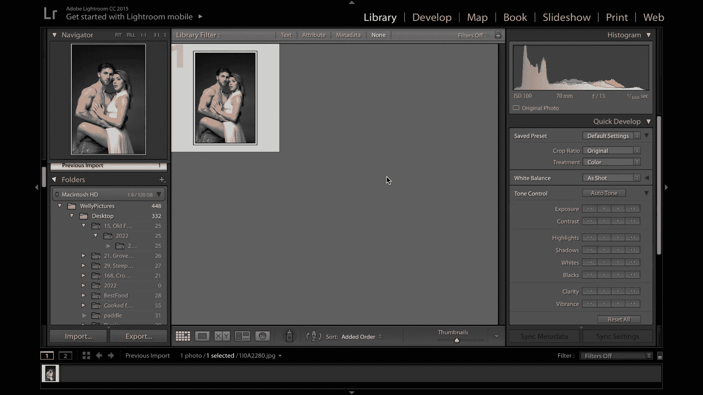
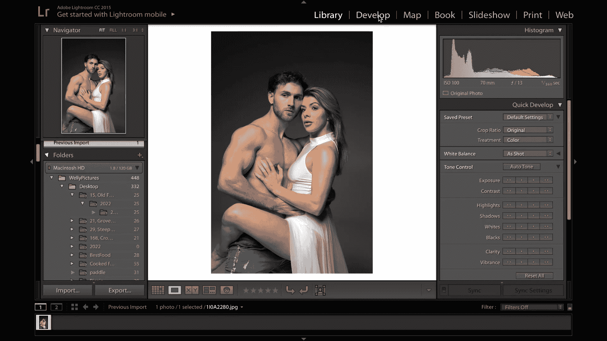
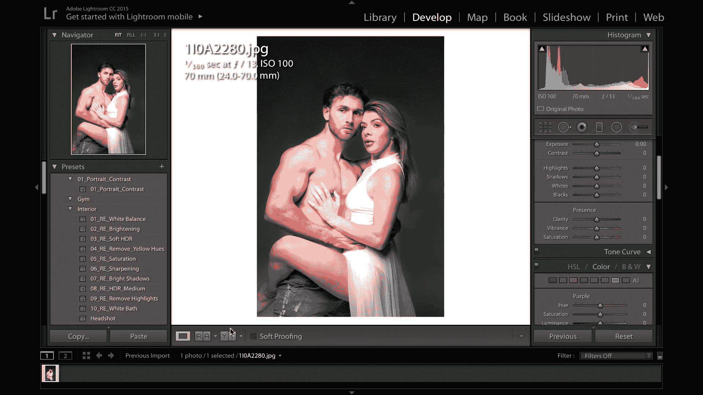
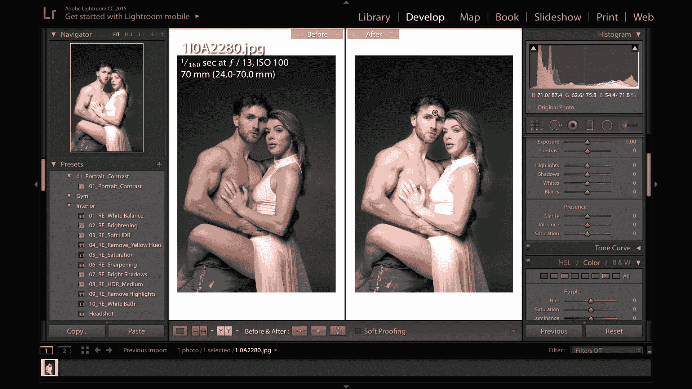
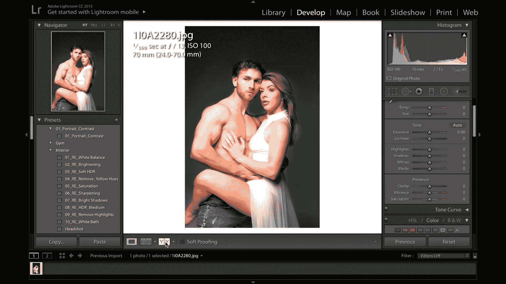
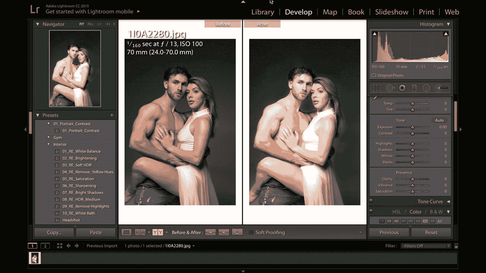

# Adobe Lightroom 照片编辑从入门到精通：第27课：使用 Lightroom 蒙版创建工作室凝胶灯光效果 💡



在本节课中，我们将学习如何在 Adobe Lightroom Classic 中使用蒙版和滤镜，为人像照片添加工作室凝胶灯光效果。我们会以一张舞者照片为例，一步步演示如何模拟多色舞台灯光，让画面看起来像是在专业摄影棚中拍摄的一样。

## 第一部分：课程概述与图片准备

上一节课我们介绍了 Lightroom 中基础滤镜的使用方法，本节中我们来看看如何利用这些滤镜为照片增加额外的灯光色彩。



凝胶灯光是一种在摄影棚中常见的拍摄技巧，摄影师会在灯光前加上彩色滤色片，让模特周围或背景出现红、绿、蓝等色彩。在 Lightroom 中，我们不需要切换到 Photoshop，也可以用蒙版工具实现类似的效果。

以下是本节课的核心思路：

- 使用放射状滤镜模拟圆形或椭圆形的灯光区域
- 为滤镜区域添加彩色，模拟凝胶灯光
- 调整羽化程度，让光线边缘自然过渡
- 使用画笔擦除不需要的光线区域
- 叠加多个光源，分别作用于人物和背景

公式描述如下：

```
最终画面效果 = 原始照片 + 放射状滤镜彩色叠加 - 画笔擦除区域 + 多个光源叠加
```

## 第二部分：进入开发模块并添加放射状滤镜

之前我们已经学习过 Lightroom 开发模块中上方的滤镜工具，本节我们将回到这些滤镜，进一步探索如何用它们添加色彩。

早些时候我们讲过，滤镜可以用来调整曝光、对比度、清晰度以及高光和阴影。这一次，我们的目标是给滤镜区域添加颜色，因为凝胶灯光本身就是彩色的光源。

以下是具体操作步骤：

1. 打开需要编辑的照片，进入 Develop 开发模块。
2. 点击右侧工具栏中的放射状滤镜图标，也就是那个圆形的蒙版工具。
3. 在画面上绘制一个椭圆形区域，覆盖你希望出现灯光效果的位置。

在示例图片中，画面左侧较暗，右侧较亮。我们假设灯光来源位于画面右侧模特附近，因此要将椭圆区域放置在额头高光和侧脸高光的位置，尽量让效果看起来真实自然。

## 第三部分：调整凝胶灯光颜色与羽化

放射状滤镜放置好之后，我们不需要立刻修改基础设置，而是直接向下滚动到“颜色”选项。

这里的核心概念可以用代码表示：

```
滤镜颜色设置 = 选择红绿蓝色调 + 调整饱和度与亮度
```

以下是颜色调整的关键点：

- 点击颜色选择器，挑选你想要的凝胶灯光颜色，例如红色或粉色。
- 颜色会默认作用在滤镜覆盖的中间区域。
- 如果需要，可以勾选“反转蒙版”，让颜色作用在椭圆外部而不是内部，但本示例中我们保持默认设置。

接下来是羽化设置。羽化决定了滤镜效果从中心向边缘的过渡方式。

- 羽化数值越高，光线边缘越柔和，呈现渐变效果。
- 羽化数值越低，边缘越硬，光线范围更像一个完整的圆圈。
- 建议将羽化数值设置在 50 到 100 之间，这样能获得既有重点亮点又有自然过渡的效果。

调整完成后，记得取消“显示选定蒙版”的勾选，这样可以更清楚地看到最终画面效果。

## 第四部分：使用画笔擦除多余光线

有时候滤镜覆盖范围会超过我们需要的区域，比如背景上不应该出现粉色光斑。此时需要使用画笔工具进行清理。

以下是擦除操作的要点：

- 在滤镜设置顶部切换到画笔模式。
- 选择“擦除”功能，然后在不需要光线的地方涂抹。
- 仔细检查模特身体、衣服以及背景边缘，确保光线只出现在应该出现的位置。

在示例中，我们先擦除背景上的粉色光线，让粉色只停留在模特身上，营造出灯光打在人物身上的真实感。

## 第五部分：添加第二个背景光源

完成第一个粉色光源之后，我们可以继续添加第二个光源，让画面色彩更丰富。

过渡到这里，我们要给背景增加另一种颜色的光，以平衡整体构图。

以下是添加第二个滤镜的步骤：

1. 点击“新建”按钮，创建另一个放射状滤镜。
2. 将新椭圆放置在背景区域，靠近模特身后。
3. 在颜色选项中选择绿色，作为背景凝胶灯光。
4. 适当调整椭圆位置，让绿色光线轻轻落在模特发际线或脸部边缘。
5. 再次使用画笔擦除工具，清理掉模特身上不需要的绿色部分，保留背景上的绿色氛围。



这样一来，画面中就同时出现了作用于人物的粉色光，以及作用于背景的绿色光，两种颜色形成对比，增加了画面的层次感。



## 第六部分：微调细节与最终对比

在所有光源添加完毕之后，还需要对细节进行微调，确保肤色和衣物上的颜色分布自然。

以下是微调建议：

- 如果某个部位颜色过重，使用画笔擦除部分色彩。
- 如果某个部位颜色不够，可以适当增大画笔尺寸重新涂抹。
- 检查模特的牛仔裤、裙�摆以及头发，避免颜色出现不自然的色块。
- 可以添加第三个微小的黄色光源作为点缀，但不要过量，以免喧宾夺主。

整个编辑过程中，不需要立即点击“完成”，因为只要不退出编辑状态，你就可以随时点击不同的滤镜，反复修改直到满意为止。

下面是编辑前后的对比示例：

```
编辑前：原始舞者照片，光线平淡，无彩色凝胶灯光效果
编辑后：人物身上有粉色高光，背景带有绿色氛围，整体呈现工作室棚拍质感
```

## 第七部分：本节课总结





本节课中我们一起学习了如何在 Lightroom Classic 中使用放射状滤镜和蒙版工具，创建工作室凝胶灯光效果。我们掌握了添加彩色滤镜、调整羽化范围、使用画笔擦除多余区域，以及叠加多个不同颜色光源的方法。通过这些步骤，你可以为任意人像照片增加专业感的彩色灯光氛围，而无需切换到 Photoshop 进行复杂的合成。

