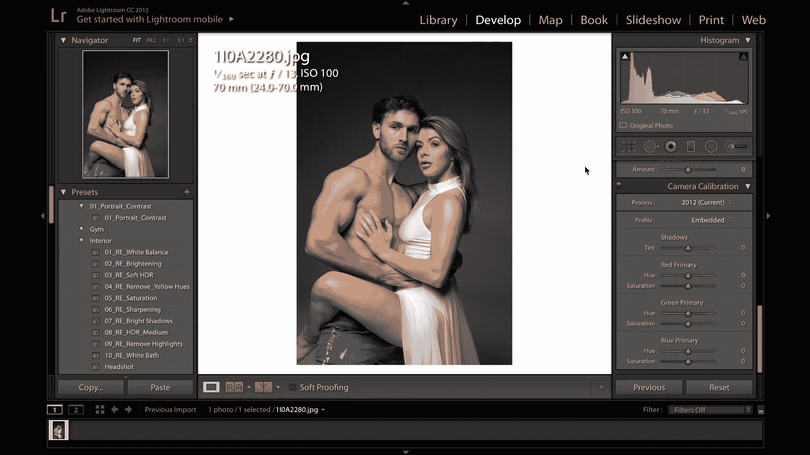
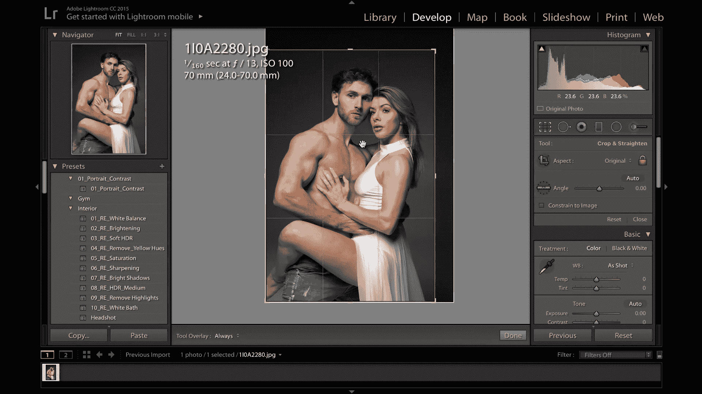
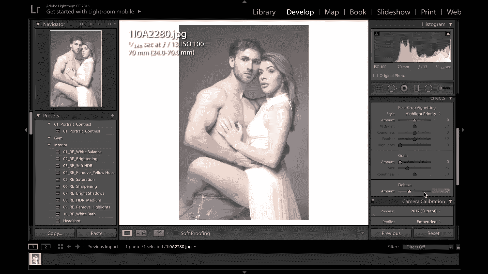
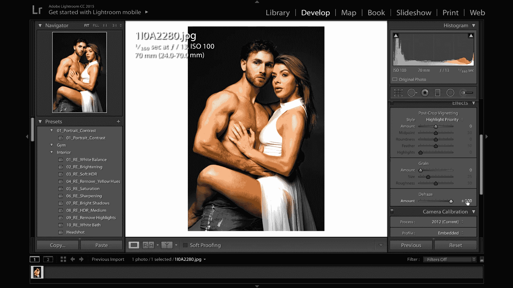
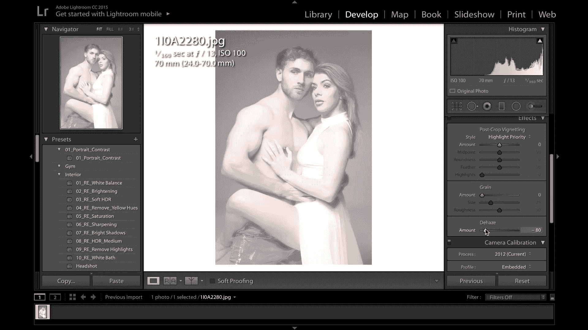
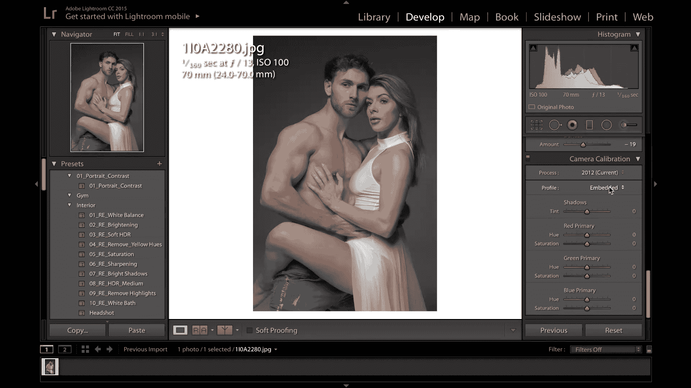
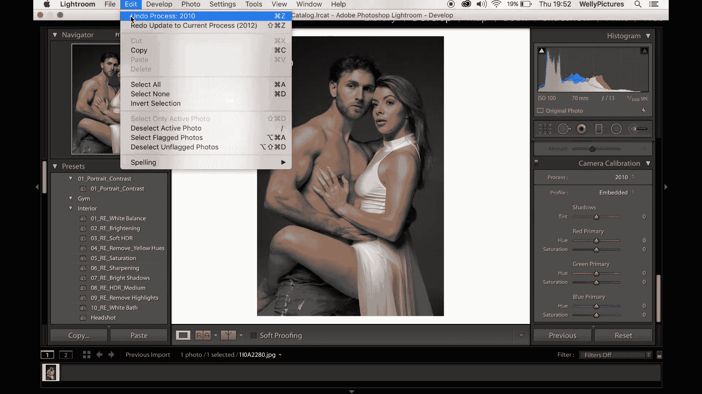
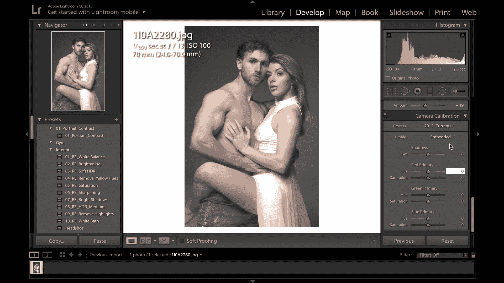

完整 Adobe Lightroom 课程：第28节：创建美丽的褪色效果 🎨

在本节课中，我们将学习如何在 Adobe Lightroom 中创建一个美观的褪色效果。这节课属于修图与增强图片技巧的一部分，适合完全没有基础的初学者。我们会从最基础的裁剪和光影调整开始，然后逐步引入去雾工具、色调曲线、颗粒噪点以及色彩配置文件，最终让你的照片呈现出复古胶片般的褪色质感。

### 基础调整：为褪色效果做准备

在正式添加褪色效果之前，我们需要先对照片进行一些基础的修图操作，为后续的效果打下良好基础。这一步的目的是让图像先具备合适的亮度和对比度，而不是直接跳到特效阶段。

以下是本节基础调整的具体步骤：
- 打开与上一节胶片效果相同的示例照片。
- 使用裁剪工具调整照片的宽高比。
- 提高高光数值，还原摄影棚灯光的亮面效果。
- 提升阴影数值，并将对比度设置为大约 20。

在完成这些操作之后，你的照片已经完成了基础增强。这时候图像看起来比较清晰，但还没有产生那种复古的褪色风格。下一步我们要进入 Lightroom 的效果面板，开始尝试真正的褪色工具。

### 使用去雾工具打造褪色底片感

上一节我们介绍了基础调整，本节中我们来看看如何利用去雾工具为照片添加白色雾化效果。去雾工具的英文名称是 Dehaze，它在 Lightroom 的开发模块中非常实用。

以下是去雾工具的使用要点：
- 去雾工具可以给照片整体添加一层白色或黑色的薄膜效果。
- 当你将数值拉向正方向时，画面会变黑。
- 当你将数值拉向负方向时，画面会变白，从而形成褪色效果。
- 在本例中，建议将去雾数值设置为 -19。

关于去雾数值的选择，可以用这个简单的公式来理解：
`褪色强度 = Dehaze 数值`
当 Dehaze 为负数时，白色雾化效果越明显，照片越接近褪色胶片的感觉。数值为 -19 时，图像已经拥有了一定的褪色氛围，但并没有完全失去细节，正好适合作为底片风格的起点。

### 使用色调曲线细化明暗层次

完成去雾调整之后，我们还可以进一步优化照片的明暗分布。本节中我们来看看色调曲线的作用。色调曲线可以帮助你精确控制画面中不同亮度区域的表现。

色调曲线的界面看起来像是一个直方图的方形版本，它把画面的亮部、中间调和暗部分成了三个区域，分别对应高光、中间调以及阴影和深色调。

以下是色调曲线的调节方法：
- 点击并拖动曲线上的圆点，可以改变对应亮度区域的明暗。
- 上方区域控制高光和亮部。
- 中间区域控制中间调。
- 下方区域控制阴影和深色调。

你不需要使用鼠标精准移动，也可以直接上下拖动这些区域。在实际操作中，建议保留一定的暗部细节，不要把阴影压得太死。这样处理之后，配合之前的去雾效果，照片就拥有了初步的褪色预设效果。

### 添加胶片颗粒增加质感

有了去雾和色调曲线的基础，照片已经具备了褪色的轮廓。本节中我们来看看如何通过添加颗粒来增强胶片质感。在 Lightroom 中，噪点通常被称作颗粒。虽然日常拍摄中我们会尽量避免画面出现噪点，但在制作艺术风格时，适当添加颗粒反而能让照片更有复古质感。

以下是颗粒工具的三个关键参数：
- 数量（Amount）：控制颗粒的多少。
- 大小（Size）：控制颗粒的粗细，数值越大，图像质量损失越严重。
- 粗糙度（Roughness）：控制颗粒表面的纹理感。

在实际操作时，建议先将图像放大，观察颗粒效果。你可以先将数量调到大约 50，仔细查看细节，然后再根据需要调低到 25 甚至更低。例如，在本示例中，最终将数量设为 8，粗糙度设为 60，大小保持在较低水平，这样既有颗粒感，又不会丢失照片的焦点质量。

核心参数关系可以简写为：
`最终颗粒效果 = 数量(25) + 大小(适中) + 粗糙度(60)`

### 调整色彩配置文件增强褪色氛围

颗粒效果添加完成之后，我们还可以从色彩方面再进一步强化褪色风格。本节中我们来看看色彩配置文件的调整方法。在 Lightroom CC 中，色彩配置文件有时也被称为相机配置文件，通过修改色相和饱和度，你可以让照片的色调更接近褪色的黑白或低饱和度风格。

以下是色彩调整的常用思路：
- 选择红色色相，可以给肤色带来偏粉红的色调。
- 选择蓝色色相，可以进一步增强冷色调的褪色感。
- 降低饱和度，可以让整体色彩变得更淡，更接近褪色效果。

需要注意的是，改变色彩配置文件可能会影响之前调整的细节，所以建议谨慎操作。如果你发现画面丢失了想要的质感，可以随时撤销或回调参数。通过对红色和蓝色的微调，你的照片将从普通的彩色图像，逐渐过渡到一种褪色饱和度较低的艺术风格。

### 总结流程回顾

在学习完所有工具之后，我们回顾一下整个制作流程。以下是本节课的完整操作顺序：
1. 使用基础面板提升高光和阴影，设置对比度约 20。
2. 在效果面板中使用去雾工具，将数值设为 -19，添加白色褪色薄膜。
3. 使用色调曲线微调高光、中间调和阴影。
4. 在效果面板中添加颗粒，数量约 25，粗糙度约 60，注意不要过度增大尺寸以免损失画质。
5. 根据需要调整色彩配置文件，降低饱和度，强化褪色氛围。

总结：

本节课中我们一起学习了如何在 Adobe Lightroom 中创建美丽的褪色效果。我们掌握了基础曝光调整、去雾工具的正负数值含义、色调曲线的分区修图方法、颗粒噪点的添加技巧，以及色彩配置文件的简单调整。希望这些内容能帮助你快速上手，制作出具有复古质感的照片作品。

