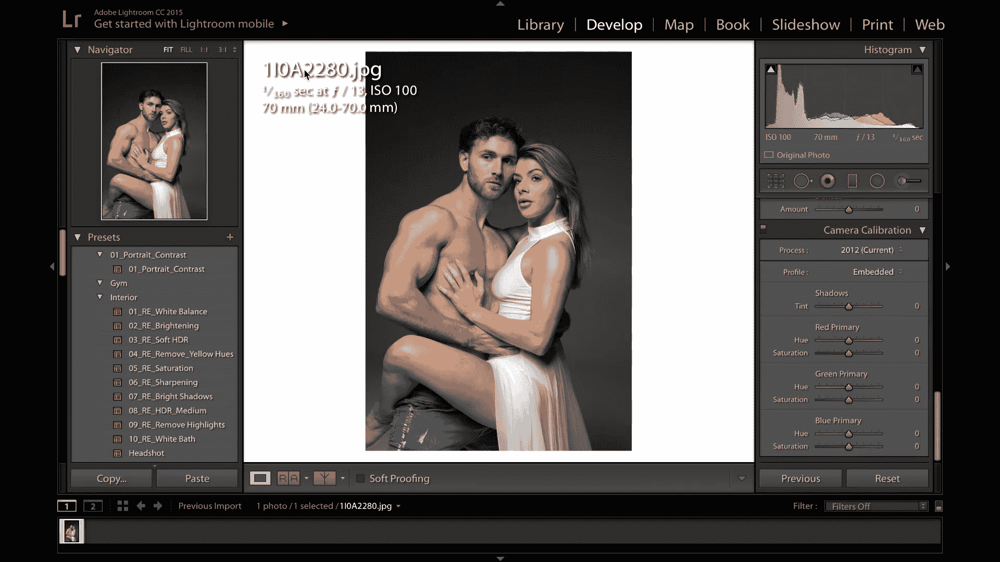
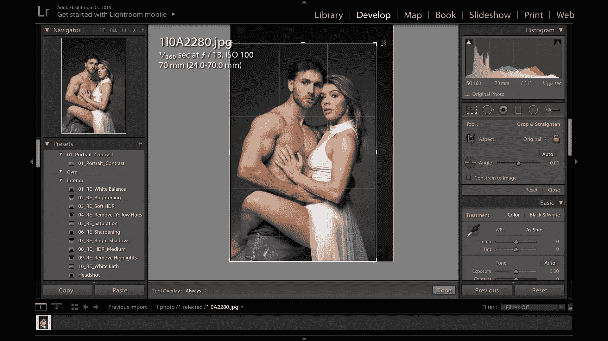
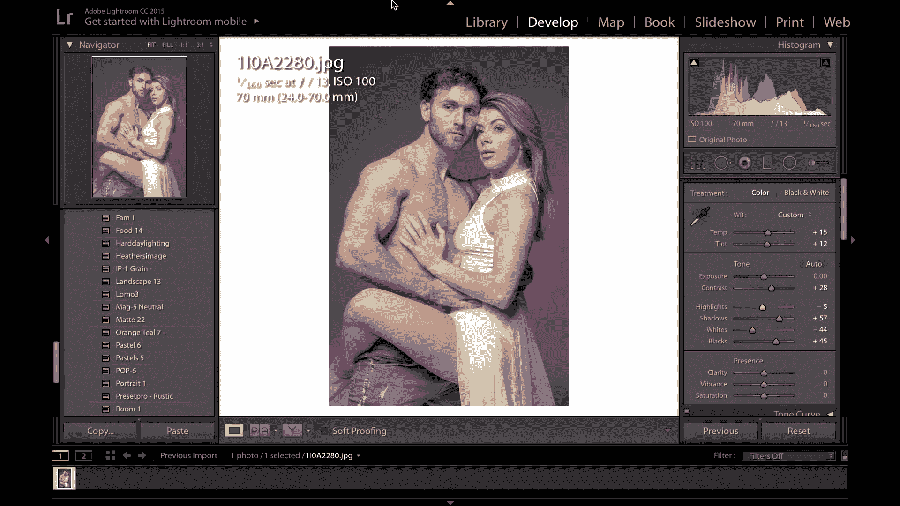
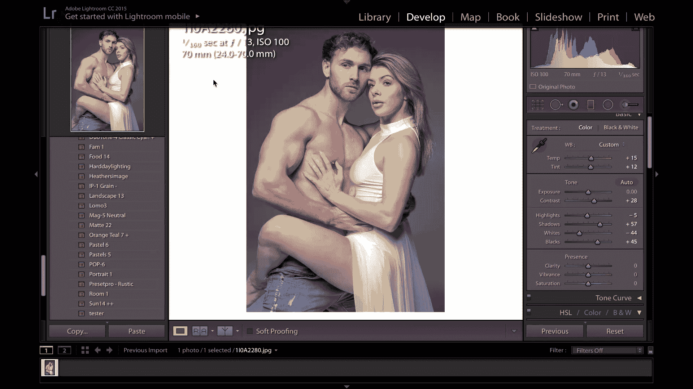
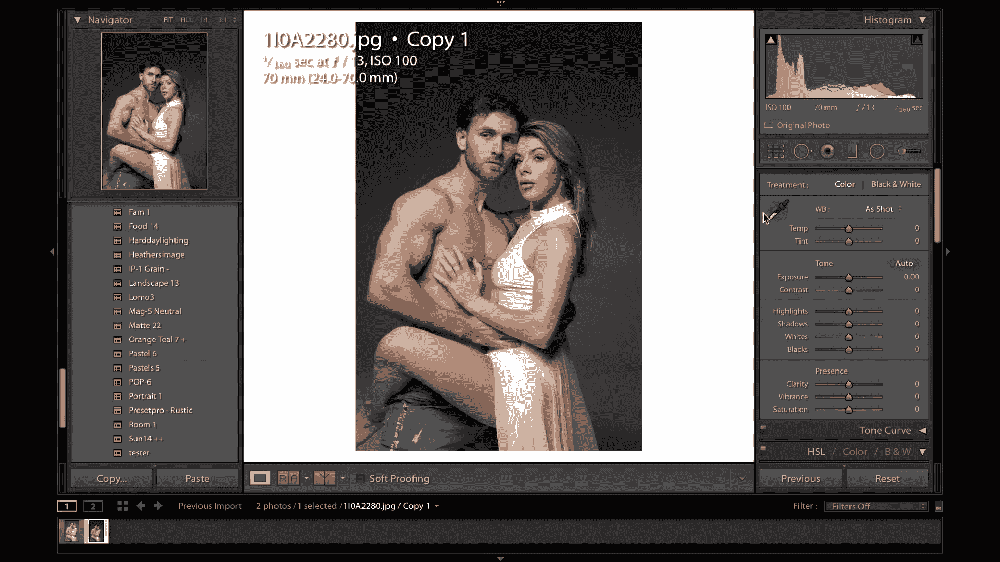
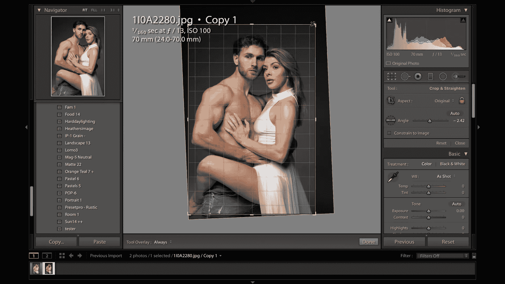
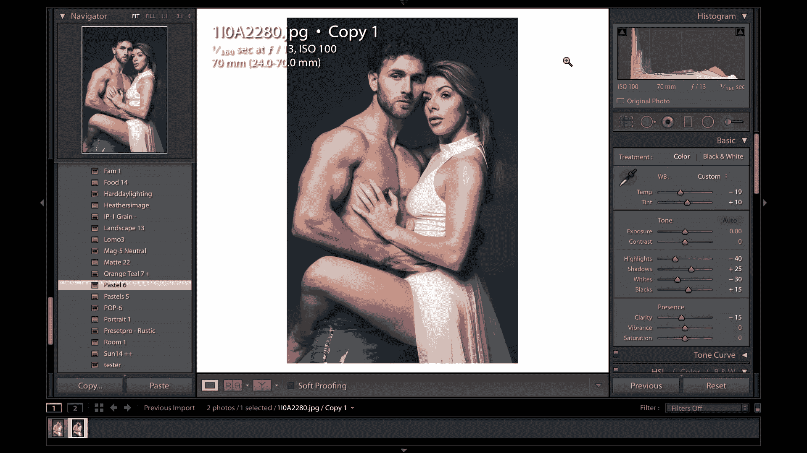
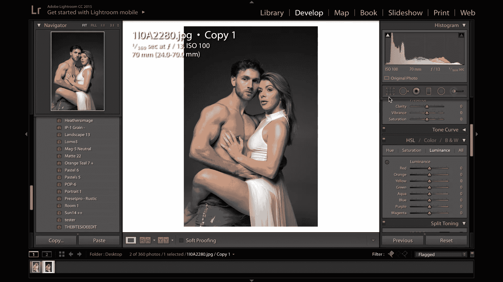
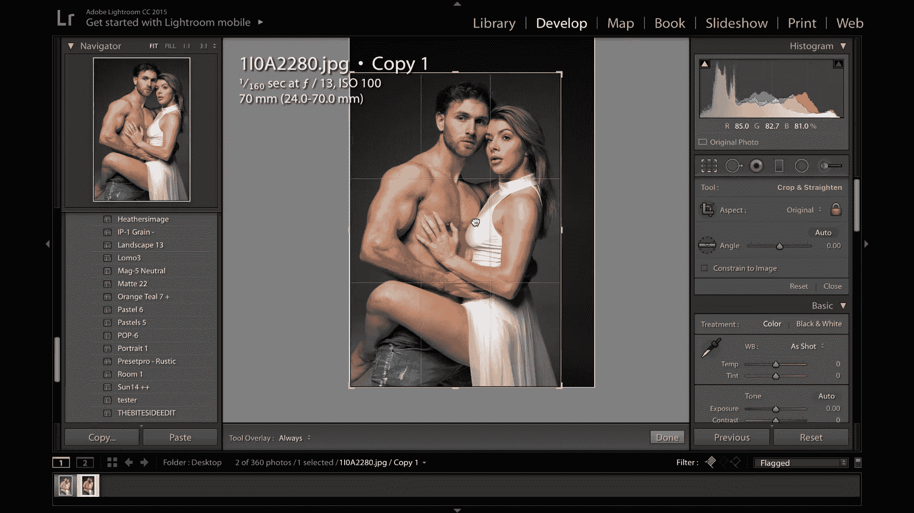
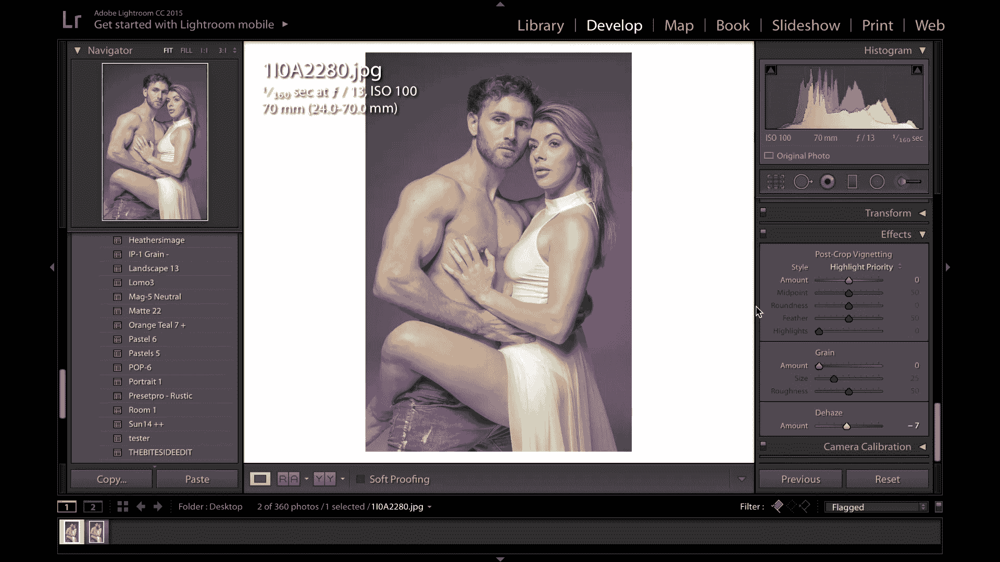

# 📸 Adobe Lightroom 零基础到精通照片编辑全攻略：第29章：创建柔和粉彩效果

在本节课中，我们将学习如何使用 Adobe Lightroom 创建柔和粉彩效果。上一节课我们介绍了如何制作漂亮的褪色效果，而本节课我们将放弃褪色风格，转而专注于一种更加柔和、温润的粉彩色调。为了方便对比，我们将继续使用上一节课的同一组图片，这样你可以清楚地看到两种效果之间的差异。整个调整过程包含多个步骤，虽然看起来内容较多，但并不难掌握。我们会从基础面板的阴影与黑点开始，逐步进入色调曲线、HSL 色彩以及相机校准，最后再对比几种已下载的粉彩预设，帮助你找到最符合自己审美的方案。

## 第一步：准备工作与基础面板调整

上一节课我们介绍了褪色效果的制作方法，本节课我们来看看如何创建柔和粉彩效果。我们在 Lightroom 的开发模块中开始操作，这个过程会涉及较多的面板和滑块，但只要按照顺序来，就不会感到困难。

以下是我们要在基础面板中调整的核心参数：

- 阴影：`阴影数值 = 57`
- 黑点：`黑点数值 = 45`
- 高光：`高光数值 = -44`
- 白点：`白点数值 = -44`

首先，我们把阴影大约提升到 57，然后把黑点提升到 45。这里需要理解黑点调整的原理。如果把黑点向左拉到负数区域，画面中的黑色会显得非常生硬；如果把黑点向右拉到正数区域，画面会开始丢失一部分黑色，同时带入少量白色，形成一种柔和的视觉效果。这个技巧不仅适用于当前的粉彩流程，也可以应用到其他类型的照片编辑中。

完成阴影和黑点的调整之后，我们把高光拉回到大约 44，白点同样拉回大约 44。此时图片的对比度会明显降低，这正是我们想要的结果，因为粉彩效果不需要强烈的对比度，我们追求的是一种轻盈、通透的质感。

接下来，我们在白平衡部分增加一点暖色调。具体参数如下：

- 色温：`色温数值 = 15`
- 色调：`色调数值 = 12`

调整完成后，图片会带入一点黄色和品红色调，为后续的粉彩效果打下基础。

## 第二步：色调曲线调整

基础面板调整完成后，我们继续进入色调曲线部分。在 Lightroom 的某些版本中，你可以直接在色调曲线顶部选择不同的颜色通道，但如果你使用的是 Lightroom Classic 旧版本，可能需要双击右上角的小方框才能显示 RGB 通道。

以下是我们要调整的色调曲线通道：

- 蓝色通道：`蓝色通道 = 开启`
- 红色通道：`红色通道 = 开启`

操作时，先将通道切换到蓝色，这里的曲线实际上就是蓝色元素的直方图。我们先增加曲线的一段，然后降低另一段，让曲线开始呈现出类似 S 形的趋势，但不需要做成标准的 S 曲线。这样就是蓝色色调的初步塑造。

在这个阶段，你可以根据自己的喜好更多地调整蓝色的高光和阴影，不需要完全照搬我的数值。接下来我们把通道切换到红色部分，同样可以自由增减，只要不过度即可。如果调得太过了，记得把滑块拉低，只保留一点点效果，不要过度饱和。

当我对红色和蓝色都满意之后，你也可以根据自己的电脑和审美，自行修改色调曲线的百分比，调整到最合适的程度。

## 第三步：HSL 色彩调整

色调曲线完成后，我们进入开发模块的 HSL 部分。HSL 代表色相、饱和度和明度，这三个维度共同决定了图片中颜色的最终表现。

以下是色相部分的参数设置：

- 红色：`色相(红) = +21`
- 橙色：`色相(橙) = +9`
- 黄色：`色相(黄) = -39`
- 绿色：`色相(绿) = -12`
- 青色：`色相(青) = -27`
- 蓝色：`色相(蓝) = -11`

色相基本上代表图片中不同颜色的偏移方向。当我们向右拉到正数时，就是在往颜色轮的另一端添加色调。例如，红色向右移动会变成偏橙的红色，而蓝色向左移动会变成偏青或偏绿的蓝色，这就是我们选择正负数的原因。

接下来是饱和度部分，用于降低颜色的强度：

- 红色：`饱和度(红) = -8`
- 橙色：`饱和度(橙) = -8`
- 黄色：`饱和度(黄) = -17`
- 绿色：`饱和度(绿) = -20`
- 青色：`饱和度(青) = +12`

再次提醒，这些是我用来创建粉彩效果的固定数值，你可以直接使用，也可以根据不喜欢的效果自行修改。

饱和度完成后，我们进入明度部分：

- 红色：`明度(红) = +12`
- 橙色：`明度(橙) = +1`
- 黄色：`明度(黄) = +8`
- 绿色：`明度(绿) = +11`

至此，HSL 部分的所有颜色调整就全部完成了。

## 第四步：相机校准与微调

HSL 调整完成后，我们继续进入相机校准部分。这一部分同样是关于颜色修改的，通过微调不同颜色的色相和饱和度，可以进一步统一画面的粉彩质感。

以下是相机校准的参数设置：

- 红色色相：`红色色相 = -9`
- 红色饱和度：`红色饱和度 = 2`
- 绿色色相：`绿色色相 = +23`
- 蓝色饱和度：`蓝色饱和度 = 负数`

所有这些设置组合在一起，就是为了给图片创造更淡雅的粉彩效果。当然，这些只是我个人使用的参数，颜色形成之后，如果你愿意，还可以稍微增加一点对比度，甚至提高自然饱和度，给画面更多层次。但因为我们要的是粉彩效果，我个人并不建议过度增加对比度。

最后，我们可以回到基础面板，再稍微提升一点高光，不要太多，只是让画面多一点通透感。这样，一个基于自定义参数的粉彩效果就完成了。

## 第五步：对比预设效果

自定义粉彩效果完成后，我也想给你展示一下我之前下载的一些粉彩预设，让你看看不同预设的呈现效果，帮助你了解粉彩图片的多种可能性。

以下是我们要对比的预设：

- Pastel 6：`预设名称 = Pastel 6`
- Pastel Stick / Pastels5：`预设名称 = Pastel Stick 或 Pastels5`

操作时，先为当前图片创建一个虚拟副本，然后重置回到原始裁剪状态，去除所有编辑。接着点击左侧的 Pastel 6 预设。可以看到，这个预设没有对颜色做太多修改，但添加了大量对比度，画面整体偏暗，带有明显的蓝色调，与我刚才制作的浅色调粉彩效果截然不同。它调整了明度、饱和度和色相，甚至还使用了分色调色，为高光和阴影分别设置了颜色，此外还做了一些降噪和锐化，但没有使用去雾技术。

再看 Pastel Stick 或 Pastels5，这个预设与我的效果更相似。它通过增加黑点给画面注入了更多白色，营造出一层覆盖在画面之上的白膜感，这就是粉彩效果的典型特征。记住，黑点向左拉是负数，会把黑色带入画面；黑点向右拉是正数，会把白色带入画面。这个预设也调整了色相、饱和度和明度，并且完全去除了画面中的绿色色调，又提高了绿色的明度，从而创造出一种棕色调的粉彩效果。它没有动细节部分，但再次调整了绿色，确保画面中绿色有限。

对比之下，我使用的颜色调整涵盖了蓝色、绿色、深绿色、黄色、橙色和红色，色相部分几乎包含了所有这些组合，同时也修改了相机校准。这就是一种通过相机校准设置、调整 HSL 和颜色设置，最后结合基础编辑中相反操作来创建粉彩效果的方法。比如通过黑点带入白膜效果，或者使用去雾工具。去雾的作用与黑点相反，向右拉到正数会带入黑色，而向左拉到负数会带入更多白色效果，这也是某些粉彩预设中白膜效果的另一个实现要素。

## 总结

本节课中，我们一起学习了如何在 Adobe Lightroom 中创建柔和粉彩效果。首先通过基础面板调整阴影、黑点、高光和白点，降低图片对比度；接着在色调曲线中分别处理蓝色和红色通道；然后进入 HSL 部分，依次设置色相、饱和度和明度；随后通过相机校准进一步统一色调；最后对比了 Pastel 6 和 Pastel Stick / Pastels5 两款预设，了解了不同粉彩效果的特点。希望你能按照这些步骤，尝试制作出自己喜欢的粉彩风格照片。

