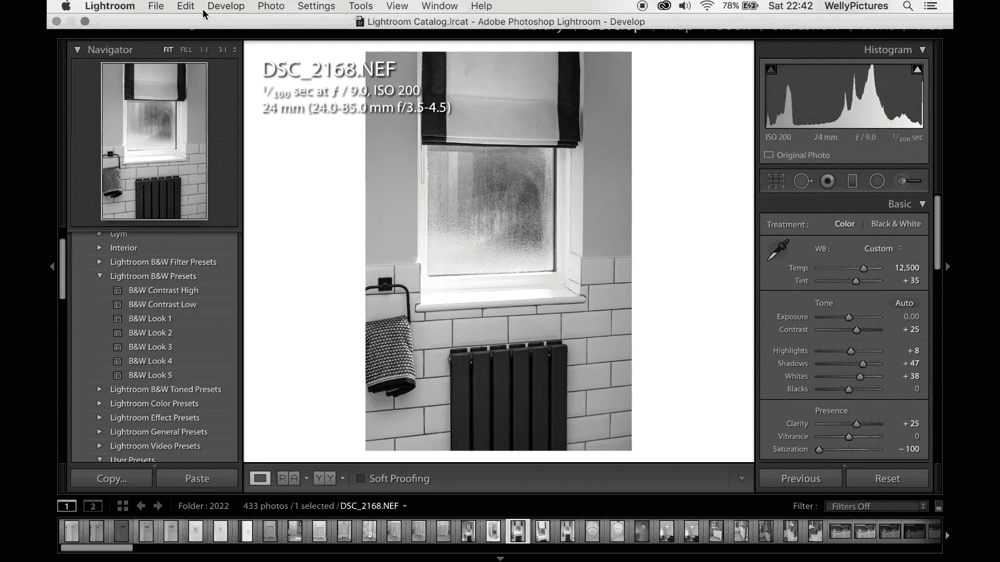
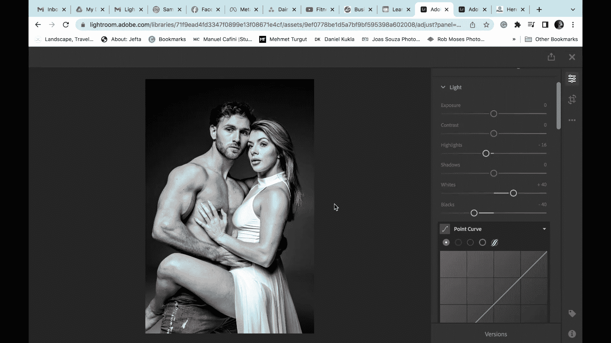

📷 完整Adobe Lightroom大师课：第30课：使用预设将彩色照片转换为黑白

在本节课中我们将要学习如何使用Lightroom预设，把彩色照片快速转换为黑白照片。我们会先在Lightroom Classic中演示自带黑白预设的使用方法，再介绍如何配合相机配置文件和基础面板进行微调，最后切换到Lightroom CC网页版，展示更多推荐和高级预设，并教你如何用调色混合器优化黑白色调。无论你是刚接触Lightroom的新手，还是希望提高编辑效率的摄影爱好者，这节课都会用大白话把每一个步骤讲清楚。

上一节我们介绍了颜色预设的基本用法，本节中我们来看看如何把照片变成黑白。

我们先打开Lightroom Classic，进入开发模块。开发模块的右侧面板就是预设区域。这里已经内置了一组黑白预设，你不需要自己从头制作。

以下是Lightroom Classic中常见的黑白预设分类：
- 高对比度黑白预设：适合需要强烈明暗对比的场景。
- 不同黑白风格预设：提供多种经典黑白效果。
- 蓝绿橙红黄滤镜预设：对应传统相机拍摄黑白照片时使用的彩色滤镜，可以在原图中有这些颜色时增加对比度。
- 红外线预设：模拟红外摄影效果，会改变画面的光影表现。
- 调色预设：比如棕色调和青色调，源于暗房传统工艺，能给黑白照片增加特殊的色调氛围。

操作时，你可以把鼠标光标下拉，在左上角的小预览框里实时查看每个预设的效果。这里有一个实际例子。示例照片是一张楼下卫生间的黑白室内图，里面有一个黑色散热器。当你浏览预设时，可能会发现散热器部分变得过于漆黑，导致细节丢失。这时候不要慌，选择“黑白风格5”这个预设，直接点击一下即可应用。

```
黑白照片 = 彩色原片 + 黑白预设
```

除了预设，Lightroom Classic还提供相机配置文件，也就是所谓的相机协作元素。它包含单色、绿色滤镜、橙色滤镜、红色滤镜和黄色滤镜，等同于传统拍摄时加在镜头前的M系列滤镜。你可以先添加绿色单色配置文件，但请注意，预设和配置文件通常二选一，建议把它们作为编辑的起点。

应用预设后，接下来要处理基础面板。示例图中，白色被增强到了91，导致搁板部分过曝。你可能会想降低高光，但效果反而更差。正确的做法是降低白色数值，既保留搁板细节，又不让白色区域过度曝光。同时，你还可以稍微提亮阴影，但如果阴影调得太多，对比度会下降，这时候再把高光适当拉回来。



这里故意使用了一张本来颜色就不多的照片，目的是让你看到，即便原图接近黑白，使用黑白预设后，黑白和灰色的表现依然非常有效。

介绍完Lightroom Classic的操作流程后，我们接下来切换到Lightroom CC网页版，看看那里的预设有什么不同。

Lightroom CC的网页版提供了更丰富的预设选择。打开网页版后，你可以先进行裁剪，把照片顶部多余的背景空间去掉，然后按回车键确认。网页版的编辑界面和桌面版Lightroom CC略有不同，但预设功能依然可用。

以下是Lightroom CC网页版中可以查看的预设类别：
- 推荐黑白预设：Lightroom官方推荐的黑白效果，分为不同风格标签页，你不需要逐个全部查看，直接找到感兴趣的区域即可。
- 高级或付费预设：列在“选择”类别下，包含人像黑白选项，适合人像照片处理。
- 造型黑白预设：数量较多，涵盖多种艺术化黑白效果。
- 相机协作相关预设：包括自然、明亮、强烈等风格，以及黑白风景、高对比度、黑白冲击力、低对比度、平、柔和和红外线等选项，同时也提供不同的调色元素。

在这个示例中，作者比较喜欢“黑白冲击力”预设，就用它作为编辑起点。点击预设后，顶部的配置文件会自动切换，基础面板中的一些设置也会随之改变。

```
应用预设后 → 配置文件自动切换 + 基础设置自动调整
```

接下来要介绍一个重要工具，就是调色混合器，在新版Lightroom CC中称为Mixer，在Lightroom Classic中对应的是色相、饱和度和亮度面板。调色混合器的作用是：即使照片已经变成黑白，你仍然可以根据原图中原来的颜色，把对应的色调调暗或调亮。

以下是使用调色混合器的常见操作示例：
- 调整青色：如果青色数值已经是负数，再往下调整可能没有明显变化。
- 调整黄色：黄色通常关联人物肤色。调整过度会让皮肤看起来像晒伤，这时候需要把数值调回来。
- 调整红色：红色也关联肤色，适当调整后，模特的嘴唇可能会出现淡淡的口红色调，调回原值即可恢复自然。

通过调色混合器，你可以优化黑白照片中色调、高光和中间调的质量，让画面更有层次感。

选好合适的预设之后，通常不需要再做太多后续编辑。在这个例子里，作者没有做额外调整，只觉得高光可以稍微再亮一点点，除此之外已经非常满意。预设让整个编辑过程变得简单得多。

关于Lightroom CC网页版的预设和调色混合器我们就讲到这里，下面来总结一下本节课的全部内容。



本节课中我们一起学习了如何使用Lightroom预设将彩色照片转换为黑白照片。首先在Lightroom Classic中，我们认识了高对比度、传统滤镜、红外线和调色等多种黑白预设，并学会了如何通过相机配置文件和基础面板修正过曝和细节丢失问题；接着在Lightroom CC网页版中，我们浏览了推荐预设、高级预设、造型预设和相机协作预设，重点演示了“黑白冲击力”预设的应用，并介绍了调色混合器对黑白色调、高光和中间调的微调方法。希望这节课能帮你快速上手黑白照片编辑，让后期工作更高效。
