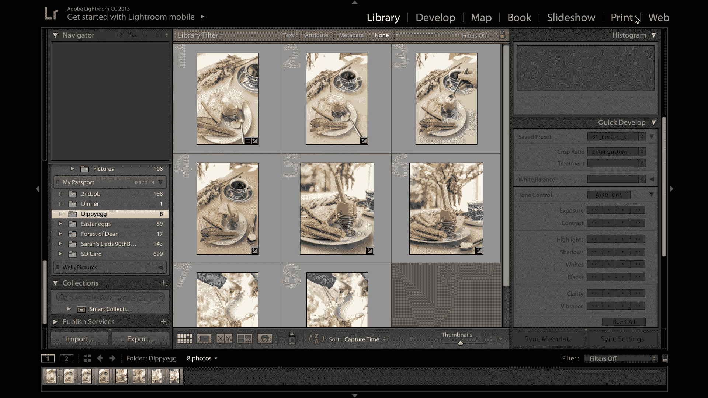
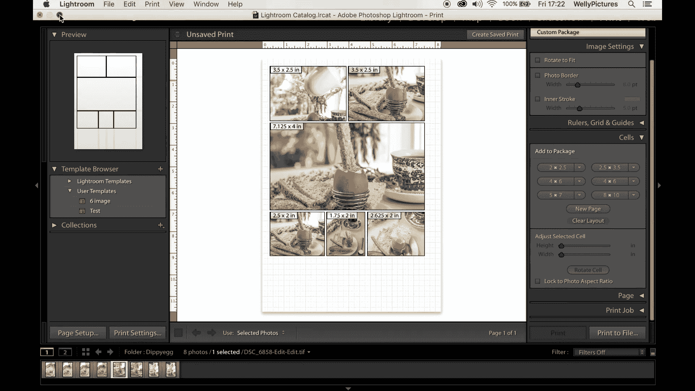
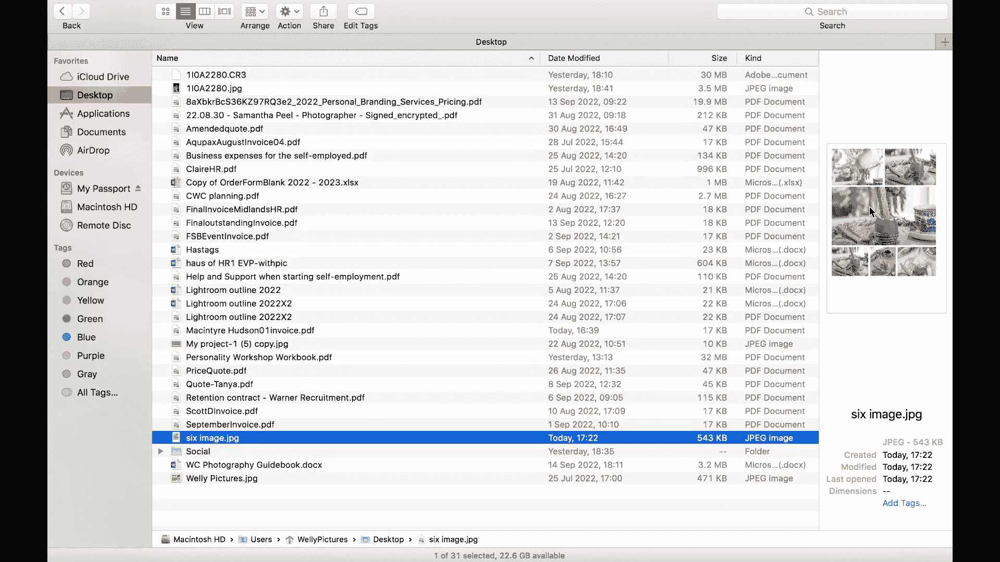
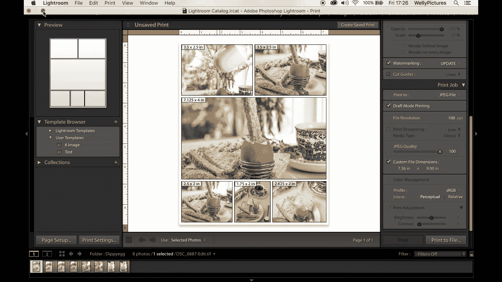
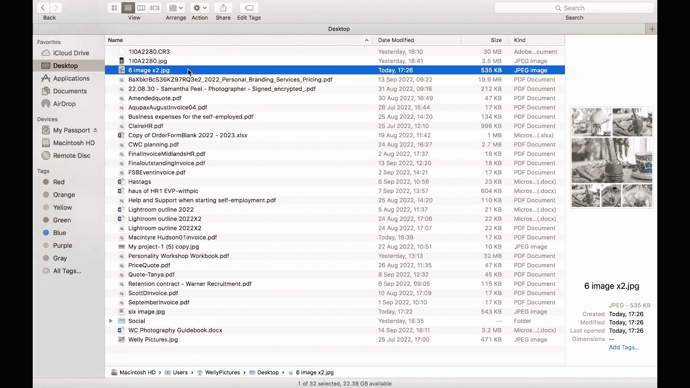

# Complete Adobe Lightroom Megacourse： Beginner to Expert Photo Editing part2：p31 126：Create a Collage in Lightroom Classics 🖼️



在本节课中，我们将一起学习如何在 Adobe Lightroom Classic 中制作图片拼贴画。很多新手习惯在资料库模块里挑选照片，然后一张张导出，但实际上 Lightroom 的打印模块可以帮你直接把多张照片组合成一张拼贴画，再保存为一张 JPG 文件，方便发布到社交媒体或网站。我们会先认识打印标签页，再了解联系表、模板、边框设置，最后导出成品。整个过程不难，只要跟着步骤走，初学者也能快速上手。

### 1. 打开打印模块，认识联系表

上一节我们可能只在资料库和开发模块之间切换，本节中我们来看看 Lightroom 里不太常用的打印标签页。

进入 Lightroom 后，找到右上角的模块选择栏，点击 **Print**（打印）标签页。进入之后，你会发现界面右下角显示的是你当前选中的照片。这时候你有两种选择：一是完全不使用模板，直接制作一张照片联系表；二是使用 Lightroom 自带的模板来排列多张照片。我们先来看看最简单的联系表做法。

以下是制作联系表的基本步骤：

1. 在打印模块左侧的模板浏览器中，找到 **Contact Sheet**（联系表）类别。
2. 点击任意一个联系表样式，右侧预览区就会立刻显示效果。
3. 按下键盘上的数字键 `1`，选中你想放入联系表的照片。
4. 照片会自动填充进联系表格式，完成后你可以直接打印，也可以保存后发给其他人，让他们查看你的图片示例。

### 2. 选择拼贴模板

联系表只是个起点，如果你想更自由地控制每张照片的位置，就需要使用普通的拼贴模板。左侧的模板浏览器里列出了很多布局，每个模板上方都有预览图，你可以一眼看出最终效果。选好模板后，Lightroom 就会帮你完成大部分排版工作，这对新手来说是个很好的切入点，不用自己从零开始摆放图片。

以下是选用三图模板的操作：

1. 在模板列表中，找到一个包含三个图片位置的模板。
2. 点击该模板，右侧预览区会立刻更新，显示三张照片的排列方式。
3. 选中这个模板后，你的拼贴画就已经有了基本框架，接下来只需要把照片放进去。

### 3. 图片设置与边框

模板只是骨架，真正决定照片外观的是图片设置面板里的边框和描边选项。

在打印模块的右侧控制面板里，有一个叫作 **Image Settings**（图片设置）的区域。这里你可以给照片旋转，也可以添加边框。把照片拖进模板时，不要指望它像联系表那样自动填满所有位置，你需要手动选中一张照片，然后把它拖到你想放的位置。

关于边框，这里有两个容易混淆的概念：

- **内部描边（Inner Stroke）**：是紧贴照片边缘的一圈线，你可以改变颜色和宽度，比如改成白色，宽度设为 10。
- **照片边框（Photo Border）**：是围绕在整个照片外部的一圈线，位置在内部描边的外面。

如果你同时开启两者，照片的可用面积会变小，所以通常二选一即可。如果你想要白色或其他颜色的边框，只保留其中一个就够了。不喜欢的话，直接取消勾选，就没有任何描边或边框了。

拼贴画外观可以用下面这个简单公式来理解：

```text
拼贴画外观 = 模板布局 + 图片内容 + 内部描边 + 照片边框
```

### 4. 单位、网格与吸附设置

边框和颜色调整完之后，还需要确认好长度单位和网格显示，这样导出的尺寸才准确。

在图片设置下方，你可以改变测量单位，常见的有英寸、厘米、毫米、点和派卡。这个单位会直接影响图片的像素计算，所以如果你熟悉英寸和像素的换算，就选英寸；如果更习惯厘米或毫米，就选对应的单位。

另外，界面上还有一些显示选项，比如网格吸附、单元格和网格线。把网格吸附打开后，照片移动时会自动对齐到网格上，排版更整齐。你也可以隐藏标尺、页面出血、分组页面等级和图像单元格，但我个人建议先全部保留，这样更容易观察每个元素的位置。

### 5. 打印作业与导出为 JPG

布局和单位都搞定后，接下来就是考虑如何导出最终文件了。

进入打印作业（Print Job）面板，这里决定了你最终得到什么文件。你可以选择直接连接打印机进行打印，但我更建议把文件保存为 **JPG** 格式。这样做的好处是，你可以自己设定分辨率（PPI）和输出尺寸，方便之后在网站或社交媒体上使用。

尺寸设置通常使用英寸，和前面的标尺、网格关联。如果你要做 A4 或 A3 的拼贴画，或者要做传单印刷，记得提前查好对方要求的尺寸和分辨率，避免导出后不符合规格。把所有信息确认无误之后，就可以进行导出了。

导出设置可以用下面这个公式来概括：

```text
导出设置 = 文件格式(JPG) + 分辨率(PPI) + 尺寸(英寸或厘米)
```

### 6. 添加自定义单元格与保存用户模板

除了使用现成模板，你还可以根据需要添加额外的图片单元格，或者完全自己动手创建布局。

如果你觉得模板里的图片数量不够，可以在右侧单元格面板里添加更多形状或大小的图片框。点击相应的按钮，新的单元格就会出现在页面上，或者你可以直接删除现有单元格，从零开始搭建自己的页面。

我来演示一下自定义布局：先把所有模板单元格删除，保留图片设置的相关信息，然后手动添加几个图片框，把它们移动到合适的位置，调整大小，最后放入照片。这样一来，你就得到了一个完全属于自己的拼贴模板。

完成后，你可以把这个布局保存到 **User Templates**（用户模板）里。给它起个名字，比如 "tester"，下次打开 Lightroom 时，这个模板就会出现在列表中，随时可以直接套用。

### 7. 导出文件并调整尺寸



模板和布局都准备好了，最后一步是把拼贴画导出为实际的图片文件。



点击 **Print to File**（打印到文件），选择保存位置，比如桌面，方便之后找到文件。给文件命名，因为我们之前已经设定好输出为 JPG 格式，所以点击保存后，Lightroom 就会开始准备打印作业。

导出完成后，去桌面查看，你应该能看到一张包含多张照片的拼贴画。这时候你可能会发现，四周留白太多，不够紧凑。这时可以使用下方的 **Custom File Dimensions**（自定义文件尺寸）来缩小画布。比如把宽度从 8.26 英寸改成 7.26 英寸，高度从 11 英寸改成 9 英寸，然后把照片往中间移动，使四周边框大致均匀。

### 8. 添加水印与最终保存

如果你是摄影师，还可以给拼贴画添加水印或身份标识牌，保护作品版权。

在打印作业面板里，还有一个额外功能，就是添加水印或身份标识牌（Identity Plate）。你可以把自己的名字、工作室名称或标题放在拼贴画的某个位置，比如右下角。添加完成后，再次点击打印到文件，保存最终版本。





这样一来，你就得到了一张尺寸合适、带有水印的拼贴画，可以直接发布到社交媒体或网站上分享。

本节课中，我们一起学习了如何在 Lightroom Classic 的打印模块中制作图片拼贴画。我们认识了联系表、选择了拼贴模板、调整了内部描边和照片边框、设置了测量单位与网格、将作品导出为 JPG 文件，还学习了如何自定义单元格、保存用户模板以及调整最终文件尺寸。希望这些内容能帮你快速上手，制作出属于自己的精美拼贴画。

