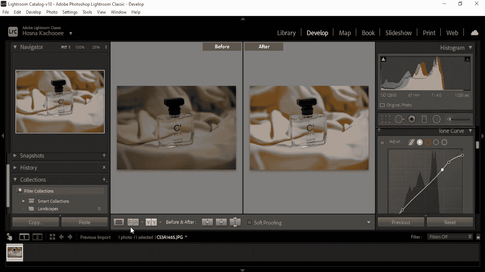

# 📸 Adobe Lightroom 零基础到专家级修图全攻略：第32节：产品摄影修图实战

在本节课中，我们将学习如何使用 Adobe Lightroom 对产品照片进行后期修图。我们会以一瓶香水和布料背景为例，讲解从基础色调调整到局部细节优化的完整流程，帮助你把普通的室内拍摄照片处理成具有棚拍质感的商业产品图。产品摄影属于商业修图阶段，我们不再追求自然光效，也不再保留周围的干扰元素，而是尽力让产品本身成为画面唯一的焦点。周围的道具，比如布料、树叶或咖啡豆，只是用来衬托主体，绝不能抢走产品的风头。

## 产品摄影修图的核心思路

上一节我们介绍了 Lightroom 的基础操作界面，本节中我们来看看产品摄影修图的核心思路是什么。

在商业产品摄影中，修图的目标非常明确，我们需要让产品和只产品在画面中脱颖而出。核心公式如下：

**产品摄影修图目标 = 主体突出 + 背景衬托 + 光线均匀 + 细节锐利**

以下是核心思路的具体说明：

- 画面中不再追求自然光效，而是追求棚拍那种平滑、清晰的商业质感。
- 周围的环境和道具只是陪衬，观众的注意力必须落在待售产品上。
- 即使原片是在室内自然光下拍摄，后期也可以重建棚拍般的光影效果。
- 修图后的图像可以略带不真实感，因为产品摄影不需要自然风格，只需要产品闪耀。

## 基础色调调整

产品摄影的核心思路已经明确，本节中我们来看看如何在 Lightroom 基础面板中完成第一轮色调调整。

我们从一张带有轻微雾气的香水照片开始，修图前后的差异主要体现在去雾、增加对比度和细节清晰度上。以下是基础面板调整的主要步骤：

- 白平衡：将色温调偏冷，因为画面中有大量白色区域，使用蓝色色温可以更好地衬托白色背景。
- 曝光：原片欠曝，适当提高曝光值，使画面整体变亮。
- 对比度：增加对比度，让产品细节更加清晰。
- 高光与阴影：降低高光，提高阴影，平衡画面明暗关系。
- 黑阶与白阶：适当降低黑阶和白阶，为后续降噪做准备。
- 清晰度：增加清晰度，增强边缘轮廓。
- 自然饱和度：提高自然饱和度，让产品颜色更丰富，但不要过度。

调整完这些参数后，画面的整体基调已经比较接近商业产品图的要求。

## HSL 色相饱和度明度调整

基础色调调整完成后，我们需要针对特定颜色进行细化，本节中我们来看看 HSL 面板的操作方法。

布料在原图中呈现黄色，为了让它更像丝绸并衬托香水，我们需要对黄色进行色相和明度调整。以下是 HSL 面板的具体设置：

- 色相：将黄色调整为更接近橙色或粉色的色调，避免使用绿色，因为绿色不适合衬托这款香水。
- 明度：适当提高明度，让画面显得更透亮。
- 中间调：只保留非常小幅度的调整，不要过度处理。
- 阴影：不进行任何调整。

完成 HSL 调整后，布料的颜色开始呈现出丝绸般的质感，与香水瓶的搭配更加协调。

## 降噪与锐化处理

颜色调整完成后，画面中可能会出现明显的噪点，本节中我们来看看如何进行降噪和锐化。

在提高清晰度和对比度的过程中，噪点会变得很明显，必须在后续步骤中去除。以下是降噪与锐化的处理逻辑：

- 降噪：适当增加降噪量，直到画面中的实际纤维细节可见，噪点被有效抑制。
- 细节与对比度：适当降低细节保留量，微幅提高对比度，避免处理过度。
- 锐化：不需要添加额外锐化，因为原图对焦准确，产品标签、Logo 和标语已经足够锐利。

产品摄影中，锐化检查清单如下：

**产品锐化检查清单 = 标签清晰 + Logo清晰 + 标语清晰**

只有确保这些文字信息清晰可辨，才能体现品牌形象。

## 局部调整：让布料看起来像丝绸

全局调整完成后，我们需要针对布料区域进行局部优化，本节中我们来看看如何使用画笔工具处理细节。

画笔工具可以让我们只对选定区域进行修改，而不会影响整张照片。以下是具体的操作步骤：

- 启用画笔工具，在布料区域进行涂抹，不需要涂抹得非常精确，因为开启了羽化选项。
- 临时提高曝光值，方便观察自己正在涂抹的位置。
- 降低清晰度和质感，并适当增加除雾效果，让布料看起来更光滑，更像丝绸。
- 处理完成后关闭临时曝光调整。
- 放大检查遗漏区域，必要时再次涂抹补全。
- 缩放图像至 25% 查看整体效果，如果布料看起来过于假，可以适当调回少量清晰度。

经过这些步骤，布料已经拥有了顺滑的丝绸外观，不再分散观众的注意力。

## 放射性渐变滤镜：平整光照

布料局部处理完成后，画面的光照可能仍然不够均匀，本节中我们来看看如何使用放射性渐变滤镜。

放射性渐变滤镜适合在主体周围进行环形调整，常用于人像和产品修图。以下是操作方法：

- 在香水瓶周围画一个圆形区域，开启羽化选项。
- 仅影响圆圈外部的画面，适当提高曝光值，让整体光照更均匀。
- 如果出现局部过曝，适当降低对比度。
- 微调曝光、白阶和高光，使画面看起来更顺滑自然。

使用放射性渐变滤镜后，画面的光照分布更加均衡，香水瓶作为主体更加突出。

## 最终对比与总结

所有调整步骤都已完成，本节中我们来看看最终的修图前后对比。

对比原图和修图后的图片，可以看到光照更加均匀，布料呈现丝绸质感，香水瓶的细节和标签都非常清晰。此时修图工作已经结束，无需再做额外调整。

本节课中，我们一起学习了产品摄影修图的核心思路、基础色调调整、HSL 颜色优化、降噪与锐化处理、布料局部优化以及放射性渐变滤镜的使用。希望你能跟着这些技巧，把自己的产品照片处理得更专业。我们下节课见，再见。
