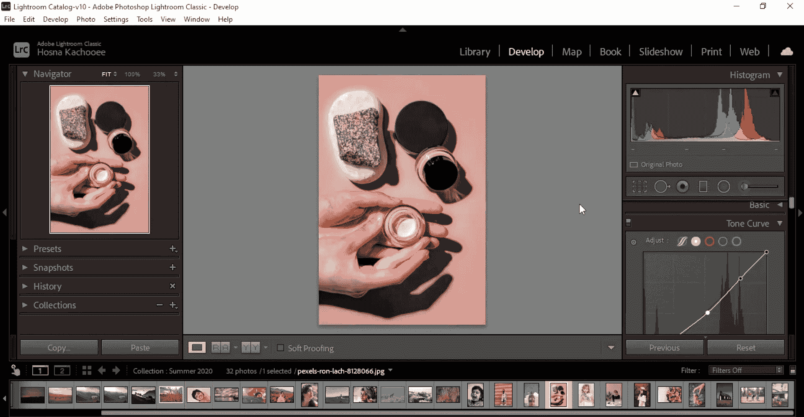

# Adobe Lightroom 产品摄影后期编辑教程：完整版：课程总览 📸


## Adobe Lightroom 产品摄影后期编辑教程：01：课程概述与导入 🎯

在本节课中，我们将继续学习产品摄影的后期编辑方法。上一节课我们已经介绍了一些基础的调光和调色技巧，本节课我们要把这些技巧应用到一张新的产品照片上。这张照片使用了不同的道具和背景，非常适合用来练习和巩固之前所学的内容。

这张照片来自 Pixels 平台，拍摄者是一位摄影师。虽然道具和背景与上一节课不同，但编辑的基本思路是一样的。你不需要担心背景变化，因为我们将使用同样的步骤来处理光影、色彩和细节。跟着讲师的操作顺序，即使你是初学者，也能逐步掌握产品照片后期处理的完整流程。

## Adobe Lightroom 产品摄影后期编辑教程：02：开启剪切指示器与基础光照分析 🔍

在开始具体调整之前，我们需要先分析图片当前的曝光状态，找出哪些区域过亮或过暗。

讲师首先会增加图片的去雾数值，去雾可以让画面看起来更清晰。之后建议始终保持直方图开启，因为直方图能帮助我们判断图片的亮度分布。接下来按下键盘上的 J 键，开启剪切指示器。剪切指示器会用颜色标记出丢失细节的区域。

以下是剪切指示器的含义：

- 红色区域代表高光剪切，也就是画面变成了纯白，这些区域没有任何细节。
- 蓝色区域代表阴影剪切，也就是画面变成了纯黑，这些区域也没有任何细节。

需要注意的是，我们的目标并不是要完全删除所有剪切区域。有些区域本身就应该是黑色或白色，比如产品的盖子就是黑色的，我们无法把它变亮，否则会破坏物体本身的设计和颜色。因此保留一定的剪切区域是正常的。

```
J 键：开启或关闭剪切指示器
红色区域 = 高光剪切（纯白，无细节）
蓝色区域 = 阴影剪切（纯黑，无细节）
```

## Adobe Lightroom 产品摄影后期编辑教程：03：基础光照参数调整 💡

分析完光影问题后，我们可以开始调整基础面板里的曝光参数，让图片整体亮度更合适。

讲师会先关闭高光警告，但保持 J 键开启的剪切指示器，这样在调整过程中可以随时观察高光和阴影情况。具体调整步骤如下：

- 增加去雾数值，提升画面透明度。
- 提高阴影，把暗部细节拉回来。
- 略微调整高光，避免过度亮化。
- 增加对比度，让明暗层次更分明。
- 降低白点，防止亮部过曝。
- 提高黑点，让暗部不过于死黑。
- 微调整体曝光，稍微降低高光，避免编辑过度。

调整完成后，我们可以查看前后对比。你会发现图片仍然有一些蓝色和白色的剪切标记，但这没关系，因为这些区域取决于图片本身。就像刚才说的，产品盖子需要保持黑色，不能强行曝光，否则会影响物体的设计效果。之后再稍微降低一点高光，画面就会看好很多。

## Adobe Lightroom 产品摄影后期编辑教程：04：增强画面存在感 ✨

光影调整完成后，下一步是提升画面的质感和细节表现，让产品看起来更有立体感。

讲师会在 Presence 面板中增加清晰度和纹理。清晰度可以增强中调对比，让整体画面更锐利；纹理则更关注物体表面的细小凹凸，能突出产品材质的细节。同时也会增加自然饱和度和普通饱和度，让颜色更鲜艳。如果图片背景是有颜色的，可以适当调整背景饱和度。如果手部皮肤看起来太偏橙色，可以回到 HSL 面板，修正肤色的色调，让手部颜色更自然。

## Adobe Lightroom 产品摄影后期编辑教程：05：色调曲线精修光影 📈

基础面板的调整完成后，我们可以进一步使用色调曲线来精细控制画面的光影分布。

讲师会先调整阴影，再降低高光，然后制作一条 S 曲线。S 曲线的作用是增加整体对比度，让亮部更亮、暗部更暗。这条曲线不需要严格呈现标准的 S 形，只要调整后画面看起来舒服、自然就可以。

```
色调曲线 S 型调整：亮部上提，暗部下压，整体对比度增加
```

完成光影调整之后，我们就可以进入颜色处理阶段了。

## Adobe Lightroom 产品摄影后期编辑教程：06：选择性色彩调整 🎨

在光影处理完毕后，我们要开始调整色彩，重点优化背景和主体之间的色彩关系。

具体操作如下：

- 选择饱和度调整工具，点击背景区域并向上拖动，增加背景颜色的饱和度。
- 对蓝色通道做同样的操作，如果蓝色区域显得太暗，可以适当增加亮度。
- 对手部区域稍微降低饱和度，让手部与背景融合得更自然。

通过这些选择性调整，背景颜色会更突出，而主体产品和手部也会与环境协调统一。

## Adobe Lightroom 产品摄影后期编辑教程：07：色彩分级赋予个性 🌈

基础色彩调整完成后，我们可以使用色彩分级功能，为图片增加个性化的风格色调。

讲师会在阴影和高光部分分别加入黄色调，让画面整体温暖一些，同时让手部和背景的色调更接近。在进行这些调整时，也要检查图片的细节和噪点。本图噪点不明显，所以暂时不需要进行降噪处理。完成色彩分级后，画面就会有更多的个人风格和视觉吸引力。

## Adobe Lightroom 产品摄影后期编辑教程：08：镜头校正与画面变形 🔧

色彩调整完成后，我们需要处理镜头带来的画面变形问题，让产品边缘更直、更规范。

具体调整包括：

- 在镜头校正面板中，向后移动滑块来消除鱼眼效果，使画面更平整。
- 开启约束裁剪功能，去除画面边缘的空白区域。
- 检查色差，本图中没有发现明显的色差操作，因此不需要额外处理。
- 稍微暗化画面角落，因为角落部分原本过于明亮。
- 使用变换面板缩放图像并移动偏移量，配合约束裁剪清理多余空白。
- 效果面板和校准面板暂时保持默认，不需要额外调整。

完成这些步骤后，画面的几何变形问题就得到了解决，产品的边缘看起来更正常。

## Adobe Lightroom 产品摄影后期编辑教程：09：局部调整画笔实战（手部） 🖌️

全局调整完成后，我们需要对手部等局部区域进行针对性修正，让主体细节更出众。

首先启用调整画笔，并开启显示选中叠加层，这样涂抹过的区域会显示为红色，方便你知道自己画在了哪里。使用鼠标滚轮调整画笔大小，并开启羽化功能，羽化可以让涂抹边缘更柔和，稍后如果误涂到不需要的区域，也容易擦除。

以下是调整画笔的使用要点：

- 涂抹手部区域，完成粗略选区即可，不需要完美。
- 按住 Alt 键切换到擦除模式，去除不需要调整的区域，比如产品本身。
- Alt 键按下时会出现减号标记，表示这些部分不会受到调整影响。

涂抹完成后，关闭叠加层显示，开始对手部进行调整。增加对比度，稍微降低高光，然后降低饱和度，因为手部原来过于饱和，容易和背景混在一起。最后给手部增加冷色调，将温度调为负值，比如设为 -3，这样手部与背景的色调会更加平衡。

```
Alt 键：切换调整画笔为擦除模式
温度：-3（给手部增加冷色调）
```

## Adobe Lightroom 产品摄影后期编辑教程：10：背景区域局部调整 🖼️

手部调整完成后，我们继续对背景区域进行局部优化，让背景颜色更符合整体风格。

创建另一个调整画笔选择，涂抹除手部和产品以外的所有背景区域。关闭叠加层显示后，我们可以清楚地看到自己在调整什么。增加背景饱和度，并调整色相，把背景改成淡粉色。之所以这样做，是因为之前的图片中手部与背景颜色太接近，容易混在一起，现在需要拉开色彩差异。

如果在涂抹过程中发现手指周围或产品边缘处理不够干净，可以再次使用画笔快速修复，确保选择范围准确。

## Adobe Lightroom 产品摄影后期编辑教程：11：细节修复与最终检查 🔍

所有局部调整完成后，我们需要仔细检查并修复可能存在的问题。

讲师发现自己在之前的操作中误涂到了阴影区域，而阴影不应该被错误调整，因此需要回去修正。你可以点击之前创建的背景选择面板，回到那个选区继续微调。调整画笔面板上会显示小点，每个点代表一次涂抹记录，点击就可以回到对应的调整面板，查看并修改该区域的参数。

最后，我们来看看前后对比。把原始图片和编辑后的图片并排放在一起，可以清楚地看到背景颜色已经改变，整体亮度也更亮，镜头校正已经消除了鱼眼效果。你可以根据自己的喜好，把背景改成蓝色、黄色或其他任何颜色。

## Adobe Lightroom 产品摄影后期编辑教程：12：课程总结与下节预告 📚



至此，这张产品照片的后期编辑流程已经全部完成。

本节课我们一起学习了如何在 Lightroom 中编辑产品照片，包括使用 J 键开启剪切指示器来判断过曝和欠曝区域、调整基础曝光参数、使用色调曲线精修光影、进行选择性色彩调整、使用色彩分级赋予画面个性、进行镜头校正以消除鱼眼效果，以及使用调整画笔对手部和背景进行局部修正。这些基础技巧可以应用到不同的产品照片和人像照片中，帮助你快速提升后期处理效果。

下节课我们将讨论不同类别的摄影后期编辑内容，敬请期待。
