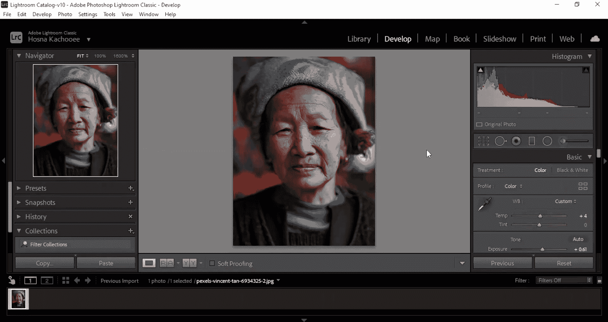

📸 Complete Adobe Lightroom Megacourse： Beginner to Expert Photo Editing：34：人像后期基础

在本节课中我们将要学习人像照片的基础后期编辑流程。我们会使用一张拍摄于老妇人身上的照片作为示例，这张照片本身就有非常丰富的色彩和细节。在放大查看她的脸部时，你会发现很多细纹和皮肤纹理，这些细节在自然风格的后期编辑中是我们希望保留的内容。当然你也可以按照自己的喜好选择不同的风格，但本节课中我会演示一种比较自然的处理方式，让最终效果看起来真实且舒适。

在介绍完示例图片之后，我们先来看看具体的照片内容以及整体编辑思路。

以下是我们将使用的示例图片以及编辑思路。

- 这是一张老妇人的肖像照，光线来自画面右上角。
- 照片中包含大量色彩与皮肤纹理，适合用来练习保留细节的编辑方法。
- 我们的目标是让画面更自然，同时把观众的注意力集中在人物脸上。

在完成了对示例图片的初步了解之后，我们先来处理画面的构图问题。

右侧裁剪工具可以帮我们重新安排画面里人物的位置。在本例中，老妇人原本位于画面左侧边缘，这并不是最理想的构图。我们要把她移到画面中央，这样观众的视线会更直接地落在她的脸上。具体操作如下。

- 点击裁剪工具图标，进入裁剪模式。
- 选择四比三的宽高比，让画面看起来更方正，而不是修长的竖构图。
- 以鼻子作为参考点，把人物脸部大致放在画面中心位置。
- 确认位置合适后，点击完成或确定按钮退出裁剪。

裁剪的核心逻辑可以用代码表示。

```
裁剪后构图 = 原始画面 × 4:3 比例
人物位置 = 画面中心
```

调整完裁剪之后，得到我们想要编辑的图片，接下来我们要进入最基础也最重要的步骤，也就是调整图片的色调与光线。

所有的照片编辑都建立在光线的基础之上，所以我们要先确保图片的曝光度合适，既不能太暗也不能太亮。曝光滑块会照亮整张图片，如果你发现画面太暗或太亮，可以双击滑块文字将其重置。在本例中，原片偏暗，我们需要稍微提高曝光值。

以下是曝光与对比度的常见调整参数。

- 曝光：控制整张图片的整体亮度。
- 对比度：控制高光与阴影之间的差异。

光线调整的核心公式如下。

```
对比度 = 高光亮度 - 阴影亮度
```

曝光和对比度设置好之后，我们需要进一步处理画面中的亮部与暗部细节。

高光滑块只影响图片中最明亮的区域，在本例中就是老妇人脸部右侧受光最强的部分。因为光源来自右上角，那部分亮度过高，我们需要把高光稍微降低，让皮肤看起来更柔和。阴影滑块则影响最暗的区域，比如衣服部分，我们可以适当加深阴影，把观众的注意力集中在脸上。

高光与阴影的调整要点如下。

- 高光：降低，避免脸部过亮。
- 阴影：适当降低，突出人物面部。

除了高光和阴影，我们还需要处理画面中最亮的白色部分和最暗的黑色部分。

白色滑块控制纯白区域，黑色滑块控制纯黑区域。在本例中，我们可以稍微降低白色点，避免画面发灰，同时也稍微降低黑色点，增加一点层次感。这样调整之后，画面的整体光线效果已经比较理想了。

白色与黑色点的调整建议如下。

- 白色：微幅降低。
- 黑色：微幅降低。

完成了基础的光线调整之后，我们可以继续优化图片的质感和存在感。

存在感面板主要用来调整图片的雾气感和整体强度，包括纹理、清晰度和去雾三个滑块。纹理会放大图片中已有的细节，数值过高会产生噪点，不适合自然风格，所以我们保持默认或重置即可。清晰度是一个增强细节的工具，稍微调整就能让图片更有层次，但不能过度，否则会引入噪点。去雾用来去除图片中的雾蒙感，数值过低会让画面失去细节，数值过高会显得不自然，我们选择一个适中的数值即可。

以下是这些滑块的作用列表。

- 纹理：增强局部细节，适度使用。
- 清晰度：增加整体锐利感，注意控制噪点。
- 去雾：去除雾气，保持自然透明感。

存在感调整的核心公式如下。

```
图像质量 = 细节保留量 - 噪点数量
```

在光线和质感处理完成之后，接下来我们来调整图片的颜色表现。

颜色面板包含自然饱和度和饱和度两个选项。自然饱和度会更智能地保护肤色，而饱和度会平均地影响所有颜色。在本例中，原片颜色已经比较鲜艳，我们可以稍微降低自然饱和度，同时也稍微降低饱和度，但会稍微提高一点自然饱和度，让整体看起来更协调。

颜色调整的简单列表如下。

- 降低自然饱和度，防止颜色过于艳丽。
- 降低饱和度，让画面更克制。
- 适当提升自然饱和度，保持整体协调。

完成了基础颜色调整之后，我们可以使用曲线工具对光线进行更精细的控制。

曲线面板给了我们更多的光线调整自由度，其中包括高光、明亮部位、暗部和阴影四个区域。在本例中，我们只需要对高光部分做一点微调，让整体光线更柔和。其余部分可以保持默认，因为我们已经在上面完成了主要的光线调整。

曲线调整的核心逻辑可以用代码表示。

```
曲线调整 = 高光区域 + 明亮区域 + 暗部区域 + 阴影区域
```

曲线调整完成之后，我们可以继续针对特定颜色进行更细致的修改。

在颜色混合器面板中，你可以分别改变某个颜色的色相、饱和度和明度。比如如果你不喜欢画面中的蓝色，可以在色相里找到蓝色，然后把它向两侧移动来改变颜色。但不要调得太过分，否则画面会显得不真实。在本例中，我们保留蓝色，因为它能衬托人物脸部，但蓝色稍微偏亮，会抢走观众对脸部的注意力，所以我们进入饱和度选项，找到蓝色并把它降低，从而去掉过多的蓝色，让注意力重新回到脸上。接下来我们可以进一步改变颜色的亮度，把蓝色调暗一些，这样我就比较满意了，画面重新聚焦在老妇人的脸上。

除了蓝色之外，我们还可以调整人物皮肤的颜色强度。皮肤色调通常对应橙色，我们进入饱和度选项，找到橙色，把数值控制在二十五左右或者更低，让脸部有一点颜色但不会过于橙黄。然后再进入明度选项，稍微提高脸部的亮度，让皮肤看起来更健康。

以下是色相、饱和度、明度的常见操作列表。

- 蓝色色相：保持不变，保持画面协调。
- 蓝色饱和度：降低，减少背景干扰。
- 蓝色明度：调暗，突出人物主体。
- 橙色饱和度：控制在二十五左右，保持自然肤色。
- 橙色明度：适当提高，亮化面部。

色彩分级面板用于统一调整整张图片的整体色调，但在本例中没有特别必要，所以我们暂时跳过。

色彩分级面板的名字就说明了它的用途，也就是修改整张图片的整体颜色。在这里你可以处理中间调，也就是画面中不算太亮也不算太暗的部分。你可以随意选择颜色，也可以调整亮暗，但对于这张特定的照片来说，没有必要深入调整，我们会在后续的课程中专门讲解这个功能。

色彩分级的使用说明如下。

- 色彩分级：用于整体色调风格化，本节暂不使用。

完成颜色调整之后，我们需要检查图片的细节，包括锐化和噪点处理。

细节面板主要涉及锐化和降噪，目的是在保留图片细节的同时让画面更干净。前面已经提到过，这张照片本身已经有很多细节，所以不需要再进行额外的锐化，否则会显得过度处理。不过图片中确实存在一些噪点，我们需要适当降低噪点数值，让皮肤看起来更干净，但不能降得太多，否则会丢失真实的皮肤纹理。

细节处理的建议如下。

- 锐化：跳过，避免过度处理。
- 降噪：适当降低，保留自然皮肤质感。

接下来我们来看看镜头校正和变形工具，用来修复镜头带来的光学问题。

镜头校正可以启用配置文件，修复因为饱和度较高而可能出现的紫色边缘等错误。在本例中，问题不明显，但为了保险起见，我们可以开启这个选项，以防画面中有我们暂时没注意到的紫色线条。至于变形工具，我们已经在裁剪的时候把图片弄直了，所以不需要再调整。变形工具在处理建筑和塔楼时会非常有用，因为它能改变透视，让观众的视线流动更自然，我们会在另一节课中详细讲解。

镜头校正与变形的操作建议如下。

- 镜头校正：开启，修复可能的色差。
- 变形：跳过，画面已经校正。

校准面板包含一些色调调整选项，但在本例中我们不会使用，所以直接跳过。

校准面板包含一些色调相关的高级选项，但本节课不需要用到，所以我们直接略过。

完成了所有全局调整之后，我们可以稍微改变一下图片的色温，让画面显得更温暖一些。

色温滑块控制图片的冷暖色调。在本例中，我们可以把照片调得稍微暖和一点，但不要过度，数值设在四左右就可以了，这样画面会更有亲切感。

色温调整建议如下。

- 色温：设为四，使画面偏暖。

最后一步是使用径向滤镜，把观众的注意力集中在人物脸上。

径向滤镜非常适合用来暗化人脸周围的区域，从而让脸部成为唯一的视觉焦点。因为人脸接近圆形，我们可以画一个圆形的滤镜区域，当然你也可以使用正方形或者带角的形状，具体取决于拍摄内容。具体操作如下。

- 点击径向滤镜工具。
- 在画面上画一个粗略的圆形，位置覆盖人脸附近。
- 将滤镜移到人脸位置。
- 在面板中调整设置，这些设置只会影响圆圈外面的区域，也就是我们想要暗化的背景部分。
- 系统会自动增加圆圈外面的曝光度，导致外部比其他地方更亮，我们需要把曝光度降低，大约设为三，达到我们想要的效果。
- 如果觉得边缘过于生硬，可以调整羽化数值，五十是比较理想的数字，能让过渡更平滑。
- 如果你想要对圆圈内部进行同样的调整，只需点击反转按钮，此时修改只会影响人脸区域。

径向滤镜的参数列表如下。

- 形状：圆形，贴合人脸轮廓。
- 影响区域：圆圈外部，用于暗化背景。
- 曝光度：降低到大约三。
- 羽化：设为五十，边缘过渡平滑。
- 反转：可选，用于只调整圆圈内部。

径向滤镜的反转逻辑可以用代码表示。



```
如果 反转 = 假，则 影响区域 = 圆圈外部
如果 反转 = 真，则 影响区域 = 圆圈内部
```

完成这些调整之后，点击完成按钮，我们就得到了最终的图片。

现在我们可以把修改前后的效果放在一起对比，看看具体发生了哪些变化。

对比修改前后的图片，你会发现变化非常明显。我们不仅增加了一些对比度，还提高了饱和度，并且对光线做了相当大的调整。这就是如何使用大量细节进行基础人像编辑的完整流程。


本节课中我们一起学习了人像后期的基础步骤，包括裁剪构图、曝光与对比度、高光与阴影、白色与黑色点、纹理与清晰度、自然饱和度与饱和度、曲线调整、色相饱和度明度、细节降噪、镜头校正、色温调整以及径向滤镜的局部修图。希望你能在未来的课程中继续学习不同风格的人像编辑，以及其他类别的照片，我们会根据商业、社交媒体、杂志等常见标准，讲解如何针对不同风格进行编辑。下节课见。

