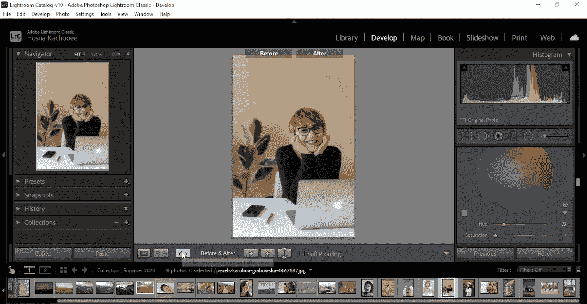

📸 Adobe Lightroom 零基础到专家级修图全套课程：第35章：人像后期进阶（第二部分）

在本节课中，我们将继续学习人像照片的后期处理方法。上一节我们介绍了在纯黑或纯白背景下拍摄的人像修图思路，本节中我们来看看在有道具和多彩背景的人像照片中，如何运用已经学过的基础技巧进行调整。我们会使用一张拍摄对象距离相机较远、并非理想人像构图的示例图片，逐步把它从过曝状态调整为色彩平衡、观感舒适的成片。


第一步：基础面板调整

以下是基础面板中的具体调整步骤：

- 去雾（Dehaze）：先对图像进行去雾处理，为后续编辑打下基础，同时也能让背景和主体都获得一定的空间感。
- 清晰度（Clarity）：适度提高清晰度，增强画面中自然存在的细节，但不要过度。
- 自然饱和度（Vibrance）：提升画面中已有的色彩表现力。
- 高光（Highlights）：降低高光。原图中有大量过曝的高光区域，如果直接使用曝光（Exposure）滑块，不仅高光会变暗，主体的暗部也会一起变暗，因此只针对高光区域降低，能在保护主体亮度的同时修复过曝。
- 阴影（Shadows）：适度提亮阴影，但幅度较小，不是必须步骤。


第二步：色调曲线与颜色混合

以下是色调曲线和颜色混合器的调整方法：

- 色调曲线（Tone Curve）：先调整光照和对比度，采用 S 型曲线。即使曲线不像标准的 S 形那么明显，也同样属于 S 曲线，用来提升整体色彩丰富度。
  ```text
  对比度提升 = 暗部适当压低 + 亮部适当抬升
  ```
- HSL / 颜色混合：分别处理橙色、绿色和黄色。保留画面中橙色调的适当比例，提高绿色的饱和度让植物看起来更有生机，同时提升亮度。对于黄色偏橙的区域，适当提高亮度。
- 中间调与阴影：中间调使用冷色调来平衡画面中大量的暖色，阴影部分则带有偏黄偏绿的色调，以保持整体色彩协调。


第三步：细节与降噪

以下是细节面板的处理方式：

- 降噪：放大图像检查，主体本身不需要额外细节，但画面中存在一定噪点，因此适度降噪，幅度不要太大，避免损失主体本身的色彩。
- 锐化：利用细节面板保留部分细节，使画面看起来更清晰。


第四步：光学畸变与变形校正

以下是光学和变形面板的处理方式：

- 镜头畸变（Distortion）：由于照片存在鱼眼效果，需要将主体稍微远离相机的视觉位置，或在软件中约束裁剪，鱼眼效果在某些场景下是需要的，但在这里不需要。
- 变形（Transform）：利用画面中的参考线（如桌子）进行校正，保持画面水平。如果自动引导点不够准确，可以手动旋转，使桌面看起来比例协调。


第五步：裁剪与最终检查

以下是裁剪和最终效果确认：

- 裁剪：稍微放大主体，去掉画面中显得多余的区域，聚焦人物。
- 效果与颜色校准：不添加颗粒或渐晕，颜色校准保持微调，避免完全不必要的改动。
- 最终检查：将缩放比例调整到 50% 左右，确认细节和色彩都合适。




课程总结

本节课中，我们一起学习了在多彩背景和道具环境下进行人像后期的完整流程，包括基础曝光修复、色调曲线调整、HSL 分色、降噪、畸变校正以及裁剪。最终画面从最初的过曝状态，变成了色彩温暖、平衡舒适的人像作品，非常适合作为网站首页的欢迎图片。你当然可以根据需要改变背景或头发颜色，但我们在这里保留了原始素材的色调。我们通过快速的前后对比，验证了调整效果。这是本节课的全部内容，下一节课我们将学习其他摄影类别的修图方法，敬请期待。

