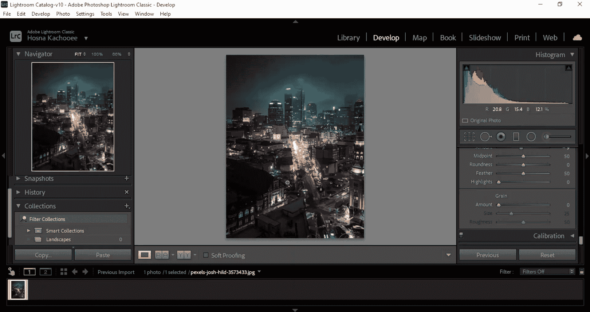

# Adobe Lightroom 零基础到专家照片编辑全攻略：第 p36 章：夜景示例实操 🌙


在本节课中，我们将学习如何使用 Adobe Lightroom 处理夜景照片。夜景拍摄往往比较棘手，因为曝光、光圈以及暗部细节都不容易把握。本节课将带你完成一个完整的夜景城市编辑流程，让你掌握如何让画面中的灯光更加突出，同时把不需要的部分压暗，最终呈现出电影感的夜景效果。

## 第一步：导入图像并去除雾气 🌫️

上一节我们介绍了 Lightroom 的基础界面，本节中我们来看看夜景编辑的第一步。

夜景照片在拍摄时容易受到大气雾气或光污染的影响，导致画面看起来不够清晰。在开始调整光影之前，建议先对图像进行去雾处理，这可以为后续的所有调整打下一个干净的基础。

去雾的核心逻辑可以用下面的公式描述：

```text
清晰图像 = 原始图像 - 雾气遮罩
```

以下是具体操作步骤：

1. 打开 Lightroom 开发模块，导入你的夜景照片。
2. 找到“基础调整”面板中的“去雾”滑块。
3. 适当拉动滑块，直到画面中的雾气或雾霾感明显减少。
4. 观察画面整体对比度，确保去雾后灯光边缘更加清晰。

去雾之后，你会发现原本模糊的夜景变得更加透亮，这为接下来的色调调整提供了更好的掌控空间。

## 第二步：调整基础色调与光影 💡

在完成去雾处理之后，我们进入基础色调调整阶段。

夜景摄影的重点通常不是建筑本身，而是建筑上发出的灯光。因此我们需要降低整体曝光，让画面变暗，从而突出那些发光的部分。下面是光影调整的核心公式：

```text
夜景效果 = 灯光亮度 × 对比度 - 背景杂光
```

以下是建议的基础面板参数调整顺序：

- 曝光：降低数值，使整体画面变暗，突出城市灯光。
- 对比度：提高数值，增加明暗区域之间的层次感。
- 高光：略微提高，保留灯光源的细节，避免过度曝光。
- 阴影：降低数值，让暗部更加深沉，营造夜晚氛围。
- 白色与黑色：根据画面需求微调白点和黑点，平衡整体明暗范围。

调整完成后，画面中的灯光会更加醒目，而建筑和街道的暗部会自然收敛，这就是夜景编辑想要达到的初步效果。

## 第三步：设置色温、清晰度与自然饱和度 🌡️

上一节我们完成了基础的光影调整，本节中我们来看看色彩温度和局部清晰度的处理。

夜景照片通常包含大量暖色调的橙色路灯，以及冷色调的蓝色夜空。如果画面过冷，会破坏城市灯光的温馨感；如果过暖，又可能让夜空显得不自然。因此我们需要找到一个平衡点。

色温调整可以用简单的逻辑表示：

```text
最终色调 = 原始色温 + 暖色偏移量 - 冷色偏移量
```

以下是色温与清晰度的调整建议：

1. 色温：将画面稍微偏向暖色，以匹配橙色城市灯光的色感。
2. 色调：根据需要微调绿洋红平衡，避免画面偏色过重。
3. 清晰度：适当增加，增强边缘轮廓的锐利感。
4. 自然饱和度与饱和度：适度提升，让颜色更有活力，但不要过度饱和。

完成这些调整后，画面整体已经具备了一定的夜景氛围，但颜色还不够精准，我们需要进一步使用色调曲线来深化暗部和亮部。

## 第四步：使用色调曲线深化明暗层次 📈

在完成基础面板和色温设置之后，我们进入色调曲线调整阶段。

色调曲线是 Lightroom 中控制画面明暗分布的强大工具。对于夜景照片，我们的目标是让暗部更黑，让亮部的灯光更亮，从而拉大明暗对比。

色调曲线的作用可以用下面的代码块理解：

```text
输出亮度 = 曲线函数(输入亮度)
```

以下是色调曲线的常用调整思路：

1. 在曲线下方添加一个控制点，拉低阴影区域，使暗部更加深沉。
2. 在曲线上方添加一个控制点，提升高光区域，让城市灯光更加明亮。
3. 中间调保持适当平缓，避免中间 tonal 区域出现断裂或色块。

调整完成后，你会发现画面的夜晚感更加浓厚，灯光与黑暗之间的过渡更加自然，这为后续的颜色细调打下了坚实基础。

## 第五步：HSL 颜色精细调节 🎨

上一节我们介绍了色调曲线的使用，本节中我们来看看 HSL 面板中的颜色精细调节。

HSL 代表色相、饱和度和明度。夜景照片中常常出现过于刺眼的蓝色天空，或者过于基础的橙色灯光。通过 HSL 面板，我们可以针对特定颜色进行独立调整，而不影响整个画面。

颜色调整的核心逻辑如下：

```text
最终颜色 = 原始色相 + 色相偏移量
```

以下是 HSL 面板的调整清单：

- 蓝色明度：降低，让夜空颜色更深，避免分散观众注意力。
- 蓝色饱和度：适当降低，减少天空的过度鲜艳。
- 橙色色相：向红色方向偏移，让路灯呈现更电影感的暖红色。
- 蓝色色相：向绿色方向轻微偏移，平衡天空色调。
- 青色、红色、黄色、绿色、紫色：根据画面中实际出现的颜色，逐一微调色相和饱和度。

完成 HSL 调整后，画面中的颜色会更加协调，城市夜景呈现出一种有意识营造的电影氛围。

## 第六步：分色分级赋予电影质感 🎭

在完成 HSL 颜色调节之后，我们进入分色分级阶段。

分色分级允许我们分别为阴影、中间调和高光添加不同的颜色色调。这是营造电影感夜景照片的关键步骤之一。

分色分级的效果可以这样理解：

```text
最终画面 = 基础色调 + 阴影色调 + 中间调色调 + 高光色调
```

以下是分色分级的建议设置：

1. 阴影：添加偏粉色的色调，增加暗部的质感和层次。
2. 中间调：偏向绿色系，使画面过渡区域更加柔和。
3. 高光：根据需要微调，保持灯光的纯净度。

调整完成后，整张夜景照片会呈现出一种统一的电影色调，不再是单纯的相机直出效果，而是经过艺术化处理的作品。

## 第七步：细节锐化与噪点控制 🔍

上一节我们完成了分色分级，本节中我们来看看细节面板中的锐化与噪点处理。

夜景照片通常在高 ISO 下拍摄，容易产生噪点。同时，因为画面中包含大量灯光和建筑细节，我们需要判断是否需要进行锐化处理。

锐化与噪点控制的判断标准如下：

```text
是否锐化 = 图像是否对焦准确 × 是否需要突出细节
```

以下是具体操作建议：

1. 放大图像至 100%，检查建筑、车辆等元素是否对焦清晰。
2. 如果图像本身已经对焦准确，可以不进行额外锐化，避免引入噪点。
3. 如果暗部存在明显噪点，适当增加噪点降低滑块，使画面更干净。
4. 对于灯光密集的夜景，噪点降低尤其有用，可以让色块更加均匀。

完成细节处理后，画面会在保持清晰的同时，减少高 ISO 带来的颗粒感，观看体验更加舒适。

## 第八步：镜头矫正与变形调整 🔧

在完成细节处理之后，我们简要讨论镜头矫正与变形面板。

夜景城市照片常常包含大量线条和几何结构，镜头畸变可能会导致建筑边缘出现弯曲或色差。Lightroom 提供了镜头矫正功能，可以自动移除这些光学缺陷。

镜头矫正的作用可以用下面的代码表示：

```text
修正图像 = 原始图像 - 镜头畸变 + 色差去除
```

以下是操作建议：

1. 启用镜头配置文件，让 Lightroom 自动识别镜头并矫正畸变。
2. 去除色差，消除灯光边缘可能出现的紫边或绿边。
3. 变形面板：如果你喜欢原始街道的布局和角度，可以不进行变形调整，保持画面的自然构图。

对于本示例中的夜景照片，我们保持原有的街道交叉角度，不使用变形工具，因为原始构图本身已经足够有趣。

## 第九步：添加边角暗角并最终对比 🖼️

上一节我们讨论了镜头矫正，本节中我们来看看最后的润色步骤——边角效果与前后对比。

夜景照片的边缘通常没有重要信息，适当添加暗角可以将观众的视线引向画面中央的灯光和建筑。

边角暗角的强度可以这样设置：

```text
边角暗角 = -19
```



以下是最终润色清单：

1. 进入“效果”面板，适当降低暗角数值，使画面边缘变暗。
2. 建议数值在 -9 到 -19 之间，不要过度，避免出现不自然的黑边。
3. 查看之前和之后的对比效果，确认所有调整都符合预期。

完成这一步后，一张完整的夜景照片编辑流程就结束了。你可以清晰地看到，从原始照片到最终电影感夜景，经历了去雾、色调、色温、曲线、HSL、分色、细节和暗角等多个环节。

## 本节课总结 ✅

本节课中，我们一起学习了如何使用 Adobe Lightroom 编辑一张夜景城市照片。我们掌握了去雾建立基础、调整曝光对比突出灯光、设置色温营造氛围、使用色调曲线深化明暗、通过 HSL 精细调节颜色、运用分色分级赋予电影感、处理细节与噪点、进行镜头矫正，以及添加边角暗角完成最终润色。

希望你能将这些技巧应用到自己的夜景照片中。在不同的拍摄场景下，你可以灵活调整参数，以达到理想的照片效果。这一课到此结束，我们下一课见。

