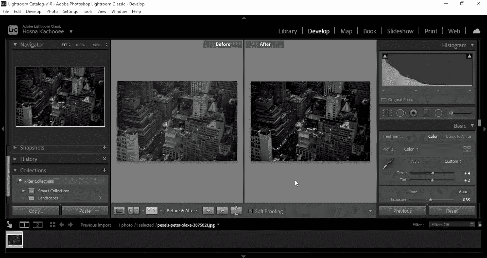
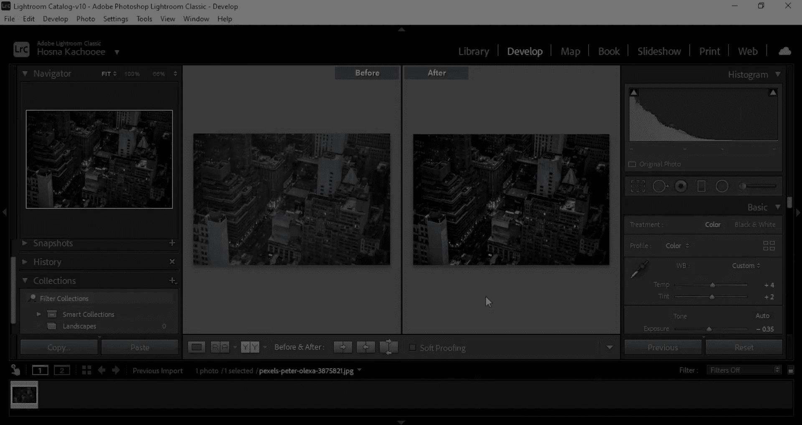

# Adobe Lightroom 夜景照片编辑：第37课：夜景示例 Part 2 🌙


## 课程概述

在这节课中，我们将继续学习如何用 Adobe Lightroom 编辑夜景照片。具体来说，这是夜景示例的第二部分。我们要编辑的这张图片和第一部分非常相似，但不同之处在于，这次画面里的灯光更少，而且拍摄时段比上一张图片更亮，属于白天时段。不过不用担心，编辑思路和上一节课基本一致，我们会一步步把这张照片调出电影感。

## 第一步：先做去雾，建立编辑基础

上一节我们介绍了夜景编辑的基本流程，本节中我们来看看如何从去雾开始。

以下是去雾操作的具体步骤：

- 打开 Lightroom，导入这张夜景照片。
- 找到去雾滑块，将其向右拖动。可以适当调高，甚至拉到最大，因为前后对比会非常明显。
- 去雾之后，画面会变得更清晰，细节更多，给后续编辑留出更大空间。

去雾的核心参数可以表示为：

```
Dehaze = +100（或根据图像情况调至最大）
```

之所以建议先做去雾，是因为它能让暗部和亮部的层次重新拉开，为后面的光线调整打下基础。如果不先去雾，后面再调对比度和曝光，很容易让画面显得浑浊。

## 第二步：调整光线，营造夜晚氛围

完成去雾之后，我们回到光面板，开始改变图像的整体亮度和对比关系。

以下是光线调整的操作顺序：

- 降低曝光，因为我们要营造夜晚城市生活的感觉，画面整体要比较暗。
- 提高对比度，让暗部更暗，亮部更突出。
- 适当提高曝光，找回部分亮度，避免画面过于压暗。
- 提高高光，也就是亮部和白色区域，让灯光更有存在感。
- 提高阴影，保留暗部细节。
- 提高白点，降低黑点，进一步拉伸明暗范围。

光线调整的逻辑可以简化为：

```
曝光：先降低后适度提升
对比度：增加
高光：增加
阴影：增加
白点：增加
黑点：降低
```

之所以这样调整，是因为这张照片拍摄时光线较亮，建筑物的细节比较清晰。在继续往下编辑之前，我们一定要保留建筑物的细节，不能把阴影完全压死，否则主体建筑就会丢失大量纹理。

## 第三步：增加清晰度，突出建筑细节

光线调整完成后，接下来要处理的是图像的清晰度。

以下是清晰度调整的要点：

- 增加清晰度滑块，让建筑物的边缘和纹理更明显。
- 放大图片，仔细观察建筑表面的细节，确保没有过度锐化导致的伪影。
- 对比清晰度开启前后的效果，你会发现建筑物的线条更加锐利。

这一步非常重要，因为夜景照片的主体通常是建筑，如果细节丢失，整张图片就会显得脏乱。调好清晰度之后，我们可以退出放大视图，继续下一步。

## 第四步：饱和度与色调曲线，增强电影感

清晰度处理好以后，我们需要进一步提升色彩和色调层次。

以下是色彩增强的操作：

- 适当提高自然饱和度，让画面中的颜色更鲜艳，但不要过度。
- 打开色调曲线面板，用来进一步增强高光和阴影的对比。
- 把高光点稍微提上去，让亮部更有光泽。
- 把中间色调稍微压低一点，增加画面的深度感。

色调曲线的作用可以理解为：

```
色调曲线：高光 ↑，中间色调 ↓，阴影 保持或微调
```

通过这一步，照片会开始具备一种电影般的质感，颜色更加浓郁，明暗过渡也更自然。

## 第五步：HSL 面板，精细调整颜色色相与亮度

接下来是本课的重点，使用 HSL 面板来改变特定颜色的色相和亮度，让夜景看起来更有电影色调。

以下是 HSL 调整的详细过程：

- 先处理色相。画面中主要是橙色，我们可以把橙色偏向红色，让暖色调更统一。
- 有些颜色看起来比较奇怪，把它改成青蓝色，增加冷暖对比。
- 对蓝色也做同样的操作，如果调得太过，稍微调回来一点点。
- 接着改变红色、品红和紫色的色相，让整体色调更协调。
- 然后切换到亮度选项卡，把蓝色和橙色的亮度都调高，让这些颜色在画面中更突出。
- 也要处理青色，让它与其他颜色融合得更好。
- 对红色也采用同样的亮度调整方法。

HSL 色相调整可以用伪代码表示：

```
HSL.Color.Hue:
  Orange → Red
  Blue → 调整后再微调
  Red → 调整
  Magenta → 调整
  Purple → 调整

HSL.Color.Luminance:
  Blue → Increase
  Orange → Increase
  Aqua → Increase
  Red → Increase
```

调完色相和亮度之后，照片已经看起来非常有电影感了，色彩搭配协调，暖色和冷色形成了良好的对比。

## 第六步：中间色调、阴影与高光色相，塑造画面氛围

HSL 基础调整完成后，我们继续深入色彩分级，针对不同明度区域单独设置色相。

以下是明度色相调整的内容：

- 先处理中间色调，选择一个偏黄的颜色，让画面中间亮度区域带有一定的色彩倾向。
- 因为图像中阴影部分较多，所以也要改变阴影的色相。
- 根据你选择的颜色不同，画面的氛围会发生变化，可以偏冷或偏暖。

关于氛围的具体效果，我们会在另一节课专门讲解，这里只要知道不同颜色会影响观感即可。

调整完成后，我们可以对高光再做一些微调，让亮部的颜色更符合整体基调。现在的画面已经非常有电影感，甚至有点像《第五元素》那种风格，和照片的拍摄角度、汽车以及建筑物非常搭配，就像你在超自然电影里看到的画面一样。

## 第七步：锐化、噪点与变换，检查画面质量

色彩调整完成后，我们需要检查图像的锐度和噪点情况。

以下是画面质量检查的步骤：

- 查看建筑物部分，发现已经足够锐利，不需要额外增加锐化。
- 放大观察，没有发现明显的噪点，所以噪点降低可以跳过。
- 缩小视图，整体看一遍，确认没有问题。
- 跳过其他不需要的面板，直接来到变换选项卡。

变换方面，我喜欢这张照片原本的拍摄角度和透视关系，所以不打算进行变换校正，直接关闭这个面板即可。

## 第八步：暗角、校准与色温，完成最终调色

画面质量确认无误后，我们来做最后的一些收尾工作。

以下是最终调色的操作：

- 在图像的四个角落添加一点点暗角，只加很轻微的效果，让视线更集中在画面中心。
- 不需要添加颗粒，所以颗粒选项不处理。
- 校准面板也不需要，保持默认即可。
- 此时我对照片的效果已经非常满意，看起来就像电影中的一帧，色调分级非常精准。

如果你想按照自己的喜好再做调整，可以回去改变每种颜色的色相，让画面更冷、更暖，或者增加更多蓝色和红色。

这让我想起，我实际上还没有添加色温。现在补上一点色温，数值大概设为 4 左右，再加一点点色调。调整过多就不需要了，保持适度即可。

色温调整可以表示为：

```
Temperature ≈ +4
Tint = 少量调整
```

## 第九步：前后对比与课程总结

所有调整完成后，我们来看看编辑前后的效果对比。

以下是最终效果的预览：



- 调整前：画面较为平淡，夜景氛围不明显，建筑细节不够突出。
- 调整后：画面具有浓厚的电影感，色彩对比协调，建筑细节清晰，整体基调符合夜晚城市生活的感觉。



这就是我追求的最终效果，我很满意，也会坚持目前的编辑方案。好了，本节课到此结束。下节课见，我们将学习不同风格和不同类别的照片，以及如何用 Lightroom 编辑它们。下次见。
