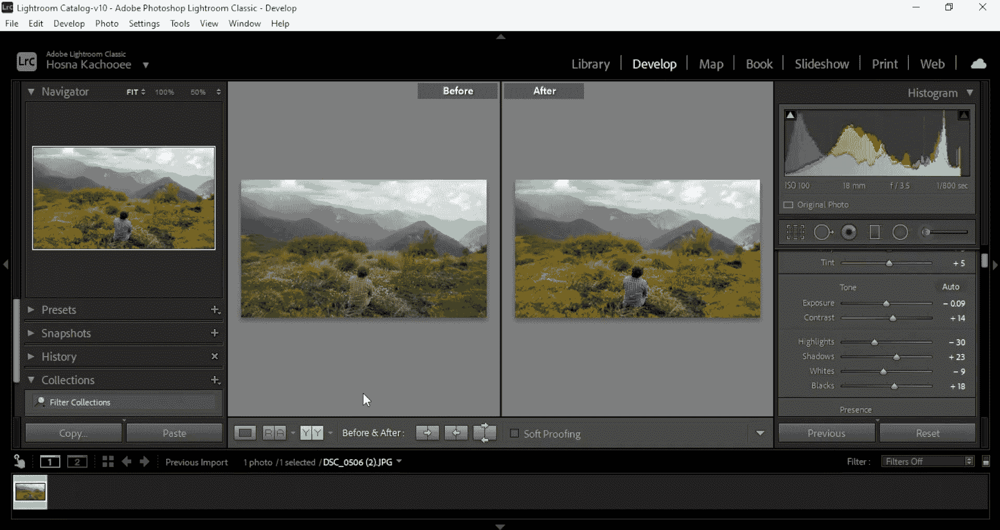

# Complete Adobe Lightroom Megacourse：133：🏞️ 风景照片编辑基础

在本节课中我们将要学习如何使用 Adobe Lightroom 编辑一张风景照片，并把它变成一张好看的成片。风景照片通常包含很多不同的元素，比如云朵、山脉、草地、树叶和人物，我们的任务是让所有这些颜色和光影协调统一。相比于人像照片，风景照片的编辑通常需要花更多时间，因为要处理的颜色更多，也更复杂。不过不用担心，本节课会用大白话把每一步都讲清楚，即使你是完全的初学者也能跟着做。下面我们就正式开始，先从整体的编辑思路说起。

上一节我们介绍了 Lightroom 的基础操作，本节中我们来看看风景照片编辑的核心目标。在一张风景照片里，常常会出现云、山、草、紫色树叶、灌木，还有一个人像主体。编辑时我们要做的是，让这些元素之间产生一种和谐感，而不是让某一种颜色过于突兀。因为涉及的元素多，所以编辑风景照片比编辑人像照片要花更多时间。具体要花多少时间，取决于你想要达到什么样的风格，不同的风格需要不同的颜色数值。比如这张照片里有比较鲜艳的绿色、背景里的蓝色、一些棕色，还有这里的紫色，我们需要把这些颜色平衡起来，最终组成一张美观的风景图。稍后我们会用到 HSL 面板来完成这个平衡，先调整各个元素的色相，让它们符合我们要编辑的风格。为了简单起见，本节课我会只改变一些颜色数值，不会做得太复杂，更复杂的编辑风格会留给后面的课程。

以下是风景照片中常见的主要编辑元素：
- 云朵
- 山脉
- 草地
- 紫色树叶
- 灌木
- 人物主体

好了，聊完编辑目标之后，我们进入实际操作。上一节我们介绍了风景照片的编辑目标，本节中我们来看看如何使用基础面板调整光线和色彩存在感。首先从白平衡开始，我会给照片加一点暖色调，同时加一点品红色调。然后往下调曝光，稍微降低一点，这样可以更清楚地看到云层里的细节。接着增加对比度，降低高光，提高阴影，降低白点，提高黑点。这时候从光线角度来看，图像已经看起来不错了。为了让效果更好，我们可以使用去雾功能，把图像里的雾气去掉，这样图像背景的细节会更多。接下来增加清晰度，把更多细节表现出来。因为这张照片颜色比较多，我也想让颜色更有生命力，所以会提高自然饱和度和普通饱和度。到此为止，光线、存在感和细节部分就处理完了。

以下是基础面板的调整顺序和大致方向：
- 白平衡：偏暖，加入品红色调
- 曝光：略微降低
- 对比度：增加
- 高光：降低
- 阴影：增加
- 白点：降低
- 黑点：增加
- 去雾：开启
- 清晰度：增加
- 自然饱和度：增加
- 饱和度：增加

基础面板调完以后，我们可以继续用色调曲线来进一步塑造图像的亮部和暗部。上一节我们介绍了基础面板的光线调整，本节中我们来看看色调曲线，用来再微调一下明暗关系。我会稍微降低阴影，高光先保持不变，然后降低亮部，再把亮部稍微提起来，同时把阴影也往上提一点。就这样先保留，等之后调整完颜色明暗之后，还可以再回来改色调曲线。

光影部分处理完成之后，最关键的颜色环节就要开始了。上一节我们介绍了色调曲线的明暗调整，本节中我们来看看 HSL 面板，这是处理风景照片颜色的核心工具。HSL 是三个英文单词的缩写，分别是 Hue 色相、Saturation 饱和度、Luminance 亮度。你可以把它理解为一组颜色控制开关，分别控制颜色的色调、浓淡和明暗。先从色相开始，我要把这里的绿色改一下，因为我觉得现在的绿色太鲜艳了，更适合偏一点橙色，当然你也可以保持原来的样子，这只是我的个人喜好。我会把绿色向左拖动，直到自己满意为止。然后对后面的紫色和蓝色做同样的处理，把它们的色相都向左拖，让颜色更蓝一些，这样看起来会更协调。青色则向右拖一点，黄色向左拖变得更像橙色，红色保持在负十七左右。色相调整完之后，接下来是饱和度，我会降低橙色的饱和度，觉得这样就不错了，颜色已经比较令人满意。

HSL 色相调整的示例方向如下：
- 绿色：向左，偏橙色
- 紫色和蓝色：向左，更蓝
- 青色：向右
- 黄色：向左，偏橙色
- 红色：保持负十七

色相调整好以后，我们继续看饱和度和亮度，让各种颜色更好地融合在一起。上一节我们介绍了 HSL 色相的调整方法，本节中我们来看看饱和度和亮度，让图像整体看起来更舒服。我会降低橙色的饱和度，然后提高绿色、紫色以及山脉其他颜色的亮度，这样整体效果就可以了。如果你想进一步改变颜色，也可以继续往下调，不过现在先到这里。

接下来我们进入色彩分级环节，给整张照片加上统一的色调氛围。上一节我们介绍了 HSL 的饱和度和亮度，本节中我们来看看色彩分级，用来给中间调、阴影和高光分别上色。我先从中间调开始，给照片加一点橙色色调，并调高强度，阴影部分也同样加一点橙色。至于高光部分，我打算让它偏绿色一点，这样天空会呈现出一种青色的感觉。接着分别调整三者的亮度，平衡和混合它们，让色彩过渡更自然。

色彩分级完成之后，我们需要检查图像的锐度和噪点。上一节我们介绍了色彩分级的上色思路，本节中我们来看看细节面板，处理锐化和降噪问题。先放大图片看看锐化情况，我觉得目前的锐化已经差不多了，就跳过不做了。关于降噪，你需要重点查看天空部分，看看有没有噪点。我仔细看了一下，噪点不算太多，但还是会增加一点色彩降噪。再看看云层，有一点点噪点，那些小点就是噪点。往下看山脉，那里也有一点噪点，稍微调高一些就可以了。另外也要处理一下色彩降噪，让颜色看起来更平滑。调整完之后可以缩放回原图，检查整体效果。

细节和降噪处理完之后，我们来处理镜头校正和变形，去除可能的颜色瑕疵和形变。上一节我们介绍了细节面板的锐化和降噪，本节中我们来看看镜头校正和变形，让画面更规整。先开启去色差功能，就像前面提到的，以防万一，这样 Lightroom 可以自动检测我们肉眼可能看不到的颜色瑕疵，并自动修复。开启这个选项总是有帮助的。然后进入变形面板，我想把图像稍微向左旋转一点。旋转之后你会注意到画面边缘出现了一些白边，这是因为我们还没有开启自动裁剪。开启后 Lightroom 会自动把那些白边裁掉，这样你就不需要手动裁剪，节省了很多时间。

变形调整完成之后，我们可以在效果面板里给照片边缘加一点轻微的氛围。上一节我们介绍了镜头校正和变形，本节中我们来看看效果面板，处理边缘的暗角或亮边。如果你想让画面角落稍微暗一点或者亮一点，都可以在这里调整。我打算让边缘稍微亮一点，数值大约加二，不要太重，我也不想出现绿色边缘。

全局调整基本完成之后，我们遇到了一个比较常见的问题，也就是人物主体和周围风景颜色太像，容易融在一起。上一节我们介绍了效果面板的边缘调整，本节中我们来看看如何使用调整画笔，对人物进行局部颜色修改。你可以看图，人物的头发和衣服跟周围的风景几乎融在一起，观众可能需要一段时间才能发现这里其实是一个人像主体。如果你也不喜欢主体原本的颜色，可以用调整画笔来解决。调整画笔是 Lightroom 一个非常实用的工具，简单来说，就像它的名字一样，它是一支画笔，允许你对涂抹的区域进行调整，而不会影响到画笔之外的地方。

调整画笔的工作原理可以用简单的代码表示：
```
仅作用于涂抹区域 = 局部参数修改
不影响未涂抹区域 = 全局参数保持不变
```

使用画笔时，有几个设置非常重要。首先是画笔大小，可以根据需要变大或变小。其次是羽化，这个选项非常关键，必须开启。如果关闭羽化，画笔边缘会非常生硬，跟图像其他部分融合不好，看起来很假。开启羽化之后，边缘就会平滑很多，建议先从五十开始尝试，你可以根据实际情况调整。这里有两个画笔选项，画笔 A 和画笔 B，你可以设置一个大画笔，一个小画笔，这样处理大面积区域和小细节会更方便。比如如果主体的手伸出来，你就需要在大画笔和小画笔之间切换。现在我们先设定一个大小，另一个设得更小一些，这样能涂出干净的边缘。

接下来我们要演示如何给画笔区域上色。先打开曝光叠加，这样你就能清楚地看到自己在涂哪里。比如我在这块区域涂一下，你会发现只有这一块变成了过曝状态。如果想把这块变暗，就把曝光滑块往下拉。不过在本节课里，我们主要是改颜色，所以先调整色温和色调，给选中的区域改色相。不要让衣服变成绿色，因为周围已经是绿色了，我们选蓝色比较好。也可以调整饱和度，让颜色变淡。你甚至可以把某个部分的饱和度完全去掉，做成单色图像，比如让玫瑰保持红色，其他部分变成黑白，那个技巧我们会在另一节课讲。现在我只想让人物的衣服保留颜色，噪点和锐化这里不需要太关注。在下方你还可以添加去雾和清晰度，这部分对人像照片很有用，比如想要让皮肤看起来更光滑，适合时尚人像或高端修图。

光线部分我会增加对比度，同时把蓝色稍微暖和一点。调整完毕之后，我放大图片，开始给人物的衣服涂色，把饱和度稍微降低一点。为了让你看清差别，我先演示一下不开启羽化时的效果。把羽化完全关掉，随便涂几笔，你会发现边缘没有融合进去，看起来很假。再把羽化打开，你会发现涂抹区域完美融合了。所以我们要开启羽化，并且控制在一个合适的量，我觉得现在这个量不错，稍微再增加一点羽化也可以。现在我就可以直接涂抹我想要改变颜色的区域了。

涂抹过程需要一点时间，你需要在之前调好的两个画笔之间切换，一个大一个小，这样能够涂到人物身上那些小细节位置。现在我先只处理她的衣服，头发之后要再单独调整，因为我们不希望头发也变成蓝色。我先勾勒出衣服的轮廓，涂完之后稍后再回来。好了，衣服已经勾勒完了，现在她的衣服变成了蓝色。如果要用橡皮擦工具，选择擦除，你会看到画笔上出现负号，同样可以调整羽化，我会稍微减少一点。如果你现在用的是鼠标，滚动滚轮就可以改变画笔大小，不用再回到这里调整，这样会方便很多。不过不管怎样，画笔 A 和画笔 B 都会很有用，你不需要每次都重新设置。现在我们来删除刚才画多的笔触。好了，现在人物穿着一件蓝色的衬衫，我觉得她跟周围环境融合得非常好，而且因为衬衫颜色比较鲜艳，她成了第一眼就能注意到的地方。

衣服处理完之后，我回到 HSL 面板，继续调整绿色的色相。不小心把蓝色重置了，所以我要把数值改回原来的样子。好了，衣服颜色没问题之后，我们可以继续处理人物的头发。也许可以把头发调暗一点或者调亮一点，把她变成金发或者其他颜色，随你喜欢。现在她的头发是这种金棕色的颜色。我们回到调整画笔，因为要给头发和衣服上两种不同的颜色，所以要重复这个操作两次。我现在就在调整画笔界面，因为我的画笔上有加号，这意味着我正在增加曝光，曝光已经自动提高了，所以我稍微涂一下，就能看到该区域受到影响了。和之前一样，我先勾勒出头发的轮廓，涂完之后马上回来。

好了，头发已经勾勒完了，接下来我要把头发颜色调暗一点。先把曝光重置，让颜色恢复原来的样子，然后增加对比度，稍微把这个区域调暗，接着继续调整光线，直到满意为止。我们希望头发稍微暗一点，这样可以找回之前去雾功能丢失的一些细节，同时增加清晰度，增加画面的立体感。色相这里不需要改，因为我们现在不是在找紫色或绿色这种反常颜色，只是想稍微降低一点颜色的强度。这样处理之后，头发看起来比周围的灌木要好一些。接下来回到黑点滑块，再根据喜好微调。好了，头发处理完成，缩放回原图，现在她几乎是黑色的头发，或者说是深棕色偏黑，跟周围的灌木不一样了，这正是我们想要的效果。现在她作为一个独立的主体凸显出来了，不会再跟周围的风景混在一起。

局部调整完成之后，我们可以对图像进行裁剪，调整主体的位置。上一节我们介绍了如何用调整画笔处理头发，本节中我们来看看裁剪工具，让构图更合理。我想让人物放在画面中央，现在她稍微偏右了一点，我们可以裁剪一下让她居中，或者创造一种你喜欢的构图感。比如人物显得有点矮，六比九的比例可能比较合适。把裁剪框调大，再放到合适的位置，现在人物的头就在中间了。你也可以调整角度，不过我对现在的角度比较满意，点击完成就可以。

裁剪完成之后，我们还发现画面下方有一些紫色花朵，因为太远了，颜色看起来像黑色，其实是紫色的。上一节我们介绍了裁剪和构图调整，本节中我们来看看如何再次使用调整画笔，让这些紫色花朵更明显。回到调整画笔，这里是我们之前设置的点，我们要添加一个新点，然后再把它涂在那些紫色花朵上，涂完之后马上回来。

好了，花朵已经勾勒完了，首先我要关闭曝光，不希望它们被过曝。接着增加色调，把品红色和紫色的叶子表现出来。然后处理去雾，在选中的区域增加去雾，找出细节，同时增加清晰度。就这样就可以了。我想让紫色稍微暗一点，当然你也可以增加阴影让紫色变浅，不过我不想重置，直接点击完成。现在我的紫色花朵可见了，可以被认出来是紫色的叶子。这样这张图片就编辑完成了。

我们完成了裁剪，编辑了自然元素，也改变了某些部分的颜色，这就是编辑风景照片的方法。这些额外的调整完全可以不做，但对你的风景照片有一个构思总是有帮助的。你应该始终设想每个部分应该是什么颜色，就像我们刚才做的那样。暂时先到这里，我们来看看修改前后的对比。现在看起来好多了，更加个性化，完全是按照我自己的喜好调整的。希望大家都能跟上，学到本节课提到的技巧。基础课程就到这里了，下节课见。



本节课我们一起学习了如何在 Adobe Lightroom 中编辑一张风景照片，包括基础面板的光线与存在感调整、色调曲线的明暗塑造、HSL 面板的色相、饱和度与亮度控制、色彩分级的整体氛围上色、细节面板的锐化与降噪、镜头校正与变形的画面修正、效果面板的边缘处理，以及使用调整画笔对衣服、头发和紫色花朵进行局部颜色修改，最后进行裁剪和前后对比。希望你能跟着步骤自己动手试一次，下次课见。

