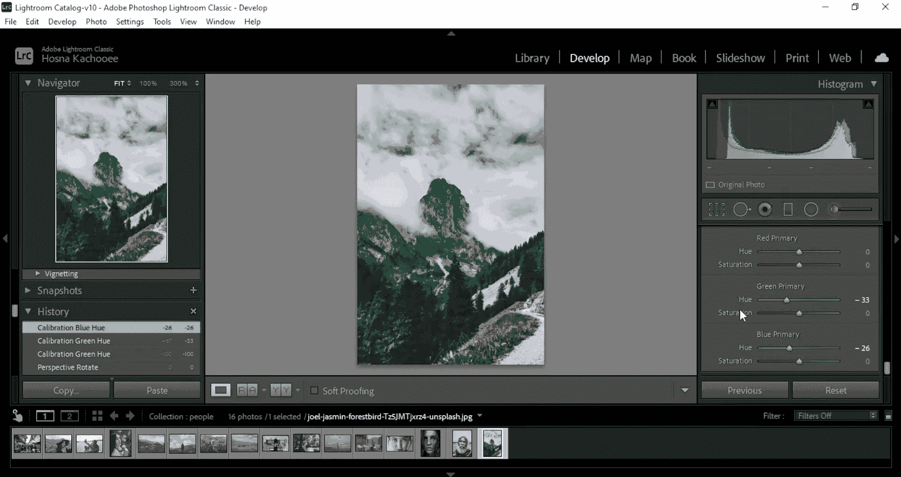

# Adobe Lightroom 零基础到专家后期处理大课：39：风景后期实战（第二部分）🏞️

在本节课中，我们将继续学习风景照片的后期处理，重点介绍一张竖构图风景照的完整调色流程。这张照片里有一条小路，天空中布满了云朵，而且没有人物主体，所以我们需要把全部精力集中在天空、道路、树木和山脉的光影平衡上。我们会从最基础的曝光调整开始，逐步引入局部调整工具来单独处理天空区域，再进入HSL色彩和色彩分级环节，最后完成降噪、镜头校正和前后对比。跟着这个流程，即使是初学者也能理解每一步调整的目的。

## 第一部分：整体光影与基础面板调整 🌤️

首先，我们需要处理照片的整体光影，为后续的局部调整打下基础。打开Lightroom后，首先使用去雾工具增加画面的清晰层次，然后提高清晰度让细节更突出。接下来回到光影面板，降低高光以挽回天空中的细节，加深阴影让树木和山脉更有立体感，同时降低黑点和白点，最后提高对比度。这时候整体的光影调整就完成了，整张图的明暗基调已经比较协调了。

以下是基础光影调整的常用参数方向：

- 去雾：增加
- 清晰度：增加
- 高光：降低
- 阴影：加深
- 黑点：降低
- 白点：降低
- 对比度：提高

光影调整可以用简单的公式来理解：

最终亮度 = 原始亮度 × 曝光系数

完成基础面板后，我们需要进一步精细调整明暗关系，并检查是否有过曝或欠曝区域。这时候可以使用色调曲线工具，先建立一个S形曲线，再从高光和阴影两端向中间延伸。按下J键可以查看剪裁提示，判断哪些地方已经丢失细节。如果黑点过亮，可以稍微降低黑点数值；如果白点已经烧掉，就需要在局部调整中重点处理，避免画面出现大面积纯白。

## 第二部分：局部调整工具与天空重建 ☁️

全局调整无法同时照顾到暗部道路和亮部天空，这时就需要局部调整工具。使用渐变滤镜或调整笔刷，只对天空区域进行处理，避免影响下方的道路和山脉。先关闭清晰度，将其设为负值，然后降低天空的高光，让调整效果逐渐向下衰减，只影响云朵部分。对于羽化范围，可以适当增大，这样画笔边缘的影响会更柔和，不会产生生硬的分界线。

以下是局部调整的操作思路：

- 选择调整笔刷或渐变滤镜
- 画出影响天空的区域
- 降低高光和白点
- 调整羽化让过渡更自然
- 提高对比度增强云层层次

局部调整的逻辑可以用公式表示：

仅影响区域 = 蒙版范围 × 局部调整参数

在处理天空时，可能会出现不自然的白色斑点或者“故障”感，这时候需要用调整笔刷进行精修。缩小画笔尺寸，沿着云朵的不规则形状慢慢描边，然后降低该区域的曝光和高光，适当降低白点，但不要降得太多，否则会显得假。调整完成后缩放回原图查看，确认天空看起来更自然，不再刺眼，整个画面的明暗也会更平衡。

## 第三部分：HSL与细节色彩调整 🎨

光影平衡完成后，我们进入色彩调整阶段，先处理细节色彩，再做整体氛围营造。打开HSL面板，先调整绿色，让颜色更接近原本的自然绿色，适当降低饱和度避免过于刺眼。接着处理天空的蓝色，让Lightroom自动识别蓝色区域，将偏紫的天空调回正常的蓝色天空。对于亮度通道，可以提高天空的亮度，让整体色彩表现更好，画面看起来更通透。

以下是HSL调整的重点区域：

- 绿色：色相偏向自然绿，适当降低饱和度
- 蓝色：修正天空色调，提高亮度
- 亮度：提升天光度让色彩更通透

HSL调整的核心思想是：

目标颜色 = 原始颜色 + 色相偏移 + 饱和度变化 + 亮度调整

## 第四部分：色彩分级与氛围营造 ❄️

基础色彩完成后，色彩分级工具能让我们为阴影、中间调和高光分别赋予色彩，营造特定氛围。这张图主要是冷色调，阴影对应树木，可以加入一点绿蓝色；中间调对应山脉和草地，可以加入冷色调；高光对应天空和道路，可以加入蓝色增强清晨感觉。适当增加饱和度让色彩更有层次，整张图就会呈现出早期清晨的寒冷感和电影感。

色彩分级的作用区域如下：

- 阴影：树木区域，建议冷色调
- 中间调：山脉和草地区域，建议冷色调
- 高光：天空和道路区域，建议蓝色调

色彩分级的最终效果可以理解为：

最终氛围 = 阴影色彩 + 中间调色彩 + 高光色彩

如果你不确定想要什么风格，可以参考Lightroom内置的预设。尝试电影风格或未来主义风格，滚动查看不同预设的效果。不过在这张图中，因为天空严重过曝，预设很难找到合适的匹配，所以我们不使用任何预设，继续手动调整。如果你刚开始学习修图，可以把预设当作参考，或者直接套用再微调，这样能更快上手。

## 第五部分：降噪与图像质量处理 🔍

放弃预设后，我们回到手动调整，稍微提升阴影并降低绿色鲜艳度，让画面看起来更舒适。接着处理图像噪点，这张照片原本就有不少噪点，先降低亮度噪点，再处理彩色噪点。放大查看可以看到深蓝色的色点，这就是彩色噪点。适当增加保留细节的数值，同时增加一点对比度，让噪点处理后的画面不会变得太平滑。不过由于原图是JPEG格式，细节保留能力不如RAW格式，所以效果不会完全完美。如果想要最佳画质，建议相机输出格式设为RAW而不是JPEG。

降噪处理包含两个主要部分：

- 亮度噪点：去除画面中的颗粒感
- 彩色噪点：去除彩色噪点斑点

噪点处理的目标可以用简单代码表示：

清晰图像 = 原始图像 - 亮度噪点 - 彩色噪点 + 保留细节

## 第六部分：镜头校正与构图微调 📐

降噪完成后，我们进行镜头校正和构图微调，让画面更有冲击力。先开启去色差，检查边缘是否有彩色边框，如果没有明显问题可以跳过。接着调整镜头畸变，稍微变亮边缘。在变形面板中，我们喜欢原本的构图，但可以稍微调整横向和纵向比例，让山脉更接近画面中心。关闭限制裁剪可以预览效果，不过最后我们还是保持相对自然的构图，不把山脉完全放在正中间，保留道路作为引导线。

镜头校正的常见步骤如下：

- 开启去色差移除
- 调整镜头畸变和边框亮度
- 微调横向和纵向变形
- 预览裁剪效果后决定是否应用

## 第七部分：色彩校准与最终对比 🖼️

最后，我们使用色彩校准面板微调绿色和蓝色，让画面色彩更统一。绿色如果偏黄，可以向右调整；蓝色也要配合整体冷色调进行微调。调整完成后，放大查看修图前后的完整对比，你会发现这已经是两张完全不同的图片。如果画面显得太暗，可以稍微提高整体曝光，让最终效果更明亮透亮。

通过刚才学到的所有技巧，我们成功把原始的风景照片变成了具有电影感的作品。山脉被移向画面中心附近，主体与相机的距离感也得到了调整，整张图呈现出早期清晨的冷色调和清新氛围。

## 总结 📝

本节课中，我们一起学习了如何用Lightroom处理一张竖版风景照片，包括基础曝光调整、局部天空修复、HSL色彩调整、色彩分级营造冷色调氛围、降噪处理、镜头校正以及最终前后对比。通过这些步骤，我们把原本平淡的图片变成了具有早期清晨氛围的电影感风景照。这是风景后期处理的第二个示例，下一节课我们将进入其他类别的照片编辑。这次课程到此结束，再见。
