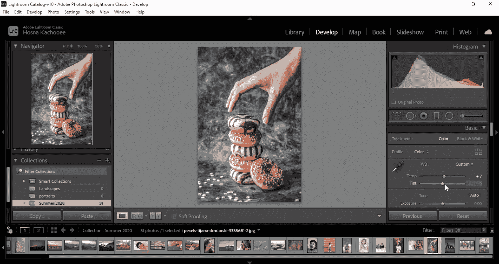
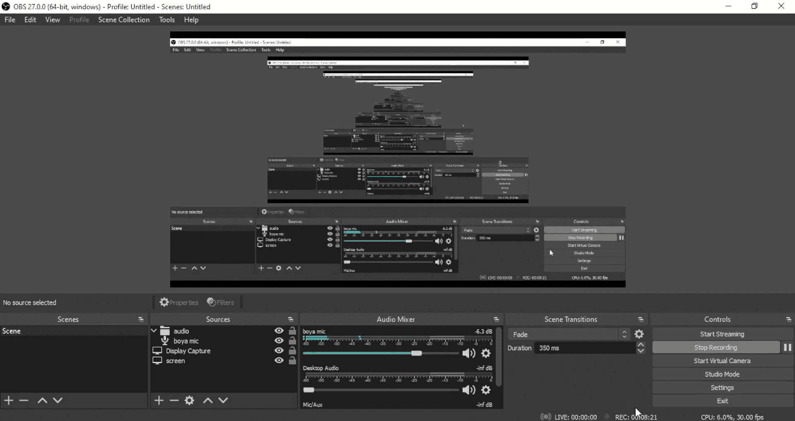
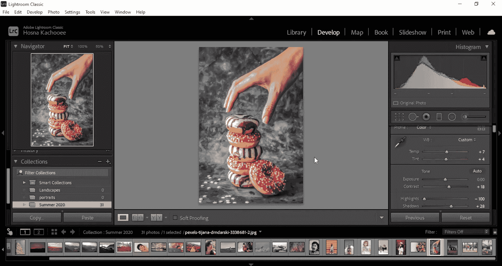

完整Adobe Lightroom大课程：第40课：食物摄影后期编辑 🍩


在本节课中我们将要学习如何针对食物类别的照片进行后期编辑，重点是让食物看起来更加美味，并激发观者的食欲。我们会从最基础的光影调整开始，依次讲解色调曲线、颜色分解、细节降噪、镜头校正以及局部修复等实用技巧。每一步操作都会配合具体的甜甜圈示例进行演示，确保初学者也能轻松跟上节奏，最终把一张平淡无奇的食物照片变得鲜艳诱人。

关于食物摄影后期处理的核心逻辑，我们可以用一个简单的公式来理解：

```
食物吸引力 = 颜色鲜艳度 × 边缘锐度 × 光影层次感
```

这个公式的意思是，一张成功的食物照片需要同时满足三个条件。第一，颜色要足够鲜艳，让人一眼就注意到食物本身。第二，食物的边缘要足够清晰，能够看清表面的纹理。第三，光影要有层次，不能平铺直叙，否则食物会显得扁平没食欲。在实际编辑过程中，我们的主要任务就是围绕这三个要素进行调整，让每一道菜都像刚出炉一样诱人。

具体来说，编辑食物照片时我们需要关注以下几个方面：

- 让主体食物在画面中突出，避免被背景抢走注意力。
- 提取并增强食物原本自带的自然颜色，而不是胡乱涂色。
- 必要时加入一些道具，比如餐具或装饰物，来增加画面的趣味性和层次感。

以甜甜圈为例，它上面粉色的糖霜和五彩缤纷的糖珠，本身就自带很强的视觉冲击力。当这些颜色在后期处理中被合理提升之后，观者就会不自觉地产生想要购买或品尝的冲动。这就是我们编辑食物照片的最终使命。

接下来，我们进入实际的编辑环节。上一节我们介绍了通用的分类编辑思路，本节中我们来看看如何把这些思路应用到具体的食物图片上。首先打开基础面板，这是所有后期处理的起点，我们先从光影部分开始调整。

在基础面板中，我会先处理去雾滑块。稍微向右拖动一点点，就能让背景和主体的颜色都更有深度，画面不会显得发灰。接着我会加入清晰度，目的是把甜甜圈表面的糖霜纹理和糖珠细节表现出来。这里不需要使用纹理滑块，因为纹理会放大噪点，反而让画面看起来不干净。

光影方面的调整步骤如下：

- 降低高光，防止甜甜圈表面过亮丢失细节。
- 提高阴影，让暗部区域也能看清内容。
- 增加对比度，让明暗区域之间的分界更明显。
- 适当降低白级，提高黑级，让整体色调更柔和。

完成这些基础光影调整之后，画面的层次感已经明显提升，背景不再平淡，食物的颜色也开始显现出活力。接着我们可以继续调整自然饱和度和普通饱和度，让粉色糖霜和彩色糖珠更加鲜艳，但不要过度，否则会显得不自然。



光影部分暂时告一段落之后，我们可以进一步使用色调曲线来精细控制亮度分布。当前我们使用的是点曲线模式，而不是参数曲线模式。点曲线允许我们在曲线上的任意位置添加控制点，从而精确调节某个亮度范围。



具体做法是这样的：如果我们希望背景稍微暗一点，就可以在曲线的暗部区域添加一个点并向下拉；同时在亮部区域稍微提升高光，让甜甜圈上的高光部分更有立体感。在确定调整位置时，可以使用光面板里的特殊取色工具，点击画面中对应的区域，Lightroom就会自动定位到曲线上的位置，然后我们只需微调即可。

色调曲线调整完成后，整体的明暗结构就比较合理了，接下来我们进入HSL颜色面板，进一步优化各个颜色的表现。HSL分别代表色相、饱和度和亮度，是处理食物照片颜色的核心工具。

首先是色相调整，我们可以用同样的取色工具来定位。比如把粉色调暗一点，让糖霜的颜色更浓郁；巧克力部分对应洋红色调，虽然单独看差别不大，但配合后续的亮度调整会有更好的效果。我本来打算把巧克力调暗一些，但那样会让它看起来像黑巧克力，而我个人更喜欢牛奶巧克力，所以最终决定保持原样不变。

接着是饱和度调整，我们要让甜甜圈本身的颜色更饱和，这样画面才会显得生动。同样地，我们也会对糖珠和糖霜部分适当提升饱和度。

然后是亮度调整，亮色通常比暗色更容易吸引人的眼睛。我们可以把糖霜和糖珠所在颜色的亮度调高，让它们在画面中更显眼。在调整亮度时，可以继续使用取色工具直接选中图像中的颜色区域，然后根据喜好增减亮度。

在这一轮颜色调整完成之后，甜甜圈的颜色已经显得鲜艳多了，开始具备让人食欲大开的效果。接下来我们给整张照片加一点暖色调，让画面整体更有食物摄影应有的温馨感觉。

具体来说，我们可以稍微调高色温，给图像注入橙黄色调，模拟温暖的灯光效果。同时再加入一点品红色调的色调偏移，让粉色糖霜看起来更甜美。整体的目的不是让照片看起来不自然，而是要营造一种让人觉得这食物刚出炉、非常诱人的氛围。

在调整色温和色调的时候，有一个很容易被忽略的问题，就是高光剪裁。高光剪裁是指图像中某些过亮的区域失去了所有细节，在Lightroom中会显示为小红点。我们可以按下键盘上的J键，或者点击面板上的相应按钮来开启高光剪裁警告。

如果出现了红色提示区域，说明那些地方已经过曝，需要我们去修复。因为这是高光问题，所以我们需要移动高光滑块，适当降低高光，直到红色警告消失。在这个过程中，建议始终关注直方图，确保没有严重的过曝区域被我们忽略。直方图是一个非常有用的参考工具，建议在编辑时一直保持打开状态。

处理完基础光影和颜色之后，我们可以继续做分色调整，给阴影和高光分别赋予不同的色调。目前中间调的表现已经令人满意，所以我们主要关注阴影部分。我们可以给阴影加一点冷色调，用来衬托背景中的蓝色调，让整个画面的冷暖对比更协调。高光部分保持不变，因为目前的效果已经符合预期。

分色调整完成后，画面的色彩搭配更加和谐，背景和主体之间既有区分又不突兀。接下来我们进入细节面板，处理图像的噪点和锐度问题。

放大图像查看时，我们会发现虽然细节很多，但也伴随着不少噪点。这些噪点属于普通噪点，而不是彩色噪点，表现为细小的颗粒而非彩色斑点。我们需要在降噪面板中慢慢向右拖动滑块，直到背景的噪点被抑制，同时不要过度降噪导致细节丢失。适当增加一点对比度，可以让画面在降噪后依然保持清晰。

降噪和细节处理完成之后，背景中的噪点已经基本清理干净，也没有彩色噪点出现。接下来我们进行镜头校正，检查是否存在色差问题。

镜头校正的操作包括开启配置文件校正和去色差选项，然后放大到百分之四十，仔细观察图像中色彩丰富的部分，特别是粉色甜甜圈和糖霜边缘，看看是否有彩色的边缘畸变。如果没有发现明显的色差，我们就可以进行受限裁剪，稍微调整构图，让画面看起来更舒服。同时我们也可以对图像进行微小的旋转，确保水平和垂直线条都比较正。

完成镜头校正和构图微调之后，图像的几何形状已经比较规整了，但我们还需要检查画面是否有轻微倾斜。使用转换面板中的引导工具，我们可以在图像上画几条参考线，告诉Lightroom哪些地方应该是水平或垂直的。这样软件就会自动帮我们把图像拉直，修正倾斜问题。

画面拉直之后，我们可以进入效果面板，为照片添加一些最后的氛围感。这里我们可以加入轻微的暗角效果，在画面四周适当变暗，从而把观者的视线引向中间的甜甜圈。暗角的数量不要太大，否则会显得不自然，同时要增加羽化量，让暗角过渡平滑。颗粒效果我们不需要，保持关闭状态即可。

效果面板调整完毕之后，画面的聚焦效果已经比较明显了，接下来我们可以对校准面板进行微调。校准主要用于调整原始颜色的基准，比如把红色稍微向粉色方向移动，让糖霜的颜色更准确。在调整校准时，也要注意饱和度不要过高，否则颜色会变得跳跃。

所有全局调整都完成之后，我们还需要处理图像上的一些小瑕疵。食物摄影有一个特点，就是我们希望照片看起来完美无瑕，食物看起来没有任何缺陷，哪怕现实中可能有瑕疵。为此我们可以使用点修复工具，也就是那个带有圆圈和箭头的工具，来去掉甜甜圈表面上那些不太好看的小污点。

使用点修复工具时，先减小画笔尺寸，因为这些斑点通常很小。点击斑点之后，Lightroom会自动寻找一个相似的区域来进行修复。如果自动选择的位置不合适，我们可以手动拖动修复源点，直到效果满意为止。修复时要确保羽化度开启，数值建议在五十以上，这样修复痕迹不会太生硬。检查手部区域时，如果没有明显需要去除的地方，就可以直接点击完成。

点修复工具处理完主要斑点之后，如果还有比较分散的小点比较难一一点除，我们可以切换到画笔工具。画笔工具不能直接去除斑点，但我们可以通过降低清晰度来平滑那些小斑点，使其在画面中不那么显眼。对于一些其实是糖珠的小点，我们可以选择保留，不需要全部抹除。

完成所有局部修复之后，我们可以缩小图像，查看整体的前后对比效果。将编辑前后的图片并排放在一起，你会发现现在的照片色彩更丰富、光影更有层次，整体看起来完全不同，确实变得更加诱人。



作为一个小技巧，如果你想改变糖霜或糖霜的口味颜色，可以使用色相调整把粉色改成绿色来代表开心果口味，或者改成浅粉色来代表草莓口味。这里我们就保持经典的粉色即可。

这就是如何编辑一张食物图片的完整流程，也是如何运用我们迄今在开发模块中学到的基本面板，把一张原本颜色暗淡、缺乏生气的照片，变成一张看起来鲜艳、诱人的食物照片。后续我们还会学习其他食物摄影的实例，了解如何针对不同类型的食物图片进行编辑。

本节课中我们一起学习了食物摄影后期编辑的核心思路，包括基础光影调整、色调曲线精修、HSL颜色调节、色温与色调处理、高光剪裁检查、分色调整、细节降噪、镜头校正、画面转换、效果添加、校准优化以及局部瑕疵修复。希望这些内容能帮助你掌握让食物照片更具食欲的编辑方法，我们下一节课见。

