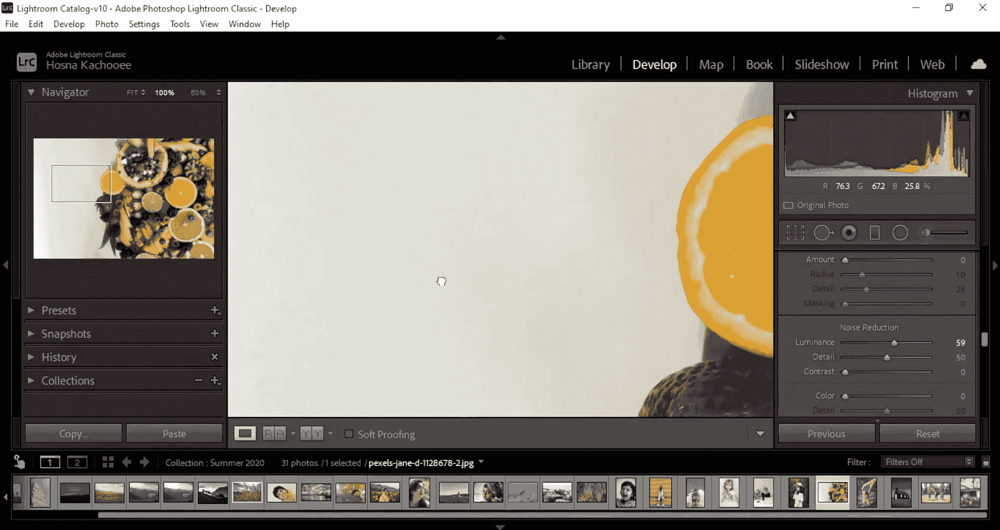

# Adobe Lightroom 从入门到专家：第 41 章：🍎 水果摄影后期进阶

在本节课中，我们将学习如何在 Adobe Lightroom 中处理一张水果摄影作品。这张照片的主体是色彩鲜艳的水果，背景是纯白色的工作室背景。我们的目标是让水果的自然颜色更加鲜艳，同时保持背景的整体明亮和干净，让观看者产生想要多吃水果的欲望。本节内容适合初学者，我们会用大白话逐步讲解每一个操作步骤，确保你能够跟上节奏，掌握食物摄影后期的核心技巧。

## 第一部分：基础调整与去雾处理

上一节我们介绍了光影调整的基本思路，本节中我们来看看针对水果图像的具体操作。以下是基础调整的核心步骤：

- 打开图像，首先使用 `Dehaze`（去雾）滑块。这是 Lightroom 中非常实用的工具，只需移动滑块，就能让画面瞬间获得更好的层次感。不过去雾可能会在某些区域产生噪点或阴影，但整体效果通常很好。
- 检查前后效果，放大图像观察细节，判断是否需要进一步调整。
- 不要使用 `Clarity`（清晰度）和 `Texture`（纹理）。对于这类水果表面本身就很光滑的图像，增加清晰度或纹理会引入噪点，破坏原本的平滑质感，反而让图像看起来不自然。
- 使用 `Vibrance`（自然饱和度）适度提升色彩，再微调 `Saturation`（饱和度），让画面看起来已经不错，但仍有改进空间。

处理完主体色彩后，我们需要关注画面两侧宽大的白色背景。如果不做处理，图像会显得不完整，仿佛有一半内容被忽略了。以下是背景亮度处理的方法：

- 提高 `Highlights`（高光），适度增加亮度，消除之前出现的畸变感。
- 同样处理 `Whites`（亮部），保持背景与主体亮度一致。
- 对 `Shadows`（阴影）进行微调，可以适当提升阴影，增加整体对比度。
- 调整 `Blacks`（暗部），让暗部区域更有层次。
- 给画面添加一点暖色调，因为这里拍摄的是夏季水果，需要营造热带水果的感觉，传达摄影师想要表达的氛围。
- 按键盘上的 `J` 键检查高光剪切情况。如果出现蓝色提示，说明阴影部分需要处理，继续调整直到画面平衡。

## 第二部分：色调曲线与颜色面板

基础明暗调整完成之后，我们可以继续深入色调和颜色的细节处理。以下是色调曲线和颜色面板的操作要点：

- 打开 `Tone Curve`（色调曲线），进一步调整图像的明暗和对比度。如果画面变得太暗，就保持稍微亮一些，在亮部区域增加对比度，使效果更合适。
- 进入 `HSL` 面板。由于我们拍摄的是色彩丰富的水果，这个面板是最有帮助的工具之一。
- 不要调整 `Hue`（色调），保持水果的自然颜色不变。
- 提高 `Saturation`（饱和度），重点针对黄色、橙色、红色和绿色等水果主色进行增强。
- 蓝色和紫色部分基本保持默认，不需要做太多改动。
- 调整完后，水果看起来已经很有食欲了。

接下来是分级调色和细节降噪。以下是具体操作流程：

- 使用 `Color Grading`（分级调色）给高光部分尝试添加一点颜色，如果效果不理想，就保持默认设置。
- 对中间调稍微增加一点冷色调，因为整体偏暖，加入冷色可以让画面更平衡，效果会好很多。
- 进入 `Detail`（细节）面板，检查白色背景部分是否有噪点。这里不需要锐化，因为主要是亮度噪点，不是彩色噪点。
- 增加 `Luminance`（亮度降噪）来去除噪点，但要注意保留水果的细节，适当降低降噪强度，避免过度抹平。
- 调整完成后，水果的锐度保留，大部分噪点也被去除了。

## 第三部分：镜头校正与边缘处理

细节处理完成后，我们需要处理镜头带来的变形问题。以下是镜头校正和边缘处理的方法：

- 打开 `Lens Corrections`（镜头校正），使用 `Distortion`（畸变）选项卡进一步修正相机拍摄产生的图像变形，使画面更平坦。
- 对比修正前后的效果，可以看到原本的鱼眼效果已经消失，画面更自然。
- 放大观察水果部分，检查是否有需要处理的色差，比如紫色等颜色的小斑点。本例中没有明显色差，不需要使用不同选项卡。
- 在 `Transform`（变换）面板中，因为图像主体是圆形构图，不需要强行拉直或拉伸，保持原有透视即可。
- 进入 `Effects`（效果）面板，如果边缘部分过亮，可以在镜头校正区域适当加暗边缘，让画面更加平衡。

## 第四部分：校准与局部调整

镜头校正完成后，我们可以进行色彩校准和局部细节润色。以下是相关操作步骤：

- 打开 `Calibration`（校准）面板，对红色稍微增加饱和度，注意不要过量，否则会变成粉色。
- 对绿色也做类似的饱和度微调，蓝色部分保持不变，不需要额外处理。
- 此时整体画面看起来清新且多汁，但石榴和覆盆子显得缺乏生气，而石榴本身颜色应该很亮。
- 需要给这些水果恢复一些色彩，同时去除菠萝上分散注意力的小斑点。

局部修复是让图像更完美的关键步骤。以下是使用调整笔刷和点状修复工具的方法：

- 启用 `Brush Tool`（调整笔刷），先调大笔刷尺寸。这一步并非必须，只是为了让画面看起来更完美。
- 临时提高曝光值，以便看清自己在涂抹哪个区域，调整完成后再把曝光值降回原样，否则会出现魔法般的石榴籽效果。
- 涂抹石榴和覆盆子时，避开白色部分，因为覆盆子颜色相近，可以一起处理。
- 打开 `Feathering`（羽化），否则笔刷痕迹无法自然融合。
- 逐个处理最后几颗覆盆子，调大笔刷尺寸，不要触碰阴影中的部分，否则会导致明暗不均。
- 重置曝光值，然后提高饱和度，对比处理前后的效果，水果原本颜色较暗，现在看起来更好。
- 给这些水果添加一点去雾效果，并适当提亮，再增加对比度，效果会明显改善。

处理完主要水果后，我们还需要清理菠萝表面的瑕疵。以下是点状修复工具的使用说明：

- 在食物摄影或水果摄影中，我们几乎希望让一切看起来完美，但仍要保持吸引力。
- 调整合适的笔刷尺寸，降低羽化程度，然后点击让 Lightroom 自动处理。
- 如果需要，可以再回来使用调整笔刷进一步修正光影。
- 虽然对于这类精细修图，我个人更倾向于使用 Photoshop，因为它提供图层和更多工具，控制力更强。但目前我们只使用 Lightroom。
- `Spot Removal`（点状修复）工具在此处可能看起来不够有用，但在时尚摄影中非常有帮助，比如处理模特特写面部的瑕疵，能让皮肤更光滑。
- 对于难以去除的斑点，如果它与外部边缘相连且边缘也受影响，就保留原样。
- 快速用笔刷处理相关区域，记得调高曝光值以便观察涂抹范围。
- 处理完成后重置曝光值，添加一点黄色，尝试让颜色更接近黄色而非绿色。
- 进一步调整饱和度，使其与菠萝其他部分匹配，必要时稍微降低饱和度。
- 使用 `Clarity`（清晰度）融合粗糙边缘，提升阴影部分，让整体效果更好，虽然不完美，但在目前条件下已经是不错的结果。

## 第五部分：最终对比与课程总结

所有后期调整完成后，我们需要检查最终效果。以下是总结和对比步骤：

- 缩小图像查看整体效果，我对当前结果很满意，喜欢色彩的突出表现，也保持了白色背景的纯净。
- 背景没有被忽视，既聚焦在水果主体，又让背景衬托出鲜艳的色彩，因为背景是观众首先看到的部分。
- 并排查看修改前后的效果，整体看起来不错，虽然部分区域可能略显数字化，但依然是一张好图片。
- 本节课结束，这是另一个将食物摄影后期技巧应用到不同食物上的示例。在拥有工作室背景、白色背景的情况下，我们可以利用背景来衬托颜色，在这里我们让背景更亮，并去除了一部分噪点，使其成为这组色彩丰富主体的合适背景。
- 本节课就到这里，下一课见。

在本节课中，我们一起学习了如何使用 Adobe Lightroom 处理色彩鲜艳水果的食物摄影作品。内容包括基础去雾与明暗平衡、避免过度清晰度和纹理、使用自然饱和度与微调饱和度、调整色调曲线、在 HSL 面板中增强水果主色、分级调色与中间调冷暖平衡、亮度降噪并保留细节、镜头畸变校正与鱼眼效果去除、边缘暗角处理、颜色校准、以及使用调整笔刷和点状修复工具进行局部润色。通过这些步骤，你可以让水果图像看起来更新鲜、更多汁，同时保持背景整洁且能够衬托主体颜色。希望本节教程对你有所帮助，祝你拍摄和后期顺利。
