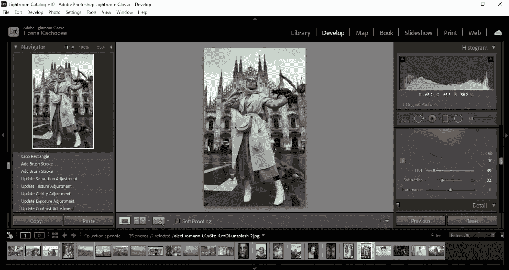

📸 完整Adobe Lightroom大课：第42课：时尚摄影照片编辑


在本节课中，我们将学习如何使用Adobe Lightroom处理时尚摄影照片。时尚摄影属于商业摄影的一种，不管是拍摄衣服、鞋子、包包还是化妆品，核心目的都只有一个，就是让产品在画面中被看见，并且让顾客的注意力完全集中在产品本身上。本节课我们会以一位模特穿着服装的照片为例，从基础的光影修正开始，一步步调整色调、色彩与局部细节，最终让服装和模特在图片中脱颖而出。

我们先来看看时尚摄影和普通风景摄影在编辑思路上的本质区别。以下是几个关键对比点：

- 风景摄影通常追求画面元素的均衡分布，天空、山川、前景都需要保留足够的细节，做到明暗平衡。
- 时尚摄影则不同，它的主角是模特身上的服装或妆容，背景只需要充当衬托，不需要抢走观众的注意力。
- 商业风格的照片会刻意让画面看起来稍微人工一些，比如去除皮肤毛孔、痘痘等瑕疵，只保留产品本身的完美状态。
- 这种处理方法同样适用于鞋子、手提箱、太阳镜等任何需要拍摄的商品，不限于服装。

```
商业时尚照片 = 产品颜色保真 + 主体亮度提升 + 背景细节压制
```

接下来，我们进入实际的图片编辑环节，先处理最基础的光影部分。以下是具体的调整步骤：

- 首先观察照片，你会发现阴影部分太暗，导致画面下方的鸽子几乎看不清楚，和背景融合在一起。
- 稍微提亮阴影，不要过度，只需要让黑色区域露出一些细节即可。
- 接下来处理高光，将高光数值降低，避免亮部过度曝光。
- 然后适当提高曝光度，同时增加对比度，让整张图片的层次感更强。
- 降低白点数值，适当增加黑点数值，完成基础的色调修正。

在光影调整完成后，我们需要检查图片中是否存在丢失细节的区域。以下是使用剪切指示器的方法：

- 按下键盘上的J键，打开剪切指示器。
- 画面上会出现一些蓝色斑点，直方图在提示你，这些部分过于暗黑，已经没有任何细节可言。
- 你需要仔细观察这些蓝色斑点所在的位置，有些纯黑区域是自然存在的，比如黑色的鸽子、模特身上的黑色裤子，或者远处窗户内部的平坦黑色。
- 这些自然的纯黑不需要强行去亮，保持原样即可。
- 如果你发现因为过曝而导致某些区域完全没有细节，那就必须回去修复，因为没有细节的区域无法通过后期挽回。
- 检查完毕后，再次按下J键，关闭剪切指示器。

```
剪切指示器警告 = 该区域纯黑或纯白，丢失细节，需要检查
```

完成基础色调之后，我们继续处理照片的存在感部分。以下是常用工具及其作用：

- 最常用的工具是去雾，可以增加画面的通透感。
- 接着增加清晰度，让物体的边缘更加分明。
- 纹理滑块不建议大幅度改动，因为我们的产品颜色丰富，需要保留原有的色彩强度。
- 提高自然饱和度，让蓝色等颜色变得更鲜艳，同时保持色彩的自然度。
- 调整完成后，你会发现照片的色彩和光影都有了非常明显的提升。

光影和存在感处理完毕后，下一步是使用色调曲线进一步塑造光影氛围。以下是具体操作思路：

- 创建一条S形曲线，这也是之前课程中讲过的经典调色方法。
- 曲线的下方代表阴影，上方代表高光，拉低下方可以加深暗部，拉高上方可以提亮亮部。
- 对于这张照片，曲线目前看起来不像一个标准的S形，但我们可以根据实际需求微调。
- 如果你想给照片增加哑光质感，可以抬升曲线最左下角的那个控制点。
- 使用曲线最顶端的控制点，可以对高光区域做更剧烈的改变。
- 调整过程中注意观察天空部分，避免过度处理。
- 由于这张照片大部分区域都属于阴影，我们主要针对暗部进行调整，同时适当提高曝光，降低高光，增加阴影，降低白点，使整体亮度更加合理。

调整完光影后，我们进入HSL面板来精细控制颜色。以下是需要注意的几点：

- 先从亮度滑块开始，如果某些颜色显得过于饱和或过度明亮，可以适当降低亮度。
- 饱和度部分在之前的面板中已经处理过，这里不需要重复调整。
- 色相滑块在商业摄影中需要特别小心，以下是原因：
  - 如果你修改了服装的色相，顾客看到照片后会以为实物是这种颜色。
  - 但实际上外套的颜色并没有改变，这样会造成产品颜色不符。
  - 所以在处理商业图片时，不要随意动用色相标签，保持产品原色是最重要的原则。

```
商业图片色相锁定 = 原始产品颜色保持不变，禁止随意更改
```

- 接下来可以适当提高橙色和红色的饱和度，让画面更有活力。
- 调整完成后，放大查看模特的脸部，确认肤色没有被扭曲，确保一切自然。

颜色处理完成之后，我们可以使用色彩分级为照片增加整体的氛围感。以下是具体思路：

- 先处理阴影部分，因为照片中有较多暗部区域。
- 给阴影添加一点偏黄的色调，可以营造出复古的视觉效果，尤其适合背景环境。
- 调整完成后，记得降低阴影的饱和度，避免颜色过于浓重。
- 亮度数值保持不变，只对暗部做轻微的色调叠加。
- 接下来处理高光部分，可以给高光添加一点青色调整，同样降低饱和度，只要轻微调整即可。
- 中间调部分不需要动，保持默认状态。
- 如果你想给整张照片统一加一层滤镜感，可以使用全局色彩分级。
- 全局调整不区分高光、阴影还是中间调，会一次性影响整张照片。
- 比如选择绿色，整张图都会变绿；选择暖色调，通常会让照片看起来更舒服。
- 根据实际效果调整全局饱和度，直到画面看起来协调为止。

色彩分级完成后，我们需要处理图片的细节和噪点问题。以下是建议的操作顺序：

- 这张照片本身细节较多，但也存在一些数码噪点。
- 可以先跳过锐化步骤，直接进入噪点降低面板。
- 逐步增加噪点降低的数值，不要一次性加太多，分多次观察效果。
- 随着噪点减少，你会发现模特的皮肤看起来更加平滑，丢失的一些细节也能逐渐找回来。
- 调整完成后，对比降噪前后的效果，确认没有过度抹除细节。

接下来是镜头校正与透视调整环节。以下是需要处理的内容：

- 模特的摆姿是曲线形的，这会给照片带来一种鱼眼效果。
- 为了配合模特的姿态，我们可以在镜头校正面板中进一步增强或减弱这种效果。
- 向左调整可以增强鱼眼感，向右调整则会减弱，让模特看起来离相机更远。
- 为了保留艺术感，我们选择保留鱼眼效果，不要把它完全抹除。
- 检查是否存在色差，如果没有明显的色差，就不需要使用色差修复工具。
- 照片四个角落有一些暗角，需要将其提亮。
- 调整后，天空部分的黑色圆圈也会被去除，画面边缘会更加干净。

在转换面板进行裁剪之前，我们还可以使用局部调整工具让背景更暗，从而突出模特。以下是调整画笔的使用方法：

- 选择调整画笔，而不是辐射滤镜或渐变滤镜，因为模特的站姿不规则，无法用简单的圆形或线性区域覆盖。
- 调整画笔能给你更多的自由度，让你按照模特的实际轮廓来涂抹选区。
- 打开遮罩显示，这样你能清楚地知道自己正在画哪些区域。
- 创建一个选区点之后，如果你关闭面板又想回来修改，只需点击那个保存的点，Lightroom就会把你带回之前的选区。
- 在涂抹过程中，不小心越到鸽子身上也没关系，因为鸽子本来颜色就深，稍微变暗影响不大。
- 但如果鸽子是白色或彩色的，就要格外小心，否则会破坏它们的颜色。
- 鸽子不是这张照片的焦点，所以不需要过度担心。
- 放大到适当比例，按住Alt键可以切换到橡皮刷模式，用来擦除多余的选区。
- 保持选区边缘贴合模特的轮廓，这样后续的调整才能和画面其他部分自然融合。
- 调整画笔是你在后期中会非常频繁使用的工具，无论照片细节多不多，无论是哪个部分，都可以用它来做局部修改。
- 它就像一支真正的画笔，让你在特定区域进行涂色和调整。
- 但和真实画笔不同，Lightroom允许你随时回到之前的选区，继续微调，这是真实画笔做不到的。
- 你可以从模特的手上擦掉一些调整，也可以在手指之间补充一些覆盖，避免出现不美观的空白斑点。
- 所有局部调整的目标是让画面融合在一起，让各个部分协调匹配。
- 如果不小心把围巾或袖子涂到了，可以把这些部分恢复回来。
- 调整完成后，点击“适应画面”按钮，缩小视图查看整体效果。
- 此时你可能会发现背景的清晰度被降到了-100，需要撤销这个过度操作。
- 先使用去雾工具来暗化背景区域，这也是一种有效的方法。
- 还可以降低背景的饱和度，特别是上方蓝色部分，避免背景颜色太突出。
- 保持阴影不变，增加对比度，适当降低曝光度。
- 将清晰度降到大约-26，同时也降低纹理数值，让背景产生模糊感。
- 再适当降低饱和度，但不要过度。
- 如果你想把鸽子的一些细节找回来，按住Alt键切换到橡皮刷，轻轻刷过鸽子所在区域。
- 使用鼠标滚轮可以调整画笔的大小，让涂抹更加灵活。
- 最终背景的细节被适当压制，但远处好看的建筑仍然保留，不会被完全抹除。

局部调整完成后，最后一步是使用转换面板进行透视校正和裁剪。以下是操作步骤：

- 转换面板中可以创建两条水平引导线，用来告诉Lightroom哪些地方应该是水平的。
- 点击起始点，拖拽到终点，创建第一条引导线。
- 创建第二条引导线，将其放在合适位置，让街道和建筑线条变得笔直。
- 点击完成，对比调整前后的效果，街道和建筑现在明显更直了。
- 如果画面仍然显得不够自然，可以关闭比例锁定，使用水平标签进一步微调直度。
- 接下来处理垂直线条，可以营造出一种低角度拍摄的视觉效果，让照片更有趣。
- 按照之前提到的方法进行旋转，同时把模特稍微向右移动一点。
- 启用受限裁剪，查看裁剪后的效果。
- 如果发现建筑顶端被裁掉了一部分，使用缩放标签把画面缩小，找回丢失的空间。
- 必要时再旋转一点点，让建筑顶端和画面边缘对齐。
- 移动垂直位置，确保模特的鞋子能够完整显示在画面中。
- 如果发现画面失去了原来的直线感，可以重置面板，重新进行裁剪调整。
- 打开历史记录面板，回到调整画笔完成后的那一步，重新开始裁剪流程。
- 先对图片进行裁剪，把模特放在画面的合适位置，同时微调角度。
- 虽然裁剪后可能会丢失背景中的鸽子，但这不影响整体效果。
- 回到转换面板，使用引导线把建筑和街道的线条重新拉直。
- 放下引导线，保持当前状态，完成透视校正。
- 做一些轻微的旋转微调，直到画面看起来足够正直。
- 再次启用受限裁剪，此时照片的整体结构已经比较平衡。
- 虽然使用了鱼眼效果，丢失了一些细节，但我们保持画面正直，不必过分纠结于那些小损失。
- 改变垂直数值，让照片看起来像是从低角度拍摄出来的。
- 当你对构图感到满意时，就可以进行最后的校准调整了。

校准是调色流程的最后一步，以下是具体操作：

- 在校准面板中，先提高蓝色的饱和度，让背景中的蓝色更显眼。
- 降低红色的饱和度，避免红色过于突出干扰主体。
- 绿色数值保持不变，不做调整。
- 查看模特的脸部，如果肤色偏绿，可以适当降低绿色相关的数值。
- 再降低一点红色饱和度，直到肤色看起来自然健康。
- 最后可以再加强一点全局色彩分级，根据个人喜好微调整体氛围。

```
最终校准目标 = 背景颜色保留 + 主体颜色突出 + 肤色自然还原
```

所有调整完成后，我们可以对比编辑前后的效果。以下是最终的对比观察：

- 你会发现背景的颜色被保留了下来，但被降低到了足够低的程度。
- 这样主体服装和模特就能成为画面中的绝对焦点。
- 在整个编辑过程中，我们使用了大量Lightroom的工具，这些都是处理商业图片时会经常用到的功能。
- 虽然通常还会使用修复点工具去除图片上的瑕疵点，但这张照片并没有需要去除的明显斑点，所以这一步被跳过了。
- 你可以把原始照片和最终效果并排放在一起，直观地看到调整带来的变化。



本节课中，我们一起学习了如何在Adobe Lightroom里编辑一张用于商业用途的时尚照片。从基础的光影修正、剪切指示器检查，到色调曲线、HSL色彩控制、色彩分级、细节降噪，再到镜头校正、调整画笔局部修饰、透视校正与最终校准，每一个步骤都围绕同一个核心目标：让服装或产品在画面中脱颖而出，背景服从主体。这些方法不仅适用于衣服，也可以用于鞋子、包包、墨镜等任何需要商业拍摄的物品。通常这类照片会在摄影棚中拍摄，但现在也有很多比较随意的户外风格案例。希望你能掌握这些技巧，并应用到自己选择的照片中去。下节课我们将学习另一个时尚编辑案例，重点放在化妆品上，到时候见。
