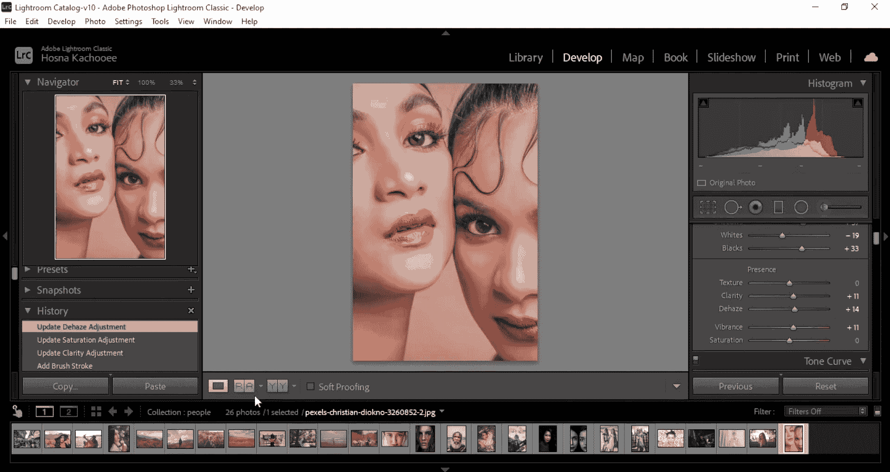

# Complete Adobe Lightroom Megacourse：138：时尚摄影后期第二部分 📸

## 开篇概述

在本节课中我们将学习如何使用 Adobe Lightroom 处理一张商业时尚特写照片。这张图片展示的是模特身上佩戴的化妆品，属于时尚摄影的另一个典型案例。与我们在之前课程中分析的第一个例子不同，这组照片给我们提供了更近距离的面部特写视角。正如我们之前提到过的，时尚类商业照片通常是在摄影棚中拍摄的。由于拍摄环境受控，背景通常就是一种纯色，所以我们不需要花时间去处理杂乱复杂的背景元素。这也让后期调整的重点可以完全集中在人物面部和妆容细节上。

## 图像分析与色调识别

在开始调整之前，我们需要先观察并理解图片目前的色彩构成。以下是几个关键的观察点：

- 模特脸上佩戴的妆容呈现明显的橙色调。
- 这种橙色调与背景色和模特的肤色非常接近。
- 除了眼睛和头发之外，画面中几乎所有部分都很好地融合在一起。
- 模特的眼睛是棕色的，头发颜色较深，因此这两个部分会从其他区域脱颖而出。
- 整体画面目前带有一种桃色色调，我们的目标是保留这种基调，并进一步增强图像的细节表现。

根据上面的观察，我们可以用一个简单的关系式来描述当前的色彩状态：

`肤色 ≈ 妆容色调 ≈ 背景色调`

`眼睛与头发 ≠ 肤色，因此会形成视觉重点`

## 基础光影调整

图像分析完成之后，我们进入 Lightroom 的基础调整面板开始处理光影。以下是具体的调整步骤：

- 首先对图像进行去雾处理，去除画面中原本存在的雾霾感，让整体看起来更锐利。
- 接着适当提高清晰度，但要注意不要过度，否则画面会出现不自然的雾霾效果。
- 如果清晰度提高得太多，就需要把它再调低一些。
- 稍微提高自然饱和度，幅度不要太大。
- 避免让模特的皮肤看起来过于橙色，因此需要加入一点暖色温，大约增加 2 个单位。
- 增加对比度，然后处理高光部分，提亮阴影部分。
- 降低白色级别，再提高黑色级别，之后进一步降低白色级别。
- 完成这些调整后，画面的变化不会特别剧烈，最后再微调一次对比度。

基础面板的调整逻辑可以简化为下面这个公式：

`基础调整 = 去雾 + 清晰度 + 自然饱和度 + 色温 + 对比度 + 高光 + 阴影 + 白色 + 黑色`

## 色调曲线调整

在基础面板调整完毕之后，接下来我们需要面对色调曲线面板。上一节我们介绍了基础的曝光与色彩处理，本节中我们来看看如何通过色调曲线进一步塑造面部立体感。

- 使用色调曲线来微调图像的整体亮度和光影分布。
- 保持当前的曲线形状，同时适当降低高光部分。
- 经过这些调整后，画面的整体效果已经看起来相当不错了。

## HSL 颜色面板处理

色调曲线完成之后，我们来到 HSL 颜色面板。上一节我们完成了光影与曲线的调整，本节中我们来看看如何让颜色更加中性和平衡。

以下是具体的操作重点：

- 降低部分橙色和红色通道的数值，使画面中的肤色和妆容色调更加中性。
- HSL 面板中的细微颜色调整，我们将在后续课程中进行更深入的讲解。

## 选择性磨皮调整

颜色处理完成之后，我们进入选择性调整阶段。上一节我们介绍了 HSL 颜色面板的使用，本节中我们来看看如何使用调整画笔对面部进行磨皮处理。

商业摄影的风格通常追求更人工化、不那么真实的效果，尤其是在面部修图方面。在商业风格中，磨皮程度通常设定在 50 左右。传统的商业照片会去除毛孔、痘痘等自然瑕疵，尽管这些瑕疵本身是皮肤的一部分。最近一些大公司开始保留更多自然细节，让审美标准变得更真实，如果你查看化妆品品牌的海报，就会注意到其中一些作品确实保留了皮肤纹理，这是一个让审美标准更现实的进步。但是，如果你想保持传统那种一切都很光滑的风格，就需要对这些区域进行磨皮，而我们最常用的工具就是调整画笔。

以下是具体的操作步骤：

- 开启调整画笔，在模特的脸部涂抹需要磨皮的区域。
- 避开眉毛、睫毛、发际线和嘴唇，因为这些部位的细节需要保留。
- 先粗略地勾勒主要区域，然后放大画面来处理更细小的部分。
- 对其他模特的脸部也进行同样的涂抹处理。
- 完成选区后，关闭画笔显示，降低清晰度数值，同时也降低纹理数值，各减少一半左右。

皮肤磨皮的处理逻辑可以用下面这个公式来理解：

`皮肤光滑度 = 原始纹理 - (清晰度降低量 + 纹理降低量)`

需要注意的是，不要把皮肤磨得完全没有纹理，否则画面会看起来像做了糟糕的修图工作，失去自然感。适度的光滑处理才能让照片看起来专业且自然。

## 分级与色彩平衡

磨皮处理完成之后，我们需要对画面的颜色进行进一步平衡。上一节我们完成了面部的选择性磨皮，本节中我们来看看如何使用分级调节来统一整体色调。

以下是具体的思路：

- 使用黄色橙色调来平衡画面中的颜色关系。
- 将橙色调调暗一些，使其与图像的其他部分更加协调。
- 目前图像的细节已经足够，构图角度也比较理想，没有必要强制让画面保持绝对水平。

## 镜头校正

色彩平衡完成之后，我们进入镜头校正面板。上一节我们介绍了分级与色彩平衡的方法，本节中我们来看看如何检查并修正镜头带来的问题。

以下是具体的检查项目：

- 尝试应用鱼眼效果，但经过预览后发现并不适合这张照片，因此将镜头距离稍微拉远，移除鱼眼效果。
- 检查色差情况，放大画面仔细观察，并没有发现明显的色差，因此无需进行额外处理。
- 在画面边缘添加一些暗角效果，帮助观众的视线集中在模特身上。

镜头校正的处理流程可以简化为下面这个公式：

`镜头校正 = 鱼眼效果调整 + 色差检查 + 边缘暗角添加`

## 局部细节增强

镜头校正完成之后，我们还需要对化妆品细节进行局部增强。上一节我们完成了镜头校正与边缘暗角处理，本节中我们来看看如何让口红和眼影更加突出。

以下是具体的操作步骤：

- 新建一个调整选择区域，针对口红和眼影部分增加饱和度，让产品的颜色更加显眼。
- 粗略勾勒嘴唇和眼睛区域，如果眼睛部分比较难以精确选择，可以先保持现状。
- 关闭之前的清晰度调整，因为这里需要保留一定的细节。
- 提高饱和度，让颜色变得更浓郁。
- 稍微使用去雾工具对这些区域进行轻微暗化。

经过这些调整之后，妆容会从面部中脱颖而出，而不是与肤色融合在一起，这正是我们想要达到的效果。

## 前后对比与总结

所有调整完成之后，我们来查看修图前后的对比效果。上一节我们完成了局部细节增强，本节中我们来看看整体的最终成果。

对比前后图片可以清楚地看到，我们已经走了一段很长的路。妆容现在更加突出，面部皮肤光滑自然，整体色调也更加统一。这就是如何编辑一张商业时尚特写照片的完整流程，特别是针对带有化妆品特写且用于商业用途的图像。

## 本节课总结

本节课中我们一起学习了如何在 Lightroom 中编辑一张商业时尚特写照片，包括图像分析与色调识别、基础光影调整、色调曲线处理、HSL 颜色面板调节、选择性磨皮调整、分级与色彩平衡、镜头校正、以及局部细节增强。我们学会了如何保留桃色基调，如何使用调整画笔磨皮而不过度抹除细节，如何通过镜头校正优化画面，以及如何让妆容颜色在最终作品中更加突出。下节课我们将继续学习新的内容，再见。

