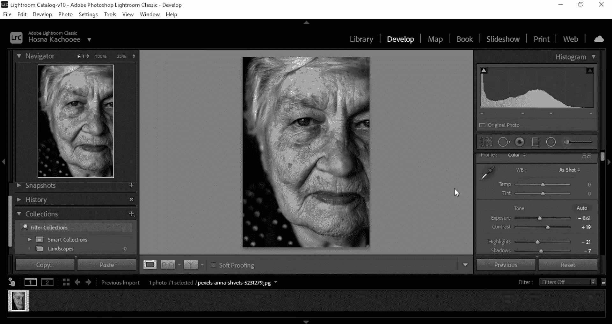

# 🖼️ Adobe Lightroom 黑白人像修图课程：第 44 课：黑白人像后期处理


在本节课中，我们将学习如何在 Adobe Lightroom 中制作一张黑白人像照片。很多初学者认为黑白照片只是把颜色去掉，但实际上这是一个需要细心雕琢的过程。你会了解到，黑白照片并不是简单地去掉颜色，而是要通过光线、对比度和局部细节，让被摄人物的特征更加突出。我们会以一张老年女性的特写照片为例，一步步把它从普通彩色照片变成一张有故事感的黑白人像。希望在课程结束时，你能掌握一套可以直接套用的黑白修图思路。

## 🧠 黑白人像的基本思路

上一节我们介绍了黑白系列的基本概念，本节中我们来看看如何处理一张黑白人像。

在编辑这类照片时，我们首先要寻找合适的光线，同时照顾好画面的清晰度，最后再把它转换为黑白模式。光线决定了黑白照片的基调，清晰度决定了照片里的细节是否足够。这里有一张老太太的照片，是一张非常近距离的特写，脸上的皱纹和表情都非常清晰。我们要做的就是把这张照片转成黑白，并让她的面部特征更显眼，即使没有颜色，照片依然能传达出人物的情绪和生活痕迹。

## 🧹 建立干净的图片基础

接下来我们开始具体操作，以下是第一步的处理要点。

调整光线之前，我个人习惯先对图片进行去雾处理，这样可以得到一个比较干净的基础，方便后续在黑白模式下继续修图。去雾可以让画面里的雾气感变淡，让整体看起来更透亮。饱和度这个参数暂时不用太在意，先把它调整一下即可，不需要在这个阶段纠结颜色是否准确。之后我会把饱和度调低，把照片里的颜色全部去掉，这样就能进入纯黑白的工作流程了。

```text
饱和度 = -100  // 去除图像中所有颜色信息，得到黑白基础
```

颜色去掉之后，我们就可以开始处理光线了。

## ☀️ 调整光线与对比度

有了黑白基础之后，我们来调整整体的光效，以下是具体的滑块设置。

首先稍微降低曝光，只需要调小一点点就行。然后增加对比度，让黑色和白色之间的区分更明显。接着适当降低高光，同时也把阴影调低一些，这样既能保留高光细节，又不会让阴影过于沉闷。只要把阴影和曝光处理好，照片里的细节就会显示出来。对我来说，现在的效果已经不错了，不需要再额外调整黑白混合参数。

## 🔍 细节处理：纹理与清晰度

光线调整完成后，我们再来看看表面细节，以下是纹理和清晰度的处理方式。

我会先放大照片仔细看看，不过发现放得太近了，于是把缩放比例调整到 25% 比较合适。其实这张照片本身已经足够锐利，也没有明显的噪点，所以不需要额外增加纹理，也不需要做锐化处理。不过我会稍微增加一点清晰度，让画面看起来更有层次感。你可以对比一下，加了清晰度和没加清晰度的效果，差别很明显。

## 📈 调色曲线与颜色面板

基础面板调整完成之后，我们往下看调色曲线，以下是调色曲线的操作建议。

调色曲线在之前的课程里已经讲过，这里我会稍微降低高光，同时把阴影调小一点点，再适当提高白点，这样黑白画面的色调范围会更舒服。由于照片已经是黑白的，HSL 和分色调面板就不需要动了，也不需要做颜色分级。在细节面板里，因为图片已经足够锐利，所以锐化和降噪都可以跳过。变形面板也不需要调整，原图的构图已经很好了，不需要做透视校正。

## 👁️ 局部增强：让眼睛更有神

全局参数都调好了之后，我们还可以重点增强人物的某个特征，以下是使用调整刷的具体步骤。

在这张照片里，最吸引我的是老奶奶的眼睛。我们可以用之前风景修图课里学过的调整刷技术，给她的眼球增加亮度。首先选择调整刷，把刷子的尺寸调小一点，然后涂抹在她的眼睛上。你会立刻发现，眼球里的细节和反光变得清晰多了。之后对另一只眼睛也做同样的处理。如果效果看起来太假，就把曝光调低一些，直到看起来自然为止。

## 🖼️ 最终效果与前后对比

所有调整完成后，我们来看看最终成果，以下是前后对比的说明。

现在我对这张图片比较满意了，我们增强了细节，让眼睛更明亮，最终创作出一张能够讲述故事的黑白人像照片。下节课我们会学习如何用类似的方法，把其他类型的照片也变成黑白。下面是修图前后的对比，照片从一张普通的图片变成了更严肃、更有深度的画面。关掉对比预览之后，本节课的内容就全部结束了。



本节课中我们一起学习了如何在 Lightroom 里制作黑白人像，包括去雾、去色、调整曝光和对比度、处理高光与阴影、使用清晰度，以及用调整刷局部打亮眼睛。希望你能按照这些步骤，尝试制作属于自己的黑白人像作品。
