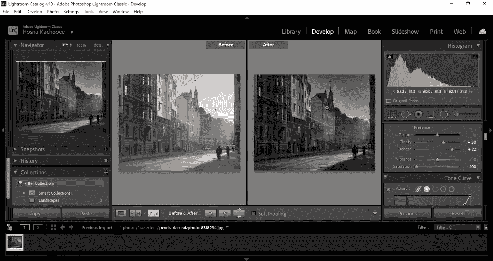

# Adobe Lightroom 零基础到精通摄影后期完整大课：02：黑白后期进阶（建筑与街景篇）🖼️

在本节课中，我们将继续学习黑白后期处理系列。上一节我们介绍了黑白人像的调色思路，本节中我们来看看如何把同样的方法应用到建筑、街道和天空等场景中。我们会把一张包含人像、街道、天空等多种元素的彩色照片，逐步转化为一张富有神秘感的黑白作品，并且保留画面里的细节层次。

## 第一步：先做去雾处理

在正式调色之前，我们需要先处理图像的大气透视感，让细节更容易被看清。以下是具体操作步骤：

- 找到“去雾”滑块，适当拉高数值。去雾可以把画面里的雾气变少，让建筑边缘和街道纹理更清晰。
- 通过提升去雾，你能更清楚地判断高光部分到底该降低多少。
- 黑白照片对细节非常敏感，这一步能让你后续的调整更有依据。

## 第二步：把饱和度降到零并调整基础曝光

去雾完成之后，我们要把彩色照片转成黑白照片，并确定基础的明暗基调。以下是需要调整的参数：

- 将“饱和度”全部拉到最低，即 `饱和度 = 0`，图像就会变成黑白。
- 降低“曝光度”一点点，使用 `曝光值 = 原始值 - 微小幅度`，因为原始照片偏亮，降低后天空会更好看。
- 提高“对比度”，即 `对比度 = 增加`，让画面明暗差异更明显。
- 提升对比度后，阴影会变深，这正好符合清晨或日落时分拍摄照片的氛围，你会感觉到这张照片就像在清晨或者黄昏时段拍摄的。

## 第三步：控制高光与阴影细节

基础曝光调整完成后，需要进一步精调高光和阴影，保证黑白照片既有亮度，又不丢失暗部细节。以下是调整思路：

- 把“高光”往下拉，即 `高光 = 降低`，因为高光是图像中最亮的部分，降低后天空就不会是刺眼的白色一片了。
- 把“阴影”稍微往上提，即 `阴影 = 提升`，因为阴影太暗会导致丢失细节，把它们拉亮可以找回暗部纹理。
- 对“黑色”部分也做类似处理，适当减少白色溢出，让黑白过渡更自然。

## 第四步：提升清晰度并再次去雾

为了让建筑和街道的纹理更立体，我们需要增强局部对比，并再次检查去雾效果。以下是具体做法：

- 提高“清晰度”，让建筑边缘和街道细节更锐利。
- 如果觉得画面还能更清爽，可以再适当增加一次“去雾”。
- 放大图像检查噪点情况，重点查看人物主体部分，确保细节没有问题。
- 如果发现自己放大过度，就适当缩小视图，看看整体效果。

## 第五步：使用色调曲线微调暗部与亮部

基础面板调整完成之后，色调曲线可以让我们对明暗做更精细的掌控。以下是操作方法：

- 在色调曲线中，把整体阴影稍微往下压，即 `暗部 = 下调`，让暗部更深沉。
- 把高光稍微往上提，即 `亮部 = 上调`，让亮部更有层次感。
- 这样调整之后，照片会朝着更神秘的方向发展，氛围感会越来越强，我们正在接近想要的视觉效果。

## 第六步：降噪与细节处理

提升清晰度和对比度之后，图像可能会出现一些噪点，尤其是在建筑表面，需要进行降噪处理。以下是降噪步骤：

- 进入“细节”面板，查看图像是否存在噪点。
- 如果在建筑部分能看到噪点，就提高“亮度”滑块，即 `亮度噪点 = 提升平滑度`，来平滑画面。
- 放大查看前后对比，虽然差异不大，但确实能让画面更干净。
- 黑白照片不需要额外的色彩噪点处理，重点只在亮度噪点上。

## 第七步：变换与透视修正

接下来我们要处理图像的几何形状，让建筑线条更正直，修正拍摄时的视角歪斜。以下是变换面板的使用方法：

- 检查是否需要轻微变换图像，使用“自动”选项时，软件会自动裁剪掉边缘的空白区域，但这可能不是你想要的结果。
- 如果不喜欢自动裁剪，可以撤销操作，手动调整水平和垂直透视。
- 适当旋转图像，让建筑的主要线条变得平直，对称线条也会恢复正常。

## 第八步：添加暗角并去除杂物

为了增强神秘感，我们可以给照片加上深色边角，同时清理画面里的干扰元素。以下是操作细节：

- 打开“暗角”选项，让画面四周变暗，视线会更集中在中间。
- 除非你想要复古风格，否则不需要添加绿色调。
- 使用“修复画笔”工具，放大查看画面里那些看不清楚的小斑点。
- 调整画笔大小，点击需要去除的位置，Lightroom 会根据周围像素自动修补。
- 记得开启“羽化”，这样修补的边缘才会平滑，不会生硬。

## 第九步：最终旋转修正与效果对比

所有调整完成之后，还需要做最后的检查和微调，确保构图和线条都正确。以下是最终步骤：

- 回到“变换”面板，检查是否有倾斜，如果发现建筑线条不够直，就用“旋转”把它校正回来。
- 校正之前的旋转错误，让对称的建筑线条恢复平直。
- 对比修改前后的效果，你会发现曝光、光影和对比度都变得非常合适，最终的黑白图像既保留了细节，又营造出了我们想要的神秘氛围。

本节课中我们一起学习了如何把黑白人像后期的经验迁移到建筑和街景照片中。我们先进行了去雾处理，再把饱和度降到零，接着依次调整了曝光、对比度、高光、阴影和黑色，并用色调曲线深化了暗部与亮部的层次。随后我们处理了噪点，修正了透视和旋转，添加了暗角，并用修复画笔去除了干扰物，最后校正了倾斜，得到了一张完整的黑白作品。希望你能从这节课学到很多技巧，并且能把这些方法运用到自己的照片中。我们下节课见，届时我们会聊聊不同的风格和不同的类别。

