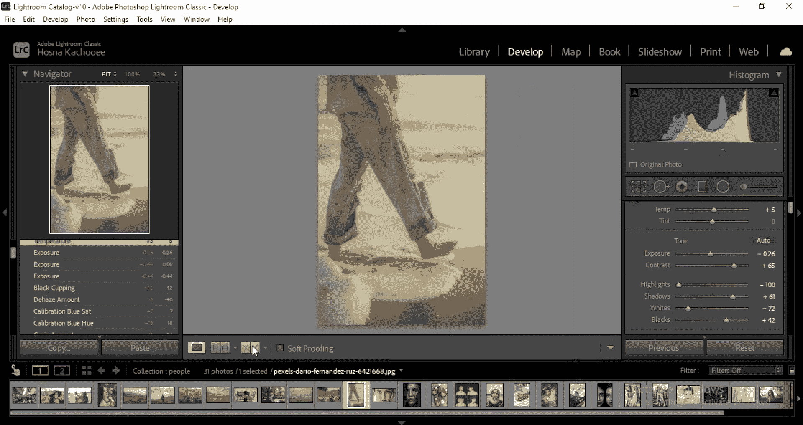

# Adobe Lightroom 复古风格照片编辑教程：第46课：复古风格实战 📷


在本节课中，我们将学习如何在 Adobe Lightroom 中制作复古风格的照片。复古风格是一种流行了几十年的经典风格，它能让照片看起来像是用老式胶片相机拍摄的。本节课我们会通过一张已经带有一些复古感觉的海滩照片，一步步调整出完整的复古效果。跟着我一起操作，你会发现复古风格其实并不难，只需要掌握几个关键参数就能完成。


## 一、复古风格的核心特征 🎞️

复古风格之所以独特，主要来自三个方面，第一是颗粒感的轻微存在，第二是画面边角的晕影效果，第三是整体偏暖的色调。当然还有其他细节，但这三点是最重要的，也是我们这节课要重点调整的内容。

以下是复古风格的核心公式：

```text
复古风格 = 轻微颗粒感 + 边角晕影 + 暖色调
```


## 二、准备素材与基础光影调整 🌊

上一节我们介绍了复古风格的核心特征，本节中我们来看看如何用 Lightroom 把普通照片变成复古风格。我们使用的这张图片本身就带有一点复古感觉，画面是一个人在海滩上行走，充满怀旧气息，这个人的穿搭也和整体的复古氛围很搭，照片是由拍摄者提供的。

现在我们开始制作复古效果，第一步是对图片进行雾化处理。雾化是我们之前一直做的相反操作，之前我们可能是在消除雾气，而现在我们要故意增加雾感，让画面看起来更像旧照片。

以下是基础光影调整的步骤：

- 首先处理高光部分，因为画面中已经有一些过度曝光的高亮区域，我们需要把高光滑块拉下来，把这些过亮的地方压暗一些，使光影更均衡。
- 接下来处理白点，稍微调低白点数值，让亮部不过分刺眼。
- 通常我会在这里增加对比度，但为了复古效果，我们先不急着加对比度，先继续其他调整。
- 然后我们使用色调曲线来处理中调，先把阴影部分提亮，因为复古图片的明暗差异通常不大，阴影和高光之间不应该有太强烈的对比。
- 接着降低清晰度，清晰度降低后画面会变得比较平坦，这正是我们想要的复古质感。
- 同时处理纹理，原始照片纹理较多，我们稍微减少一些纹理，让画面更柔和。
- 如果清晰度之前调得太重，也要把细节滑块相应降低，避免画面出现不自然的边缘。

完成光影调整后，我们来调整色温。我们先给画面加一点暖色温，后续还会在颜色分级和 HSL 面板中进一步增强暖色效果。


## 三、色调曲线与整体平坦度 📈

上一节我们完成了基础的光影和色温初步调整，本节中我们来看看如何用色调曲线让照片呈现出复古风格特有的平坦感。

在色调曲线面板中，我们的目标是让整张图片看起来比较平坦，也就是降低整体对比度，让明暗过渡更柔和。具体操作如下：

- 在暗部区域创建一个点，把背景和海水部分的细节重新拉回来，避免暗部过于死黑。
- 降低整体对比度，这样可以找回一些原本丢失的细节。
- 稍微提高高光部分，保持画面整体的平坦状态。
- 接下来处理蓝色部分，把蓝色调得更暖一些，让整体色调更符合复古风格。

通过色调曲线的这些调整，画面已经看起来相当平坦，复古风格的雏形也逐渐显现出来了。


## 四、色相、饱和度与亮度调整 🎨

上一节我们通过色调曲线让画面变得平坦，本节中我们来看看如何用 HSL 面板进一步调整颜色，让照片看起来像是用老式相机拍摄的。

复古照片的一个特点是，它模拟的是老式胶片相机拍摄的效果，不应该看起来像是经过明显的后期处理，而应该像是一张直接从拍立得相机里出来的原始照片。因此我们要尽量让颜色保持自然，不要过度饱和。

以下是 HSL 面板的具体调整建议：

- 在饱和度选项卡中，增加青色和蓝色的饱和度，让海洋和天空更有色彩表现力。
- 黄色部分也可以适当提高饱和度。
- 橙色部分则要降低饱和度，但因为橙色会影响到皮肤颜色，调整时要格外小心，避免让人物皮肤看起来不自然。
- 在亮度选项卡中，降低蓝色的亮度，特别是人物裤子那部分的蓝色，让它更深沉一些，不会抢走画面的注意力。

完成这些颜色调整后，照片的色彩基调就更接近复古胶片的感觉了。


## 五、颜色分级与进一步暖化 🌅

上一节我们完成了 HSL 中的色相、饱和度和亮度调整，本节中我们来看看如何用颜色分级面板让图片更加温暖。

在颜色分级面板中，我们使用全局选项卡来统一调整整张图片的色调。我们选择一种接近红色的橙色，再适当增加一点饱和度。关于亮度，可以稍微提高，这样暖色效果会更明显。高光部分我们暂时不再调整，因为之前已经通过全局选项卡实现了想要的温暖效果。


## 六、细节、晕影与颗粒处理 🖼️

上一节我们完成了颜色分级的暖色调整，本节中我们来看看如何处理细节面板、添加晕影以及复古风格必不可少的颗粒感。

在细节面板中，我们并不希望图片过于锐利，因为复古风格讲求的是平坦和柔和，所以不添加任何锐化，也不去调整降噪。原因很简单，复古照片里的颗粒和噪点正是我们想要保留的特质，而不是需要去除的缺陷。因此这两个选项都跳过，镜头校正也不做，保持默认状态即可。

晕影效果在其他面板中进行，操作如下：

- 降低画面四个角落的亮度，让视线更集中在画面中央。
- 增加羽化，让晕影过渡更自然，不生硬。
- 调整圆度，让晕影范围更符合画面构图。
- 保留之前在高光部分可能丢失的一些亮度信息。

接下来处理颗粒，我们需要放大图片来查看添加的颗粒量。适当增加颗粒，同时把颗粒的大小调小，让颗粒看起来更细腻、不那么粗糙。普通观看者可能不会注意到这些颗粒，除非他们使用小屏幕或者放大查看，但作为编辑流程的一部分，我们仍然需要把它做好。


## 七、校准、最终雾化与曝光调整 ⚙️

上一节我们完成了细节、晕影和颗粒的处理，本节中我们来看看校准面板的设置，以及最后的雾化和曝光调整。

在校准面板中，我们可以处理蓝色部分。因为画面里蓝色比较多，我们让蓝色保持在较暗的一边，避免颜色变得过于鲜艳不自然。我们的目标是不让观众看出这张照片做过后期处理，让它看起来就像是直接从相机里出来的原始文件。

接下来我们再次对图片进行雾化处理，移动除雾滑块来增加雾感。然后处理黑点，把黑点调得更浅一些，因为复古图片通常会带有一种光晕效果。画面中海水最亮的部分就是这种光晕的体现。

如果画面整体太亮，我们可以适当降低曝光。在本例中，降低曝光是为了营造一种太阳即将西下的氛围，好像这张拍立得照片正是在日落前拍摄的。如果保持原本的亮度，画面会给人一种清晨或正午阳光充足的感觉，这就失去了我们想要的怀旧氛围。为了增强那种怀旧感，我们降低曝光，让观众感觉到这张照片是在太阳即将落下的时候拍摄的。

最后，我们再往图片里添加一些暖色，让整体色调更加温暖。


## 八、前后对比与本节总结 🔍

上一节我们完成了所有的调整参数设置，本节中我们来看看最终的前后对比效果。

调整完成后，对比修改前和修改后的图片，你会发现这是一张完全不同的照片，风格也完全不同。建议把两张图片并排放置来看，这是一种很好的方式，可以鼓励你自己，也能让你欣赏在 Lightroom 中编辑过程中所取得的进步。

本节课中，我们一起学习了如何在 Adobe Lightroom 中制作复古风格照片。我们掌握了复古风格的核心要素，包括颗粒感、晕影和暖色调；学习了如何调整高光、白点、阴影、清晰度和纹理来营造平坦的画面质感；使用了色调曲线来压平对比度并找回暗部细节；通过 HSL 面板调整了色相、饱和度和亮度，让颜色更接近老式胶片相机的效果；利用颜色分级进一步增强了暖色氛围；处理了细节面板、添加了晕影和颗粒，并保留了复古风格所需的噪点；最后通过校准、再次雾化和降低曝光，营造出了日落时分的怀旧场景。



希望你喜欢这节课，我们下节课再见。

