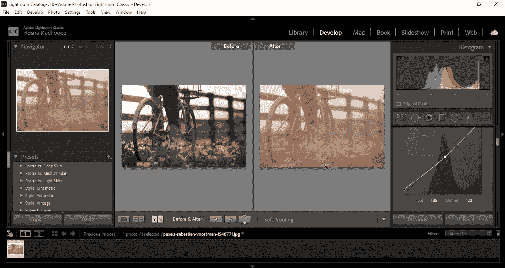

Complete Adobe Lightroom Megacourse：47：复古图片编辑实战（第二部分）📸

在本节课中，我们将一起学习如何在 Adobe Lightroom 中把一张照片调出复古风格。我们会以一张骑自行车的怀旧照片为例，逐步讲解色调、明暗、色彩分级以及肉粒等调整步骤，让你理解复古效果的核心逻辑，并能够根据自己的喜好自由发挥。

# 为什么这张图适合做复古风格

上一节我们介绍了复古调色的基本思路，本节中我们来看看另一个具体的例子。

以下是这张图片适合做复古风格的原因。

- 我们还有另一张图片，准备把它编辑成复古图像。
- 就像第一个例子一样，这张照片捕捉的是骑自行车时的怀旧瞬间。
- 画面中的光线可能是日落，也可能是日出。
- 我们现在就可以把这张图片连接起来，因为骑自行车的经历大概是所有人都有过的。
- 围绕自行车的花朵也有助于营造出宁静的氛围。
- 当你想要创造复古外观，并找回那种怀旧感时，这种氛围非常合适。
- 所以，当我们想要给图片应用复古风格时，这张图是非常合适的素材。

# 开始编辑前的准备

以下是我们在开始之前需要明确的目标。

- 如果你还记得上一节课的内容，我们在寻找图片中褪色的效果，我们希望图片里有一些肉粒。
- 我们需要一些晕影效果。
- 我们希望颜色有一定程度的去饱和，但不能过度。
- 整体图片上我们也需要一种暖色调。
- 为了实现这些效果，我们需要从基础色调开始调整。

# 基础色调调整

以下是具体的调整步骤。

首先，我们要去雾。

我们要对图片进行去雾处理。做完这一步之后，图片看起来已经比较平坦了。我们只完成了这一项操作。

如果你查看直方图，会发现存在削裁情况。如果按下 J 键，你会看到大量的削裁提示。但这是因为画面里有阳光和太阳。如果存在逆光问题，这种情况可以轻易忽略，因为我们知道那是太阳，而且这不是什么大问题。

让我们回到色调面板。我将把阴影调高，全部调到最高，没错。现在我要降低图片的对比度。稍微减少高光部分。我们不能调得太低，因为你知道，那个实际上就是太阳。太阳是直接对准相机镜头拍摄的，这通常是你想要避免的情况。但是因为这里有栅栏在挡住光线，所以我们没有获得全部的光线。正因为如此，我们才能看到这里发生了什么。如果图片是在太阳直接对准镜头，并且没有任何东西遮挡的情况下拍摄的，我们将什么都看不到，因为一切都会一片漆黑。

在增加阴影之后，让我们减少亮部。同时，我们也要增加黑部。这样我们就已经做出了相当大的变化。图片变得更加平坦了。我们增加了阴影部分。现在我们可以看到花朵和裤子里面有更多的细节了。如果不做这些调整，你会看到裤子上有类似大象的图案，但在那之前我们根本看不出来。现在所有的图案都清晰可见，我们也能看到花朵的细节。好的。

让我们缩小视图。我会在完成图片后再回到白平衡调整。在完成色调曲线之后再处理白平衡。

# 明暗与对比度微调

以下是明暗部分的具体操作。

让我们来到这里，我要降低清晰度。这只做了一点点改变。你可以看到调整前后的效果对比。同样，这有助于让我们的图片变得更平坦。至于自然饱和度，我们确实希望保留一定的饱和度，但我会把图片稍微去饱和一点。让我缩小视图，这样能看得更清楚。去饱和之后，效果如下所示。我们可能之后会再回来调整这个数值。

# 色调曲线调整

以下是色调曲线的调整方法。

接下来去色调曲线面板。我们会再次提升阴影部分。降低高光部分。然后创建一个点来控制对比度或中间调部分。我们就到这个位置，实际上刚才在饱和度方面做过头了。我会在 HSL 面板里处理，因为在那里我们可以控制每种单独的颜色。好的。

# HSL 面板调整

以下是 HSL 面板的详细调整内容。

让我们来到 HSL 面板。我们看到了 H 选项卡。正如我们之前提到的，我们不会去碰这个。因为图片会带有一定程度的去饱和，颜色不会过于突出。我们希望图片看起来真实，就像刚从胶片相机里取出来一样，没有做任何额外的后期处理。

让我们来到亮度选项卡。我要降低绿色的亮度，也就是我们的草地。降低黄色的亮度，也就是我们的天空。降低红色的亮度，也就是裤子。自行车上有一些青绿色。我们已经处理过黄色了。我们也来处理一下橙色。这样就能增强日落效果。

接下来去饱和度选项卡。我实际上要增加饱和度，因为绿色看起来有点没有生气。至于橙色，也就是我们的日落部分，我会稍微降低一下。负十这个数值就可以用来处理裤子的颜色了。我要降低颜色强度。效果看起来相当不错了。

# 白平衡设置

以下是白平衡的调整步骤。

在忘记之前，让我们回到白平衡面板。给整体图片添加一个暖色调。因为复古图像通常带有暖色调的白平衡，而不是冷色调。让我们把数值增加到加九。这样我们的图片看起来会更友好，也更温暖。我还要添加一点粉色色调。好了。

# 色彩分级调整

以下是色彩分级的具体设置。

先从阴影开始。阴影是图片中最暗的部分。我们给阴影添加一种红色，固定饱和度，或者如果你愿意，也可以在上面调整。亮度方面，我们要处理亮度。我会调高一些。

接下来处理中间调。添加橙色，或者说黄色。去饱和度是可以的。让我们增加亮度。

最后是高光部分，我们选择橙色。降低饱和度。我也要降低亮度。我会说负三十七。我们要把这些融合在一起，平衡整体效果。实际上，让我们取消平衡。好的，这样就平衡了。负五这个数值就不错了。

# 肉粒与变形调整

以下是肉粒和变形的调整细节。

这就是我们可以给图片添加肉粒的地方。我们不去碰噪点降低选项。不去碰畸变选项。我们不需要任何东西。我也没有看到任何色差问题。

我要先添加一些肉粒。让我添加一些肉粒。让我放大视图，看看我添加了多少。这个量是不是太多了或者太少了。让我们增加粒径，看看效果如何。实际上，我们要减小粒径。粒径要小一些。增加粗糙度。这样看起来就更好，也更自然了。好了。让我们缩小视图。我要再往极端处调整，因为我真的看不太清。效果不是那么鲜明。我会让它更粗糙一些。好的，现在让我们缩小视图。

对于变形部分，我可能需要移动旋转，抱歉，是水平选项卡。向这个方向调整。这样我们才能获得那种骑行路线的氛围，就像是一次体验。我也要处理一下垂直选项卡，不过我们就不处理垂直了。水平调整就够了。

# 裁剪后晕影与校准

以下是裁剪后晕影和校准的操作。

然后我们要做一些裁剪后晕影。我们选择高光优先级，因为两个角上都有高光。所以，让我们添加一些晕影。把晕影加上。把丢失的高光再找回来，就这样。让我增加一下。好的，这太多了。负十四这个数值就可以了。

在进入校准之前，我要回到上面的自然饱和度选项卡。我只是要稍微降低一下。好的，这太多了。我们选择加九。我会进一步对图片进行去雾处理。好的，我们快完成了。

让我们进入校准面板，修正颜色。红色主色调。看看哪个看起来更好。加十一偏向黄色的一边。这就是我们想要的。让我们看看用去饱和色调是什么效果。好的，这变得更好了。

我们也要把绿色向蓝色方向移动。因为我希望绿色保留自己的颜色，同时也要去饱和。至于蓝色，我们图片里的蓝色不多，但我们就来处理一下。这会很有帮助。好的。

# 细节微调与前后对比

以下是最后的细节微调和效果对比。

还能做什么呢，我要再加一点晕影。在哪里呢。可以加更多吗。处理圆形度。把边缘羽化一下。好的，效果看起来不错。

现在，让我们看看还丢失了什么。我要再加一点温度。因为校准之后我们失去了一些暖色调。好了，现在我们对图片的处理完成了。

让我们看看调整前后的对比。我们的图片看起来相当柔和，也相当怀旧。它也是褪色的，所以它分享了一种体验。我们从角度就知道，我们是在分享一种体验，而不是单纯展示一个漂亮的主体。让我们把它们并排放在一起看。就这样。

这就是创造复古外观的另一种方式。虽然我打算在这里修正一下。我觉得我们可能破坏了草地的和谐感。好的，就是这样。草地还是在那里。但是你知道，你应该把它保持在负七。好的，现在我们的图片处理完成了。

这就是如何编辑复古图片的方法。根据你的喜好，你可以把效果做得更强烈。或者更褪色，随你喜欢。抱歉，我刚才说错了。要提高对比度，来让图片变暗，通过往下调整。现在我对我的图片很满意了。我觉得它相当怀旧和柔和。这就像是在分享一次体验。希望你们能够学会如何编辑复古图片。希望你们不久的将来能找到自己的风格。这一课就到这里了。下一课见。

本节课中我们一起学习了如何在 Lightroom 中把一张骑自行车的怀旧照片调成复古风格。我们分别讲解了基础色调、阴影亮部黑部、色调曲线、HSL 面板、白平衡、色彩分级、肉粒、变形、裁剪后晕影以及校准等步骤，并通过前后对比了解了复古图像的核心特征。

# 核心要点公式

复古风格图片 = 降低对比度 + 提升阴影 + 降低高光 + 黑部适当提升 + 加入肉粒 + 暖色调白平衡 + 适度晕影

HSL 亮度调整 = 降低绿色亮度 + 降低黄色亮度 + 降低红色亮度 + 降低橙色亮度

色彩分级 = 阴影红色 + 中间调橙色或黄色 + 高光橙色 + 适当降低亮度与饱和度

