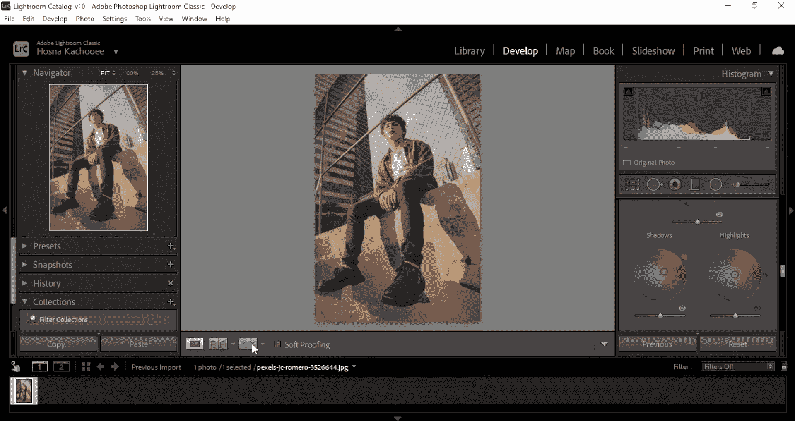

# Adobe Lightroom 后期处理从入门到精通：第 48 章：街头摄影后期处理 📸


在本节课中，我们将学习如何使用 Adobe Lightroom 中的变形面板来改变照片的透视和角度。我们会以一张街头摄影照片为例，画面里有天空、塔楼，而且拍摄者的鞋子比脸部更靠近画面前景。我们会先完成基础的曝光和色彩调整，再通过色调曲线、HSL、亮度、分色、细节、镜头校正等模块，最终打造出带有鱼眼效果的复古电影风格。这节课适合初学者，所有参数都会用大白话讲解，大家可以跟着视频一步步操作，不用担心看不懂专业术语。


接下来我们先来看看基础的曝光和光影调整。这是后期处理的第一步，决定了照片的整体明暗基调，调好了这一步，后面的色彩调整才会更容易操作。


以下是基础面板的调整步骤：

- 调整色温，让画面偏暖，增加街头氛围
- 加入洋红色调，让颜色更有电影感
- 降低曝光，避免画面过亮
- 降低对比度，让明暗过渡更自然
- 降低高光，挽回天空和亮部细节
- 提高阴影，让暗部不至于太黑
- 降低白点和黑点，控制极端亮部和暗部

代码示例：

```
色温：偏暖
色调：洋红
曝光：降低
对比度：降低
高光：降低
阴影：提高
白点：降低
黑点：降低
```


完成基础光影之后，我们继续使用去雾、纹理、清晰度、自然饱和度和饱和度，让照片的存在感更强，观众一眼就能看出这是一张经过精心处理的街头作品。


以下是存在感增强的参数列表：

- 去雾：增加，去掉雾气感
- 纹理：增加，突出街道细节
- 清晰度：增加，让边缘更锐利
- 自然饱和度：提高，保持肤色自然
- 饱和度：适度提高，让颜色更丰富


接下来我们来看看色调曲线。色调曲线是控制照片明暗层次的重要工具，可以让画面的暗部和亮部分别独立调节，而不影响整体曝光。


色调曲线的核心公式如下：

`输出亮度 = 输入亮度 × 曲线增益`

以下是色调曲线的调整方法：

- 把亮部曲线向上拉，让高光更亮
- 把暗部曲线向下压，让阴影更深
- 微调暗部和亮部，让对比度更柔和
- 检查整体明暗，避免过度调整导致画面发假


色调曲线调整完成后，我们进入色彩面板，开始修改照片的具体颜色。这一步的目的是让街头照片呈现出夜间商业广告或运动品牌广告的感觉。


色彩调整使用 HSL 模式，其含义如下：

`H = 色相 (Hue)`
`S = 饱和度 (Saturation)`
`L = 亮度 (Luminance)`

以下是各颜色的调整思路：

- 红色：调整色相，避免影响人脸肤色
- 蓝色：改变色相，让天空更有质感
- 橙色：调整人脸相关颜色，保持自然
- 黄色：偏向红色，增加暖调
- 青色：调整天空和阴影部分的颜色


完成色相调整之后，我们还需要调整各颜色的饱和度，让颜色的浓度更协调，避免某些颜色过于突兀。


以下是饱和度的微调建议：

- 红色：小幅增加饱和度
- 黄色：小幅增加饱和度
- 蓝色：小幅增加饱和度
- 其他颜色：根据画面效果适当调整


接下来我们来看看亮度面板，也叫 Luminance。它控制每种颜色的明暗程度，可以单独让天空变亮或衣服变暗，而不影响其他颜色。


亮度调整的代码逻辑如下：

```
颜色亮度 = 原始亮度 × 亮度系数
```

以下是具体的亮度调整方案：

- 天空：提高亮度，让蓝色更明亮
- 衣服：降低亮度，让深色部分更沉稳
- 肤色：保持不变，避免过亮或过暗
- 其他颜色：根据画面需求微调


亮度调整完成后，我们进入分色模块，也叫 Color Grading。这一步能把所有颜色统一起来，让整张照片看起来像是用同一卷胶片拍摄的。


分色调整的主要思路如下：

- 阴影：偏蓝色，营造复古电影感
- 中间色调：不需要大幅调整
- 高光：微调，避免过度
- 平衡：适当降低，让颜色融合更自然


分色完成之后，我们进入细节面板，为照片添加复古质感。街头摄影通常需要一点胶片颗粒感，这样看起来更有故事感。


细节处理的步骤如下：

- 锐化：数值设为 13，让边缘清晰但不过度
- 噪声：检查后发现没有明显噪点，不需要处理
- 纹理：增加，模拟胶片质感
- 颗粒：增加，增强复古风格


接下来是镜头校正和绿度调整。我们先检查是否需要镜头校正，如果画本身没有明显变形，就可以关闭这个模块。


镜头校正的处理方式如下：

- 检查画面变形，发现不需要校正，关闭镜头校正
- 添加绿度，让画面更有街头色彩
- 降低粗糙度，避免绿度过重
- 降低绿度总量，防止过度调整


现在我们来到本节课的核心部分，也就是变形和透视调整。我们要通过变形面板给照片做出鱼眼效果，让拍摄者的鞋子成为画面的主视觉点。


变形调整的核心公式如下：

`透视变形 = 原始透视 + 垂直偏移 + 水平偏移`

鱼眼失真效果的计算逻辑如下：

`鱼眼失真 = 中心拉伸 + 边缘变暗`

以下是变形面板的具体操作步骤：

- 垂直调整：增加滑块，让鞋子更接近地面
- 开启受限裁剪：去除不必要的白边
- 水平调整：稍微向右移动，让构图更平衡
- 手动失真：向左增加失真，打造鱼眼效果
- 受限裁剪：再次开启，裁剪掉多余的白边


变形调整完成后，我们回到光面板，对高光、阴影和中间色调做最后的微调。这一步是为了让前面所有的调整效果融合得更自然。


以下是最终微调的列表：



- 高光：再次降低，控制亮部
- 去雾：进一步增加，增强画面通透感
- 阴影：适当提高，让暗部更柔和
- 高光和亮部：根据画面效果再次微调
- 暗部：降低，增加层次感
- 中间色调：调整，让过渡更平滑


所有调整完成之后，我们来看看调整前后的对比效果。对比能让我们直观地了解每一步调整带来的变化。


对比结果如下：

- 调整前：普通的街头照片，透视平直，颜色较为平淡
- 调整后：带有鱼眼失真和复古电影感，鞋子成为画面主角，整体具有商业广告风格


本节课中我们一起学习了如何在 Lightroom 中对街头摄影照片进行后期处理。我们完成了基础曝光、色调曲线、HSL 色彩、亮度、分色、细节、镜头校正以及变形透视调整，最终打造出带有鱼眼效果的复古电影风格。希望大家能够理解变形面板和失真标签的使用方法，后续会有更详细的课程深入讲解。这一节课到这里就结束了，我们下一节课见。


