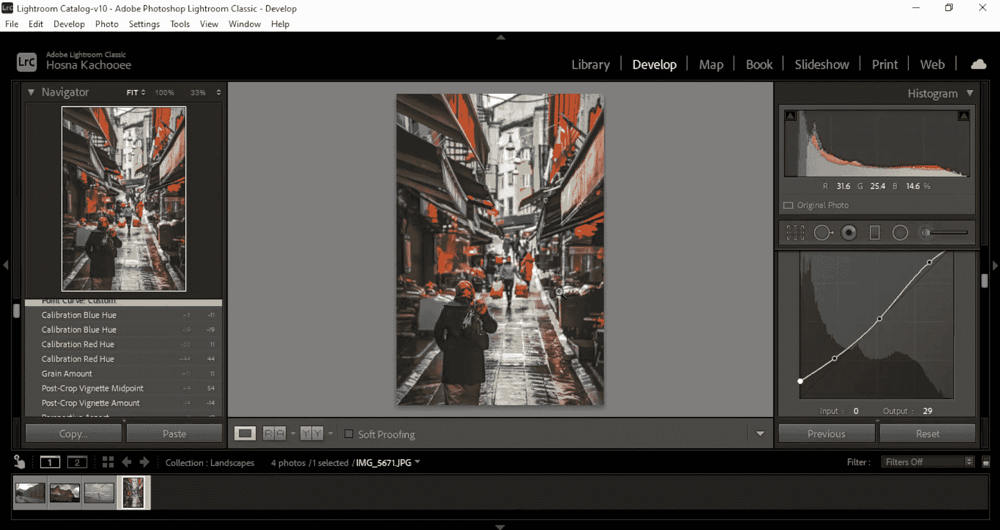

# 📸 Adobe Lightroom 从入门到精通：049：街头摄影后期编辑（第二部分）


在本节课中，我们将学习一种在社交媒体和 YouTube 上非常常见的照片编辑风格，也就是都市街头风格。你很可能在网上见过很多为此类风格出售的预设，说明这种风格的受欢迎程度很高。如果你手头有一张街道的完美照片，或者是在建筑旁穿着好看衣服的照片，掌握这种编辑方法会非常有帮助。本节课的核心在于通过颜色搭配，让建筑和人物共同成为画面的主角，并让图像中的每个细节都清晰可见。

---

### 一、什么是都市街头编辑风格

上一节我们可能聊过别的编辑思路，本节我们来看看都市街头风格。

这种风格在社交媒体和 YouTube 上随处可见，很多博主甚至会为此专门出售预设。它和风景照不一样，不需要处理树木或草地，主要拍摄对象是建筑和人。在这类图片中，建筑和人物都是画面的焦点，Transform 面板非常重要，因为街道照片里通常会出现很多线条，需要我们校正透视。比如一个市场场景，没有购物的人就不像市场，你看有些人正在购物，这位女士正要购物，这些元素都让场景更有生活气息。我们的目标是让颜色统一起来，让图像的每个部分都能看得见。

以下是都市街头风格的主要特点：

- 主体通常是建筑和人，而不是自然风景。
- 颜色搭配和上色是这类照片的核心。
- 需要修正建筑和街道的透视线条，让画面显得平衡。

---

### 二、基础曝光调整：让暗部看得清

在确定编辑方向之后，我们先来处理图片的亮度问题，这是后续所有调整的基础。

打开图片后，按下 J 键可以查看剪裁情况，你会发现很多暗部，这主要是因为原片欠曝，大部分区域都很暗，几乎看不清商店在卖什么。为了看清我们正在处理的内容，先把阴影调高。调高之后，画面明显变好，欠曝情况减轻了。接着把黑色也调高，这样图像每个部分都能看到了，之前我们看不到的细节现在都出来了。只需移动几个滑块，图像就变得相当清晰。这时候可能出现了高光过曝，所以也要把高光降低一点，画面会看起来更好。再增加一点对比度，稍微提高白色，让画面更有层次感，整体明暗关系就理顺了。

以下是基础面板的调整顺序：

1. 打开 J 键查看暗部和亮部剪裁情况。
2. 提高阴影，让暗部细节可见。
3. 提高黑色，进一步亮暗部。
4. 降低高光，防止亮部过曝。
5. 增加对比度，适度提高白色。

---

### 三、Presence 模块与自然质感

曝光基本搞定之后，我们进入 Presence 模块，处理图像的清晰度和整体氛围感。

首先使用去雾功能，等预览出来之后图片会变暗一些，这时候可以用曝光滑块把亮度拉回来。这里有一个很重要的原则：街头摄影要保持自然，不要制造人工感。商业照片通常会创造一个人工空间，一切都干净完美，颜色完美匹配，像是在做广告。但我们只是想分享一次经历，告诉关注者我去了市场，现场是什么样子，并不是在说服他们去那个市场，也不是在做商业宣传。所以我们不会追求那种完美的白色场景。如果这是一个刚开业的市场做商业拍摄，那可能需要把一切弄得无瑕，让水果闪闪发光，颜色非常鲜艳。但我们的例子不是这样，我们想展示的是真实自然的样子。接下来把暗部的两个滑块都调高一点，再稍微增加对比度，保持白色不变，提高清晰度来突出细节和纹理，让图像已有的质感更明显。

---

### 四、HSL 面板：统一图像色彩

曝光和清晰度处理完之后，颜色的处理是街头风格的灵魂，接下来我们进入 HSL 面板。

核心概念可以用下面的公式来理解：

```
HSL = 色相 (Hue) + 饱和度 (Saturation) + 亮度 (Luminance)
```

现在的图片颜色已经比较丰富，有红色、橙色、街道上的中性色，比如女士的裤子和屋顶，还有蓝色。这正是使用 HSL 面板创建理想配色的好时机。有了这样一张多彩的图片，你有很大空间去实验和发挥创意，决定图像最终的样子。

以下是 HSL 三个子模块的作用：

- 色相：改变颜色的色调，比如把红色偏向橙色，或把蓝色偏向青色。
- 饱和度：控制颜色的鲜艳程度，避免过度导致假色或脱色。
- 亮度：调整单种颜色的明暗，让各色在画面中平等可见。

先说色相。从红色开始，比如旗帜上面包的颜色，给它更偏橙色的色调。然后处理橙色，让它更偏红一点，但不要变成粉色，保持红色。黄色适当移动，绿色也移动，蓝色让它更偏青色。紫色不多，暂时不动。可以使用工具直接点击女士的衣服来改变颜色，让它更偏青色。再试着调整一下街道，虽然能做的不多，稍微移动一点。仅仅改变色相，图像看起来就已经很不一样了。

色相调整的具体操作如下：

- 红色：偏向橙色。
- 橙色：偏向红色，但不要粉。
- 黄色、绿色：适当移动色相。
- 蓝色：偏向青色。
- 人物衣物：可用选择工具直接改变颜色。

接下来是饱和度。观察图片，你的眼睛会直接被红色吸引，因为红色太鲜艳了，正在抢走主体（道路和女士）的注意力。这是因为人眼的工作方式，总会先注意到最明显、最清晰的东西。所以降低红色的饱和度，这样画面会更平衡，眼睛可以移动到别处。同时，把绿色、青色、紫色和品红的饱和度也都适当提高一点，让各部分颜色协调。我们不要触动总饱和度，因为一切看起来已经饱和度适中，不想让画面显得假，或者过于暗淡，那样会产生一种严肃且可疑的氛围，这不是我们想要的。

饱和度调整建议如下：

- 红色：降低，避免抢走注意力。
- 绿色、青色、紫色、品红：适当提高，让整体更均衡。
- 总饱和度：不动，保持自然质感。

最后是亮度。提高各种颜色的亮度，让颜色更清晰、更平均地呈现。黄色和绿色可以亮化，但红色太鲜艳，需要把红色调暗，不让它抢走注意力，让红色相比其他颜色稍微低调一些。现在效果看起来不错，颜色之间不再争抢，画面更加和谐。

---

### 五、色彩分级与色调曲线：营造氛围

HSL 调完之后，我们继续用色彩分级和色调曲线来统一画面情绪。

色彩分级完成后，回到色调曲线，可以给图片增加平面感，或者更精细地处理灯光。先给阴影部分加一点黄色调，这个亮黄色与明亮的橙色很搭，能起到平衡作用。中间调加入蓝色，让色调更有层次。高光部分尝试蓝色、黄色或橙色，最终选择蓝色，不过度饱和，因为我们希望接近白色而不是鲜艳的颜色。还可以进一步调整饱和度，现在我可以把所有颜色融合在一起，让颜色相互配合，创造出我们想要的完美氛围。你也可以平衡一下，现在我喜欢这个颜色，所以回到色调曲线。

接下来做 S 曲线，和我们一直做的一样，始终从三个点开始。底部和顶部的点不算，它们只是默认的阴影和高光点。我们想让图片稍微平一点，把阴影稍微降低，平衡一下对比度。然后再把曝光调高一点，高光降低一点。营造温暖氛围，色温设为 4 就可以。再给图片加一点粉色色调，因为它和所有颜色很搭配。或者觉得绿色更好，那就用绿色，设为 -4。对面还有相反的色调可选。目前看起来不错，图像已经很锐利了。

---

### 六、细节、降噪与镜头校正

颜色和氛围都处理好了，接下来处理图像的锐度、噪点和镜头问题。

图像已经比较锐利，稍微再锐化一点就够了，不要过度。降噪方面，图像有一些噪点，可以增加亮度降噪并加一点对比度。彩色噪点也加一点，比如 11，以防万一。等预览生成，缩放查看，效果不错。

然后是镜头校正。因为画面里有一条路，我们想让它看起来像一条长街，因为市场的摊位似乎永远延伸下去，不管去哪里都有卖水果或零食的摊位。所以用畸变面板创造那种“长街”的感觉，开启受限裁剪，让图片的末端看起来更远，仿佛前方还有很长一段路要走。检查一下色散，放大查看预览，如果没发现色散问题，就可以跳过这个标签。缩放回图片整体，继续下一步。

---

### 七、转换面板修正透视

镜头校正之后，我们还需要处理街道和建筑的透视，确保画面看起来笔直、自然。

之前说过，处理街道和建筑时，透视是关键。转换面板能帮我们进一步实现这个目标。因为有两条线可以提供给 Lightroom 参考，点击转换工具，点击并按住创建第一条线，然后再画第二条线。如果自动效果不理想，我们也可以手动调整。先移动水平滑块，让街道居中画面，稍微旋转图片让一切变得笔直。可以用人行道的起点作为参考线。水平滑块可能还需要再微调一点。不要缩放图片，否则会破坏之前的工作。可以尝试纵横比把图片拉长或压扁，或者调整纵向来改变透视。撤销之前的水平操作，效果会更好。我们改变了透视，现在看起来像是站在街道尽头拍摄的，虽然不完全在正中间，但已经营造出了那种错觉。用转换面板让图片稍微平一点，当然你也可以按自己喜欢的方式保留。

---

### 八、效果、校准与最终检查

透视修正完成后，最后添加一些氛围效果，并进行色彩校准。

进入效果面板，处理后期裁剪暗角。向左调整可以给画面四个角加上暗角效果，也可以改变中点位置。我觉得这样就可以了。再加一点颗粒，给图片带来轻微的复古感，不要太多，设为 11 即可。

最后来到校准面板，这里可以进一步调整原色，也就是红绿蓝三原色。看看我们希望颜色偏红还是偏黄，选择更偏红的色调。调太多了需要等预览，先设为 11。图片里蓝色不少，绿色不多，绿色就不动了。把蓝色调得更偏扫描仪感，先试一下，觉得调过了，改为 -11。现在我很喜欢这张图片了，如果想再平一点，也可以再加一点平面感。好了，我的图片完成了。我提升了颜色，按自己想要的方式改变了色调，也改变了透视，让观众看到图片时，感觉就像站在街道尽头，正在看着这个市场。

---

### 总结



本节课中，我们一起学习了都市街头风格的后期编辑流程，包括基础曝光调整、保持自然质感、HSL 面板的色相、饱和度和亮度调节、色彩分级与色调曲线、细节降噪与镜头校正、转换面板透视修正，以及最后的效果和校准。希望这些内容能帮助你处理街头摄影作品，让你的照片更有故事感。
