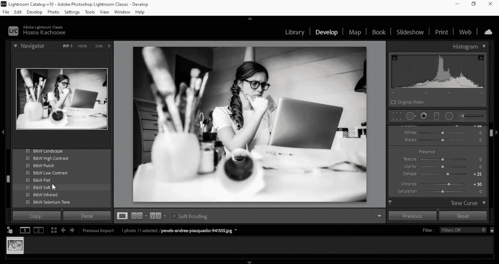

# 完整Adobe Lightroom大课程：第145课：图片心境与色彩分级 🎨


在本节课中，我们将学习如何在Adobe Lightroom中通过调整颜色和色温来控制照片的心境。我们会把之前“原则”课程里讲到的知识，套用到一张真实的图片上，看看不同的色彩搭配和色温变化，到底会让观众产生什么样的感受。无论是冷色调带来的孤独感，还是暖色调营造的希望感，都会在接下来的内容中一一拆解，帮助初学者直观理解“心境”在后期调色里是怎么起作用的。


## 一、先看原始图片：冷色调带来的心境

在进入实际调整之前，我们需要先理解一张未经修改的图片，默默地告诉观众一个什么样的故事。只有搞清楚原图自带的氛围，我们才知道之后该往哪个方向调整。

所以现在我们有这张图片，已经可以看到这张图片有绿色和冷色调。当我们看着它，我们看到这个女孩正在努力做一个项目，也许她困惑了，她在认真思考。当周围有这种冷环境，这显示这是一件严肃的事，她其实做得不太好，因为所有的颜色和冷感。我们之前提到过，冷色调表示悲伤的环境，绿色可以表示无助或绝望，而现在这张图片完美展示了这一点，这就是我们从这张图片得到的心境。

用简单的公式来描述这个冷色调心境：

```text
冷色调心境 = 冷色温 + 绿色调 + 阴影偏暗 + 低饱和度
```


## 二、把图片变暖：心境如何随之改变

刚才我们分析了原图的冷色调心境，接下来我们来试试，如果把整张图片的色调往暖色方向推，观众的感受会发生怎样的转变。

那如果让这张图片变暖会怎样？我们来看一看。我要移动色温，可能还要改几个地方，也许加点色调，还要把饱和度降一点。我要处理一下阴影，稍微去掉一些，处理雾霾，处理高光，只是为了把图片调回来，为了节省时间，我直接用Lightroom自带的预设。我这里有一些选项，找一个暖色调的，已经很暖的那种。

以下是我尝试的几种暖色调预设及其效果：

- 未来主义：这个风格不太适合这张图片，传达不出我们想要的感觉。
- 复古：这里没有我们要找的那种颜色，效果不对。
- 创意：呈现出冷光，看起来严肃又悲伤，和暖色调的初衷相反。
- 暖阴影：点击暖阴影之后，图片立刻呈现出一种正面的感觉。女孩仍然在做一个难的项目，依然在深思熟虑，但我们又觉得有希望，觉得她会按时完成项目，观众可能也会为她加油。这种积极的心境，就是通过暖阴影或暖色调营造出来的。
- 暖而忧郁：这种风格既暖又忧郁，既给人希望，又暗示她可能失败，可能丢掉项目。之所以这样，是因为图片里确实有一些暖色，但背景里的绿色在阴影中制造了严肃的心境，甚至被称为暖而忧郁。
- 冷阴影和暖高光：这种组合呈现出更戏剧性的视觉效果。可以想象，她可能是个科学家，有人在追她，她需要赶紧完成项目。我只是举例，让大家更容易理解。绿色和蓝色再次显示出一种绝望和求生的感觉。
- 冷色调预设：再次显得严肃，我们之前聊过蓝色，这张看起来像一张老照片，像是一个闪回，是过去某个人在做这件事的记忆。高光过曝，缺乏饱和度，但墙上还有一点暖色，显示这是一个温暖的记忆。也许她是个备受珍爱的科学家，已经去世，未来。
- 再次选择暖阴影：看起来她仍然在努力工作，但这次她有时间，我们对她有希望，觉得她会按时完成。
- 红色提升：这也是一个闪回，但看起来有点悲伤，是一个悲伤的闪回。也许在做项目的时候发生了不好的事情，而现在她正在回忆。
- 平铺绿色：这种心境通常用于科幻或超级英雄电影，为了营造那种奇幻的视觉效果。
- 暖对比：我们之前聊过这个风格。
- 复古：又是蓝色，又是悲伤。
- 最悲伤的一个：这大概是最悲伤的预设，还显示出孤独，但这个角色仍然在努力做她的项目。
- 低饱和度对比：饱和度降低，看起来是过去的东西，是一个闪回。因为背景里有冷色调，所以这并不是一个快乐的闪回。

暖色调心境的核心逻辑可以用下面这段简单的伪代码来表示：

```text
暖色调心境 = 色温偏暖 + 暖阴影 + 适当饱和度 + 希望感
```


## 三、没有颜色时：黑白图片的心境表达

刚才我们讨论了有颜色的图片，接下来我们要思考一个问题：如果图片完全没有颜色，观众还能感受到暖色或冷色吗？答案是可以的，只不过这时候我们需要关注高光、阴影和色调分级。

那么如果我们的图片没有任何颜色，看不到暖或冷会怎样？在黑白图片中，我们看的是高光和阴影。光影有多戏剧化，阴影是不是太暗，是不是变亮了，高光是不是过曝或者欠曝。让我们看看这些因素现在是如何起作用的。

以下是几种常见的黑白处理方式及其所营造的心境：

- 戏剧化主体：主体看起来很有戏剧感，这通常出现在悲伤的闪回里。可能会加上故障效果或胶片颗粒，表明这个闪回在回忆者心里没有留下好的印记。因为高光过曝，图片大部分变成了白色，阴影被压暗，制造出戏剧效果。
- 高对比：这个风格比较正常，只是展示一张黑白图片，既不特别戏剧，也不特别有趣。
- 低对比：呈现出一种温暖的心境，是一个闪回，因为图片有点饱和度低，显得比较平淡。我们会觉得这是一个关于某人的闪回，不会产生不好的感觉，也不会觉得会有什么事情发生，不戏剧，只是一个正常的闪回。
- 红外：看起来很有戏剧感，就像在《弗兰肯斯坦》这类电影里经常看到的黑白风格。之所以这么用，是因为电影本身很戏剧化，角色非常重要，发生的事件也非常激动人心。这种光影，过曝的高光和暗下来的阴影，共同制造出戏剧效果。
- 蓝色调黑白：有时候黑白图片也可以加上色调。这时候不是黑白，所有颜色都变了，整张图片覆盖了一层蓝色，就像做了一个全局的色彩分级。这会制造出冷色调和悲伤的心境。
- 分调偏冷：这种风格不太暖，更偏向冷色。既不展示温暖的记忆，也不展示悲伤的记忆，而是展示一个戏剧性的记忆，还会让我们有点紧张，因为感觉这之后马上就会发生什么。
- 明亮分调：这并不是真正的黑白图片，只是一些明亮的颜色。这会创造一个更有趣的环境，因为颜色鲜艳、有活力，我们不会觉得主体遇到了麻烦。



黑白图片心境的构成可以简化为下面这个公式：

```text
黑白心境 = 高光亮度 + 阴影暗度 + 对比度 + 色调叠加
```


## 四、课程小结与回顾

通过刚才的演示，我们已经看到了，只靠Lightroom里的几个预设，就能让同一张图片呈现出截然不同的情绪。接下来我们来总结一下，这节课到底学到了什么。

这就是每种色彩分级在我们图片中起的作用。我们只用了一些预设，把刚才做的全部撤销，仅仅通过预设，我们现在更清楚地了解了，如果做某些调整，图片会显得多么戏剧化、悲伤或温暖。这就是心境的工作原理。

在本节课中，我们一起学习了如何通过色温、颜色搭配、预设以及黑白处理来改变照片传达的心境。我们也看到了冷色调与暖色调在同一张图片里能带来截然不同的情绪。希望这些内容能帮助你更好地掌握Lightroom里的情绪调色技巧。

