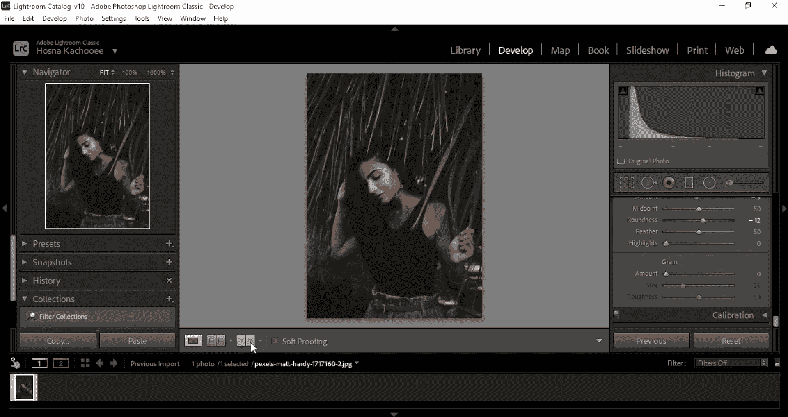

Complete Adobe Lightroom Megacourse：Beginner to Expert Photo Editing part2：52：哑光人像修图 🖼️


在本节课中，我们将学习如何在 Adobe Lightroom 中完成哑光人像修图。这是目前社交媒体上非常流行的一种修图风格，如果你关注 Instagram，就会发现很多博主都在用这种风格来处理旅行照片、自拍、产品照片以及各种其他类型的图像。哑光人像的核心特征是去饱和度，色调比我们之前做过的所有人像修图都要偏冷，特别是当画面中包含绿色时，效果会非常出色。画面主体通常带有蓝色，因此这种风格主要聚焦在蓝色和绿色这两种颜色上。接下来我们将演示如何达成这种修图风格，一步步把普通照片调成具有 Instagram 网红感的哑光人像效果。


第一部分：基础面板光影调整 📐


上一节我们介绍了哑光人像的整体风格特点，本节我们来看看如何在基础面板中设置对比度和光影。基础面板是修图的起点，决定了照片的整体明暗基调。

以下是基础面板中需要调整的参数。

```
对比度：32
高光：增加
阴影：增加
白点：降低
黑点：增加
曝光：轻微增加
```

首先将对比度提高到大约 32，同时也要提高高光，对阴影做同样的处理。这样处理之后，画面的明暗对比会变得更明显。如果你觉得还不够，可以再稍微增加一点。接下来降低白点，同时也要提高黑点，并且稍微提高曝光。快速对比一下修图前后的效果，你会发现画面变得更明亮，并且为图像增加了对比度。调整完这些参数之后，我们回到基础面板，继续往下处理存在感部分。


第二部分：存在感面板质感调整 ✨


完成基础面板的光影调整之后，本节我们继续处理画面的质感和色彩还原。存在感面板主要控制图像的清晰度、去雾和饱和度表现。

以下是存在感面板中的关键设置。

```
去雾：-26
自然饱和度：增加
饱和度：16
色温：偏暖
色调：品红
```

这里我们要对图像进行去雾处理，数值设为负 26。然后提高自然饱和度，如前所述，我们希望绿色和蓝色更加突出。但是同时也要降低饱和度，数值设为 16 比较合适，避免颜色过于艳丽。此外，我们还要调整图像的色温和色调，给图像更暖的色调，并添加品红色调。如果觉得颜色太重，可以适当降低一点。完成这些设置之后，画面的整体质感已经有了初步的哑光感觉，接下来进入最关键的一步，也就是色调曲线。


第三部分：色调曲线亮度塑造 📈


色调曲线完成之后，本节我们进入最关键的一步，也就是色调曲线。这一步非常重要，因为它会对图像产生最大的变化，决定画面的明暗分布。

以下是色调曲线的操作要点。

```
画面亮度 = 原始亮度 + 曲线调整值
操作：添加多个控制点，保护人脸曝光，降低白点
```

稍微提升曲线，增加一点亮度，这样就可以了。然后添加另一个控制点，再添加一个控制点，确保人脸曝光良好。接着降低这一部分的亮度，这样处理之后就比较合适了。同时也要降低白点。色调曲线调整完成之后，我们做了相当多的变化，现在画面比之前更有哑光感了。不过我们还没有完成，色调曲线之后，我们进入 HSL 面板来细化颜色。


第四部分：HSL 面板颜色精细化 🎨


色调曲线调整完成之后，画面已经有了哑光感，本节我们来细化具体的颜色表现。HSL 代表色相、饱和度、亮度，通过这个面板可以分别控制每种颜色的表现。

以下是各个颜色通道的调整建议。

```
红色：饱和度 -18，亮度增加
橙色：饱和度调整，亮度增加（保护肤色）
黄色：完全降低
绿色：降低至约 62
青色：降低
蓝色：提升
```

从红色开始，先调整饱和度，设为负 18 比较合适，然后提高亮度。接下来是橙色，调整橙色色相，实际上不需要大幅改变，因为这是肤色参考，我们只调整橙色饱和度，并且提高亮度，让颜色更明亮，让自然颜色更鲜艳。然后调整黄色，画面中黄色不多，我们将黄色完全降低，去掉灌木丛中的黄色。接着是绿色，降低到大约 62，同时降低青色和蓝色，稍微提升蓝色。颜色调整完毕之后，这些颜色现在有了哑光感，偏向冷色调。对比之前的图像，我们已经接近 Instagram 网红风格了。接下来进入色彩分级。


第五部分：色彩分级阴影着色 🌗


HSL 颜色调整完成之后，本节我们再处理阴影部分的色调，让画面更有电影感。色彩分级可以分别为阴影、中间调和高光添加颜色。

以下是色彩分级面板的设置方法。

```
目标区域：阴影
阴影色相：54 或 62
混合度：0
平衡值：降低
亮度：稍微降低
```

我们使用之前课程中提到的阴影和高光，但是只调整阴影，不碰高光。将阴影色相调整到大约 62，或者 54 也可以，这样我更满意。混合度设为 0，不要让颜色混合，同时也要降低平衡值。至于亮度，稍微降低一点就可以。现在我们改变了阴影色相，这有助于衬托她的肤色、绿色叶子、蓝色以及图像的暗部。图像正在慢慢成形，还有几个步骤就完成了。接下来进入细节面板。


第六部分：细节面板降噪处理 🔍


色彩分级完成之后，画面的整体氛围已经出来了，本节我们来处理图像的清晰度和噪点。细节面板主要用于锐化和降噪。

以下是细节面板的降噪设置。

```
色彩噪点降低：12
锐化：保持默认，不过度处理
```

关于细节，我们需要放大查看肤色，这里有一些噪点。但是细节我已经满意，不再进行锐化处理。接下来添加降噪，将色彩噪点降低设为 12。同样要注意不要做得太多，否则睫毛都看不见了。适当降低一点，保留面部纹理，稍微增加一点对比度。如果你想进一步修改，可以使用斑点修复工具，这个工具我们会在高级人像修图课程中详细讲解。现在缩放回来，皮肤效果已经可以了，可以稍微磨皮让皮肤更光滑。细节处理完成之后，最后一步是给照片添加一些氛围感，本节我们来看看效果面板。


第七部分：效果面板暗角添加 🌑


细节处理完成之后，最后一步是给照片添加一些氛围感，本节我们来看看效果面板。效果面板主要用于添加颗粒和暗角，增加画面的电影质感。

以下是暗角的设置建议。

```
数值：向左拖动，出现深色边缘
圆度：调得更圆
羽化：保持默认
```



启用暗角功能，向左拖动数值，这样可以得到深色边缘，让主体在画面中央更加突出。如果觉得效果太强，可以适当降低。关于圆度，你可以稍微调整，让它更圆或更不圆，我希望更圆一些。羽化参数可以保持默认。照片效果就这样了，和 Instagram、Pinterest 上的其他摄影师相比，我们做得不错。现在可以对比一下修图前后的效果。


总结与回顾 📚


本节课中我们一起学习了哑光人像修图的完整流程，包括基础面板对比度设置、存在感面板去雾与饱和度调整、色调曲线亮度塑造、HSL 颜色精细化控制、色彩分级阴影着色、细节面板降噪以及效果面板暗角添加。你看到修图前后的对比，照片进步很大，已经成功完成了哑光人像修图。给自己鼓个掌，你做得非常好。下一节课见，我们将学习更多不同的修图风格，并且会用简单的技巧和解释，带你了解如何达成那种风格的编辑。下一节课见。

