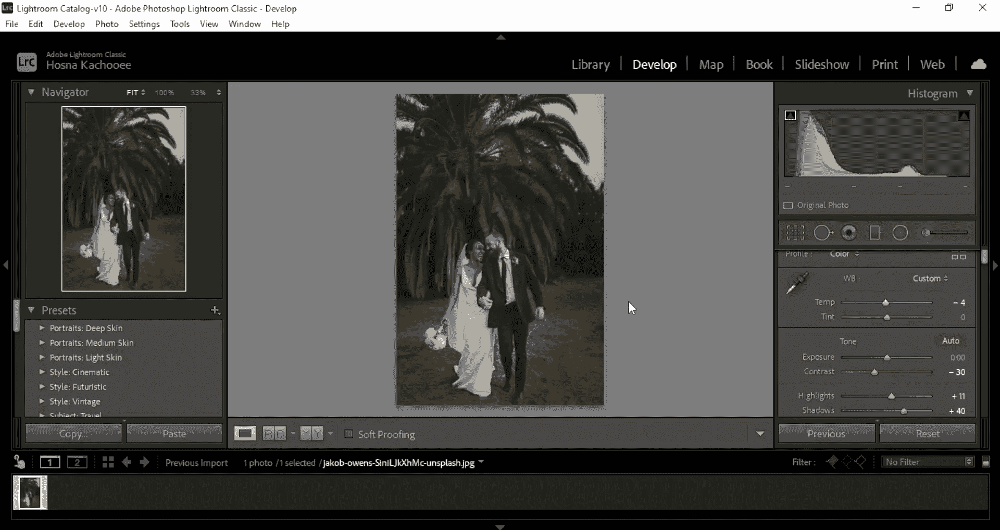

# Complete Adobe Lightroom Megacourse：148：垫片风格婚纱人像后期 📸

在本节课中我们将要学习如何用 Lightroom 把一张婚纱照调成垫片风格。垫片风格在社交媒体上非常常见，尤其是拍摄婚礼照片的时候，摄影师通常会用这种柔和的绿色调来营造安静又难忘的氛围。如果色彩过于鲜艳，照片就缺乏那种平和的感觉。本节课我们会一步步操作，把原始照片调成既有复古质感又突出新人主体的垫片风格效果。

## 第一步：基础色调调整 🌅

上一节我们介绍了垫片风格的基本概念，本节中我们来看看如何从基础面板开始调整这张婚纱照。首先打开 Lightroom 的基础面板，我们要先处理照明部分，为后续的曲线和颜色调整打好基础，这是整个后期流程的起点。

以下是基础面板需要调整的参数：

- 曝光：保持不变，因为原片曝光已经比较合适，不需要大幅改动。
- 对比度：适当降低，让照片整体显得更柔和，符合垫片风格的低对比特征。
- 高光：先降低再根据新娘礼服亮度微调，避免亮部过度曝光失去细节。
- 阴影：适当提升，让暗部看起来更淡化，增加复古感。
- 白阶：稍微提升一点，让亮部更有层次，但不要过亮。
- 黑阶：同样提升一点，配合前面的调整已经能看出淡化效果。

通过以上操作，我们仅用基础面板就初步得到了一种褪色的垫片质感。接下来我们继续深入调整色调曲线。

## 第二步：色调曲线与存在感 📈

刚才我们完成了基础面板的调整，本节中我们来看看色调曲线和存在感面板如何进一步塑造画面氛围。色调曲线是垫片风格的核心工具之一，能够决定照片的明暗分布和整体柔和程度。

色调曲线的核心思路可以用这个公式理解：

```
垫片风格曲线 = 阴影端点向上提升 + 高光端点适当压低 + 增加中间调对比度节点
```

具体操作如下：

- 打开色调曲线面板，选择 RGB 曲线。
- 把阴影端点向上拖动，这会让整张照片变得淡化，正是我们想要的垫片效果。
- 在高光区域创建一个点并稍微压低，同时在中间调增加一个对比度节点，让曲线呈现轻微的 S 形但整体偏淡。
- 在底部再添加一个点，完成曲线塑造，使画面更有层次。

存在感面板方面，我们要适当提高清晰度并轻微加入雾气，让画面更有氛围感。同时适当提升自然饱和度，让颜色更鲜明一些，但不要过度，否则会破坏垫片风格的柔和感。

色调曲线通常会让背景变暗，主要焦点自然落在新娘和新郎身上。接下来我们进入 HSL 面板处理具体颜色。

## 第三步：HSL 色相饱和度明度调整 🎨

上一节我们完成了色调曲线和存在感的设置，本节中我们来看看 HSL 面板如何细化绿色、蓝色、橙色和紫色等色调，这是垫片风格中最关键的一步。HSL 面板允许我们分别控制色相、饱和度和明度，针对婚纱照中常见的绿色草地和蓝色天空非常有用。

以下是具体调整思路：

色相调整：

- 绿色：向左或向右调整，决定是偏黄绿还是偏蓝绿。因为新郎穿着深绿色西装，我们需要把草地颜色和西装颜色分开，避免混在一起造成视觉混乱。
- 蓝色：天空部分向左调整，获得更柔和的青蓝色调，避免天空过于生硬。
- 黄色：根据需要选择偏黄色调，让整体色温更温暖一些。
- 橙色：涉及肤色，必须非常小心，数值建议保持在负五左右，避免新人面部泛红或颜色不自然。
- 紫色：照片中紫色不多，可以暂时跳过，不做特别调整。
- 青色：新郎西装和部分细节属于青色，需要调整到偏绿色一侧，让西装颜色与环境更协调。

饱和度调整：

- 青色：适当增强，因为之前看起来有些褪色，适当提升能让画面更生动。
- 蓝色：适当降低，避免天空过于刺眼，保持与整体风格一致。
- 绿色：适当增强，让草地颜色更有存在感。
- 黄色：适当增强，提升画面的温暖感。
- 其他颜色保持平衡，不要过度饱和。

明度调整：

- 橙色：提升明度，因为这是新人肤色，提升后能让主体从树木背景中脱颖而出。
- 蓝色：稍微降低一点，让天空区域更柔和。

使用 HSL 工具时，建议先用目标调整工具点击画面不同区域，识别当前颜色属于哪个色相，再决定往哪个方向移动滑块。完成 HSL 调整后，颜色已经比较协调了，接下来我们用分级调色面板进一步统一色调。

## 第四步：分级调色面板 🎭

刚才我们完成了 HSL 的精细调整，本节中我们来看看分级调色面板如何给阴影、中间调和高光分别上色，让垫片风格更有层次感。分级调色可以为不同亮度区域添加特定颜色，是营造电影感和复古感的重要手段。

分级调色面板包含四个部分：阴影、中间调、高光和全局。以下是具体操作：

阴影部分：

- 画面中阴影较多，我们可以利用这个机会给阴影添加想要的颜色。
- 尝试不同的色调，选择满意的一个后降低饱和度，同时适当降低亮度，避免颜色过于突兀，保持自然。

中间调部分：

- 中间调占据了画面的大部分区域，对整体色调影响最大。
- 尝试红色或橙色调色，使整体更加平衡，适合婚纱照的温暖基调。
- 降低饱和度，保持色彩克制，不要让画面显得廉价。
- 提升亮度，因为主体容易和背景融合，提升亮度能让新人更突出。

高光部分：

- 画面中的高光不多，除了新娘的礼服和天空。
- 这部分不建议动，否则会改变礼服原本的颜色，导致主体颜色失真。

全局部分：

- 尝试添加一种统一的颜色，比如绿色或橙色，为整张照片套上一层色膜。
- 经过对比，选择之前使用过的橙色调色效果更好，与肤色和整体风格统一。
- 调整饱和度，比如降到负二十三左右，让效果自然一些，不过分夸张。

分级调色完成后，照片已经有了明显的温暖垫片风格。你也可以根据喜好选择更冷或更暖的色调，没有绝对的标准。接下来我们处理细节和噪点。

## 第五步：细节面板与颗粒保留 🔍

上一节我们完成了分级调色，本节中我们来看看细节面板如何处理锐化、降噪以及保留胶片颗粒。细节面板决定了照片的清晰程度和画面质感，是后期的收尾工作之一。

在细节面板中，我们需要区分噪点和胶片颗粒，这是很多初学者容易混淆的地方。核心判断标准如下：

```
如果画面中出现均匀的小点，且呈现绿色或灰色，通常是胶片颗粒，不是噪点。
如果是不规则的彩色斑点，才属于需要去除的噪点。
```

具体操作：

- 放大图片到百分之百，仔细观察细节部分，看看画面中到底是什么样的点状物。
- 如果看到的是像小点一样的颗粒，那是胶片颗粒，它能增加复古质感，建议保留，不要删除。
- 不要开启降噪，否则会把所有细节压平，失去照片原本的质感和电影感。
- 跳过降噪步骤，保持原有的颗粒感，让照片看起来像用胶片相机拍摄一样。

照片的颜色已经看起来不错了，接下来我们检查是否有色差问题，确保画面边缘干净。

## 第六步：色差校正 🔵

刚才我们处理了细节面板，本节中我们来看看如何识别和修复照片中的色差问题。色差通常表现为物体边缘出现的彩色边框，比如蓝色或紫色的条纹，会影响画面的清晰度。

以下是处理步骤：

- 放大到照片中的细节部分，比如树木边缘或高对比度区域，寻找彩色边缘。
- 识别色差的颜色，这里主要是蓝色，出现在棕榈树或其他植物边缘附近。
- 先确定颜色，再调整相应的滑块，让修复只影响该颜色区域，不影响其他部分。
- 逐一检查画面中其他可能的色差区域，重复上述操作，直到边缘干净。
- 需要注意的是，如果图片质量较低，有时无法完全去除色差，这是正常的，不必强求完美。

完成色差校正后，画面边缘变得更干净。我们可以先跳过线性渐变，等到效果面板中再处理 vignette 等内容。接下来进入校准面板。

## 第七步：校准面板 🎯

上一节我们完成了色差校正，本节中我们来看看校准面板如何对原始颜色进行进一步微调。校准面板主要调整红、绿、蓝三原色的色相和饱和度，能够从源头改变颜色表现。

由于这张照片中绿色占据大部分，调整绿色原色会对整体影响较大，需要谨慎操作。

具体操作：

- 打开校准面板，观察预览变化，找到绿色原色滑块。
- 将绿色原色色相调整到负五十八左右，让绿色在明暗之间有更好的过渡，避免颜色过于生硬。
- 蓝色部分使用蓝色原色调整色相，同时调整饱和度，避免蓝色过于强烈，保持与整体垫片风格一致。

校准完成后，颜色分离度进一步提升，画面看起来更专业。接下来我们需要用调整画笔对主体和背景做局部分离，增强空间感。

## 第八步：调整画笔局部调整 🖌️

刚才我们完成了全局色彩校准，本节中我们来看看如何使用调整画笔给新人背后的区域做暗处理，让主体更突出。局部调整是后期中非常实用的技巧，可以针对特定区域进行处理，而不影响整张照片。

调整画笔的使用步骤如下：

1. 启用画笔工具，并勾选显示选定蒙板覆盖层，这样能清楚看到涂抹范围，避免涂错区域。
2. 在新娘和新郎背后进行粗略涂抹，不需要完美，但不要涂到人物身上，否则显得不自然。
3. 如果涂抹过头，可以用擦除功能把多余部分退回来，保持选择区域的准确性。
4. 为了让人物和背景融合得更自然，可以用画笔的羽化边缘轻轻扫过人物边缘，让过渡更柔和。
5. 漏掉的地方，比如手臂附近，需要补上，确保背景区域被完整覆盖。

涂抹完成后，我们对选中的背景区域做以下调整：

- 适当降低曝光量，让背景变暗，减少背景对主体的抢眼干扰。
- 如果清晰度自动变成了负值，需要撤销，因为我们不想让背景变得模糊，只需要变暗。
- 提升曝光，恢复适当亮度，避免背景过于死黑。
- 增加对比度，让画面更有层次，主体与背景的分离感更强。
- 如果过度调整，可以降低对比度，改为降低该区域的阴影和高光，保持自然。
- 不要碰高光，只调整阴影即可，这样能保持天空和礼服的原有亮度。

完成局部调整后，点击完成。此时我们可以对比调整前后的效果，发现背景更暗，新人更突出，画面空间感增强。

## 第九步：色温微调与最终对比 ❄️

上一节我们完成了调整画笔的局部处理，本节中我们来看看最后的色温微调，以及前后对比效果。色温是决定照片整体氛围的最后一步，能够让画面更凉或更暖。

在完成所有主要调整后，我们发现照片偏暖了一些，需要稍微调冷，以符合垫片风格的清新感。

具体操作：



- 进入色温滑块，向负方向调整，比如负四左右，抵消之前过度的暖色调。
- 这样可以让画面更平衡，既有温暖感又不过分油腻，符合婚纱照的高级感。

最后，把调整前后的照片放在一起对比。最终效果呈现出温暖而又具有垫片质感的风格，和原始照片有明显区别，颜色更柔和，主体更突出，整体氛围更符合婚礼摄影的需求。

## 课程总结 📚


本节课中我们一起学习了如何用 Lightroom 把一张婚纱照调成垫片风格。我们依次完成了基础面板的曝光对比度调整、色调曲线淡化处理、HSL 面板的颜色细化、分级调色的阴影中间调上色、细节面板的颗粒保留、色差校正、校准面板的原色微调，以及调整画笔的局部背景暗处，最后还做了色温微调。通过这些步骤，原始照片变得柔和、复古，并且新人主体更加突出，整体呈现出专业的婚纱照后期效果。下一节课见。

