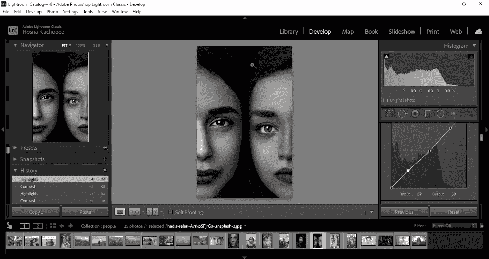

# Adobe Lightroom 后期大课：第149课：低调人像后期 📸

在本节课中我们将要学习如何在 Adobe Lightroom 中完成低调人像后期编辑。低调摄影是一种专业的人像拍摄与后期处理风格，画面整体偏暗，只有主体的脸部或关键部位保留亮度。我们将通过一张包含两张人脸的示例图片，逐步讲解从基础面板到局部调整的完整流程，最后对比调整前后的效果。

本课会讲两种不同的编辑风格，分别叫做低调和高调。现在我们先从低调开始。低调的基本思路是，在一张图片中提取亮部，在另一张图片中提取暗部。对于这张示例图，画面整体很暗，除了两个人的脸部以外，我们需要把其他所有区域都压暗。这些照片本来是彩色拍摄的，但很多时候会转成黑白，这样更能衬托外观。高调编辑会放到下一课，本节课只讲低调。

这属于一种比较高级的编辑方式，不是随处可见的效果，但它是肖像或其他摄影形式中看起来很专业的表现形式。一开始可能听起来有点令人困惑，不过在实际编辑过程中，我们会逐步讲解低调图片与其他图片的不同之处。

## 低调摄影的核心概念

上一节我们介绍了低调人像后期的整体目标，本节中我们来看看低调摄影的核心定义与数学表达。

**核心公式**：`低调效果 = 暗背景 + 亮主体 + 面部细节保留`

以下是低调摄影的关键要点。

- 亮部提取：在画面中提取亮部，同时压暗暗部。
- 阴影压暗：与高调摄影相反，低调不是把所有东西都变亮，而是让大部分区域进入阴影。
- 黑白处理：很多时候低调照片在拍摄后会被转成黑白，这样更能突出光影对比。

低调摄影的基本思路是，在一张图片中提取所有亮部，在另一张图片中提取所有暗部。这属于一种比较高级的编辑方式，不是随处可见的效果，但它是肖像或其他摄影形式中看起来很专业的表现形式。一开始可能听起来有点令人困惑，不过在实际编辑过程中，我们会逐步讲解低调图片与其他图片的不同之处。

## 拍摄与后期的关系

上一节我们介绍了低调摄影的核心概念，本节中我们来看看拍摄与后期编辑之间的关系。

以下是拍摄低调照片时需要注意的核心要点。

- 相机设置：拍摄低调照片时，需要将相机调到较暗的曝光设置，使背景接近纯黑。
- 光源设置：需要额外的光源，只照亮主体，不照亮背景。
- 背景效果：大多数时候背景会完全变成纯黑，而主体光线充足。
- 后期作用：后期编辑无法改变拍摄时的基础光影关系，但可以增强低调效果。

现在手头这张图里有两张人脸，还有一个深色背景。让图片看起来低调的大部分设置其实是在相机里完成的。但是后期编辑可以帮助增强这种效果。所以当你拍摄低调照片时，应该调整相机设置，让背景变暗。很多时候背景会完全漆黑，但主体被照得很亮。大多数时候你需要使用第二个光源。相机设置为非常暗的模式，光源只照射主体。这样就能同时拍出非常暗的背景和非常亮的主体。

## 基础面板光影调整

上一节我们介绍了拍摄与后期的关系，本节中我们来看看在 Lightroom 基础面板中该如何调整光影。

以下是基础面板中需要调整的滑块。

- 除雾：适当降低，避免画面过于发白。
- 阴影：降低，使暗部更深。
- 黑色：降低，进一步压暗最暗区域。
- 高光：提升，保留主体脸部亮部细节。
- 白色：提升，增强亮部过渡。
- 对比度：增加，拉开明暗差距。
- 曝光：适当提升，让主体更清晰。

先看看我们这张图的效果。我会先调整除雾，就像我平时做的一样。刚才调得有点过头了，调回来差不多就行。像我们刚才提到的，背景需要很暗，所以要降低阴影和黑色，调到这个程度。接着提高高光，也就是面部亮部，白色也做同样的处理。现在来看看我们做了什么：完全压暗了阴影，提亮了高光，还要增加对比度。这种摄影风格跟黑白照片类似，细节非常重要，不能有模糊不清的地方，否则低调风格就体现不出来。所以我们再提高一点曝光。

## 局部调整笔刷使用

上一节我们介绍了基础面板的光影调整，本节中我们来看看如何使用局部调整笔刷来进一步精修面部。

以下是使用调整笔刷的具体步骤。

- 选择主体面部：用笔刷涂抹两个人的脸部区域。
- 边缘羽化：适当增加羽化值，让光影过渡自然，避免出现生硬界限。
- 曝光调整：只在选区内增加曝光，亮起面部。
- 高光与阴影：分别降低高光、提升阴影，平衡面部亮度。

现在正好是使用调整笔刷的好时机。我来选择这两个人的脸部。打开笔刷，选定脸部区域。稍后我们还要回来处理眼睛，需要用另一个选区。按住 Alt 缩小笔刷，我们想要非常锐利的边缘，这样能在光影之间创造出秩序感。增加笔刷大小，稍微降低一点，重新增加选区，好的，移除这个。现在我只能在他们的脸上增加曝光，调得太多了，就这样吧。降低高光，太阳穴太亮了，增加脸部阴影。另外还要进一步降低图片的除雾值。这个选项开了。我们想把它调到相反一边，因为我们想保留眼睛、鼻子、嘴唇周围的细节。你马上就能注意到我们之前提到的毛孔。这是我们想保留的，因为我们追求的是更自然的风格。

## 肤质与细节保留

上一节我们介绍了局部调整笔刷的使用，本节中我们来看看如何保留皮肤的自然细节。

以下是保留皮肤细节的处理方法。

- 清晰度：适当增加，突出皮肤纹理。
- 自然风格：低调摄影追求自然质感，不需要磨皮去除毛孔，保留毛孔更真实。
- 锐化：不再额外增加锐化，保持原有画质。

虽然这张图片质量有点低，但不像商业图片那样需要把毛孔去掉。因为这是一种更自然的风格，所有人都有毛孔，我们想保留这些毛孔。所以我们要增加清晰度。现在光影部分已经调好了，我打算保持饱和度不变，也不再增加锐化了。就这样，现在看起来好多了。

## 裁剪与变换

上一节我们介绍了肤质与细节的保留方法，本节中我们来看看如何通过裁剪与变换来修正构图。

以下是裁剪与变换的操作。

- 构图调整：裁剪图片，让两个人的下巴位置尽量对齐。
- 变换面板：在变换面板中调整水平线和垂直线，修正倾斜。
- 实际限制：如果一个人的脸已经被裁剪，只能尽量调整，无法达到完美对齐。

现在我需要裁剪图片，因为你看两个人的下巴没有对齐。我先裁剪到我喜欢的比例，还可以再裁剪一点。可以在变换面板里操作，裁掉顶部的一小部分。接下来转成黑白。之前提到过，黑白是低调摄影中更广泛接受的颜色选择。当然也有带光的低调照片，但我现在想保持暗色调。转成黑白之后，我要进一步调整每个部分，让整体看起来更好。

## 黑白转换与色调曲线

上一节我们介绍了裁剪与变换的操作，本节中我们来看看黑白转换与色调曲线的设置。

以下是黑白与色调曲线的关键步骤。

- 黑白转换：低调摄影常用黑白处理，更能突出光影对比。
- 色调曲线：构建 S 曲线增强对比度，暗部下压，亮部上提。
- 色彩混合：黑白图像下可调节亮度混合，例如降低红色通道以修正肤色。

我可以用调整笔刷回去创建区域选区，然后做出 S 曲线。现在没有颜色了，如果你想可以混合通道，但我使用亮度通道。如果你想现在混合，脸部会出现在红色通道里，稍微降低一点。我们没有其他颜色，主要是肤色。我相信她的眼睛是绿色的，这个稍后再修复。我不打算添加任何分级色彩。细节很好，色彩降噪也没问题。然后还有畸变面板，让它们远离相机。接下来来到变换面板，我要让 Lightroom 改变水平线。移动一下，好的。现在他们的下巴差不多对齐了，但也可以修正垂直线。稍微调整一点，好的。模特没有正视相机直视，头有点倾斜，但视线直视前方。这样可以创造那种半侧脸的感觉，对她来说比较难，就这样吧。因为通常你会想保留下巴，但因为其中一个下巴已经被裁剪了，这是我们能做到的最好的结果。至于校准面板，我们不使用那些选项，也不使用那一个。

## 背景与头发处理

上一节我们介绍了黑白转换与色调曲线，本节中我们来看看如何处理背景与头发的局部调整。

以下是背景与头发的局部调整步骤。

- 外部区域选取：用笔刷选择背景和头发区域。
- 曝光降低：降低这些区域的曝光，使背景更黑。
- 细节保留：不要把头发调得太黑，保留部分发丝细节，避免画面看起来像两张脸漂浮在黑布上。

现在让我们进一步完成低调编辑的整体效果。先做这个，然后做那个。我可以选择外部区域，进一步压暗背景，这对头发也适用，没关系。我放大一点，尝试做一个准确的选区。如果选到脸下面一点点也没关系，脸部边缘本来就有阴影，不用太担心。到这里来，增加笔刷大小，我们可以覆盖这个大区域。然后减小笔刷，进入中间缝隙。好了，又合适了。我要进一步羽化边缘，针对这两个人。这就太多了。这里干净了，那里也干净了。减小尺寸，让我进入中间，这个太大了。撤销那个，降低笔刷尺寸，增加它，我们漏掉了这些区域，好的。现在我要取消选区，降低这些区域的曝光。但我们不想做得让头发完全没有细节。我们想保留这些区域，让你知道，这不是两张脸冒出黑布，我们有一些细节，但光源照在他们的脸上。

## 眼睛细节增强

上一节我们介绍了背景与头发的处理，本节中我们来看看如何增强眼睛的细节。

以下是眼睛的增强步骤。

- 新建选点：为眼睛单独建立调整点。
- 曝光提升：适当增加眼睛曝光，突出瞳孔细节。
- 清晰度：提升眼睛清晰度，让目光更有神采。
- 自然度：调整后检查，避免眼睛看起来过于假发。

我还要为眼睛创建另一个点。得新建一个点。完成了，创建新点，用于眼球。让我增加，重新调整，其实这样就行。完美。让我们做第一个点和第二个点。因为已经做了羽化，所以更容易了。像这样增加清晰度。因为她眼睛颜色较浅，你能看到眼睛里的细节，但不太明显，没关系。我们就增加曝光。让我缩小图片，确保她看起来不太假。我们可以清楚地分辨出每只眼睛里的细节，就这样保持吧。

## 直方图与剪切检查

上一节我们介绍了眼睛细节的增强方法，本节中我们来看看如何使用直方图检查剪切情况。

以下是直方图检查方法。

- 按 J 键：查看高光和阴影剪切区域。
- 目的确认：低调摄影允许部分阴影剪切，这是为了压暗背景。
- 最终修正：检查是否有过曝高光，必要时降低对比度或调整高光滑块。

你可以进一步调整黑色和白色，希望不要太多。现在如果你看直方图，会看到有很多剪切区域，按 J 键。这其实是我们的目的，我们想压暗那些区域。所以我要移除那个剪切提示。让我们看看，漏掉什么了吗？不觉得。看看周围。我觉得图片已经完成了。

## 前后对比与总结

上一节我们介绍了直方图与剪切检查，本节中我们来看看最终的前后对比效果。

以下是本节课的主要内容回顾。

- 低调摄影的核心在于压暗阴影，保留主体亮部。
- 高调摄影正好相反，下一课将介绍高调编辑。
- 本节课我们学习了低调人像后期的完整流程，包括基础面板、调整笔刷、黑白转换、色调曲线、背景处理与眼睛细节增强。

来看看前后对比，差别真的很大。实际上我想降低对比度，降低对比度，好的，现在看看。还是看起来不错。我们也有一些过曝高光，修复一下。稍微增加一点对比度。好的。这就是一种低调编辑风格，抱歉刚才说高调了。因为如果你在色调曲线里往下拉，图片就会变暗。这就是低调编辑风格，意味着阴影和暗部不存在。我们更关注主体的亮部。而高调正好相反，会在下一课讲。

但是先到这里。让我们并排看看前后对比，效果挺不错的。如果你喜欢，可以去磨平她的脸，但我想保持自然。所以我决定保留原貌。本节课就到这里。下一课见，我们会谈论高调图片。

本节课中我们一起学习了低调人像后期的完整编辑流程，包括拍摄思路、基础面板调整、调整笔刷局部修图、黑白转换、色调曲线、背景头发处理、眼睛细节增强以及直方图检查。
