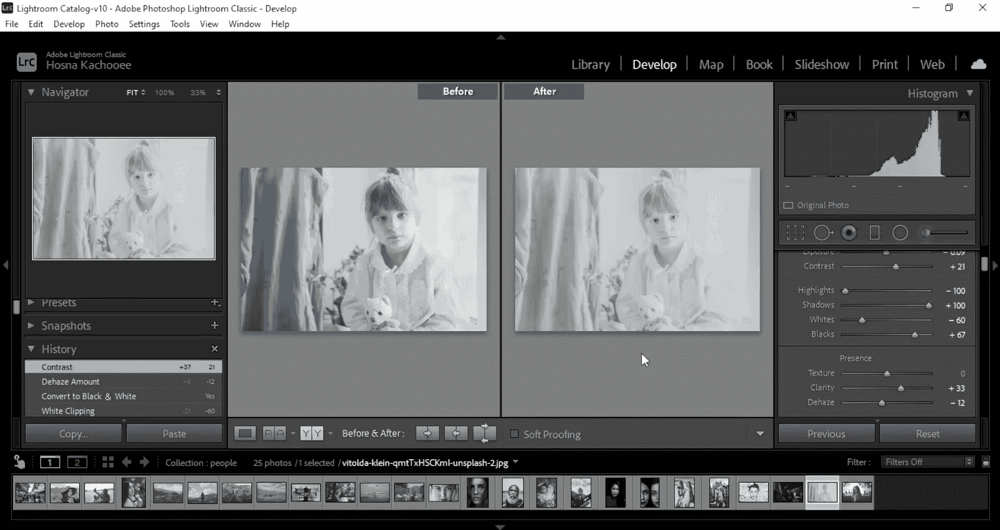
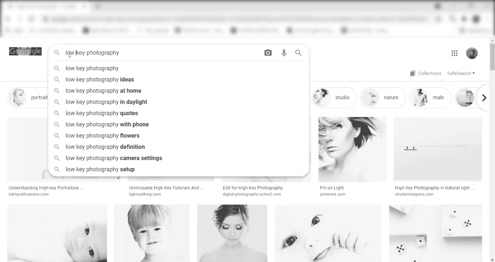
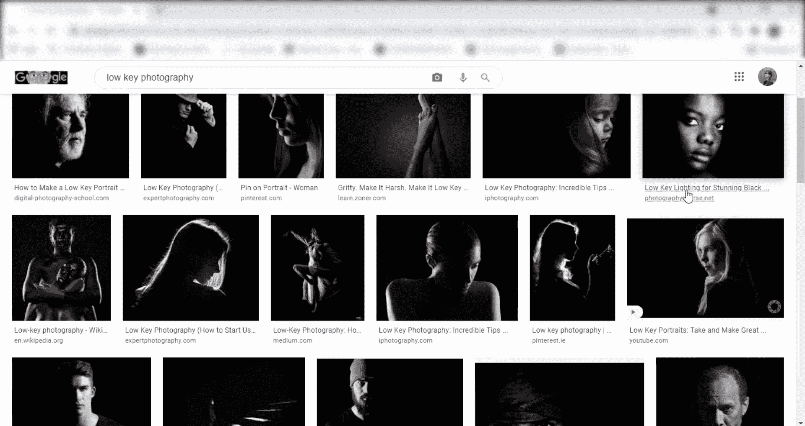
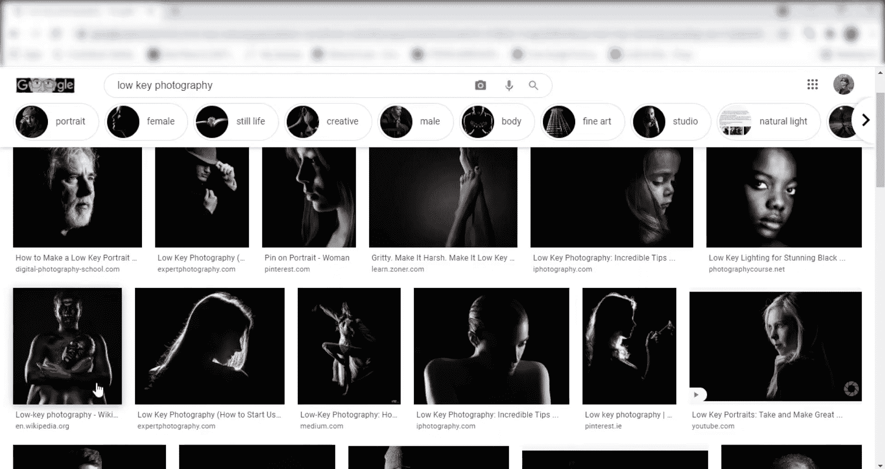
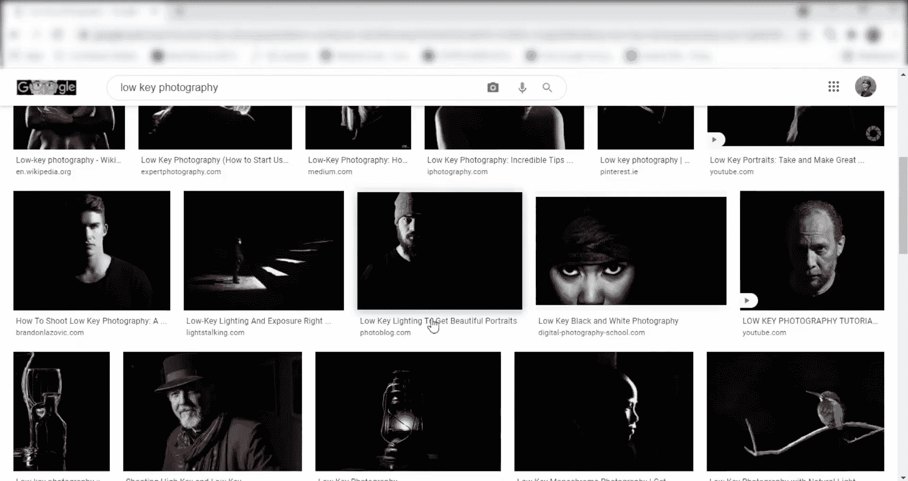
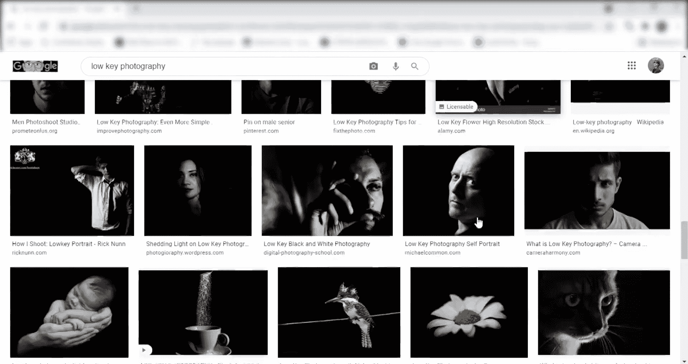
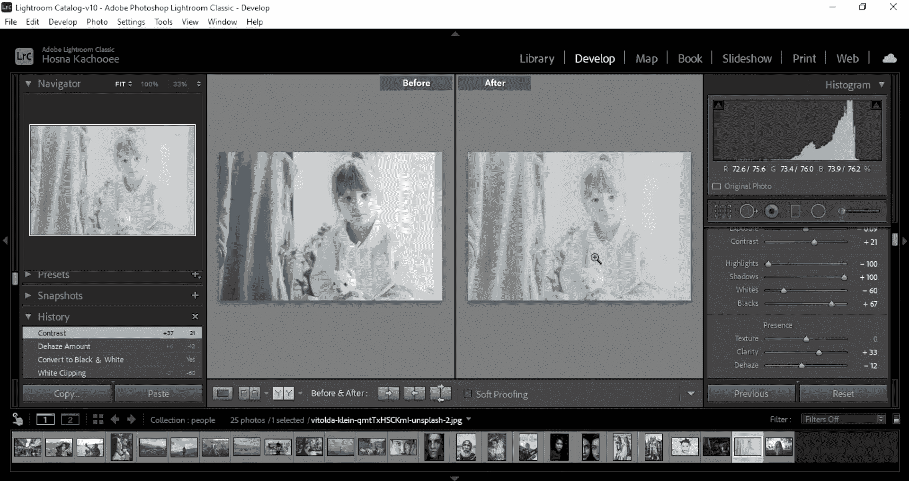

Complete Adobe Lightroom Megacourse：Part 2 P55：☀️ 高调人像编辑教程


在本节课中，我们将学习如何在 Adobe Lightroom 中完成高调风格的人像后期处理。高调编辑是摄影和修图里一种比较专业的表达方式，它和之前课程里讲过的低调编辑正好相反。如果你还不太清楚高调是什么意思，也不用担心，这节课会用大白话把每一步都讲清楚，让你从零开始掌握这种明亮、清爽的画面风格。


上一节我们介绍了低调编辑，本节中我们来看看高调编辑的核心逻辑。高调编辑的目标很简单，就是让画面里的白色部分更突出，同时把阴影和暗部尽量压低，直到几乎看不见。低调编辑是要去掉暗部让主体发光，而高调编辑则是要让整个画面看起来明亮、通透、偏白。

核心概念可以用下面这个简单公式来理解：
```
高调编辑 = 白色突出 + 阴影消失 + 色彩极少
```
或者用代码块描述典型的高调场景设置：
```
高调拍摄场景：
  主体服装：白色
  背景颜色：白色
  道具颜色：白色
  其他色彩：仅占画面很小一部分
```
换句话说，高调图像里几乎没有深色区域，绝大部分像素都集中在亮部和中间调，给人一种明亮甚至略显空灵的感觉。


了解了高调的基本定义之后，我们接着看拍摄或选择素材时需要注意什么。在做高调后期之前，最好事先准备好适合的素材。高调风格对拍摄现场有比较明确的要求，如果原片里颜色太杂、暗部太多，后期想要强行变成高调会比较吃力。

以下是高调拍摄的常见场景条件：
- 主体人物最好穿白色衣服。
- 背景建议使用白色背景布或白色墙面。
- 道具也尽量选白色或浅色。
- 如果画面里出现其他颜色，那部分面积应该很小，不要抢走白色的主导地位。

本节课练习用的这张照片，原本有一块蓝色的布，还有植物和泰迪熊上的绿色。因为我们要把它做成高调风格，所以蓝色大面积的布料需要被去掉或变成白色，只保留少量绿色作为点缀。


场景条件明确后，我们就可以打开 Lightroom 开始调整了，首先从基础面板入手。高调编辑的第一步是在基础面板里做全局色调调整。我们的目标是让画面整体变亮，降低对比度，让暗部和高光都向中间靠拢，营造出那种没有深色阴影的视觉效果。

以下是基础面板的调整步骤：
1. 提亮阴影滑块，让暗部细节变亮，向着“全白”方向靠近。
2. 降低对比度，避免亮部和暗部之间出现太强的对立。
3. 适当降低高光，防止最亮的地方过度曝光失去细节。
4. 适当提高黑色，平衡整体亮部分布。
5. 整体看下来，画面会显得有些发灰或发白，像好莱坞电影里某些特定场景，这属于高调风格的正常表现，不必觉得奇怪。

高调编辑并不是每天都会用到的日常风格，更多是商业摄影或艺术人像里会采用的专业手法。不过了解每一种风格都有好处，万一以后客户或者项目需要这种视觉语言，你就能快速上手。


基础色调大致确定之后，接下来要处理画面的透气感和边缘轮廓。高调图像通常不需要太多雾气或暗部重量，所以我们会通过“去雾”相关的滑块来降低画面里的暗沉感。同时，为了避免人物轮廓过度模糊，需要用清晰度来保留主体的边缘线条。

具体调整思路如下：
- 不要使用增加去雾的操作，而是朝相反方向调整，减少画面中的阴影和暗部重量。
- 适当提高清晰度，这样可以保留人物头部和身体的轮廓线，防止整个人像融入白色背景里。
- 饱和度和自然饱和度不需要调得太高，因为高调风格追求的是淡雅，而不是色彩浓烈。不过如果某些颜色即将被去除，也可以暂时先提高饱和度，方便之后观察哪些区域需要处理。


全局明暗和清晰度处理完毕，下一步要精细控制画面的色调分布，这时候就要用到曲线工具了。曲线工具可以让你对不同亮度区间的像素做更精准的调整。在高调编辑里，我们主要通过曲线来压制高光，抬起白色部分，让画面的过渡更柔和。

曲线调整的操作要点如下：
- 创建 RGB 曲线，当前可能是一条比较奇怪的线条，不用担心，先往下调整。
- 降低高光部分的曲线点，避免画面某些区域过于刺眼。
- 调整白色滑块，让人物头部的轮廓重新清晰可见。
- 整体曲线不需要制造剧烈的 S 型，高调风格更喜欢平缓、明亮的色调分布。


全局色调和曲线都调整之后，画面里可能仍然残留一些不符合高调要求的颜色，这时候需要用局部调整工具来清理。本节课练习照片里有一块蓝色的布料，它破坏了高调的纯净感。我们需要把这块蓝色布变成白色，让画面里只保留植物和泰迪熊上的少量绿色。

局部调整的操作流程如下：
- 使用调整画笔工具，降低蓝色布料区域的不透明度，或者把该区域的颜色擦成白色。
- 处理完蓝色之后，绿色会成为画面里唯一比较突出的颜色。这时可以适当提高绿色的饱和度，让它作为点缀存在。
- 同时调整蓝色的亮度通道，让原本蓝色的部分不再显眼。
- 去掉大面积蓝色之后，可能会发现人物的眼睛也变色了，因为原本眼睛是蓝色的，现在需要单独处理眼睛区域，把蓝色眼眸保留回来。


大面积蓝色已经清理，但人物眼睛的颜色也不见了，接下来要专门用调整画笔把眼睛弄回来。眼睛是人像里很重要的细节，不能因为全局去蓝而让眼睛变得失去神采。我们要在局部调整里专门给眼睛加回蓝色，并提升眼睛的清晰度。

调整眼睛的具体步骤如下：
- 打开调整画笔，画笔涂抹在眼睛区域，注意避开周围的植物叶子，不要把绿色也涂掉。
- 如果不小心涂到墙面或其他无颜色区域，通常不会造成明显损害，因为那些地方本来就没有颜色。
- 仔细清理所有能看到的蓝色残留，让画面看起来自然，不出现尴尬的色块。
- 重置清晰度并去除该区域的所有饱和度，然后再针对眼睛单独操作。
- 将图像放大到 100%，增大画笔尺寸，按住 Alt 键从眼睛周围移除多余的选区，只保留眼睛本身。
- 给眼睛重新上色，提高蓝色饱和度，关闭遮罩叠加层查看实际效果。
- 处理瞳孔和眼部深色部分，去掉不需要的选区，这个操作经常需要反复调整。
- 提高眼睛区域的清晰度，让瞳孔里的细节更清晰可见。
- 给眼睛加上一点冷色调，因为整张图片的氛围偏冷，这样能进一步统一画面情绪。
- 人物的嘴唇本来就没有颜色，保持原样即可，不需要额外处理。


眼睛和局部颜色都修复好之后，我们还需要检查整体亮度，特别是有没有因为逆光导致的过曝问题。高调图像追求明亮，但明亮不等于过曝。如果画面里某些区域太亮，失去了细节，就需要再次使用局部调整来降低曝光或高光。

关于曝光和背光的处理要点如下：
- 降低整体曝光，如果发现画面某些部分过于明亮，就把曝光滑块往下拉。
- 如果主体被背光照射，容易出现逆光问题，也就是相机对着亮光源拍摄，人物位于光源前方，边缘容易发白或失真。
- 逆光问题在后期比较难修复，容易引入噪点，很多时候只能接受现状。不过这张照片还好，我们仍然能看到人物的一些细节。
- 使用调整画笔降低局部高光，把饱和度降到看起来自然的程度，白色滑块也不要拉太多，保持画面呼吸感。


亮度和高光问题解决之后，我们可以给整张图片加上统一的色调，强化高调风格的冷峻感觉。高调风格不仅要亮，通常还会带有一种人工的、偏冷的氛围，让画面看起来像机器人或电影特效一样，这正是这种风格的魅力所在。

全局调整的操作如下：
- 添加一个全局滤镜或使用色调分离，给整张图片偏冷的颜色。
- 提高亮度通道，让画面看起来更加清冷。
- 噪点降低方面，检查图片里是否有明显的颗粒感，如果有少量噪点，可以用亮度通道把它去掉，让画面更平整。
- 缩小图片检查，确保没有把人物的轮廓压扁，必要的话把丢失的细节再找回来。


全局色调和噪点都处理完了，最后还要做一些镜头变形校正和暗角处理，让画面更完整。即使是高调风格，也需要关注镜头带来的技术问题，比如暗角、色差或变形，这些都会影响最终观感。

镜头校正和微调的步骤如下：
- 进行镜头校正，如果需要，可以把人物稍微远离相机的感觉做一点调整。
- 如果画面感觉太冷，可以关闭温度滑块，双击重置，或者在 HSL 面板里把相关颜色调低。
- 变换面板通常不需要做太大调整，高调图像更看重整体明暗，而不是透形变换。
- 检查画面四角是否有暗角，有的话把它们提亮，让亮部更均匀。
- 如果还是觉得某些区域太亮，就再次降低高光和白色，直到整体感觉协调。


修图基本完成，这时候可以分享一点拍摄时的实用建议，帮助你以后减少后期修复的麻烦。拍照的时候，注意观察光源位置，尽量避免逆光情况，这样后期会轻松很多。逆光导致的背光问题在后期很难彻底修复，容易带来噪点，很多时候只能尽量接受。不过高调风格本身对细节要求不算极高，只要大体明亮即可，不必追求完美。


所有调整都做完之后，我们来看看修图前后的效果，并了解一下高调摄影的其他应用场景。高调编辑的最终效果应该是明亮、偏白、阴影很少的画面。我们可以把修前和修后并排对比，直观感受高调风格带来的变化。

除此之外，高调摄影不仅限于人像，还可以应用于很多其他题材，以下是常见的高调摄影类型：
- 动物摄影
- 风景摄影
- 婴儿摄影
- 物体静物摄影
- 人像摄影
- 时尚摄影

高调图像的共同特点是更关注画面里的白色部分，之所以叫“高调”，就是因为色调整体偏高、偏亮。通过简单的网络搜索，你可以看到大量高调图片的例子，它们通常一开始就没有太多暗部细节，整体明亮通透。




看完高调的各种例子之后，我们可以尝试把图片变成黑白，再顺便回顾一下上一节学过的低调风格，两者形成鲜明对比。如果你不喜欢彩色高调的效果，也可以一键把图片转成黑白，有时候黑白高调更有质感。每个案例不一样，颜色保留与否要看具体效果，适合自己的就是最好的。



为了加深理解，我们再回顾一下低调摄影。低调和高调正好相反，画面非常暗，外围大部分是黑色，只有画面里浅色的部分才是观看焦点。在人像摄影里，那个焦点通常就是人的脸部。低调照片也可以加入颜色，下面是几个不同题材的低调示例：
- 带颜色的低调人像
- 低调物体摄影
- 低调动物摄影



高调和低调都是比较专业的风格，如果你能熟练编辑这两种图片，作品会给观众留下很深刻的印象。








现在我们回到 Lightroom，做最后的总结。回到 Lightroom 界面，你已经学会了如何把一张普通图片通过上述技巧变成高调风格。高调编辑的核心就是让白色突出、去掉阴影、保留极少色彩，并配合局部画笔处理细节。



本节课中我们一起学习了高调编辑的定义、场景准备、基础面板调整、曲线控制、局部调整去蓝与修复眼睛、曝光与背光处理、全局冷色调润色、镜头校正，以及高调与低调的对比示例。希望这些内容能帮你掌握高调人像后期的基本流程，下节课见。
