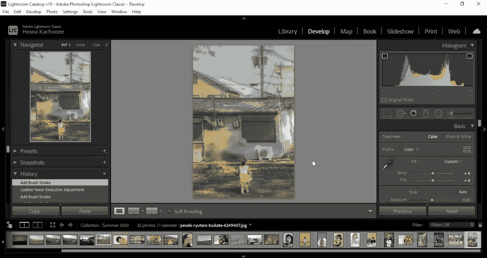

# 📷 Complete Adobe Lightroom Megacourse： Beginner to Expert Photo Editing part2：56：胶片风格模糊效果制作


本节课中，我们将学习如何在 Adobe Lightroom 中为已经完成开发的照片添加电影风格的模糊效果。在正常的后期开发流程结束后，我们往往还想给图片增加最后的点睛之笔，让主体更加突出，整体氛围更有胶片质感。本节课将通过一张人像照片的实例，逐步讲解如何利用 Lightroom 现有的调整工具，在不具备真实镜头模糊功能的情况下，模拟出类似的背景虚化效果，并完成电影风格的色调处理。


## 第一部分：图像校正与主体构图

在开始调整颜色之前，首先需要保证画面的水平与构图正确。如果原始照片稍微倾斜，或者主体没有位于画面中心，后期的模糊效果也很难达到理想状态。以下是图像校正的具体操作步骤：


- 打开 Lightroom 的 Transform 模块，使用导向工具（Guided Tool）给图像指定两条参考线。
- 第一条参考线可以选取房屋的屋顶边缘，第二条参考线可以选取人行道的边界线。
- Lightroom 会根据这两条线自动将图像水平拉直，使建筑结构看起来更正。
- 接着调整主体位置，将人物移至画面正中央，避免过于偏向右侧。
- 可选地轻微旋转图像，进一步修正屋顶的直线度，如果效果不理想则可以跳过此步。


完成上述操作后，图像的基础构图就已经就绪，我们可以进入下一步的色调编辑阶段。


## 第二部分：基础色调与曝光调整

在进行局部模糊之前，通常先对全图进行基础曝光和色调修正，确保明暗关系合理。以下是基础调整的操作步骤：


- 按下键盘上的 J 键，检查是否存在高光溢出或阴影堵塞（Clipping）。
- 如果没有明显的溢出，可以保持默认设置。
- 降低高光（Highlights），挽回天空或亮部细节。
- 提高阴影（Shadows），让暗部细节重新可见。
- 增加对比度（Contrast），提升画面层次感。
- 使用去雾（Dehaze）工具，增加画面清晰度和通透感。


调整完成后，图像整体质感会有明显提升。不过为了更好地制作模糊效果，我们暂时先不急于完成后续的所有编辑，而是先处理背景虚化部分。


## 第三部分：使用调整画笔制作模糊蒙版

Lightroom 本身并没有直接的图像模糊功能，但我们可以利用调整画笔（Adjustment Brush）配合参数降低的方式，模拟出背景虚化的效果。核心思路可以用下面的公式来理解：


模糊模拟效果 = 清晰度降低 + 纹理降低 + 去雾适度增加 + 对比度降低


以下是制作蒙版的详细过程：


- 启用调整画笔工具，在画笔设置中打开遮罩叠加（Overlay），此时刷过的区域会显示为红色。
- 调整画笔大小，将除了人物主体之外的所有背景区域全部涂红。
- 放大画面，仔细检查人物头部边缘，确保没有误涂到头发或脸部。
- 如果需要更自然的过渡，可以调整羽化（Feathering）参数，让涂抹边缘更加柔和。
- 保持气球在画面中，因为气球为照片增加了叙事性和视觉趣味，避免画面显得单调。
- 使用滚轮缩放画面，将涂抹区域补全到细小缝隙中。
- 按住 Alt（Windows）或 Option（Mac）键，切换到橡皮擦模式，此时画笔上会出现减号标志。
- 擦除掉人物主体上的红色遮罩，只保留背景区域被选中。


完成蒙版制作后，关闭遮罩叠加，接下来我们就可以对被选中的背景区域进行模糊参数调整了。


## 第四部分：模糊参数与电影质感调整

由于 Lightroom 没有真正的模糊滤镜，我们需要通过降低清晰度相关参数来模拟虚化效果。建议的参数设置可以用下面的代码块参考：


```
调整画笔局部参数：
清晰度（Clarity）：-41
纹理（Texture）：降低至最低
对比度（Contrast）：降低
去雾（Dehaze）：适度增加
锐度（Sharpness）：根据需要微调
```


具体操作步骤如下：


- 降低清晰度（Clarity），使背景细节变得柔和，数值建议设置为负 41 左右。
- 降低纹理（Texture），进一步削弱背景表面细节，使图像呈现出模糊感。
- 适度增加去雾（Dehaze），因为轻微的雾气有助于营造胶片氛围。
- 降低对比度（Contrast），增加画面的平坦感，强化电影风格。
- 根据需要微调锐度（Sharpness），避免边缘过于生硬。


调整完成后点击完成（Done），对比调整前后的效果，你会发现背景已经呈现出一种柔和的虚化状态，而人物主体依然保持清晰。


## 第五部分：电影风格色调分级与细节修整

背景模糊效果制作完成之后，我们需要对整张照片进行电影风格的色调处理，使整体风格更加统一。以下是色调分级的操作步骤：


- 再次进行基础面板调整：降低高光，适度调整对比度，提高白色级别，将黑色级别设置为负 5。
- 使用去雾工具适当增强细节，再次通过清晰度滑块给负值，软化画面边缘。
- 调整自然饱和度（Vibrance），避免颜色过于艳丽，保持低饱和的朦胧感。
- 进入色调曲线（Tone Curve），制作哑光平坦（Matte Flat）效果，这是胶片相机照片的常见特征。
- 在曲线上添加控制点，分别操作高光、阴影和白色调区域，细化明暗过渡。


进入颜色分级（Color Grading）阶段，具体操作如下：


- 降低蓝色和青色的亮度（Luminance），让冷色调区域更加深沉。
- 提高绿色的亮度，增加画面的自然通透感。
- 降低黄色的亮度，使画面整体色调更趋向统一。
- 降低蓝色和青色的饱和度，提高绿色的饱和度，朝着梦幻模糊效果靠近。
- 给高光添加温暖色调，给阴影添加稍微冷一点的色调。
- 中间调先尝试添加偏绿偏蓝的色调，再根据实际效果改为更温暖的色调，以达到平衡。
- 确认饱和度设置合适后，进入降噪面板检查图像噪点，如果没有明显噪点则跳过此步。
- 在畸变（Distortion）面板中，可根据喜好添加轻微的鱼眼效果，增加胶片相机的复古质感。
- 颜色混合器中微调红色和绿色，如果绿色已经看起来自然，则无需额外修改。
- 返回色调曲线，再次提升暗部控制点，使画面更加平坦。
- 调整整体色温，让图像呈现更温暖的视觉感受，避免偏冷。


经过上述色调处理后，照片已经逐渐接近电影风格模糊效果的目标。


## 第六部分：局部修复与气球模糊处理

在检查画面时，我们可能会发现气球周围的区域虽然被模糊处理了，但气球本身却保持清晰，这会造成视觉上的不协调。以下是修复步骤：


- 重新启用之前创建的调整画笔锚点，点击画面上出现的编辑点。
- 打开遮罩叠加，再次将画笔涂抹到气球及其周围区域，确保气球也被包含在模糊范围内。
- 切换到橡皮擦工具，提高羽化数值，平滑气球边缘的过渡，避免出现生硬的线条。
- 关闭遮罩叠加，降低噪点设置，检查最终画面。
- 点击完成（Done），查看调整前后的对比效果。


至此，整张照片的电影风格模糊效果已经全部完成。


## 第七部分：最终效果对比与本节总结

通过本节课的操作，我们成功利用 Lightroom 现有的调整画笔和参数面板，模拟出了背景模糊效果，并完成了电影风格的后期处理。以下是最终对比总结：


- 调整前：原始照片背景清晰，主体突出度一般，整体缺乏电影氛围。
- 调整后：背景呈现柔和虚化，人物主体与气球保持适当清晰度，色调偏暖且平坦，整体具有胶片质感。


你可以将调整前后的图片并排查看，直观感受参数调整带来的变化。




本节课中，我们一起学习了如何在 Lightroom 中校正图像构图、制作背景模糊蒙版、调整电影风格色调，以及进行局部修复与最终效果对比。希望这些内容能帮助你掌握胶片风格照片编辑的核心技巧。下节课见。


