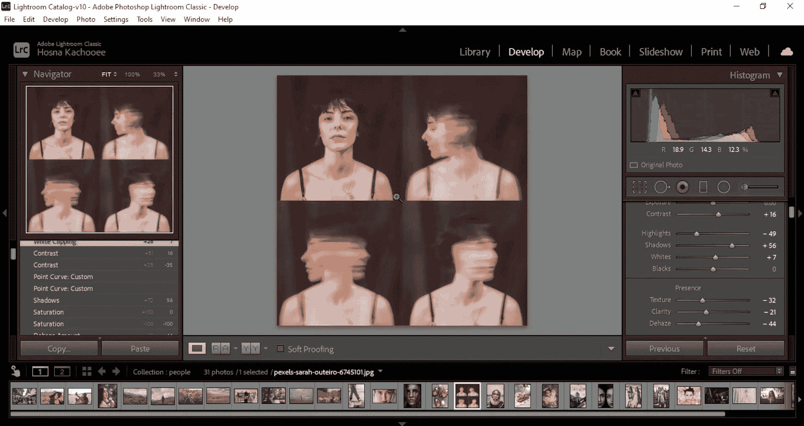

🎞️ Complete Adobe Lightroom Megacourse：P57：胶片风格人像后期实操


## 本节课程概述

在本节课中我们将要学习如何在 Adobe Lightroom 中为带有运动模糊效果的人像照片应用胶片风格后期调色。课程内容将延续之前章节中介绍的编辑原则，并把这些原则落实到一张具体的照片上。我们会先分析运动模糊是如何产生的，然后逐步调整基础面板、色调曲线、HSL 面板以及分色调等模块，最终呈现出一种复古胶片质感的画面效果。整个过程适合初学者跟随操作，每一步都会说明调整的目的和预期结果。

## 理解运动模糊效果

上一节我们介绍了后期编辑的基本原则，本节中我们来看看运动模糊在实际照片中的表现形式。运动模糊是一种特殊的模糊效果，它不同于普通的失焦或手抖模糊。如果你仔细观察这张照片，会发现人物的脸部比身体其他部分更加模糊。

这种现象的成因可以用下面的公式简单说明：

```
运动模糊 = 主体保持静止 + 快门释放前几秒头部移动
```

具体操作时，人物在拍摄开始时是完全静止的，但在快门释放前的几秒钟里，她移动了头部。这样一来，相机记录下来的就是头部运动留下的痕迹，而身体其余部分保持相对清晰。这种手法属于比较高级的编辑风格，如果技巧不到位很容易出错，但一旦掌握正确方法，就能创作出非常优雅的作品。我们现在的任务就是在这张已经拍摄好的照片基础上，进一步应用胶片风格的编辑方法。

## 胶片风格编辑的核心思路

在正式调整参数之前，我们需要明确胶片风格编辑的整体思路。我们将使用与上一节课相同的技巧和配色方法，尽管这张图片中的颜色数量不如前一节那么多，但整体逻辑保持不变。

以下是胶片风格编辑的核心目标：

- 画面呈现褪色感，整体显得平淡柔和
- 保留人物皮肤和背景的细节，避免出现大面积纯亮或纯暗区域
- 营造复古胶片的氛围，阴影部分适度提亮
- 肤色保持自然，不过度偏橙色，也不过度去饱和度

## 基础面板：雾化与曝光

有了编辑思路之后，我们开始具体操作，首先打开基础面板。在普通照片编辑中，我们通常会使用去雾功能来增加清晰度，但胶片风格恰恰相反，我们需要增加雾化效果，让图像看起来更有雾气和质感。

首先调整雾化滑块，将其设为负值，让画面整体变得朦胧柔和。雾化完成后，你会发现人物皮肤上出现了一些非常亮的区域，这些亮部会掩盖皮肤纹理，因此需要把白色滑块降低，以便重新看清身体上的细节，避免出现破坏图像质感的平坦亮部。

接下来处理对比度。胶片风格的主要目标就是让图像看起来平淡，所以我们要降低对比度，营造出褪色的复古效果。阴影部分原本比较多，通常我们会把阴影调暗，但在这张照片中，背景颜色较深，而人物头发也很深，如果阴影太暗，头发细节就会和背景融为一体，因此我们需要适当提升阴影，保留头发的层次。

基础面板主要涉及的滑块如下：

- 雾化：设为负值，增加画面朦胧感
- 对比度：降低，追求平淡复古质感
- 阴影：提升，避免深色头发与背景混在一起
- 白色：降低，保留皮肤和衣物的细节
- 曝光：保持不变，当前曝光已经合适
- 清晰度：大约设为负 21，降低画面锐度
- 纹理：降低，进一步增加褪色感
- 自然饱和度：保持不变，重点关注肤色表现

调整完成后，画面已经呈现出较为褪色和平淡的状态，背景偏棕色，整体氛围逐渐接近我们想要的胶片风格。

## 色调曲线细节修正

基础面板调整完成后，我们进入色调曲线面板，进一步修正图像的明暗层次。色调曲线可以让我们更精确地控制阴影、中间调和高光部分，但在操作时我们仍要注意保留图像细节，不要过度压缩暗部或亮部。

在曲线上我们可以创建几个控制点，分别对应阴影、对比度和高光。这样会形成一条形似 S 型的曲线，虽然看起来有点奇怪，但却是一种不错的调色路径。此外，我们还需要单独处理高光滑块，把它稍微往下拉一些，避免亮部过于刺眼。中间调部分之前调得太暗了，现在稍微提亮之后，画面看起来更加舒适。其他颜色通道因为这张照片本身颜色不多，暂时不需要动，保持原样即可。

## HSL 面板肤色调整

色调曲线处理完毕后，我们来到 HSL 面板，重点照顾人物肤色。HSL 面板分为色相、饱和度和明度三个部分，在这次编辑中，我们不再调整色相，目的是保留人物原有的肤色特征，避免过度改动。

对于饱和度部分，肤色主要集中在红色和橙色色标上。如果你上下移动饱和度滑块，会发现只影响人物的皮肤，不会改变背景或其他区域。我们可以适当把颜色找回来一点，让画面看起来不过度去饱和，同时保持一点复古的克制感。

明度部分则可以用来让皮肤变亮，或者让人物融入背景。由于我们不希望人物融入背景，因此需要稍微提亮皮肤，在背景和主体之间建立明显的区分。

以下是 HSL 面板的调整重点：

- 色相：不调整，保持原有肤色
- 饱和度：针对红色和橙色色标，仅影响皮肤区域
- 明度：适当提亮皮肤，拉开与背景的距离

## 分色调与色彩平衡

HSL 面板完成后，我们继续调整分色调，统一画面的色温基调。分色调允许我们为阴影和高光分别设置颜色，这是营造胶片风格的重要步骤。

目前画面整体偏暖，我们希望保留这种暖色调，可以往阴影部分添加一点橙色，让温暖感更加稳定。不过现在画面已经比较去饱和，我们可以让它变得更淡一些。如果此时画面显得过于温暖，可以通过添加一点冷色来平衡，直到整体色调看起来协调自然。

## 细节、噪点与镜头校正

色彩调整结束后，我们检查细节面板，确认画面干净度。在这张照片中，没有出现任何噪点，也没有色彩噪点，同时没有色差问题，因此这几个选项都可以跳过，不需要花费时间处理。

因为我们正在处理多张图片的编辑流程，镜头校正和变换面板暂时不需要使用，保持默认状态即可。

## 虚化边缘与颗粒纹理

细节检查无误之后，我们添加胶片风格的标志性元素：边缘虚化和颗粒。虚化功能可以把图像边缘稍微变暗，把观众的注意力引向画面中心。

接下来添加颗粒。如果你追求复古风格，颗粒就是最好的帮手。放大图片查看颗粒效果，调整粗糙度让颗粒看起来更粗糙一些，同时把颗粒大小调小，数量适当降低，这样画面会更有胶片质感，而不会显得脏乱。

## 校准面板与存在感微调

颗粒添加完成后，我们进入校准面板和存在感板块做最后微调。校准面板中可以稍微降低红色主色调的数值。回到存在感部分，我们再次降低高光，降低对比度，保留阴影部分，数值设为负 16 是比较合适的选择。

此时可以进一步增加雾化程度，让画面更有质感。当然，如果你愿意，也可以把图片变成黑白，但我们之前花了很多时间调节暖色调，所以决定保留彩色效果。在调整过程中，可以参考直方图来指导操作，适当提升阴影部分，让画面看起来更好。这些调整属于个人偏好，你可以保持画面鲜艳，也可以去掉多余的雾化效果，完全由你决定。

## 前后对比与风格选择



所有参数调整完毕后，我们对比修图前后的效果，确认风格方向。查看前后对比时，我们发现画面可能被处理得过度，需要稍微降低雾化和对比度，然后适当提高白色数值，最终才能达到理想的胶片风格。

之所以选择这种复古胶片风格，是因为我们添加了雾化，让画面显得哑光，并提升了阴影部分。不过你也可以选择更现代的胶片风格，那种风格的细节平衡较好，阴影始终保持较暗。如果你观察老式人像照片，会发现它们的阴影通常会比较明亮，所以本节课采用的是老式风格。你可以根据自己的喜好选择任何一种风格，没有固定标准。

## 本节课程总结

本节课中我们一起学习了如何在 Adobe Lightroom 中为带有运动模糊效果的人像照片应用胶片风格后期调色。我们分析了运动模糊的成因，明确了胶片编辑的核心思路，并依次调整了基础面板、色调曲线、HSL 面板、分色调、细节面板、虚化边缘、颗粒纹理以及校准面板等模块。最后通过前后对比确认了最终效果，并介绍了复古胶片风格与现代胶片风格的区别。希望这些内容能帮助你掌握胶片风格人像后期的基本方法。

