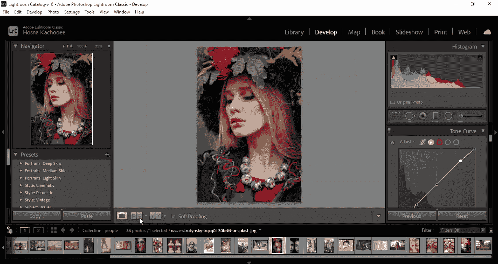

# 📸 Adobe Lightroom 从入门到精通大课：第59章：特写人像后期（第2部分）

在本节课中，我们将学习如何使用 Adobe Lightroom 处理一张特写人像照片。这张照片的拍摄距离并没有特别贴近人脸，但是帽子和连衣裙上有很多纹理细节，我们需要在后期编辑时把这些细节保留下来。整个流程会从基础的去雾调整开始，然后依次调整色调面板、色彩饱和度、色调曲线以及 HSL 面板，最后完成裁剪、暗角和色彩校准。无论你是刚接触 Lightroom 的新手，还是已经有一点编辑经验的学习者，都能从这节课中学到实用的后期思路。

首先，我们需要先看一看这张原始照片，明确编辑的目标。这是一张特写人像示例，拍摄对象戴着帽子，穿着连衣裙。和正面特写不同，这次镜头没有那么靠近人脸，但帽子和裙子上的材质细节非常丰富。在后期编辑时，我们的首要任务就是保留这些细节，不要在调整色彩和光影的时候把它们弄丢了。所以我们要先观察图像，再决定具体的调整步骤。

上一节我们介绍了照片的整体情况，本节中我们来看看如何用去雾工具把隐藏的细节显现出来。以下是使用去雾工具的基本步骤：

- 打开 Lightroom 的基础面板，找到“去雾”滑块。
- 适当增加去雾数值，这样可以带出照片中的暗部细节，同时也会让阴影区域变暗。
- 去雾之后，原本笼罩在人脸周围的雾霾感会被去除，画面整体会更清晰。

`原始图像 + 去雾强度 = 清晰细节 + 暗部加深`

这个公式能帮助你快速理解去雾工具的作用，即通过增加去雾数值，既能还原细节，也会让阴影部分变得更暗。

色调处理完成之后，我们需要进入色调面板，对整体亮部和暗部进行精细调节。以下是色调面板中的关键调整项：

- 曝光度：适当提高，让整体画面更亮。
- 高光：降低数值，因为目前的高光主要集中在人脸和部分项链上，如果调得太过，皮肤会失去细节。建议回退到大约负 7 左右。
- 阴影：适当提高，这样我们之后处理颜色时，才能看清楚当前正在处理的内容。
- 黑色级：适当提高。
- 白色级：适当降低。

你可以按键盘上的 J 键，查看画面中是否出现溢出部分。帽子部分可能会有一些溢出提示，但这通常只是大帽子带来的自然阴影，光源从帽子上方和下方照射，所以这是正常现象，不需要特别处理。对比度方面，先增加再降低，用来平衡画面的对比关系，避免过强或过弱。温度和色调暂时先不处理，等颜色调整完毕再回来微调。

基础色调调整完毕后，我们要开始处理图像中的颜色问题。以下是色彩处理的核心思路：

- 自然度：先适当提高，因为画面中已经有不少颜色，领口部分饱和度也比较充足。
- 饱和度：如果画面本身已经饱和度不错，只需要再增加一点点，那么不建议直接拉全局饱和度，否则人脸等不需要加强的区域也会被影响。
- 正确做法：此时应该使用 HSL 面板，针对单个颜色进行调整，而不是一味增加全局饱和度。
- 如果照片颜色较为暗淡，饱和度不足，则可以适当提高全局饱和度来增加色彩强度。

色彩大致调整完毕之后，我们可以使用色调曲线来进一步塑造光影层次。以下是构建 S 曲线的常见步骤：

- 在阴影区域创建一个点并稍微下拉。
- 在高光区域创建一个点并适当提升，但不要提得太高，避免高光过亮。
- 在中间调区域创建一个点，用来调整对比度。
- 本次编辑我们不追求哑光风格，保持简单，只围绕光影、细节和颜色来进行调整。

`阴影下拉 + 高光适当提升 + 中间调微调 = 对比度提升 + 层次分明`

这个简化的 S 曲线公式可以帮助你记住，色调曲线的核心就是通过拉升高光、压暗阴影，再微调中间调，来提升画面的立体感。

色调曲线完成后，我们需要进入 HSL 面板，对各种颜色进行单独控制。以下是 HSL 面板中各颜色的调整建议：

- 红色：人肤色中包含红色，调整时不能过度，否则会影响皮肤自然度。
- 绿色：可以让颜色更浓郁，或者偏向黄色，建议设定在大约 22 左右。
- 蓝色：可以偏绿色，也可以加深，建议加深蓝色，这样可以让服装和帽子与其他部分区分开来。
- 青色：原本不太突出，可以让它偏绿色一些。
- 品红与紫色：根据画面需要进行适当调整。
- 黄色：对应头发部分，可以让它偏橙色一点，让金发的质感更突出。
- 亮度：让红色、橙色和头发的黄色变亮一些，让画面更有透明感。如果某个区域，比如屏幕反光，太过吸睛，可以适当降低亮度。

`单色色相 + 单色饱和度 + 单色亮度 = 精准的色彩控制（不影响肤色）`

HSL 面板的优势在于，你可以单独调整每一种颜色，而不会像全局饱和度那样把人脸也一起改变。

HSL 颜色调整结束后，我们回到温度和色调，给照片定下最终的色彩基调。以下是色温与色调的调整要点：

- 色温：设置为正 7，给画面增加暖色调。
- 色调：加入一点粉色，这种粉色会和当前已有的颜色搭配得很好。
- 整体效果：通过暖色温和粉色色调，平衡画面中原本偏冷的色彩。

色温色调设定之后，我们进入分色调面板，进一步修复画面中的绿色调问题。以下是分色调的分步调整方法：

- 阴影部分：加入粉色色调，适当停留在合适的位置，去除原本过于浓重的绿色调。
- 中间调部分：尝试暖色调，红色效果不错，同时降低饱和度，亮度设为负 10。
- 阴影亮度：设为负 5 或负 7。
- 高光部分：不需要处理，目前的高光表现已经不错。
- 全局部分：加入黄色，让画面看起来更有生命力，去饱和度设为 13，亮度设为负 8，稍微变暗一点。

`阴影色调 + 中间调色调 + 高光色调 + 全局色调 = 画面整体氛围`

分色调的作用就是给画面的不同亮度区域分别上色，从而营造出统一的氛围感。

分色调完成后，我们需要检查图像的锐度和噪点情况。以下是细节面板的检查要点：

- 将图像放大到 33% 查看，嘴唇、鼻子、头发的轮廓都已经比较清晰。
- 背景是虚化的，没有明显的噪点。
- 因此，我们可以跳过锐化和降噪步骤，不需要额外处理。

细节检查无误之后，我们来调整画面的构图。以下是裁剪工具的使用方法：

- 使用镜头校正中的“限制裁剪”，让人物显得离相机稍远一些。
- 裁剪掉不必要的区域，比如帽子后方多余的空间。
- 在顶部工具栏中找到裁剪工具，选择一个合适的长宽比。8.5 比 11 太短，我们可以直接使用原始图像的长宽比。
- 将人物放置在画面中心，稍微向上调整一点，去掉多余的留白，让视觉焦点集中在人物身上。

构图完成后，我们可以添加暗角并进行最终的色彩校准。以下是后期裁剪暗角与校准的步骤：

- 后期裁剪暗角：加深边缘，找回部分丢失的高光，画面角落的高光本身不多，不需要添加颗粒，原本的颗粒表现已经不错。
- 校准面板：可以改变图像中所有红色的色相，建议设为负 2。绿色是最需要关注的部分，暂时偏向黄色即可。
- 最终色调：给阴影加一点粉色色调，让画面看起来更好。

色彩校准之后，我们再回去检查一下光影表现，确保整体效果协调。以下是最终微调的建议：

- 回到色调曲线，稍微再处理一下光影，保持阴影不动，适当提高对比度，调整高光部分。
- 整体呈现出一种不同寻常的 S 曲线形状。
- 最终风格比较简单，只是让画面更亮，让颜色更鲜艳，并通过紫色或粉色色调加上暖色温，平衡了原本偏冷的颜色。
- 查看前后对比，可以明显发现编辑前后有很大差异，也可以把两张图并排放置观察。

`编辑前图像 - 编辑后图像 = 调整幅度`

这个简单的对比逻辑能帮助你判断自己是否调得太过，或者还没有调够。

前后对比看清楚之后，我们还可以使用参考视图来辅助决策。以下是参考视图的使用优势：

- 开启参考视图后，你可以始终把当前编辑的图像与原始图片放在一起对比。
- 这样可以帮助你判断自己是否调得过头，或者还没有调够。
- 在不同窗口和不同选项之间切换，也是非常有帮助的工作方式。

本节课中，我们一起学习了如何在 Lightroom 中处理一张特写人像照片。我们从去雾工具开始，逐步调整了基础色调、色调曲线、HSL 颜色、色温色调以及分色调，完成了裁剪、暗角和色彩校准，最后通过前后对比和参考视图确认了最终效果。希望这节课能帮助你掌握人像后期的基本流程，我们下节课再见。
